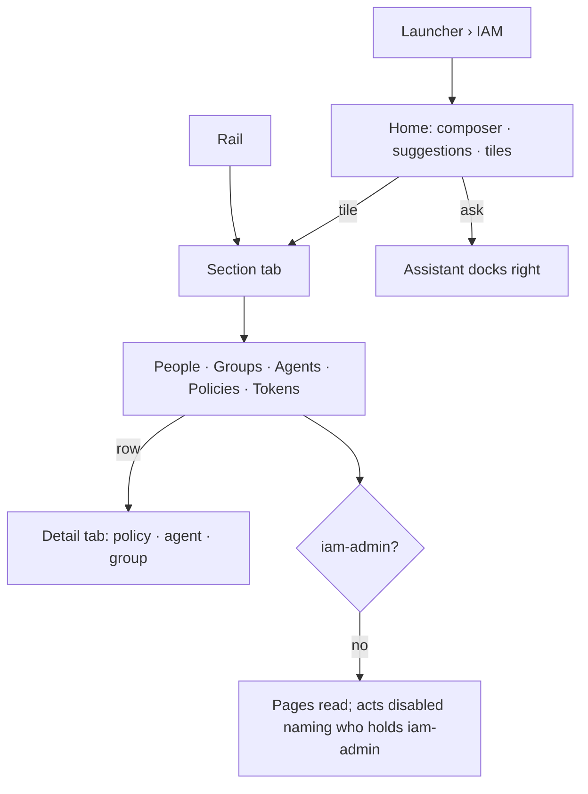

# The IAM product

IAM is a product of its own in the launcher, on the Agents shell: a rail, a workbook of pages and the
assistant on the right. Access spans every product and belongs to none.

| | |
|---|---|
| Index | [11.10](../../../README.md#11--identity-and-access) · Slice **I01** |
| Module | [Identity and access](../spec.md) |
| API / CLI / Studio | ✅ / — / ✅ |
| Related | [policies](policies.md) · [effective access](effective-access.md) · [people and groups](people-and-groups.md) · [tokens](tokens.md) · [the Agents shell](../../agents/features/the-agents-shell.md) · products: [iam.md](../../../../products/iam.md) · [shell.md](../../../../products/shell.md) |

> **As** an owner of a Graph, **I want** who may do what read in one place, one click from each
> principal and each policy, **so that** access is proven, not guessed.

## Capabilities

| # | Capability | Notes |
|---|---|---|
| C1 | The rail | Home · People, Groups, Agents · Policies, Tokens · Settings (the gear at its foot). Lit for the section in the path |
| C2 | Home | *Who may do what in airways?* — the composer centred with `IAM · <Graph>` chips, four suggestions, and a tile per section with the engine's counts |
| C3 | Sections are tabs | A rail item opens its section as a workbook tab; a policy, an agent or a group opens as a tab of its own |
| C4 | Settings | The Graph's settings — its Members tab is where People also lands |

## Journey

## Seams

| Seam | What the user sees |
|---|---|
| Loading | Each page's table shows the kit's loading rows; Home's tiles show `—` until counts arrive |
| A count the engine cannot give | `—`, never a number made in the browser |
| Not a member | The Graph's routes refuse as everywhere else |
| Reload | The open tabs and the active one survive, as in every product |

## Surfaces

| Surface | Shape |
|---|---|
| Routes | `/u/:username/:graphSlug/iam/{home · people · groups · agents · policies · tokens · settings}`; a detail is `?page=policy:<name>` · `iam-agent:<id>` · `iam-group:<name>` |
| `iam.home` | `AssistantStart` with heading *Who may do what in <Graph>?*, placeholder *Ask who can reach something, or draft a policy…*, suggestions *Which agents can write to the graph?* · *Who can push data?* · *What can <person> do?* · *What was refused today?*; tiles People · Groups · Agents · Policies · Tokens with the overview's lines |
| `GET …/iam/overview` | `{people, service_accounts, groups, agents, policies: {managed, custom, inline, boundary}, tokens: {live, expiring_week}}` |
| Package | `@invana-studio/iam` — `product.tsx`, `sections/spec.ts`, one folder per section; the app's host renders it on the Agents host |

## Decisions

| # | Decision |
|---|---|
| IP1 | IAM is the sixth product in the launcher, after Agents. It uses the Agents shell — rail, workbook, no leftSection, the assistant on the right. |
| IP2 | The rail is Home · People, Groups, Agents · Policies, Tokens, with Settings at its foot opening the Graph's settings. |
| IP3 | Home's tiles print the engine's overview lines: *N people · N service accounts*, *N groups*, *N agents — built in Agents*, *N managed · N custom · N boundary*, *N live · N expires this week*. |
| IP4 | A detail opens as a tab of its own: a policy, an IAM agent page, a group. A row selects and *Open* or a click on the name opens it, as Agents' lists do. |
| IP5 | Every IAM write is gated by `iam-admin` through `ActButton area="iam"`; reads are every member's. |
| IP6 | The composer on IAM pages carries `IAM · <page>` chips; asking goes to the shared assistant. |

## Not building

| Not building | Because |
|---|---|
| Connections — stored OAuth or API keys | Invana pulls from and pushes to no source in v1 ([iam.md](../../../../products/iam.md)) |
| Requests as their own page | an ask is a kind in Approvals |
| Check access as a section | it is the Test access modal |
| Building agents in IAM | Agents builds them; IAM reads them |
