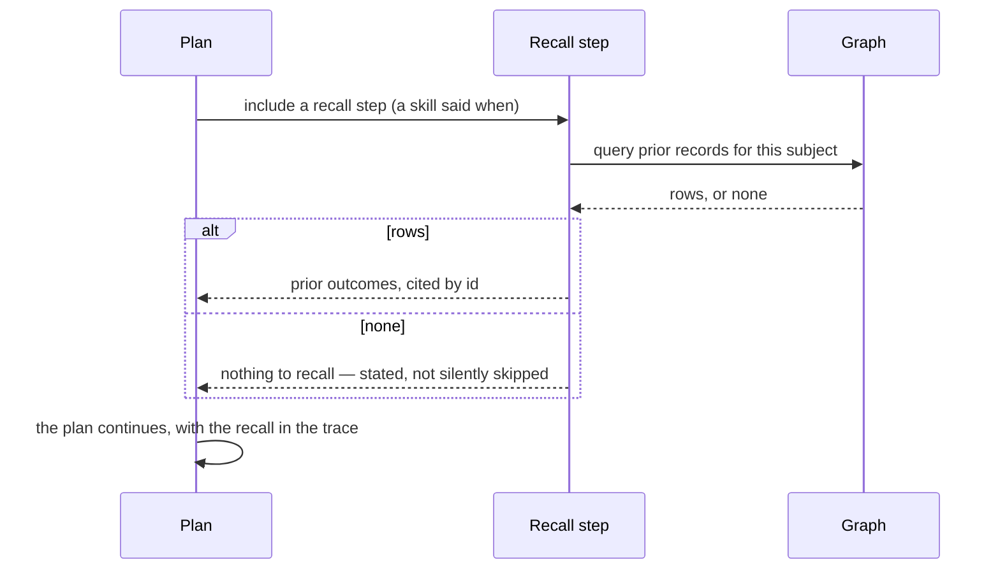
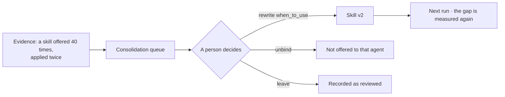

# Memory — module spec

What carries over between runs. An agent does not remember on its own: everything it "knows" the next
time is either **a record in the graph it queries**, or **something a person changed on the evidence**
of what happened. This module owns both paths, and the evidence that drives them.

> ⚠ **Rewritten for orchestration § 0** — `Todo` · `Flow` ·
> `Task` · `TaskRun` · `Lens`. The words *Thought*, *Thinking* and *Step-as-a-record* are retired, and
> **`Task` now names a node inside a plan**, never a thing a user authored. Migration:
> task-model-migration.md.

| | |
|---|---|
| Index | [§8 · Memory](../../README.md#8--memory) |
| Features | evidence · recall-by-query · proposals · consolidation |
| Depends on | [Ask](../ask/spec.md) (runs produce the record) · [Skills](../skills/spec.md) · [Workflows](../workflows/spec.md) · [Work](../work/spec.md) (criterion outcomes) |
| Depended on by | every module that improves with use |

System design: [memory.md](../../../../specs/system-design/modules/memory.md) — the two paths, the mechanism-versus-domain split and where memory lives (§§ 2 · 3 · 4). This file keeps the vocabulary, what the module owns, the flows, its decisions and what is absent.

## 1. Vocabulary

Product-wide words: [terminology.md](../../terminology.md). What this module adds:

| Noun | Is | Is not |
|---|---|---|
| **The record** | every run, step, emission, answer and outcome — owned by [Ask](../ask/spec.md), audited by Operate, **read** here | this module's data |
| **Evidence** | what the record says about how well something worked | a metric board |
| **Recall** | an agent querying prior records mid-run, as a planned step | remembering |
| **Proposal** | a suggested new version of an artefact, carrying its evidence and a diff | an automatic change |
| **Consolidation** | a person accepting, editing or rejecting a proposal | training |
| **Hypothesis** | what accepting a proposal predicts, so it can be judged later | a promise |

## 5. What this module owns

| Owns | Shape |
|---|---|
| `plan_verified` | per workflow version: how often a Verify step judged it as serving |
| Skill evidence | per skill: offered count, reported-applied count, and the gap |
| Criterion evidence | per criterion: met / unmet / not-applicable across tasks |
| Recall step | the planned query step shape: read prior records, cite them in the answer |
| Consolidation queue | evidence a person has not yet acted on |

All of it is **derived from the record**, which [Ask](../ask/spec.md) writes and Operate retains. This
module adds no store of its own — a second copy of the truth would drift from the first.

## 6. Flows

### M1 — Recall inside a run

### M2 — Evidence becomes a change

The same shape carries a workflow that keeps serving (promote it), a criterion that is never met
(rewrite or drop it), and a rule nothing ever cites (deactivate it).

## 7. Cross-feature decisions

| # | Decision |
|---|---|
| M1 | An agent does not remember across runs on its own. |
| M2 | What is recalled is a record with a source, read by a planned step — never context injected behind the scenes. |
| M3 | Consolidation is human. The system proposes on evidence; a person edits. |
| M4 | Domain memory is modelled by the domain. The product ships the mechanism, not the nouns. |
| M5 | "Nothing to recall" is stated in the trace, never skipped silently. |
| M6 | Evidence is derived from the record. This module adds no store of its own. |
| M7 | The operational record stays in Invana; domain memory is modelled in the graph. The join is a `run_id` on the node. |
| M8 | Improvement is a **versioned proposal a person accepts**, never a weight that shifts. Every proposable artefact carries versions. |
| M9 | Acceptance states a hypothesis and is measured against it; a worsened outcome opens an ordinary revert proposal. |

## 8. Deliberately absent

| Not built | Because |
|---|---|
| Implicit cross-run memory | unauditable, and its recall cannot be cited |
| Embedding-based recall | what is recalled must be explainable as a query over records |
| Agents writing their own skills or rules | consolidation has an author for a reason |
| Per-user personalisation of answers | the graph is the shared truth; a per-person memory forks it |
| Automatic promotion or demotion on evidence | evidence proposes; a person decides |
| Training or fine-tuning on outcomes | the artefacts must stay readable and editable by a person |
| Per-agent scores | a score invites optimising the score |
