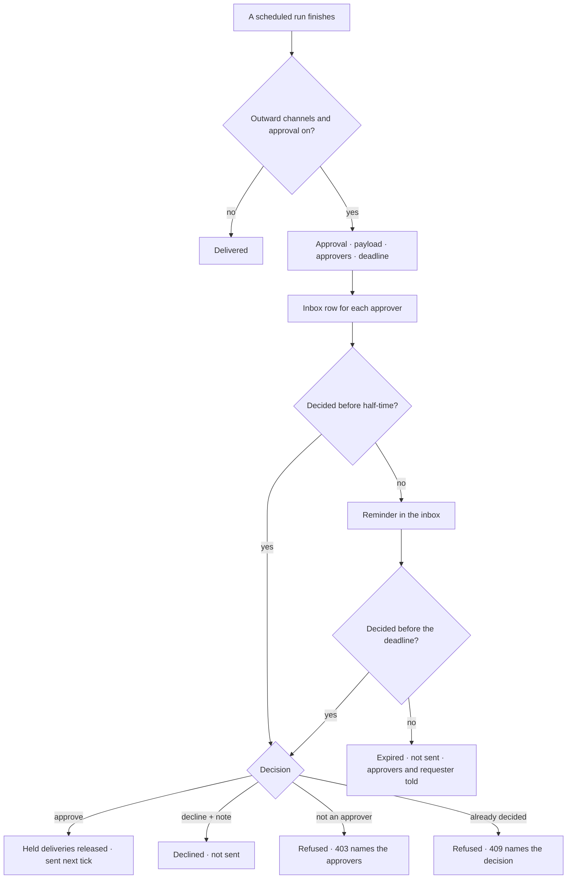

# Approvals

Anything that leaves Invana waits for a person. An **approval** names what will be sent, exactly,
who may approve it and by when. A reminder goes at half-time; at the deadline it ends **expired, not
sent** — never auto-approved.

| | |
|---|---|
| Index | [10.8](../../../README.md#10--operate) · Slice **B08** |
| Module | [Operate](../spec.md) |
| API / CLI / Studio | ✅ / ✅ / 🟡 |
| Related | [notifications](notifications.md) · [schedules](schedules.md) · [publish review](../../connect-and-model/features/publish-review.md) · [review](../../work/features/review.md) · [the runtime](../../platform/features/runtime.md) §10 · products [shell.md › Decisions](../../../../products/shell.md#decisions) SH-12 |

> **As** an approver, **I want** to see exactly what a run will send before it goes, **so that**
> nothing leaves without a person.

## Capabilities

| # | Capability | Notes |
|---|---|---|
| C1 | One row per thing waiting | `subject_kind` · `subject_id` · the run it came from · `payload` — exactly what will be sent, to which channels |
| C2 | Named approvers | User ids; only they may decide. Empty is refused at request |
| C3 | A deadline | `deadline_at`; a reminder at half-time, once |
| C4 | Approve · decline, with a note | Approve releases the held deliveries; decline marks them `declined`, not sent |
| C5 | Expiry | At the deadline: `expired`, the held deliveries `expired`, the approvers and the requester told in the inbox |
| C6 | What waits on me | `GET …/approvals?mine=true` — pending, nearest deadline first |
| C7 | Who decided is recorded | `decided_by_id` · `decided_at` · `note`, and an event |

## Journey

## Seams

| Seam | What the user sees |
|---|---|
| Nothing waiting | *Nothing waits on you* in Activity › Approvals |
| A member who is not an approver | The approval reads, with its approvers; *Approve* is disabled naming them |
| Decided twice | 409 — the second click names who decided first |
| The deadline passes during review | The decision is refused (409, `expired`); the row reads *expired, not sent* |
| An approver leaves the Graph | Still listed; the others may decide. With none left it expires at its deadline |
| The engine was down at the deadline | Expired on recovery, with the deadline as the time it lapsed — never approved late |

## Surfaces

| Surface | Shape |
|---|---|
| Activity › Approvals | Pending first, nearest deadline first; each shows what will be sent and to where |
| The approval | The payload as it will be sent, the channels, approvers, deadline, Approve · Decline with a note |

## Engine

| Thing | Shape |
|---|---|
| `approvals` | `graph_id` · `subject_kind (delivery · model_publish)` · `subject_id` · `run_id` · `schedule_id` · `title` · `payload` · `approver_ids[]` · `requested_by_id` · `deadline_at` · `reminded_at` · `status (pending · approved · declined · expired)` · `decided_by_id` · `decided_at` · `note` |
| Routes | `GET …/approvals` (`?status=` · `?mine=true`) · `GET …/approvals/{id}` · `POST …/approvals/{id}/approve` · `POST …/approvals/{id}/decline` (tag `approvals`) |
| Events | `approval.request · approve · decline · expire · remind` |
| CLI | `invana approvals list · approve · decline` |

## Decisions

| # | Decision |
|---|---|
| AP1 | **Never auto-decided.** At the deadline an approval ends `expired`; what it held is `expired, not sent`. A late decision is refused. |
| AP2 | Only a named approver decides. Graph roles do not widen it — an owner who is not named is refused like anyone else. |
| AP3 | One reminder, at half-time between request and deadline, to the approvers who have not decided. |
| AP4 | An approval holds **deliveries**, not a run: the run has already settled, so refusing costs nothing and the run's own status is unchanged. The deliveries carry the state — `held` → `pending` → `sent`, or `declined` · `expired`. |
| AP5 | The `payload` is the rendered message as each channel will receive it, frozen at request. Approving sends that, never a re-render. |
| AP6 | Writing an approval decision is the `ask` area (viewer): the approver list, not a Graph role, is the bound. |
| AP7 | **A breaking model publish is the second subject** (`model_publish`, subject = the [publish review](../../connect-and-model/features/publish-review.md)). It holds a publish, not deliveries: the payload is the impact list, approving lets the clock open the migration run, and declining or expiry leaves the draft unpublished. The approvers are the Graph's owners other than the requester. |

## Not building

| Not building | Because |
|---|---|
| A plan node's `approval:` gate | the runtime's ([13.8 §10](../../platform/features/runtime.md)); when it lands it raises this same row with its own `subject_kind` |
| Amending the payload before approving | approve or decline what was shown; an edit is a new run |
| Quorum or ordered approvers | any one named approver decides |
| Approval by email reply | a decision is an authenticated act in Studio, the CLI or the API |
