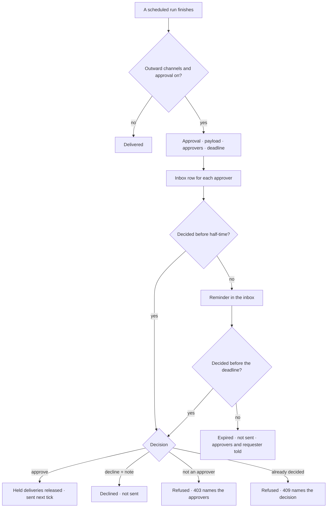

# Approvals

Anything that leaves Invana waits for a person. An **approval** names what will be sent, exactly,
who may approve it and by when. A reminder goes at half-time; at the deadline it ends **expired, not
sent** — never auto-approved.

| | |
|---|---|
| Index | [10.8](../../../README.md#10--operate) · Slice **B08** |
| Module | [Operate](../spec.md) |
| API / CLI / Studio | ✅ / ✅ / 🟡 |
| Related | [notifications](notifications.md) · [schedules](schedules.md) · [publish review](../../connect-and-model/features/publish-review.md) · [review](../../work/features/review.md) · [the runtime](../../platform/features/runtime.md) §10 · products [shell.md › Decisions](../../../../products/shell.md#decisions) SH-12 |

> **As** an approver, **I want** to see exactly what a run will send before it goes, **so that**
> nothing leaves without a person.

## Capabilities

| # | Capability | Notes |
|---|---|---|
| C1 | One row per thing waiting | `subject_kind` — `delivery` (a finished run's outward send), `step` (an agent's `send` step, held mid-run — [tool-plugins](../../platform/features/tool-plugins.md) C10), `model_publish` · `subject_id` · the run it came from · `payload` — exactly what will be sent, to which channels |
| C2 | Named approvers | User ids; only they may decide. Empty is refused at request |
| C3 | A deadline | `deadline_at`; a reminder at half-time, once |
| C4 | Approve · decline, with a note | Approve releases the held deliveries; decline marks them `declined`, not sent |
| C5 | Expiry | At the deadline: `expired`, the held deliveries `expired`, the approvers and the requester told in the inbox |
| C6 | What waits on me | `GET …/approvals?mine=true` — pending, nearest deadline first |
| C7 | Who decided is recorded | `decided_by_id` · `decided_at` · `note`, and an event |
| C8 | Every ask in one queue | `kind`: `access` · `budget` · `delegation` · `send` · `question` — a send is a held `delivery` or `step`; each with its actor chain, what it wants, who it is routed to and why, how long it has waited, and its run |
| C9 | Approvals › Waiting | `For you · All · Answered`; Approve · Decline in place when the reader is a named approver, *waiting on them* otherwise |
| C10 | Allow always | A delegation approval approved with `scope = always` also writes `always` into the caller's *May delegate to* |
| C11 | Approvals › Alert rules | Rules over the ledger — writes to a type, secrets out of place, refusal spikes, access granted, third-party reads — each with what it matches, who it notifies and when it last fired; on · off, new, edit, delete |

## Journey

## Seams

| Seam | What the user sees |
|---|---|
| Nothing waiting | *Nothing waits on you* in Approvals › Waiting |
| No alert rules | *No alert rules yet* with *New alert* |
| A member who is not an approver | The approval reads, with its approvers; *Approve* is disabled naming them |
| Decided twice | 409 — the second click names who decided first |
| The deadline passes during review | The decision is refused (409, `expired`); the row reads *expired, not sent* |
| An approver leaves the Graph | Still listed; the others may decide. With none left it expires at its deadline |
| The engine was down at the deadline | Expired on recovery, with the deadline as the time it lapsed — never approved late |

## Surfaces

| Surface | Shape |
|---|---|
| `agents.approvals` | `/agents/approvals` — `SectionPage` *Approvals*, tabs Waiting · Alert rules. Waiting: `SegmentedControl` `For you · N` · `All · N` · `Answered` (`?f.view=`), a kit `Table` Kind · Asked by · Wants · Routed to · Waiting · Run, with Decline · Approve in the row for the reader's own asks |
| `agents.approvals.alerts` | `/agents/approvals/alerts` — a `Table` On (`Switch`) · When · Matches · Notifies · Last fired, and *New alert* opening a `Dialog` |
| The approval | The payload as it will be sent, the channels, approvers, deadline, Approve · Decline with a note |
| The tray | The bell's popover lists what waits on me; *Review* opens the approval inside it — payload, what each choice does, who asked, the run and step, approvers, time left — and only then Approve · Decline ([notifications](notifications.md) NT11 · NT12) |

## Engine

| Thing | Shape |
|---|---|
| `approvals` | `graph_id` · `subject_kind (delivery · step · model_publish · access · budget · delegation · question)` · `subject_id` · `run_id` · `schedule_id` · `title` · `payload` · `approver_ids[]` · `requested_by_id` · `deadline_at` · `reminded_at` · `status (pending · approved · declined · expired)` · `decided_by_id` · `decided_at` · `note` |
| `approvals` (added) | `kind` · `asked_by` (the actor chain, `[{kind, id, name}]`) · `wants` (one line) · `routed_reason` (`world owner` · `agent owner` · `started the run` · `wrote the Todo` · `install admin`) · `step_run_id` |
| `alert_rules` | `graph_id` · `name` · `enabled` · `match {act, touched, verdict[], refused_by[], threshold {count, window_s}}` · `notify_user_ids[]` · `notify_line` · `last_fired_at` · `created_by_id` |
| Routes | `GET …/approvals` (`?f.view=for_you·all·answered` · `?f.kind=` · `?status=`) · `GET …/approvals/{id}` · `POST …/approvals/{id}/approve` (`{note, scope: run·always}`) · `POST …/approvals/{id}/decline` (tag `approvals`) · `GET · POST …/alert-rules` · `PATCH · DELETE …/alert-rules/{id}` |
| Events | `approval.request · approve · decline · expire · remind` |
| CLI | `invana approvals list · approve · decline` |

## Decisions

| # | Decision |
|---|---|
| AP1 | **Never auto-decided.** At the deadline an approval ends `expired`; what it held is `expired, not sent`. A late decision is refused. |
| AP2 | Only a named approver decides. Graph roles do not widen it — an owner who is not named is refused like anyone else. |
| AP3 | One reminder, at half-time between request and deadline, to the approvers who have not decided. |
| AP4 | An approval holds **deliveries**, not a run: the run has already settled, so refusing costs nothing and the run's own status is unchanged. The deliveries carry the state — `held` → `pending` → `sent`, or `declined` · `expired`. |
| AP5 | The `payload` is the rendered message as each channel will receive it, frozen at request. Approving sends that, never a re-render. |
| AP6 | Writing an approval decision is the `ask` area (viewer): the approver list, not a Graph role, is the bound. |
| AP7 | **A breaking model publish is the second subject** (`model_publish`, subject = the [publish review](../../connect-and-model/features/publish-review.md)). It holds a publish, not deliveries: the payload is the impact list, approving lets the clock open the migration run, and declining or expiry leaves the draft unpublished. The approvers are the Graph's owners other than the requester. |
| AP8 | **Approvals is the one queue**, a section of Agents: every ask an agent or a run makes of a person — access, budget, delegation, send, question — is an `approvals` row with a `kind`. Activity has no Approvals tab; the bell's tray reads the same rows. |
| AP9 | **An ask is routed to whoever owns the thing asked for**: the world's owner for access, the target agent's owner for a delegation and a send, the person who started the run for budget, the Todo's author for a question, an install admin for workers. `routed_reason` says which, in those words. |
| AP10 | **An approved ask is for this run**, and reaches that agent only, never its children. *Allow always* exists only on a delegation, and writes the caller's *May delegate to*. |
| AP11 | **A waiting step holds; the rest of its run carries on.** |
| AP12 | **Alert rules match ledger rows** — an act pattern (`graph.write.*`), a touched pattern (`graph/Fare`), verdicts and refusal reasons, optionally a threshold (`count` in `window_s`). The clock evaluates them over new ledger rows; a match notifies each named member in the inbox and records `last_fired_at`. A rule change is itself a ledger row. |
| AP13 | **`For you` is what the reader may decide**; `All` is every pending ask in the Graph the reader can see; `Answered` is the decided and expired ones, newest first. The counts on the tabs are the engine's. |

## Not building

| Not building | Because |
|---|---|
| Alert rules notifying channels | an alert reaches people in the inbox; a channel is a notification rule's ([notifications](notifications.md)) |
| A plan node's `approval:` gate | the runtime's ([13.8 §10](../../platform/features/runtime.md)); when it lands it raises this same row with its own `kind` |
| Amending the payload before approving | approve or decline what was shown; an edit is a new run |
| Quorum or ordered approvers | any one named approver decides |
| Approval by email reply | a decision is an authenticated act in Studio, the CLI or the API |
