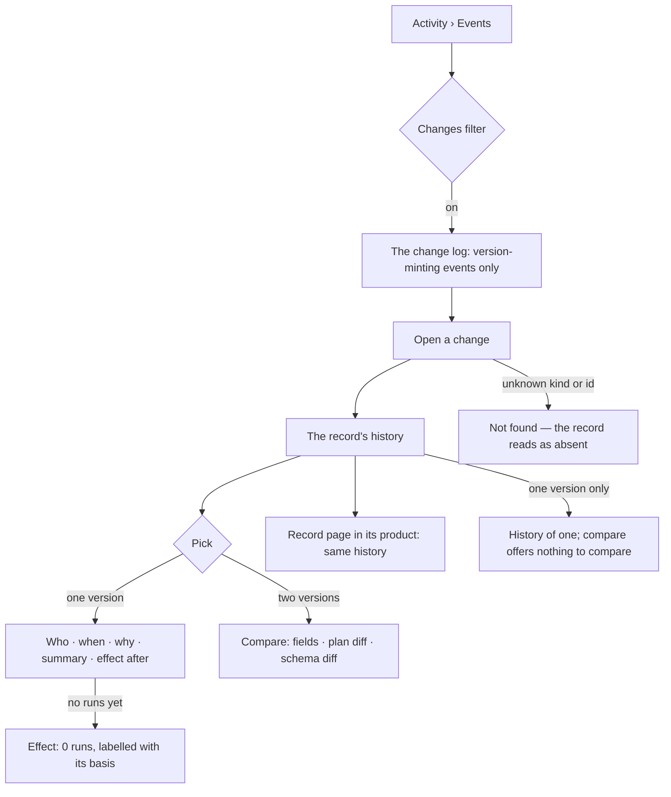

# Change log

Every version of every versioned record, with who made it, why, what changed and what happened after —
read from the records that already hold the versions and the events that minted them.

| | |
|---|---|
| Index | [10.6](../../../README.md#10--operate) · Slice **B01** (P-09) |
| Module | [Operate](../spec.md) |
| API / CLI / Studio | ✅ / 🔵 / ✅ |
| Related | [audit-and-activity](audit-and-activity.md) · [see-what-ran](see-what-ran.md) · products: [shell.md](../../../../products/shell.md) SH-14 · [agents.md](../../../../products/agents.md) AG-06 · AG-09 · [modeller.md](../../../../products/modeller.md) MO-09 |

> **As** an auditor, **I want** every change to anything versioned, with its effect after, and any two
> versions compared, **so that** every change is accountable.

## Capabilities

| # | Capability | Notes |
|---|---|---|
| C1 | The change log | The Graph's events, narrowed to the ones that mint a version — `GET …/events?changes=true` |
| C2 | A record's history | Every version of one record, newest first: version · who · when · why · a one-line summary · the effect after |
| C3 | Compare any two versions | One shape for every kind: field changes, the plan diff when there is one, the schema diff for a model |
| C4 | Effect after | Runs, failed runs and tokens that ran on a version — tokens only, never currency |
| C5 | Why | An optional reason on the write that mints a version, carried on its event |

## Journey

## Seams

| Seam | What the user sees |
|---|---|
| A version written before reasons existed | `why` is empty — never invented |
| An agent version from before diffs were recorded | The field is named, before and after are empty: *not recorded* |
| A model version | Its `change_summary` is its why; its effect is the Graph's runs while it was the published one, labelled `window` |
| A version nothing ran on | Effect reads 0 runs, not blank |
| A record in another Graph, or a kind that is not versioned | 404 — absent, not forbidden |
| Comparing a version with itself | Empty change, `summary` says so |
| A draft | Not a version: drafts never appear in a history or a compare |

## Surfaces

| Surface | Shape |
|---|---|
| Activity › Events › Changes | `/activity/events?filter=changes` — the Events tab's *Changes* toggle; rows are change events with Product and Who filters (`shell.events.changes` · `packages/shell/src/activity/changes/ChangesList.tsx`) |
| Compare | `/activity/changes/<kind>/<record>?a=&b=` — two versions side by side, inside Events (`shell.change.compare` · `packages/shell/src/activity/changes/ComparePage.tsx`) |
| Agent page › History · Skill page › History | The record's changes — version · when · by · what changed · why · after (C03 AG-06 · AG-09) |
| Model page › History | Every published version of the models in scope, each opening Compare (`modeller.model.history` · `packages/modeller/src/models/model-page/ModelHistory.tsx`) |
| Dataset record › Change log | when · version · who · what changed · why (`datasets.record` · `packages/datasets/src/dataset/RecordsTab.tsx`) |

## Engine

| Record kind | Event `target_kind` | Versions read from | Version id | Why from | Compare | Effect basis |
|---|---|---|---|---|---|---|
| `skill` | `skill` | `skill_versions` (published) | number | `details.why` | prose fields, unified lines · the two versions' plans | `pinned` — steps whose `skills_offered` names the version |
| `rule` | `rule` | `rule_versions` | number | `details.why` | statement, unified lines | `pinned` — steps whose `rules_offered` names the version |
| `plan` | `workflow` | `task_plans` by key | number | `details.why` | plan diff (steps, arguments) | `pinned` — roots run as `template:<key>@<v>` or on that row |
| `agent` | `agent` | `agent.create` / `agent.update` / `agent.soul_set` events | number | `details.why` | fields folded from the events' `diff` | `pinned` — roots with `agent_id` and `agent_version` |
| `model` | `graph_model` | `graph_versions` (not draft) | SemVer | `change_summary` | schema diff | `window` — the Graph's roots while it was published |
| `dataset` | `dataset` | `dataset_versions` | number | `why` on the version | licence, author chain, columns · a records summary | `bound` — the load runs that bound the version, in every Graph |

| Route | Returns |
|---|---|
| `GET /api/v1/u/{user}/{graph}/events?changes=true` | `EventListResponse`, version-minting actions only; composes with every other filter |
| `GET /api/v1/u/{user}/{graph}/history/{record_kind}/{record_id}` | `RecordHistory` |
| `GET /api/v1/u/{user}/{graph}/history/{record_kind}/{record_id}/compare?a=&b=` | `ChangeCompare` — `a` omitted compares `b` with the version before it |
| `GET /api/v1/datasets/{publisher}/{name}/history` · `/history/compare?a=&b=` | The same two shapes for a dataset, which belongs to no Graph ([2.4](../../bring-data-in/features/datasets.md) DT12) |

| Shape | Fields |
|---|---|
| `RecordHistory` | `record_kind` · `record_id` · `name` · `items: ChangeEntry[]` |
| `ChangeEntry` | `version` (string) · `version_id` · `at` · `action` · `event_id` · `actor_id` · `actor_kind` · `actor_name` · `why` · `summary` · `effect` |
| `ChangeEffect` | `basis` (`pinned` · `window` · `bound`) · `runs` · `failed` · `tokens_in` · `tokens_out` · `since` · `until` |
| `ChangeCompare` | `record_kind` · `record_id` · `a` · `b` · `summary` · `fields: ChangeField[]` · `records: RecordsSummary?` · `plan: PlanVersionDiff?` · `schema_diff: SchemaDiff?` |
| `RecordsSummary` | `added` · `removed` · `changed` — records by key between two dataset versions |
| `ChangeField` | `field` · `before` · `after` · `lines` (unified diff, text fields only) |

| Write | Carries |
|---|---|
| `POST …/skills/{id}/versions` · `PATCH …/skills/{id}` | optional `why` → `skill.publish` `details.why` |
| `PATCH …/rules/{id}` | optional `why` → `rule.publish` `details.why` |
| `PATCH …/agents/{id}` | optional `why` → `details.why`; `details.diff` holds every changed field's before and after |
| `POST …/task-plans/promote` | optional `why` → `workflow.promote` `details.why` |

## Decisions

| # | Decision |
|---|---|
| CL1 | **The change log is events, not a table.** A change is the event that minted a version; the versions stay in the tables that already hold them. One more kind of event, as the shell decided — no second record to keep in step. |
| CL2 | **`?changes=true` on the events list is the change log.** It narrows to `CHANGE_ACTIONS` in `core/events/actions.py`, which lists each kind's minting actions; it composes with the existing filters. |
| CL3 | **History and compare live under `…/history/{record_kind}/{record_id}`**, one route for every kind, read by `ChangeLogManager` in the `activity` band — the only band that may read events, every app and runs at once. |
| CL4 | **Six kinds: `skill` · `rule` · `plan` · `agent` · `model` · `dataset`.** A dataset belongs to no Graph, so its history is read with `graph_id` null under its own routes ([DT12](../../bring-data-in/features/datasets.md)). Boards are not here: a board version is a frozen reading (a report), not a change to a definition. |
| CL5 | **`version` is a string on the wire** — skills, rules, plans and agents count, models use SemVer. `version_id` is the version row's id where one exists, null for an agent. |
| CL6 | **Effect after is counted, never estimated.** `pinned` counts what a run recorded it used; a model is not pinned on runs, so its effect is the Graph's roots while that version was published, labelled `window` so nobody reads it as attribution. Tokens are a run's root row plus its own steps. |
| CL7 | **Why is optional and never inferred.** It rides on the minting event as `details.why` (500 characters at most); a model's is its `change_summary`. |
| CL8 | **An agent update records `details.diff`** — `{field: {before, after}}` for every changed field — beside the field names it already recorded, because an agent has no version table and its event is the only place an earlier version still exists. |
| CL9 | **Compare `a` omitted is "against the one before"**; `a` older than `b` is not required — the diff reads from `a` to `b`. Drafts are never versions. |
| CL10 | **Restore is not here.** Restoring makes a new version through the record's own write (shell.md); the change log only reads. |
| CL11 | **The agent and skill pages read their own history; the shared surfaces are C04.** Their History tabs read `history/<kind>/<id>`, and the skill's Plan tab reads its compare against the version before; Activity › Changes and the compare board stay with the shell ([agents.md › Decisions](../../../../products/agents.md#decisions) *Agent history* · *Skill history*). |
| CL12 | **Studio draws one change log and one compare for every product.** The change log is the Events tab's *Changes* filter, a change's compare is a path under Activity, and a model's History and a dataset record's change log open the same compare; the rules are in [shell.md › Decisions](../../../../products/shell.md#decisions) *The Changes filter* · *The compare page* · *One compare for every product*. |

## Not building

| Not building | Because |
|---|---|
| A change table or snapshot store | the versions already exist; a copy drifts (CL1) |
| Currency in effect after | tokens only |
| Restore from the change log | a restore is the record's own write, which mints a new version |
| Per-cell provenance | record level plus the change log covers it (datasets.md) |
| Backfilling `why` or agent diffs for old events | an empty field is honest; an inferred one is not |
| Board and report versions | a frozen reading, not a definition change (CL4) |
