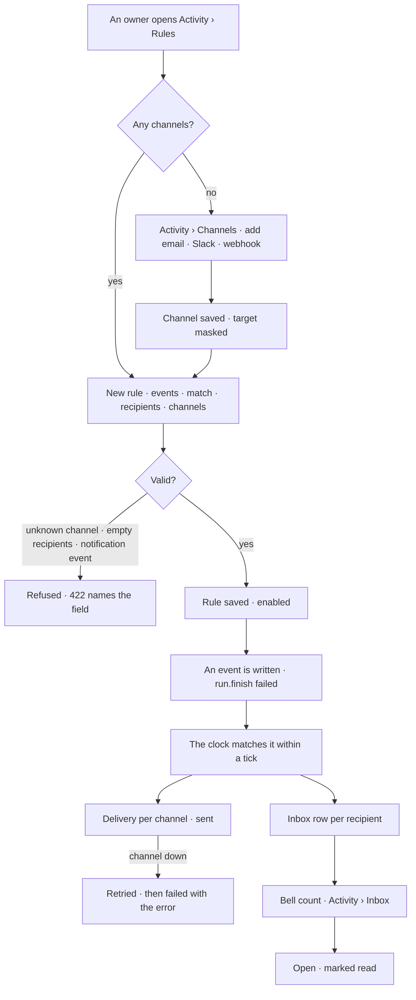

# Notifications

Which events reach whom, on which channel — and one inbox per person of what needs them. A
**rule** matches events and names its people and channels; a **channel** is a place outside the
inbox to send to; a **notification** is one inbox row; a **delivery** is one send to one channel.

| | |
|---|---|
| Index | [10.7](../../../README.md#10--operate) · Slice **B08** |
| Module | [Operate](../spec.md) |
| API / CLI / Studio | ✅ / ✅ / ✅ |
| Related | [approvals](approvals.md) · [schedules](schedules.md) · [audit-and-activity](audit-and-activity.md) · [roles](../../identity-and-access/features/roles.md) · products [shell.md › Activity](../../../../products/shell.md#activity) SH-15 · SH-16 |

> **As** anyone on a Graph, **I want** one inbox of what needs me and rules that say which events
> reach whom on which channel, **so that** failures and slowdowns find the right person and I act on
> what matters first.

## Capabilities

| # | Capability | Notes |
|---|---|---|
| C1 | Channels | `email` · `slack` · `webhook`. In-app is not a channel row: every rule and schedule may deliver to the inbox |
| C2 | A channel holds its credential encrypted | A Slack incoming-webhook URL or a webhook URL + signing secret, Fernet-encrypted; the read shows only a masked target |
| C3 | Rules | Event action patterns (`run.finish`, `approval.*`), an optional `match` on the event's details (`{"status": "failed"}`), recipients, `in_app`, channels, enabled |
| C4 | Recipients | Named members · holders of named Graph roles · `requester` — the person a run or act was on behalf of |
| C5 | The inbox | My notifications on this Graph, newest first, with an unread count; mark some or all read |
| C6 | Deliveries are recorded | One row per send: what was sent, to which channel, `pending · held · sent · failed · declined · expired`, attempts and the error |
| C7 | A failed send retries | Up to three attempts, then `failed` with the error; the inbox row is never lost to a channel failure |
| C8 | Approvals, reminders and expiries always reach the inbox | Not rule-driven: an approver is told without anyone writing a rule ([10.8](approvals.md)) |

## Journey

## Seams

| Seam | What the user sees |
|---|---|
| Inbox empty | *Nothing needs you* — good news, not a blank page |
| A viewer opens Rules | The list reads; *New rule* is disabled naming the owners (rules and channels are the `settings` area) |
| Email with no SMTP on the install | The channel saves; its read says *email is not configured on this install*; each delivery fails with that reason |
| A channel deleted while a rule names it | Refused (409) naming the rules that use it |
| A rule matching its own deliveries | Refused: `notification.*`, `delivery.*` and `approval.remind` are never matched, so a rule cannot feed itself |
| A recipient removed from the Graph | Skipped at match time; the rule still saves |
| The engine was down | Events written meanwhile are matched on recovery — the cursor is a row, not process memory |
| A private project's events | Reach only the people staffed on it ([9.7](../../work/features/private-projects.md)) |

## Surfaces

| Surface | Shape |
|---|---|
| Header bell | Unread count from `GET …/notifications?unread=true` |
| Activity › Inbox | My notifications and the approvals waiting on me, each with its next step |
| Activity › Rules · rule | The rules list; a rule's events, match, recipients and channels |
| Activity › Channels | The channels with kind, masked target and *ready* |

## Engine

| Thing | Shape |
|---|---|
| `notification_channels` | `graph_id` · `name` (unique per Graph) · `kind` · `target` (masked, shown) · `secret_encrypted` · `created_by_id` |
| `notification_rules` | `graph_id` · `name` · `events[]` · `match{}` · `member_ids[]` · `roles[]` · `requester` · `in_app` · `channel_ids[]` · `enabled` · `created_by_id` |
| `notifications` | `graph_id` · `user_id` · `kind (event · approval · reminder · expired · delivery)` · `title` · `body` · `event_id` · `rule_id` · `approval_id` · `run_id` · `target_kind` · `target_id` · `read_at` — unique `(user_id, event_id, rule_id)` |
| `notification_deliveries` | `graph_id` · `channel_id` · `rule_id` · `event_id` · `firing_id` · `approval_id` · `status` · `payload` (exactly what is sent) · `attempts` · `error` · `sent_at` |
| `notification_cursors` | `name` · `created_at` · `event_id` — how far the clock has matched |
| Routes | `GET …/notifications` · `POST …/notifications/read` · `GET·POST …/notifications/rules` · `GET·PATCH·DELETE …/notifications/rules/{id}` · `GET·POST …/notifications/channels` · `DELETE …/notifications/channels/{id}` (tag `notifications`) |
| Events | `notification_rule.create · update · delete` · `channel.create · delete` · `delivery.fail` |
| CLI | `invana notifications list · read` · `invana notifications rules list · apply --file` · `invana notifications channels list · add · remove` |
| Settings | `INVANA_SMTP_HOST` · `INVANA_SMTP_PORT` · `INVANA_SMTP_USERNAME` · `INVANA_SMTP_PASSWORD` · `INVANA_SMTP_FROM` · `INVANA_SMTP_STARTTLS` · `INVANA_CLOCK_INTERVAL_S` |

## Decisions

| # | Decision |
|---|---|
| NT1 | **One clock.** A single loop in the engine process matches new events, fires schedules, reminds and expires approvals, and sends pending deliveries — one `tick(now)` each interval (default 30 s). Every step is idempotent on unique keys, and the cursor row is taken `FOR UPDATE SKIP LOCKED`, so two engine processes never double-send. |
| NT2 | **Rules read the event record; they never hook a write.** Matching runs after commit, from `events`, through a persisted cursor. A write is never slowed or failed by a notification. |
| NT3 | Rules and channels are the `settings` area (owner): a channel holds a credential, and a rule decides who is paged. Reading them, and one's own inbox, is open to every member. |
| NT4 | In-app is not a channel. A rule's `in_app` and a schedule's `deliver_in_app` write inbox rows; channels are only what leaves Invana. |
| NT5 | A channel's credential is write-only: stored Fernet-encrypted under `INVANA_ENCRYPTION_KEY`, never read back; the read shows a masked `target`. |
| NT6 | A webhook delivery is a JSON `POST` signed with `X-Invana-Signature: sha256=<hmac of the body>` when the channel has a secret. A Slack delivery posts `{"text": …}` to the incoming-webhook URL. Email goes through the install's SMTP. |
| NT7 | A rule never matches `notification.*`, `delivery.*` or `approval.remind`, so no rule can feed itself. |
| NT8 | Recipients resolve at match time: named members still on the Graph, holders of the named roles, and `requester` (the event's `on_behalf_of_user_id`, else its user actor). An event on a private project reaches only its staffed people. |
| NT9 | A send is tried three times, one per tick, then left `failed` with the error. The inbox row is written first and never depends on a channel. |
| NT10 | Read state is per notification (`read_at`); the bell is the unread count. Approvals waiting on the reader are counted by the Inbox as rows of their own until decided. |

## Not building

| Not building | Because |
|---|---|
| Microsoft Teams | listed as *not connected*; no work planned (products shell.md) |
| Per-product notification centres | one inbox, filtered by product |
| Digest batching or quiet hours | a schedule is how routine reading recurs |
| Rules on an answer's value | that is a monitoring product |
| Escalation chains and on-call rotations | a rule names its people; paging policy is another product's job |
| Per-user channel preferences | a rule owns its channels; a person reads the inbox |
