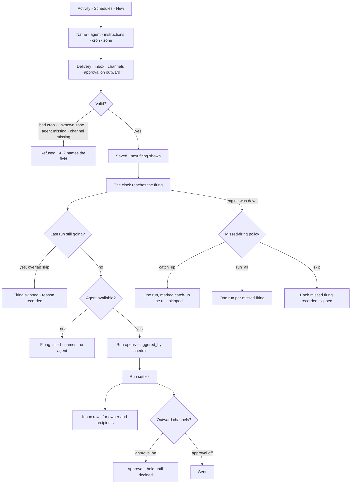

# Schedules

Routine work that runs itself and lands where people read. A schedule names an **agent**, the
**instructions** it carries out, a **cron**, and where the result is **delivered**. Each occurrence
is a **firing**, recorded whether it ran or not.

| | |
|---|---|
| Index | [10.1](../../../README.md#10--operate) · Slice **B08** |
| Module | [Operate](../spec.md) |
| API / CLI / Studio | ✅ / ✅ / ✅ |
| Related | [notifications](notifications.md) · [approvals](approvals.md) · [see-what-ran](see-what-ran.md) · [instructions](../../skills/features/instructions-publish-rollback.md) · products [shell.md › Decisions](../../../../products/shell.md#decisions) SH-13 |

> **As** anyone on a Graph, **I want** to schedule routine work — a digest, a morning plan — with no
> project, **so that** it runs itself and lands where I read.

## Capabilities

| # | Capability | Notes |
|---|---|---|
| C1 | One kind | A schedule needs no project. It names an agent and instructions; whatever the run produces is delivered |
| C2 | Cron in a time zone | 5-field cron (`*`, lists, ranges, steps) read in an IANA zone, default `UTC` |
| C3 | A firing opens a run | `triggered_by = schedule`, through the named agent, on behalf of the schedule's owner — the same run as a Todo's |
| C4 | Every firing is recorded | `queued · opened · skipped · failed` (*run now* is `queued` until the clock opens it), with the reason, the run, and whether it was a catch-up |
| C5 | Missed-firing policy | `catch_up` (default): run once on recovery, marked catch-up, the rest skipped · `run_all`: every missed one, at most 24 · `skip`: none |
| C6 | Overlap policy | `skip` (default): a firing while the last run is still going is skipped, saying so · `allow` |
| C7 | Delivery | To the inbox of the owner and named recipients, and to channels ([10.7](notifications.md)) |
| C8 | Outward actions wait | A delivery to a channel waits for an [approval](approvals.md) unless `approve_outward` is switched off on the schedule |
| C9 | Pause · resume · run now · delete | Pausing keeps the history; resuming fires from now, missing nothing it treats as missed; *run now* is a firing like any other |

## Journey

## Seams

| Seam | What the user sees |
|---|---|
| No schedules | *Nothing is scheduled* with *New schedule* |
| A member without `contributor` | The list reads; *New schedule* is disabled naming who can |
| Agent retired or paused | The firing fails naming the agent; the schedule stays active |
| Paused mid-run | The run finishes and is delivered; no further firings |
| The run fails | Delivered as a failure — the inbox says it failed and links the run |
| The engine was down for a day | One catch-up run and one skipped firing per missed occurrence, each saying why |
| A channel deleted | Refused while a schedule names it (409) |

## Surfaces

| Surface | Shape |
|---|---|
| Activity › Schedules | Coming up (next 7 days) and every schedule, with its next firing |
| New schedule | Name · agent · instructions · cron · zone · delivery · missed and overlap policy |
| Schedule detail | Firings, newest first, each with its run and outcome |

## Engine

| Thing | Shape |
|---|---|
| `schedules` | `graph_id` · `name` · `agent_id` · `instructions` · `cron` · `timezone` · `status (active · paused)` · `missed (catch_up · run_all · skip)` · `overlap (skip · allow)` · `deliver_in_app` · `recipient_ids[]` · `channel_ids[]` · `approve_outward` · `approver_ids[]` · `approval_deadline_s` · `next_fire_at` · `owner_id` |
| `schedule_firings` | `schedule_id` · `due_at` · `fired_at` · `outcome (queued · opened · skipped · failed)` · `catch_up` · `manual` · `run_id` · `reason` · `delivered_at` — unique `(schedule_id, due_at)` |
| Routes | `GET·POST …/schedules` · `GET·PATCH·DELETE …/schedules/{id}` · `POST …/schedules/{id}/pause · resume · run` · `GET …/schedules/{id}/firings` (tag `schedules`) |
| Events | `schedule.create · update · pause · resume · delete · fire · skip` |
| CLI | `invana schedules list · create --file · show · pause · resume · run-now · delete` |

## Decisions

| # | Decision |
|---|---|
| SC1 | **One kind of schedule.** It names an agent and instructions and opens a run; whether that creates work is the run's business, not the schedule's. |
| SC2 | A firing opens the same run a Todo opens — `triggered_by = schedule`, the agent's lens frozen, on behalf of the owner — and is queued behind a person by the Graph's contention rules ([5.7](../../agents/features/concurrency-and-contention.md)). |
| SC3 | Every firing is recorded, including skips and failures, with a reason. `(schedule_id, due_at)` is unique, so two engine processes never fire one occurrence twice. |
| SC4 | **Missed firings.** A firing is *missed* when the clock reaches it more than five minutes late. `catch_up` runs the latest once, marked catch-up, and records the earlier ones skipped; `run_all` runs each (at most 24, the rest skipped); `skip` runs none. An on-time firing is never treated as missed. |
| SC5 | Overlap `skip` skips a firing while the schedule's previous run is not terminal; `allow` opens it anyway. |
| SC6 | **Delivery follows the settled run.** The clock delivers a firing once its run is terminal: inbox rows to the owner and recipients, and one delivery per channel. A failed run is delivered as a failure, never dropped. |
| SC7 | **Outward actions wait for approval** unless the schedule switches it off. The approvers are `approver_ids`, else the owner; the deadline is `approval_deadline_s` (default a day). |
| SC8 | Writing a schedule is the `work` area (contributor). The owner is whoever created it; editing never changes on whose behalf it runs. |
| SC9 | Times are stored in UTC; the cron is read in the schedule's zone, so *08:00 Europe/Berlin* stays 08:00 across a clock change. |
| SC10 | Resuming fires from now: the occurrences while paused are not missed, because nobody wanted them. |

## Not building

| Not building | Because |
|---|---|
| A schedule naming a skill or a Flow | it carries instructions; the plan generated from them is [6.5](../../skills/features/instructions-publish-rollback.md)'s, and a schedule's instructions are stored here until 6.5 reads them |
| Overlap `queue` | `skip` or `allow`; a queue of firings is a backlog nobody asked for |
| `run_all` beyond 24 | a day of hourly firings is the most a recovery replays |
| Calendar-aware scheduling | cron plus a zone and a missed-firing policy is enough |
| Alerting on an answer's value | that is a monitoring product |
| Per-schedule budgets | the agent's budget bounds the run |
