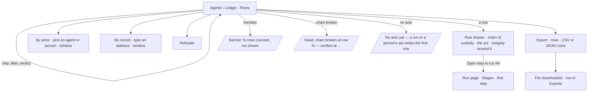

# The ledger

Every act by a person or an agent in a Graph — who, through which agents, what it touched, allowed or
refused — as one append-only log whose rows hash the one before. It changes nothing; it is read by row,
by actor, by record and by refusal, and exported with its hashes.

| | |
|---|---|
| Index | [10.9](../../../README.md#10--operate) · Slice **F05** |
| Module | [Operate](../spec.md) |
| API / CLI / Studio | 🟡 / — / 🟡 |
| Related | [audit-and-activity](audit-and-activity.md) (events — the writes) · [see-what-ran](see-what-ran.md) · [the-run-page](../../agents/features/the-run-page.md) · [approvals](approvals.md) (alert rules read the ledger) · [govern spec](../../govern/spec.md) (touches, the per-run stream) · products: [agent-fabric.md](../../../../products/agent-fabric.md) AF-14 |

> **As** a reviewer, **I want** the full log — by row, actor, record, refusal — exportable and provably
> unedited, **so that** access is proven, not assumed.

## Capabilities

| # | Capability | Notes |
|---|---|---|
| C1 | A row per act | when · actor with its chain (*ravi ▸ Route Auditor ▸ Hub Checker LHR*) · act (a function, or a person's act such as `run.stop`) · touched (`layer/name` and a volume line) · verdict (`allowed` · `refused` · `approval` · `held`) with the refusal's reason (`grant` · `lens` · `world` · `ceiling` · `robots` · `policy`) · run · where it ran |
| C2 | Rows | Tiles Acts today (against the 7-day daily mean; no change is shown while that mean is under 10 acts a day) · People · Agents · Refused (by reason) · Waiting (approvals); preset chips (Refused today · Writes · Third-party reads · Secrets used · Granted access · People only); filters since · actor · act · touched layer · run · `All · Allowed · Refused · Approval`; the applied-filters strip; newest first, paged |
| C3 | A row's detail | A drawer: chain of custody (who started it, each agent with how it got there, the function and plugin version, where it ran, the lens), the act (function · arguments · touched · the rule that allowed or refused it), integrity (row hash, previous hash, chain verified), the rows around it, *Open step in run #N*, *Copy link* |
| C4 | By actor | A person or agent and a window: tiles Acts · Writes · Third-party · Secrets · Refused; Graph data · Web · LLM · Acted through (the helpers it spawned or delegated to) |
| C5 | By record | An address (`graph/Airport:LHR`, `graph/Fare`) and a window: tiles Acts · Reads · Writes · Refused · People · Agents; every act on it; who can see it now (worlds · people · agents · who can write) |
| C6 | Refusals | Tiles Refused today (share of acts) · By grant · By lens · By world · By ceiling; refused a day over 30 days; top refused functions; by the rule that held |
| C7 | Export | Rows (the current filters) as CSV or JSON Lines, with each row's hash and the previous; past exports listed; retention and integrity stated |
| C8 | Members | A member sees their own acts and the rows of runs they can open; the rest is counted, not shown — a banner says how many |
| C9 | Integrity | Append-only; each row's hash covers its content and the previous row's hash; the chain is re-verified every 10 minutes and the head says when it last held |

## Journey

## Seams

| Seam | What the user sees |
|---|---|
| No acts yet | *No acts yet* — a run or a person's act writes the first row |
| A member | The banner: *You see the rows of runs you can open, and your own acts. N rows today belong to runs you cannot open — counted, not shown* |
| The chain fails to verify | The head reads *hash chain broken at row #N* in `--destructive`; rows still read |
| A filter matches nothing | *0 of N match* with *Clear all* |
| An export of zero rows | *Export* disabled, *no rows match* |

## Surfaces

| Surface | Shape |
|---|---|
| `agents.ledger` | `/agents/ledger` — `SectionPage` *Ledger* with `append-only` · `hash chain verified HH:MM · 365 days kept` in the head and *Export*; tabs Rows · By actor · By record · Refusals · Export; filters in the URL (`?f.since=` · `?f.actor=` · `?f.act=` · `?f.layer=` · `?f.run_id=` · `?f.verdict=`) |
| `agents.ledger.entry` | `?row=<id>` — the row drawer over the Rows tab |
| `agents.ledger.actor` | `/agents/ledger/actor?actor=agent:<id>&since=7d` |
| `agents.ledger.record` | `/agents/ledger/record?address=graph/Airport:LHR&since=30d` |
| `agents.ledger.refusals` | `/agents/ledger/refusals` |
| `agents.ledger.export` | `/agents/ledger/export` |
| `agents.ledger.member` | the Rows tab signed in as a member |
| A run's Ledger tab | the Rows table with `f.run_id` |

## Engine

| Thing | Shape |
|---|---|
| `ledger_rows` | `id` · `graph_id` · `seq` (per Graph, from 1, unique) · `at` · `actor_kind` (`person · agent · system`) · `actor_user_id` · `actor_agent_id` · `actor_chain` `[{kind, id, name}]` · `act` · `layer` (`graph · web · llm · secret · agent · run · lens · access · rule`) · `touched` · `touched_line` · `verdict` · `refused_by` · `rule` · `run_id` · `step_run_id` · `run_number` · `where` · `args` · `hash` · `prev_hash` |
| `ledger_exports` | `id` · `graph_id` · `requested_by_id` · `filters` · `format` · `rows` · `created_at` |
| `ledger_checks` | `graph_id` (key) · `verified_at` · `ok` · `last_seq` · `broken_seq` |
| Writer | `invana.core.ledger.record(db, …)` — the one writer: takes the Graph's last row under a row lock, computes `seq` and the hash, inserts. Called by the interpreter for every step it settles and every touch it refuses, by delegation for every spawn, escrow return and refusal, and by `emit_event` for every event a person or an agent causes |
| Hash | `sha256(prev_hash + canonical JSON of the row's content fields)`, hex; the first row's `prev_hash` is 64 zeros |
| `GET …/ledger` | `Page[LedgerRowRead]` on the list contract; filters `since · actor · act · layer · run_id · verdict · refused_by`; `hidden` — rows the reader may not see, counted |
| `GET …/ledger/stats` | tiles and preset counts for `since` (default today) |
| `GET …/ledger/{id}` | `LedgerRowDetail` — the row, its chain of custody, the rule, `around[]` (two before, two after in its run), `verified` |
| `GET …/ledger/actor` | `?actor=agent:<id>|person:<id>&since=` → `LedgerActorRead` |
| `GET …/ledger/record` | `?address=&since=` → `LedgerRecordRead` with `can_see` |
| `GET …/ledger/refusals` | `LedgerRefusalsRead` — tiles, `by_day[30]`, `top_functions[]`, `by_rule[]` |
| `GET …/ledger/export` | `?format=csv|jsonl` + the Rows filters → the file; records a `ledger_exports` row |
| `GET …/ledger/exports` | the Graph's exports, newest first |
| `GET …/ledger/integrity` | `{verified_at, ok, last_seq, broken_seq, retention_days}` |

## Decisions

| # | Decision |
|---|---|
| LG1 | **The ledger is one table, written by one function.** `core.ledger.record` is the only writer; nothing updates or deletes a row. The per-run `task_stream` stays the run's own record and `run_touches` its projection; a ledger row is the Graph-wide fact that an act happened. |
| LG2 | **Every act is one row.** A step the interpreter settles is a row (`act` = its function, verdict `allowed`, or `refused` when it failed on a bound); a refused touch is a row (`refused · grant`, `lens`, `robots`); a spawn, a refused spawn (`ceiling`) and an escrow return are rows; an event a person causes — stop a run, decide an approval, change an alert rule, publish, pause — is a row with `act` = the event's action. |
| LG3 | **The actor chain is resolved when the row is written**: the person the run is on behalf of, then each agent from the root to the acting one, names as they were. A later rename never rewrites a row. |
| LG4 | **Rows hash the one before.** `hash = sha256(prev_hash ‖ canonical JSON)`, `seq` per Graph; the writer takes the Graph's head under a row lock so two writers never fork the chain. |
| LG5 | **The chain is re-verified every 10 minutes** by the activity clock, from the last verified row on; the result is `ledger_checks` and the head reads it. A full re-verify runs on demand from the integrity route. |
| LG6 | **Members see their own acts and the rows of runs they can open; admins see every row.** What a member cannot see is counted (`hidden`) and the page says so. |
| LG7 | **Every ledger number is the engine's** — tiles, chips, per-day counts and top lists are computed over stored rows by the ledger endpoints. |
| LG8 | **An export is the Rows filters, as a file, with the hashes**, generated on request and recorded in `ledger_exports`. |
| LG9 | **Retention is 365 days**, stated in the head; rows are kept for the period and never edited. |
| LG10 | **By actor includes the helpers an agent spawned or delegated to** — every row whose chain names it. |
| LG11 | **Who can see a record now** is the worlds that name its type, the Graph's members, the agents whose skills reach it in those worlds, and who may write it — read from govern, never from the ledger. |
| LG12 | **A member's Rows tab is the banner, the filters and the table.** The tiles and preset chips count rows across the Graph, so only an admin sees them |
| LG13 | **A `world` refusal is its own reason** — the world did not name the layer or domain — with its own Refusals tile, never folded into `lens` |
| LG14 | **The Acts change is absent while the 7-day daily mean is under 10 acts**; a percentage over a near-empty week misleads |
| LG15 | **Rows read today until a window is chosen.** The window filter offers Today · Last 24 hours · 7 days · 30 days · *Any time*; the tiles count today when *Any time* is chosen |

## Not building

| Not building | Because |
|---|---|
| Editing or deleting a row | a correction is a new row |
| Scheduled exports and the archive to object storage | both need an object store an install configures; on-demand export covers proof now |
| A ledger CLI | the export is the portable form |
