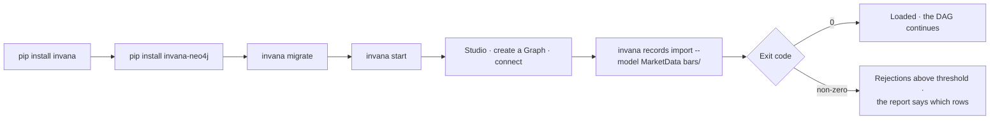

# Command line

`invana` — install, run, migrate, import. Anything scripted happens here; anything read happens in
Studio.

| | |
|---|---|
| Index | [13.3](../../../README.md#13--platform) |
| Module | [Platform](../spec.md) |
| API / CLI / Studio | — / ✅ / — |
| Related | [load-data](../../bring-data-in/features/load-data.md) · [share-a-model](../../connect-and-model/features/share-a-model.md) |

> **As** whoever runs this, **I want** a handful of commands that behave like every other CLI, **so
> that** installing and automating it needs no special knowledge.

## Commands

| Command | Does |
|---|---|
| `invana init` | Bootstraps the root superuser; idempotent, and non-interactive for a container |
| `invana users` | Creates accounts and resets passwords, for an operator with shell access |
| `invana start` | Runs the engine, and Studio when bundled |
| `invana migrate` | Applies database migrations; nothing migrates itself on boot |
| `invana version` | The engine version and every installed connector |
| `invana records import` | Loads a folder of records into a model |
| `invana datasets list · show · import · versions · diff · history · share · retract · refresh · bind` | The install's datasets: import a CSV or JSON file as the next version, read versions and change logs, share, retract (Admin), set or fire a refresh, bind a version into a Graph's model — [2.4](../../bring-data-in/features/datasets.md) · [2.5](../../bring-data-in/features/retract-and-refresh.md) · [2.6](../../bring-data-in/features/bind-a-dataset.md) |
| `invana standards list · show · apply · attach · detach · check` | The install's standards: apply a standard file as its next version, attach one to a dataset with a mode (`block · warn · report`), score a dataset version against it — [2.7](../../bring-data-in/features/standards.md) |
| `invana rules list · show · apply` | The install's rules, or a Graph's with `--graph`: list, show every version, apply a rule file (a check and a mode included) — [6.4](../../skills/features/rules.md) |
| `invana members list · add · set-roles · remove` | A Graph's members and their Graph roles (`--role`, repeatable); the last owner cannot be removed or demoted — [11.4](../../identity-and-access/features/membership.md) · [11.6](../../identity-and-access/features/roles.md) |
| `invana projects list · create · show` · `invana branches list · fork · decide · merge` · `invana findings add · review` · `invana proposals list · accept · reject` | A project of a type (`--private` for only its people), its branches, evidence with a stance, and decisions the rules check — superseded, never edited — [9.5](../../work/features/branches-and-decisions.md) · [9.7](../../work/features/private-projects.md) |
| `invana reports generate · publish · export` | A project's report drawn from its records, published as frozen versions, exported as Markdown — [9.6](../../work/features/project-reports.md) |
| `invana schedules list · create --file · show · pause · resume · run-now · delete` | A Graph's schedules, as `--user`: apply a schedule file, read its firings, fire one now — [10.1](../../operate/features/schedules.md) |
| `invana approvals list · approve · decline` | What waits on `--user` to leave Invana, and the decision with a note — [10.8](../../operate/features/approvals.md) |
| `invana notifications list · read` · `invana notifications rules list · apply --file` · `invana notifications channels list · add · remove` | The inbox, the rules that fill it and the channels they send to — [10.7](../../operate/features/notifications.md) |
| `invana search "<text>"` | The ⌘K search from a terminal, as `--user`, over every Graph they are in or one `--graph` — [13.10](search.md) |
| `invana models export · import · upgrade` | Moves a domain model between Graphs |
| `invana models starters` | Lists the shipped starter models |
| `invana loader` | Loads a flat CSV straight through the connector; `--graph` supplies the connection and journals it as a `bulk` run — [2.1](../../bring-data-in/features/load-data.md) |

## Capabilities

| # | Capability | Notes |
|---|---|---|
| C1 | Exit codes a scheduler can branch on | Zero, non-zero, and distinct codes for validation failure |
| C2 | Human output on a tty, machine output otherwise | Detected, and overridable |
| C3 | Core plus connectors | Each database connector is its own package |
| C4 | Cross-platform | The same commands on every OS a contributor uses |
| C5 | Configuration by file and environment | Flags override both, in that order |
| C6 | Migrations are explicit | Boot never migrates |
| C7 | Version reports the whole set | Engine plus each connector, so a bug report is complete |

## Journey

## Seams

| Seam | What the user sees |
|---|---|
| Migrations pending at start | Refuses to start, naming the command to run |
| A connector not installed | The connector list, and the package to install |
| No config found | The defaults it will use, and where to put a file |
| Version mismatch between engine and connector | Named at start, not at first query |

## Decisions

| # | Decision |
|---|---|
| CL1 | Nothing migrates on boot. |
| CL2 | The CLI is the entry point for anything scripted. |
| CL3 | Connectors are separate packages; the core depends on no driver. |
| CL4 | Exit codes distinguish failure kinds. |
| CL5 | The same commands work on every supported OS. |

## Not building

| Not building | Because |
|---|---|
| A deployment orchestrator | an image and a command; the rest is the operator's platform |
| An interactive shell | the API and Studio cover exploration |
| Writing graph data from the CLI beyond import | writes have contracts |
