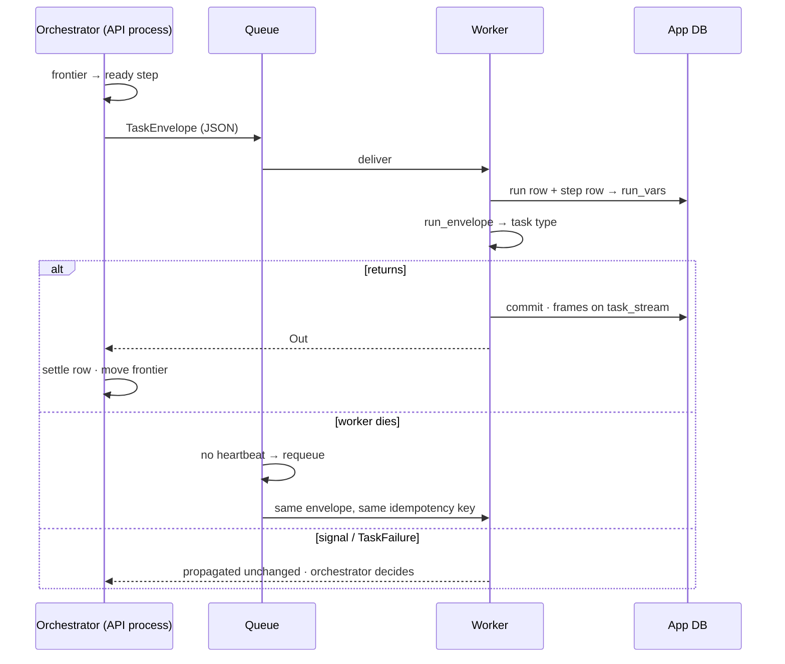

# Distributed execution

Every step leaves the interpreter as a **`TaskEnvelope`** — ids and args, all JSON — and is called by
one function, **`worker.run_envelope()`**, which rebuilds the step's context from those ids. The
`inline` executor calls it in-process today; a distributed executor calls it in a worker. This slice
built the envelope and the call, then benchmarked three queues under the same workload and chose one.

| | |
|---|---|
| Index | [13.11](../../../README.md#13--platform) · Slice **B14** |
| Module | [Platform](../spec.md) |
| API / CLI / Studio | — / — / — — engine only; workers run tool steps from [13.12](tool-plugins.md) |
| Related | [the runtime](runtime.md) §2 · [plugins](plugins.md) · [products › plugins §5–§8](../../../../products/plugins.md#7-ready-for-n-workers) · [workers](../../agents/features/workers.md) 5.15 · the executor for workers on other machines, open: [workers-and-orchestration](../../../building-engine/workers-and-orchestration.md) |

> **As** an operator whose fan-outs outgrow one process, **I want** to start more workers and have
> every step run on whichever is free, **so that** a 200-lane plan finishes in a ninth of the time on
> nine workers, and a worker that dies mid-step costs a retry, not the run.

## Capabilities

| # | Capability | Detail |
|---|---|---|
| C1 | A step as JSON | `TaskEnvelope`: `run_id · node_id · attempt · plugin@version · key@version · args · graph_id · lens_id · actor_id`; `to_json` / `from_json` |
| C2 | One call everywhere | `run_envelope(envelope, contexts=…)` resolves the task type, opens the context, stamps the idempotency key, applies `timeout_s`, maps `HTTPException` to a diagnosis |
| C3 | Context rebuilt from ids | `RebuiltContexts` opens a session, reads the run and step rows, and rebuilds `RunVars` through `TaskRuntime.run_vars` — the same method the pass uses |
| C4 | Idempotency key per attempt | `run_id:node_id:attempt` — equal on a redelivery, new on a retry the orchestrator decides; on `ctx.idempotency_key` |
| C5 | Refuses what it does not carry | A `key@version` this process has not loaded is a `defect` failure, before any context opens |
| C6 | The executor choice | **procrastinate** on the engine's Postgres — measured below |

## Journey

## Seams

| Seam | What happens |
|---|---|
| Step state on `RunVars` | Does not cross a process. `v.query`, `v.result`, `v.intent` set by one step are gone for the next step on another worker; only outputs and `${steps.x.y}` bindings travel. The NL chain (understand → translate → validate → execute → shape) stays inline until its steps hand over through outputs |
| Frames from a worker | Land in `task_stream` (the emitter writes by run id), but the live broadcaster is per process — an SSE subscriber on the API process sees them only when the stream reader polls the table |
| A redelivered write | Same idempotency key; the worker returns the outcome already recorded for it rather than running the task type again ([13.12](tool-plugins.md) TP6) |
| A task type that overruns | Its manifest's `timeout_s` ends it as a `transient` failure, cause `task_timeout`, inline and in a worker alike |
| A worker on an older engine | `key@version` it does not carry → `defect · unknown_task_type`; it never runs a neighbouring version |
| The worker's transaction | `RebuiltContexts` commits when the task type returns and rolls back when it raises — the worker owns it, as a request does |

## The benchmark

`engine/benchmarks/executors/` — `uv run --with … python benchmarks/executors/bench.py <executor>`;
results in `results/<executor>.json`. Every executor runs the same envelopes through the same
`run_envelope`; nothing is added to the engine's dependencies.

| Setting | Value |
|---|---|
| Machine | one laptop, 18 cores, macOS; Postgres 18 and Redis 7 in Docker on the same host |
| Workers | 1, 3, 9 processes, each its own process group, one task at a time (concurrency 1) |
| `bench.graph_query` | stands in for an `execute_graph_query` lane: 50 ms I/O wait + a 2 000-row JSON encode. **No graph database touched** |
| `bench.llm_step` | stands in for an LLM call: 1 s I/O wait. **No model called, no tokens spent** |
| Fan-out | 200 `graph_query` lanes + 20 `llm_step`, sent at once; ideal = 30 s of work ÷ workers |
| Throughput | 1 000 no-op envelopes sent at once (batched where the executor batches) → tasks per second to drain |
| Dispatch latency | 30 envelopes one at a time to idle workers → send-to-start, p50 / p95 |
| Kill | the fan-out on 3 workers; one worker SIGKILLed after 80 envelopes finished |
| Recovery tuning | procrastinate: heartbeat 2 s, a reaper requeues jobs whose worker is silent 10 s · Dramatiq: `heartbeat_timeout` 10 s, `maintenance_chance` 100 000 (defaults 60 s and 1 000) · Prefect: no setting exists |
| Ledger | each finished envelope writes one row keyed by its idempotency key; a second write of a key is a duplicate execution |

### Results

| | procrastinate 3.10 | Dramatiq 2.2 (Redis) | Prefect 3.8 |
|---|---|---|---|
| Throughput, tasks/s — 1 · 3 · 9 workers | 409 · 716 · 1 309 | 218 · 499 · 963 | 2.5 · 1.8 · 1.8 — bound by sending |
| Fan-out makespan, s — 1 · 3 · 9 (ideal 30 · 10 · 3.3) | 31.3 · 10.9 · 4.3 | 30.8 · 10.6 · 4.2 | 41.6 · 76.7 · 77.6 |
| Fan-out efficiency — 1 · 3 · 9 | 0.96 · 0.92 · 0.77 | 0.97 · 0.94 · 0.79 | 0.72 · 0.13 · 0.04 |
| Dispatch latency p95, ms — 1 · 3 · 9 | 7.2 · 7.5 · 10.0 | 16.8 · 10.3 · 17.4 | 50.3 · 48.5 · 50.4 |
| Worker killed mid-run: lost · duplicates | 0 · 0 | 0 · 0 | **2** · 0 |
| Kill → last envelope done | 13.4 s (reaper at 10 s) | 13.3 s (tuned); defaults not run — the 60 s heartbeat is its floor | never — 2 envelopes still unfinished 900 s after the kill |
| Idle worker memory | 185 MB | 233 MB | 222 MB |
| Send 1 000 envelopes | 0.08 s (one batched insert) | 0.29 s | 398–544 s — one API call per `.delay()`, 0.4–0.5 s each |
| Services it adds | **none** — the app's Postgres | Redis (or RabbitMQ) | a Prefect server and its database |
| Recovery comes from | a reaper the engine runs (≈ 10 lines) | the broker, once tuned | nothing — a dead task worker's task runs stay running |

Efficiency at 9 workers is bounded by the workload, not the queue: 20 one-second LLM steps over 9
workers take at least three rounds. procrastinate and Dramatiq land within 0.02 of each other at every
worker count.

Prefect's server ran on its default SQLite. A Postgres-backed server would send faster, but every
`.delay()` stays an HTTP round trip to a second service, against one batched insert for
procrastinate — and losing a dead worker's envelopes does not depend on the database.

## Decisions

| # | Decision |
|---|---|
| DE1 | **procrastinate is the distributed executor.** It matches or beats Dramatiq on throughput, fan-out and latency, recovers a killed worker as fast, and adds no service: jobs live in the Postgres every install already runs, so `pip install invana` plus `invana worker` is the whole deployment. Dramatiq needs Redis for the same result; Prefect needs a second server and database — and on this workload it is send-bound at about two envelopes a second, so more workers made a fan-out slower, and it lost the envelopes of the worker that died |
| DE2 | **A step travels as `TaskEnvelope`; nothing live crosses.** The worker rebuilds the context from ids with the same `TaskRuntime.run_vars` the pass uses, so a step sees one world wherever it runs. |
| DE3 | **`run_envelope` is the only place a task type is called.** The `inline` executor and every worker go through it; inline resolves through `TASKS` (the seam tests substitute a step on), a worker through the frozen registry by `key@version`. |
| DE4 | **The idempotency key is `run_id:node_id:attempt`.** Redelivery keeps it, a retry the orchestrator decides changes it — so "skip if written" is right for the first and wrong for neither. |
| DE5 | **A declared `timeout_s` is applied** — by `run_envelope`, inline and in a worker — as a `transient` failure with cause `task_timeout`. `retries` stays declared: retry *policy* is the orchestrator's, redelivery is the queue's. |
| DE6 | **The engine runs the reaper.** procrastinate does not requeue a dead worker's jobs by itself; the orchestrator retries jobs whose worker has been silent 10 s, with workers heartbeating every 2 s. |
| DE7 | **Signals and failures cross unchanged.** `NeedsInput`, `CannotAnswer`, `Converse` and `TaskFailure` propagate out of `run_envelope`; the orchestrator decides what they mean. Their wire form is B06b's, with the first step that runs remotely. |
| DE8 | **Only steps that hand over through outputs run remotely.** A step that reads state an earlier step left on `RunVars` stays inline until that state is an output. |
| DE9 | **Workers reach procrastinate only through the engine's worker gateway.** A worker on any machine — Python, Docker or a Kubernetes Deployment — long-polls `POST /api/v1/workers/lease` over HTTPS with its pool credential; the engine takes the next job for that pool's queues from procrastinate, takes heartbeats and outcomes back, and runs the reaper. No worker holds a database credential, so scaling out is starting more workers against one engine URL. Hatchet, Temporal and DBOS are compared in [workers-and-orchestration](../../../building-engine/workers-and-orchestration.md). |
| DE10 | **B2–B5 of the executor benchmark are the gateway's acceptance tests.** Dial-out with no database route, the 700-agent run, a killed worker and a killed orchestrator are measured as part of F06; a failure that the gateway cannot close reopens the executor choice. Orchestrator take-over after a crash is scale-out work (a leased orchestrator), not F06's. |

## Engine

| Path | Holds |
|---|---|
| `plugins/envelope.py` | `TaskEnvelope` · `out_to_json` · `out_from_json` |
| `plugins/worker.py` | `run_envelope()` · the `Contexts` protocol |
| `runtime/executor.py` | `envelope_for(row, v)` · `InlineContexts` · `RebuiltContexts` · `_dispatch` (inline, through `run_envelope`) |
| `runtime/interpreter/loop.py` | `TaskRuntime.run_vars(db, th)` — the run's vars from its row, used by the pass and by `RebuiltContexts` |
| `plugins/sdk/context.py` | `TaskContext.idempotency_key` |
| `benchmarks/executors/` | the harness: `workload.py` and one adapter per executor |

| `TaskEnvelope` field | Type | Notes |
|---|---|---|
| `run_id` | str | the run (`parent_run_id` of the step row) |
| `node_id` | str | the step row |
| `attempt` | int | the row's attempt |
| `plugin` | str | `name@version` |
| `task` | str | `key@version`, or a bare key |
| `args` | dict | resolved, JSON only |
| `graph_id` · `lens_id` · `actor_id` | str, optional | what the worker rebuilds from |

## Not building

| Not building | Because |
|---|---|
| A worker process, `invana worker`, procrastinate as the `workers` extra, the wire forms | built in [13.12 Tool plugins](tool-plugins.md) — tool steps are the first to run in workers |
| Moving the NL chain to workers | its steps hand over through `RunVars`; DE8 |
| Routing envelopes to resource pools (GPU, `sim.*`) | later — one pool until a plugin declares `gpu` |
| Celery, RQ, Temporal, Arq | not in the shortlist the product doc set |
