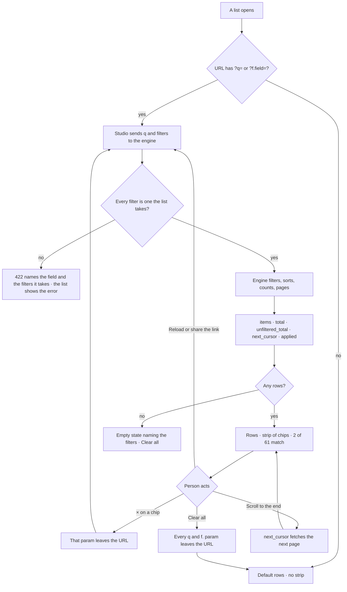

# One list contract

Every list in the product is searched, filtered, sorted and paged the same way, by the engine, and
answers with the filters it used. Studio carries the filters in the URL and shows them as chips above
the rows, so a list opened by a link, by ⌘K or by the assistant reads the same as one filtered by hand.

| | |
|---|---|
| Index | [13.15](../../../README.md#13--platform) · Slice **F01** |
| Module | [Platform](../spec.md) §5 |
| API / CLI / Studio | ✅ / — / ✅ — the Agents lists |
| Product | [agent-fabric.md › Lists, filters and the assistant](../../../../products/agent-fabric.md#lists-filters-and-the-assistant) — AF-F17 · AF-26 |
| Related | [metrics-are-stored](metrics-are-stored.md) · [design-system](design-system.md) · [see-what-ran](../../operate/features/see-what-ran.md) |

> **As** anyone reading a list, **I want** the list to say which filters it is showing and to be
> filtered by the engine, **so that** I trust what it leaves out — and a link, a reload or the
> assistant opens the same rows.

## Capabilities

| # | Capability | Notes |
|---|---|---|
| LC1 | Search | `q` — case-insensitive contains over the list's named text fields |
| LC2 | Named filters | One query parameter per field, repeatable (`status=failed&status=stopped`); values of one field OR, fields AND |
| LC3 | Sort | `sort=<field>` or `sort=-<field>` over the list's sortable fields; every list has a default |
| LC4 | Keyset paging | `cursor` + `limit`; the cursor is opaque and stable under writes |
| LC5 | A real total | `total` counts every matching row; `unfiltered_total` counts the list with no `q` and no filters |
| LC6 | Applied filters echoed | `applied` lists each filter the engine used, with the value's human label |
| LC7 | Filters in the URL | Studio reads and writes `?q=` and `?f.<field>=`; a reload or a shared link shows the same rows and chips |
| LC8 | The applied-filters strip | One chip per filter with ×, *Clear all*, and *set by the assistant* when the assistant set them |

## Journey

## Seams

| Seam | What the user sees |
|---|---|
| While the rows load | The strip already shows the URL's chips; the table shows its loading state |
| A filter value that names nothing (a deleted agent) | The engine echoes it with the raw value as its label; zero rows; the chip can be removed |
| An unknown filter in a hand-typed URL | The engine refuses with 422 naming the field and the list's filters; the list shows that message |
| A write while paging | Keyset paging never repeats or skips a row that was already there |
| A member without access to the Graph | The list is absent (404), as every Graph-scoped read |
| The assistant set the filters | The strip says *set by the assistant* until a person changes a filter |

## Surfaces

| Surface | Shape |
|---|---|
| Every list endpoint | `?q=` · `?<field>=` (repeatable) · `?sort=` · `?cursor=` · `?limit=` (default 50, at most 200) → `Page[T]` |
| `Page[T]` | `items: T[]` · `total: int` · `unfiltered_total: int` · `next_cursor: str \| null` · `applied: AppliedFilter[]` |
| `AppliedFilter` | `field` · `value` · `label` — `q` is echoed as field `q` |
| Studio URL | `?q=` · `?f.<field>=` (repeatable) · `?via=assistant` |
| `@invana/ui` `AppliedFilters` | Chips (`field`, value label, ×), *Clear all*, an optional *set by* note — a story in design-kit |
| `@invana-studio/core` `useListParams` | Reads and writes the URL's `q` and `f.` params; turns them into the request |

### The Agents lists

| List | Route | Search (`q`) | Filters | Sort (default first) |
|---|---|---|---|---|
| Agents | `GET …/agents` | name | `status` (none leaves out retired) · `kind` · `ephemeral=shown` (else spawned helpers are left out) | `name` · `-created_at` · `-updated_at` |
| Skills | `GET …/skills` | name | `status` (published · draft) · `origin` | `name` · `-updated_at` · `-created_at` |
| Task plans | `GET …/task-plans` | name · key | `origin` · `family` | `key` · `name` · `-created_at` |
| Runs | `GET …/runs` | the ask | `status` · `agent_id` (labelled with the agent's name) · `task_id` · `kind` · `origin` (who triggered it) · `started_by` (labelled with the username) · `since` (`24h` · `7d` · `30d` · `90d`) · `candidates=true` (served, never promoted) · `interactive=true` (canvas and system runs shown) | `-created_at` |
| LLM providers | `GET …/llm` | name | `kind` | `created_at` · `name` · `-updated_at` |
| LLM models | `GET …/llm/{provider_id}/models` | model id | `status` | `created_at` · `model_id` · `-updated_at` |
| Plugins | `GET /api/v1/plugins` | name · title | `kind` · `enabled` (`true` · `false`) | `name` |
| Catalogue | `GET …/catalogue` | step key · summary | `bound` · `plugin` | `bound` (declared order, then key) · `key` |
| Approvals | `GET …/approvals` | title | `status` · `kind` (the subject's kind) · `mine=true` (waiting on the reader) | `-created_at` |
| Schedules | `GET …/schedules` → `SchedulePage` with `paused` | name | `enabled` (`true` · `false`) | `name` |
| Members | `GET …/members` | username · email | `role` (the stored role, not the ones `owner` implies) | `username` |

## Engine

| Piece | Where | Does |
|---|---|---|
| `ListParams` | `core/lists/params.py` | `q` · `filters: dict[str, list[str]]` · `sort` · `cursor` · `limit`; built by `list_params(spec)`, the one FastAPI dependency every list view takes |
| `ListSpec` | `core/lists/params.py` | A list's search fields, filters (column or predicate, and a labeller), sorts and default sort; validates a request against itself |
| `Page[T]` · `AppliedFilter` | `core/lists/schemas.py` | The response shape |
| `page_of_select()` | `core/lists/querysets/page.py` | Applies `q`, filters, keyset sort and limit to a `select()`; counts `total` and `unfiltered_total` |
| `page_of_rows()` | `core/lists/rows.py` | The same contract over rows already in memory — plugins and the catalogue come from the frozen registry, not a table |

## Decisions

| # | Decision |
|---|---|
| LC1 | **One helper, every list.** A list endpoint takes `ListParams` from `list_params(spec)` and answers `Page[T]`. No list grows its own query parameters for search, filtering, sorting or paging. |
| LC2 | **The API uses plain field names; Studio's URL prefixes them.** The engine reads `?status=`; Studio's address bar carries `?f.status=`, so a list's own page parameters (`?tab=`) never collide with a filter. `q` is the same word in both. |
| LC3 | **Filters are declared, not inferred.** A list names the filters it takes; anything else is a 422 that names the field and lists the filters it takes. A value outside a filter's enum is a 422 naming the allowed values. |
| LC4 | **Values of one field OR; fields AND.** `status=failed&status=stopped&agent_id=a1` is *(failed or stopped) and agent a1*. |
| LC5 | **The cursor is keyset, opaque, and bound to its sort.** It encodes the last row's sort value and id; a cursor sent with a different sort is a 422. A list read from memory pages the same way over the same key. |
| LC6 | **`total` is a count of the matches; `unfiltered_total` of the list.** Both are SQL counts, never `len(items)` — the board's *2 of 61 match* is these two numbers. With nothing applied they are equal. |
| LC7 | **`applied` carries the label.** The engine resolves a value to the words a person reads — an agent id to its name, `not_served` to *not served* — so Studio and the assistant show one chip. An id that resolves to nothing is labelled with itself. |
| LC8 | **Summary fields a list already serves stay beside the page.** The agents list's `persistent` · `ephemeral` · `default_agent_id` · `tokens_this_month` are fields of `AgentPage`, a subclass of `Page[AgentRead]`, counted over the whole Graph — not over the filtered rows. |
| LC9 | **Limit 50 by default, 200 at most.** A Studio list that shows everything a Graph has today asks for 200 and loads the next page on scroll. |
| LC10 | **Studio never narrows rows.** Search boxes, segmented controls and selects write the URL; the query hook sends it; no `.filter()` over a list's rows decides what is shown. A segmented control (*All · Live · Drafts*) is a preset of a filter and shows as its chip. |
| LC11 | **The strip shows what the URL holds.** Chips come from the response's `applied` once it arrives and from the URL while it loads, so a reload never flashes an unfiltered list. |
| LC12 | **`?via=assistant` marks the assistant's filters.** A link the assistant writes carries it; the strip says *set by the assistant* until a person adds or removes a filter, which drops it. |
| LC13 | **Fleet and Performance read stored numbers.** Every figure on the Fleet overview and the Performance tabs is served by the engine, from stored columns ([metrics-are-stored](metrics-are-stored.md)); Studio formats. |
| LC14 | **One URL holds one list's filters.** The list a page is about owns `?q=` and `?f.`; a second list on the same page (the Catalogue under Plugins, Templates under Library) keeps its search in the component and still sends it to the engine, so the engine still decides what it leaves out. |
| LC15 | **A list's default view is what `unfiltered_total` counts.** Runs count root runs without canvas and system runs; Agents count those not retired and not spawned helpers — what the list shows with nothing applied. |
| LC16 | **Runs and approvals are newest first.** Pending approvals are already their own filter (`status=pending`), so the list has no separate pending-first order. |

## Not building

| Not building | Because |
|---|---|
| Offset paging (`page=3`) | Unstable under writes; §5 of the platform spec |
| A query language in `q` (`status:failed name:x`) | Filters are named parameters; `q` is plain text |
| Saved filter sets | A filtered URL is the saved view — bookmark or share it |
| Client-side filtering as a fast path | LC10 — one place decides what a list leaves out |
| Facet counts per filter value | Not drawn on any board; a later list may add them to its own page |
| The assistant opening a list with filters | The assistant's function lands with Runs and the assistant (F05); this feature gives it the contract and the `?via=assistant` mark |
