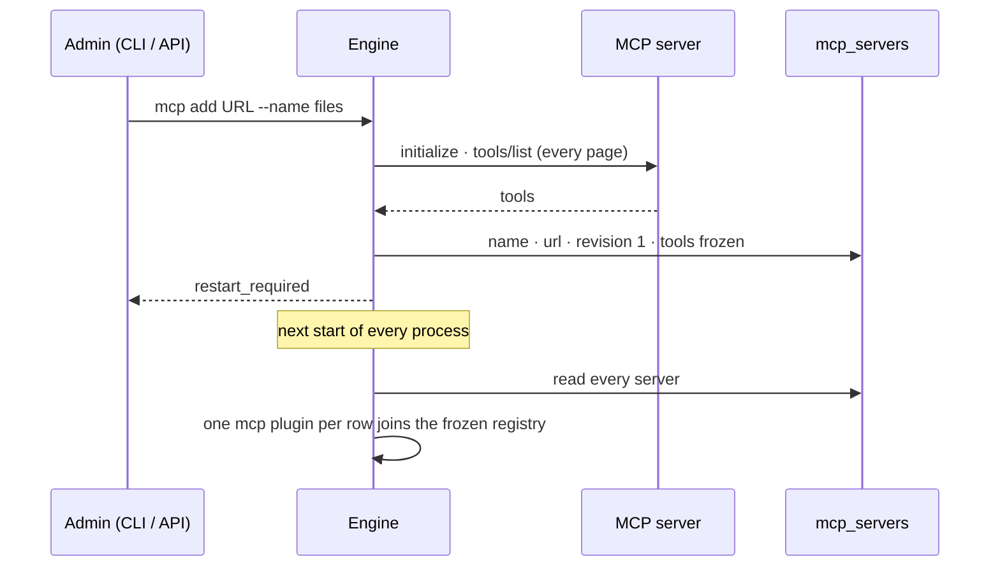

# MCP plugins

An install Admin connects an MCP server; its tools become task types in a plugin of kind `mcp`, one
plugin per server. The tool list is **frozen when the server is added** — what the server offers
later reaches no plan until an Admin refreshes it — and the plugin is switched on and off like a
[tool plugin](tool-plugins.md), and runs where tool steps run.

| | |
|---|---|
| Index | [13.13](../../../README.md#13--platform) · Slice **B07** |
| Module | [Platform](../spec.md) |
| API / CLI / Studio | ✅ / ✅ / 🔵 — the Agents › Plugins surface is C03 |
| Related | [tool plugins](tool-plugins.md) · [plugins](plugins.md) · [approvals](../../operate/features/approvals.md) · [products › plugins §2, §9](../../../../products/plugins.md#2-code-layout) · [products › agents AG-13](../../../../products/agents.md) |

> **As** an install Admin, **I want** to connect an MCP server and see its tools as task types with
> their manifests and versions, **so that** agents can call them once I enable it — and only the
> tools I saw, not whatever the server starts offering later.

## Capabilities

| # | Capability | Notes |
|---|---|---|
| C1 | Add a server | `invana plugins mcp add <url> --name <name>` · `POST /api/v1/plugins/mcp` — connects over Streamable HTTP, lists the tools, freezes them into `mcp_servers` |
| C2 | One plugin per server | `invana.mcp.<name>`, `kind = "mcp"`, version `<revision>.0.0`; each tool is the task type `mcp.<name>.<tool>`, bound `network` |
| C3 | Frozen tool list | The tools, their input schemas and annotations as they were when added; a later change on the server reaches no plan until refreshed |
| C4 | Refresh | `invana plugins mcp refresh <name>` · `POST /api/v1/plugins/mcp/{name}/refresh` — a new revision; only a changed tool's version moves |
| C5 | Loaded at start | Every process — API, CLI, `invana worker` — adds the stored MCP plugins to its registry when it starts; an add or refresh says `restart_required` |
| C6 | Enable · disable | The same switch as a tool plugin — `invana plugins enable invana.mcp.<name>`; disabled is the default |
| C7 | Call a tool | One step is one `tools/call`; its outputs are `text`, `content` and `structured` |
| C8 | Approval for anything not read-only | A tool the server marks `readOnlyHint: true` is `side_effect = "read"`; every other tool is `send` and waits on an approval |
| C9 | A bearer token, in the worker | The plugin declares one secret, `mcp_<name>`; when `INVANA_SECRET_MCP_<NAME>` is set it is sent as `Authorization: Bearer …` |
| C10 | Optional extra | `invana[mcp]` installs the MCP SDK; without it no server is added and none loads |

## Journey

```mermaid
flowchart TD
    A[Admin: invana plugins mcp add URL --name files] --> B{install Admin?}
    B -->|no| B1[403 · only an install Admin adds an MCP server]
    B -->|yes| C{mcp extra installed?}
    C -->|no| C1[409 · pip install 'invana-engine[mcp]']
    C -->|yes| D{name free and well-formed?}
    D -->|no| D1[409 taken · 422 not a name]
    D -->|yes| E[initialize + tools/list over Streamable HTTP]
    E -->|unreachable · 401 · not MCP| E1[422 · names the URL and what failed · nothing stored]
    E -->|tools| F[Freeze: mcp_servers row · revision 1 · skipped names listed]
    F --> G[restart_required · listed installed = false until each process restarts]
    G --> H[Restart API and workers · plugin invana.mcp.files loads]
    H --> I[Admin enables it]
    I --> J[Agent's envelope allows mcp.files.read_file · plan names it]
    J --> K{readOnlyHint true?}
    K -->|no| K1[send · approval in the inbox · declined → not sent]
    K -->|yes| L[dispatched like a tool step · inline or the tools queue]
    K1 -->|approved| L
    L --> M[tools/call]
    M -->|isError| M1[blocked · mcp_tool_error · the server's text]
    M -->|unreachable| M2[transient · mcp_unreachable]
    M -->|result| N[Out: text · content · structured]
```



## Seams

| Seam | What happens |
|---|---|
| Added, not yet restarted | Listed `installed: false`, `restart_required: true`; its task types are not in this process's registry, so a plan naming one is refused by the validator. Enabling it is allowed — it is a gate and takes effect once loaded |
| Refreshed, not yet restarted | The process keeps serving the revision it loaded; the listing shows that version and `restart_required: true` |
| API and worker on different revisions | A worker that has not restarted does not carry the new `key@version` and fails the step `defect · unknown_task_type` — restart workers with the API |
| The server changed its tools | Nothing changes until an Admin refreshes. A tool it dropped fails at call time with the server's error (`blocked · mcp_tool_error`) |
| Server down at call time | `transient · mcp_unreachable`, naming the URL |
| Server wants a token | Without `INVANA_SECRET_MCP_<NAME>` the call is unauthorised: `blocked · mcp_unauthorized`, naming the variable — set it on the API (for add and refresh) and on every worker |
| A tool name Invana cannot key | A name outside `[A-Za-z0-9_-]{1,64}` is skipped at freeze and listed in `skipped`; the rest are added |
| A server with no tools | Added; the plugin has no task types |
| The extra is missing at start | Stored servers do not load; they are listed `installed: false` with the extra `mcp` |
| Disabled | `blocked · plugin_disabled`, naming the CLI to enable it — the same gate as a tool plugin |
| A tool that is not read-only | Waits on an approval like `mail.send`; a declined call fails as not sent |

## Engine

| Path | Holds |
|---|---|
| `plugins/mcp/client.py` | `list_tools(url, token)` and `call_tool(url, token, name, args)` over the SDK's Streamable HTTP client; the failure mapping |
| `plugins/mcp/plugin.py` | `freeze(tools, previous)` — the frozen list with per-tool versions; `to_plugin(server)` — one `LoadedPlugin` from a stored server |
| `plugins/__init__.py` | `install_mcp(plugins)` — appends the MCP plugins to the frozen registry, once at start-up |
| `runtime/catalogue/__init__.py` | `sync()` — re-derives `CATALOGUE` and `TASKS` from the registry after `install_mcp` |
| `runtime/managers/mcp.py` | `McpManager` — `add`, `refresh`, `get`, `load` (what start-up calls) |
| `runtime/managers/plugins.py` | `SWITCHABLE = {tool, mcp}`; stored-but-unloaded servers in the listing |
| `runtime/executor.py` | an `mcp` step is gated and routed like a tool step |
| `server/app.py` · `cli/context.py` | `McpManager().load(session)` at start-up, before the runtime is built |
| `server/plugins/` | `POST /plugins/mcp` · `POST /plugins/mcp/{name}/refresh`; the `mcp_servers` admin view |
| `cli/commands/plugins.py` | `invana plugins mcp add · refresh` |

| `mcp_servers` column | Type | Notes |
|---|---|---|
| `name` | String(32), PK | `[a-z][a-z0-9_]{0,31}` — the plugin is `invana.mcp.<name>` |
| `url` | String(2048) | the Streamable HTTP endpoint |
| `revision` | int | 1 on add, +1 on each refresh; the plugin version is `<revision>.0.0` |
| `tools` | JSON | `[{name, version, title, description, input_schema, annotations}]` as frozen |
| `skipped` | JSON | tool names that could not be keyed |
| `server` | JSON | `{name, version, protocol}` from `initialize` |
| `frozen_at` | timestamptz | when the tool list was last read |
| `added_by_id` | String(36), nullable | the Admin who added or last refreshed it |

| Endpoint | Who | Returns |
|---|---|---|
| `POST /api/v1/plugins/mcp` `{name, url}` | install Admin | 201 `McpServerRead`; 403 not an Admin · 409 name taken or extra missing · 422 bad name or server unreachable |
| `POST /api/v1/plugins/mcp/{name}/refresh` | install Admin | `McpServerRead`; 404 unknown · 422 unreachable |
| `GET /api/v1/plugins` · `/plugins/{name}` | any signed-in user | as [13.12](tool-plugins.md), MCP plugins included; `restart_required` on each row |

| `McpServerRead` field | Type | Notes |
|---|---|---|
| `name` · `plugin` · `url` | str | `plugin` is `invana.mcp.<name>` |
| `revision` | int | the stored revision |
| `loaded_revision` | int, nullable | what this process loaded; null when not loaded |
| `restart_required` | bool | `loaded_revision != revision` |
| `tools` | `[{key, version, side_effect, summary}]` | as frozen |
| `skipped` | list[str] | |
| `server` | obj | `{name, version, protocol}` |
| `frozen_at` | datetime | |

| Task manifest field | From the tool |
|---|---|
| `key` | `mcp.<server>.<tool name>` |
| `summary` | its `title` or first line of `description` |
| `args` | each top-level `inputSchema` property — `string · integer · number · boolean · array · object` → `str · int · float · bool · list · obj`, a nullable union by its other type, anything else `obj`; `required` and `default` as declared |
| `outputs` | always `text: str` · `content: list` · `structured: obj` |
| `side_effect` | `read` when `annotations.readOnlyHint` is true, else `send` |
| `bound` · `timeout_s` · `retries` · `resources` | `network` · 60 · 0 · `cpu` |

## Decisions

| # | Decision |
|---|---|
| MC1 | **One MCP server is one plugin.** `invana.mcp.<name>` of kind `mcp`, its tools the task types `mcp.<name>.<tool>`. The `plugins/mcp/` package is the code that makes them, not a plugin itself. |
| MC2 | **The tool list is frozen when the server is added**, and only an Admin's refresh reads it again. A plan names what an Admin saw; a server cannot widen what agents may run by changing its list. `notifications/tools/list_changed` is ignored. |
| MC3 | **A refresh is a new revision; a tool's version moves only when its declaration does.** The plugin is `<revision>.0.0`; a new tool is `1.0.0`, a changed input schema, description or annotations bumps the tool's major, an unchanged tool keeps its version, a dropped tool leaves the registry. |
| MC4 | **MCP plugins join the registry at start-up, read from `mcp_servers`.** The registry stays frozen per process; an add or refresh takes effect when each process restarts, so the API and every worker serve the same revision. Enabling stays a gate (13.12 TP1) and needs no restart. |
| MC5 | **MCP plugins switch like tool plugins** — off until an install Admin enables them, the same `plugin_states` row and the same refusal at dispatch. |
| MC6 | **MCP steps run where tool steps run** — on the `tools` queue under `procrastinate`, in-process under `inline`. A call's effects are the server's, so it is treated as third-party work. |
| MC7 | **Only a tool the server marks read-only skips approval.** `readOnlyHint: true` is `read`; a missing or false hint is `send`, held on an approval (13.12 TP9). The hint is the server's word, which the Admin accepted by adding it. |
| MC8 | **Every MCP task type has the same three outputs** — `text`, `content`, `structured` — because a tool's output schema is optional and its content is a list of blocks. |
| MC9 | **One optional bearer token per server**, the secret `mcp_<name>`, read where the call is made: the API process for add and refresh, the worker for a step. No OAuth flow this slice. |
| MC10 | **Streamable HTTP through the official SDK, as the `mcp` extra.** The SDK owns the protocol; stdio is not offered because it would start third-party processes on the engine's machine. |
| MC11 | **An add that cannot list the tools stores nothing.** Unreachable, unauthorised or not an MCP server is a 422 naming the URL; there is no half-added server to clean up. |
| MC12 | **No retries, a 60 s limit.** Most tools are `send`, and a blind retry of a send is a second send. |

## Not building

| Not building | Because |
|---|---|
| stdio servers | MC10 — no third-party processes on the engine's machine |
| OAuth for MCP servers | a bearer token covers self-hosted servers; OAuth is its own feature |
| Resources, prompts, sampling, elicitation | task types are tools; the rest has no place in a plan |
| Loading an add or refresh without a restart | MC4 — the registry is frozen per process |
| Following `tools/list_changed` | MC2 |
| An Admin marking a tool read-only | MC7 — the server's hint decides; disable the plugin to stop it |
| Removing a server | disabling it stops every call; a removal would orphan the versions old runs recorded |
| Keeping superseded revisions callable | a refresh replaces the revision; a re-run on an old tool version is refused as unknown |
| The Agents › Plugins screen | C03 |
