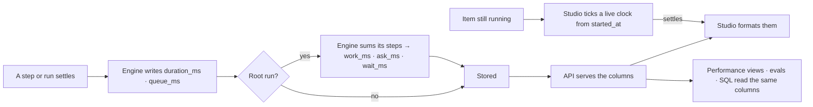

# Metrics are stored, not derived

Every number Studio shows is the engine's: computed once, from stored columns, and served by the API.
Studio formats it. The performance views, the evals and the reply's meta line read the same column,
so one fact never shows as two numbers.

| | |
|---|---|
| Index | [13.14](../../../README.md#13--platform) |
| Module | [Platform](../spec.md) |
| API / CLI / Studio | 🟡 / — / 🟡 — Phase 1 shipped |
| Related | [telemetry](telemetry.md) · [runtime](runtime.md) · [the answer surface](../../ask/features/the-answer-surface.md) · [fleet performance](../../agents/features/fleet-performance.md) |

> **As** an operator assessing how well Invana answers, **I want** every duration, total and rate
> stored by the engine, **so that** I can measure turnaround and query performance from the backend,
> and what Studio shows is the same number I measure.

## Capabilities

| # | Capability | Notes |
|---|---|---|
| MS1 | Every run row stores its own timing when it settles | `duration_ms` · `queue_ms` on every `task_runs` row |
| MS2 | A root run stores how its time was spent | `work_ms` · `ask_ms` · `wait_ms` |
| MS3 | The API serves the stored values | step rows, the trace, run lists, the reply, a simulation |
| MS4 | Studio formats, never derives | A live clock on a running item is the one place Studio does time arithmetic |

## Journey

## Seams

| Seam | What the user sees |
|---|---|
| A step still running | A live clock from its stored `started_at`; replaced by `duration_ms` once it settles |
| A run paused on a clarification | No roll-up until it settles; a run whose `finished_at` is cleared to resume loses its roll-up, and the next settle writes it again |
| A run from before the columns existed | The migration backfills it from its timestamps |
| A row that never started (refused at a ceiling) | `duration_ms`, `queue_ms` and the roll-up are empty; its wait is read as queued → finished |
| A settled row with no stored value | Studio shows nothing — never a number it computed |

## Surfaces

| Surface | Field | Meaning |
|---|---|---|
| Stream step payload · `RunNodeRead` · `TraceStep` | `duration_ms` | `started_at → finished_at` of the step |
| `TraceStep` | `offset_ms` | From the run's start to the step's start — the log's offset |
| `TraceStep` | `share_of_run` | The step's `duration_ms` over the run's `duration_ms`, 0–1 |
| `TraceRead` · `TaskRunSummary` | `duration_ms` · `queue_ms` · `work_ms` · `ask_ms` · `wait_ms` | The root's stored timing |
| `SessionMessageRead` · stream `message` | `work_ms` | Its current run's `work_ms` — the reply's meta-line time |
| `SimulationRead` | `duration_ms` | Its run's `duration_ms` |

## Engine

| Column (`task_runs`) | On | Written | Meaning |
|---|---|---|---|
| `duration_ms` | every row | whenever the row is flushed | `started_at → finished_at`; empty while either is |
| `queue_ms` | every row | whenever the row is flushed | `queued_at → started_at` |
| `work_ms` | root | when the run settles | Sum of its nodes' `duration_ms`, except a node paused on a person |
| `ask_ms` | root | when the run settles | Sum, over each paused node, of the gap until the next node started |
| `wait_ms` | root | when the run settles | `duration_ms − work_ms`: time the run was open and no step was working |
| `tokens` | every row | whenever the row is flushed | `tokens_in + tokens_out` of the row itself; empty when it spent none |
| `run_tokens_in` · `run_tokens_out` · `run_tokens` | root | when the run settles | The root's own spend plus its direct nodes' |

## Decisions

| # | Decision |
|---|---|
| MS1 | **A per-row fact is a column, written by one hook.** `duration_ms` and `queue_ms` are set by a mapper hook on `TaskRun` before every insert and update, so every place that sets `finished_at` — settle, cancel, failure, restart, eval — writes them without being told to. A row whose timestamps are reset (a resumed run) has them cleared by the same hook. |
| MS2 | **A roll-up is written once, where the run settles.** `work_ms`, `ask_ms` and `wait_ms` are computed from the run's nodes beside `cost_usd`, in the same function, from the same node list. Every path that finishes a root calls it. |
| MS3 | **Work is what the steps did; a paused step's span is the wait.** A node with status `needs_input` is not work. The gap from a paused node's finish to the next node's start is `ask_ms`. |
| MS4 | **A reply's time is its run's `work_ms`.** It matches the step rows under *How I got this* added up, and excludes time a person spent answering. The query's own time is the Execute row's. |
| MS5 | **A windowed aggregate is computed by the engine from the columns, never stored as a counter.** p95 over 7 days or tokens today is an endpoint's query over `duration_ms` and tokens; a counter can disagree with the rows it counts. |
| MS6 | **A change, a rate or a share is the engine's.** `↑ 38%`, `▲ 1.2 pt`, `61% applied` and `72% of the run` are returned by the endpoint that serves the values they compare, so thresholds and arrows are decided once. |
| MS7 | **A count of a list that may be paged is the API's `total`.** `items.length` is never shown as a count. |
| MS9 | **A token total is stored, never added in Studio.** Every row stores its `tokens`; a root stores `run_tokens_in`, `run_tokens_out` and `run_tokens` when it settles — its own spend plus its direct nodes', the one definition the run list, the trace and the Todos thread share. A run still going is summed by the engine on read, from the same rows, until it settles. |
| MS10 | **Per-run and share figures come with the totals.** A change effect returns `tokens` and `tokens_per_run`; a trace step returns `share_of_run_tokens`; a touch returns `tokens` in its volume; an activity node returns `tokens`. |
| MS11 | **A change has one shape.** Every endpoint that compares a number with its prior returns a `Change`: `by` (a ratio, or points for a rate), `direction` (flat within ±2%, or ±0.1 pt), and `tone` (better, worse, or neutral where up is neither). Studio picks the arrow and the colour from it and does no arithmetic. |
| MS8 | **Not covered:** a count of a small list that is fully on screen (`Bound (3)`, a tab count, a selection), what the canvas draws right now, a live clock on something still running, "3m ago" from a stored timestamp, a meter's fill, and layout (a waterfall bar's width). |

## Phases

The audit found about 90 derived metrics across Studio. Each phase is one change set.

| # | Phase | Engine | Studio | Status |
|---|---|---|---|---|
| 1 | Durations | MS1–MS4 columns, backfill, API fields; plan performance and fleet read the columns | Delete `totalDuration` · `durationMs`; `stepDuration` · `elapsedOf` keep only the live clock; the simulation reads `duration_ms` | ✅ |
| 2 | Totals the API already returns | — | The list `total` on the run journal, sessions, projects, todos, decisions, skills, plans and LLM endpoints | ✅ |
| 3 | Tokens | MS9–MS10: `tokens` on every row, the root's roll-up, backfill; `tokens`/`tokens_per_run` on change effects, touches and activity nodes; a step's share of the run's tokens | Every `tokens_in + tokens_out` reads `tokens`; the step board reads `share_of_run_tokens`; the change history reads `tokens_per_run`; the Todos thread reads the run's stored spend | ✅ |
| 4 | Changes, rates, shares | One `Change` shape (`by` · `unit` ratio or points · `direction` · `tone`) from `core/metrics.py`, on fleet and performance measures, eval draft-vs-live, plan-version p95 with its `prior_version`, model growth; rates and shares (`applied_rate`, `error_rate`, `caller_share`, `per_day`); classifications (`wide` · `rare` · `slow`); the totals and counts those endpoints already held (drift, draft added/changed/removed, compare, lens rules and people, skill offered/applied, `prompt_chars`) | Delete `relChange` · `arrowPct` · the flat threshold · `readsAs` math · `versus` math · `WIDE_SPREAD`/`RARE_BRANCH` · `callerSplit` math · `grewBy` math · the drift and draft counts; `Change` is one type in `@invana-studio/core` | ✅ |
| 5 | Aggregates Studio builds from partial data | Endpoints for the Runs board tiles and the journal's live count · Imports stats · the Validation queue count · Provenance count · the Graph's node total · Modeller records, drift and draft-change counts · Project overview tiles · Impact reach · counts of a subset of a list (todos in review, current decisions, packaged plans, agents without the ephemeral ones) · a run's touches per layer and participant (`counts` is per direction) · a run's step progress on the run read (`steps_done`/`steps_total` are only on the list row) · a running run's token count in the stream (the assistant's live strip sums its steps) · the change history's *A → B* tokens-per-run ratio between two versions · tokens per participant on the run lens · the Modeller's records tiles and per-model record sums (live counts grouped by model) · the models-overview totals (published, drafts, node and edge types) · a frozen run report's *share of what it could touch* | Read them | 🔵 — each endpoint is designed in its own feature file first |

### Phase 1 sites

| Studio | Replaced by |
|---|---|
| `assistant/SessionSteps.tsx` `stepDuration` · `StepTrace` | step `duration_ms` |
| `assistant/SessionSteps.tsx` `totalDuration` · `SessionTurn.tsx` meta line | message `work_ms` |
| `projects/TodosSection.tsx` *Ask for …* | run `work_ms` |
| `shell/activity/runs/RunsList.tsx` `elapsedOf` · `RunsBoardPage` Elapsed column | `TaskRunSummary.duration_ms` |
| `shell/activity/runs/boards/runBoards.ts` `durationMs` fallbacks · `offsetOf` | `duration_ms` · `offset_ms` |
| `shell/activity/runs/runSummary.ts` work · asking · waiting | `work_ms` · `ask_ms` · `wait_ms` |
| `shell/activity/runs/boards/stepBoardSpec.ts` *% of the run* | `share_of_run` |
| `shell/activity/runs/boards/taskFlowFromRun.ts` | step `duration_ms` |
| `datasets/imports/ImportsPage.tsx` Elapsed column | run `duration_ms` |
| `projects/simulation/specForm.ts` | `SimulationRead.duration_ms` |

## Not building

| Not building | Because |
|---|---|
| Counter columns for windowed totals | MS5 — a counter can disagree with the rows it counts |
| A `wall_ms` column | `queue_ms + duration_ms` — `wall_ms()` in the engine, read by plan performance and fleet |
| Moving canvas counts to the engine | MS8 — they describe what is drawn, not a stored fact |
| Server-side "3m ago" | MS8 — a relative time is formatting of a stored timestamp |
