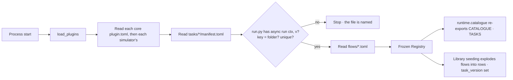

# Plugins

Every task type the runtime can run lives in a **plugin**: a folder with a `plugin.toml`, one
`tasks/<key>/` folder per task type (a `manifest.toml` beside its `run.py`) and the packaged flows it
ships. Core plugins are today's catalogue, always loaded and versioned with the engine. The registry
builds itself from the manifests once at start-up and is then frozen.

| | |
|---|---|
| Index | [13.9](../../../README.md#13--platform) · Slice **B06a** |
| Module | [Platform](../spec.md) |
| API / CLI / Studio | — / — / — — the engine layout only; the Plugins registry surface is C03, `invana plugins` is B06b |
| Related | [the runtime](runtime.md) · [read the catalogue](../../workflows/features/the-catalogue.md) · [products › plugins](../../../../products/plugins.md) |

> **As** an engine developer adding a task type, **I want** one folder with its manifest and its code,
> **so that** the planner, the validator, the catalogue route and a future worker all read the same
> declaration without a second registry to keep in step.

## Capabilities

| # | Capability | Notes |
|---|---|---|
| C1 | One format for every task type | `tasks/<key>/manifest.toml` + `run.py`; core and tool plugins differ only in `kind` |
| C2 | A plugin manifest | `plugin.toml` — `name · kind · engine · extra · secrets`; a core plugin's version is the engine's |
| C3 | A task manifest | `key · version · summary · bound · side_effect · args · outputs · requires · resources`, plus optional `timeout_s · retries` |
| C4 | Packaged flows | `flows/<key>.toml` — the fixed multi-step plans the plugin ships (`model-import@1`, `stitch-apply@1`, …) |
| C5 | Checked at start-up | A manifest whose key's last dotted segment is not its folder, whose `run.py` has no `async def run(ctx, v)`, or whose key repeats stops the process with the file named |
| C6 | Frozen per process | Built once; nothing registers while plans run |
| C7 | Keys never move | `run_nodes.task_key` and Studio read them; moving a task type into a plugin renames nothing |
| C8 | Each Task records its task type's version | `tasks.task_version`, written when a plan's rows are exploded |
| C9 | Simulator plugins | `plugins/simulators/<name>/`, `kind = "simulator"`: one simulator task type, its declared spec fields, and one packaged `simulate` flow — run by [9.8 Simulation](../../work/features/simulation.md) |

## Journey

## Seams

| Seam | What happens |
|---|---|
| A manifest that does not match its code | Start-up fails with the manifest's path |
| A plan naming a key no plugin declares | Refused by the validator, as before |
| A Task row written before this slice | `task_version` is NULL — the version it ran was never recorded |
| A test that substitutes a step | `TASKS` stays a plain dict for that seam; the registry itself is frozen |

## Engine

| Path | Holds |
|---|---|
| `plugins/__init__.py` | `load_plugins()` → the frozen `Registry`, cached |
| `plugins/sdk/manifest.py` | `PluginManifest` · `TaskManifest` · `FlowManifest` · `Arg` · `Type` · `Bound` · `SideEffect` · `Resource` |
| `plugins/sdk/context.py` | `TaskContext` · `RunVars` · `Out` and the shared step helpers |
| `plugins/sdk/errors.py` | `TaskFailure` · `NeedsInput` · `CannotAnswer` · `Converse` |
| `plugins/registry.py` | `Registry` — plugins, task types by `key` and `key@version`, flows; read-only mappings |
| `plugins/sdk/simulation.py` | `Input` · `read_inputs(ctx)` — the pinned dataset versions a simulator reads, hash-checked |
| `plugins/simulators/<plugin>/` | `genomic` — loaded after the core plugins |
| `plugins/core/<plugin>/` | `pure · graph_read · graph_write · schema_write · ingest · llm · work_write`; `ingest` also holds the bodies `bundle · records · stitching` |
| `runtime/catalogue/__init__.py` | Re-export of `CATALOGUE` · `TASKS` and the contract names, so importers keep working |

| `TaskManifest` field | Type | Notes |
|---|---|---|
| `key` | str | the plan vocabulary; its last dotted segment is the folder name (`sim.genomic_prediction` → `genomic_prediction/`) |
| `version` | semver str | per task type; every core task type starts at `1.0.0` |
| `summary` | str | the catalogue drawer's one line |
| `bound` | `Bound` | what it spends — the envelope's ceiling group |
| `side_effect` | `read · write · send` | `write` for the `*_write` and `ingest` bounds |
| `args` | `{name: {type, required, default}}` | |
| `outputs` | `{name: type}` | the type is the lane roll-up |
| `requires` | list of keys | ordered before it in any plan |
| `resources` | list of `llm · cpu · gpu` | `llm` for the `llm` bound, else `cpu` |
| `timeout_s` · `retries` | int, optional | `timeout_s` applied by `run_envelope()`; `retries` declared only |
| `spec` | `{name: {type, required, default, label}}` | a simulator's spec fields; empty on every other task type |

| Column | Type | Notes |
|---|---|---|
| `tasks.task_version` | String(32), nullable | the task type version the row was exploded against; NULL for rows written before |

## Decisions

| # | Decision |
|---|---|
| PL1 | **`invana.plugins` shares band 3 with `invana.runtime`.** Task bodies use the runtime (stream, governing, models) and the runtime dispatches task types, so the two are non-independent siblings in the `bands` contract; `apps` still never imports either. |
| PL2 | **Flows reach `apps` as an argument.** `TaskPlanManager.ensure_seeded` takes the flows (and their task versions) from the runtime caller, the same way it already takes `requires`, because an app may not import band 3. |
| PL3 | **A core plugin's version is the engine's.** `plugin.toml` for `kind: core` carries no `version`; the loader reads the installed engine version. |
| PL4 | **`run.py` keeps the task's own function name** and binds `run` to it, so stack traces, tests and re-exports keep the names they had. |
| PL5 | **`TASKS` is a mutable dict derived from the frozen registry.** Tests substitute steps on it; the registry's own mappings are read-only. |
| PL6 | **`timeout_s` is applied by `run_envelope()`; `retries` stays declared** — retry policy is the orchestrator's ([13.11](distributed-execution.md) DE5). |
| PL7 | **Manifests are TOML**, read with the standard library's `tomllib`. A YAML parser would be a new core dependency for the same tables; TOML also keeps comments, so a flow carries its own rationale. |
| PL8 | **`plugin.toml` lists its `tasks` and `flows` in order.** The order is the catalogue's listing order, and a folder on disk the list does not name is a load error rather than a silently skipped task type. |
| PL9 | **Every core task type starts at `1.0.0`;** `side_effect` is `write` for the `graph_write · schema_write · ingest · work_write` bounds and `read` otherwise; `resources` is `llm` for the `llm` bound and `cpu` otherwise. |
| PL10 | **The seeded agents keep their own step lists.** `ql-query` and `modeller` carry their envelope's steps inline, as agent data in `apps/agents/registry.py`, rather than reading `ql-direct` and `modeller-propose` from band 3. |

| PL11 | **A simulator plugin contributes exactly one simulator.** `kind = "simulator"`, its own semver `version`, one task type and one packaged flow of kind `simulate` whose single step names it. Two models are two plugins, so `--plugin <name>` is never ambiguous. |
| PL12 | **The simulator contract is checked at load.** Its task type is `bound = "none"`, `side_effect = "read"`, takes `spec: obj` · `inputs: list` · `seed: int` (all required) and declares `ranked: list` · `summary: obj`; a plugin that breaks any of it stops the process with its manifest named. |
| PL13 | **A simulator reads data only through `read_inputs(ctx)`.** It gets the records of the versions Invana pinned, after their content hash is checked and a retraction refused. It never queries the graph or another dataset. |
| PL14 | **A simulator's task type is in the registry like any other** — the catalogue lists it, the interpreter dispatches it, and a plan may name it only where an envelope allows it. The closed **core** set stays the count the catalogue test holds; a simulator adds to the registry, not to it. |
| PL15 | **A task type's key may carry its plugin's prefix** (`sim.genomic_prediction`); the folder is the last segment, so the module path stays importable. Core keys have no prefix. |
## Not building

| Not building | Because |
|---|---|
| Tool and MCP plugins | B06b and B07 |
| `invana plugins …` CLI and the Agents › Plugins surface | B06b · C03 |
| Enabling or disabling a plugin | B06b — until then a simulator loads whenever it is installed |
| Hot-loading a plugin | the registry is frozen per process |
| Skills shipped inside a plugin | skills stay seeded from `runtime/managers/skill_seed.py` until a tool plugin ships one |
