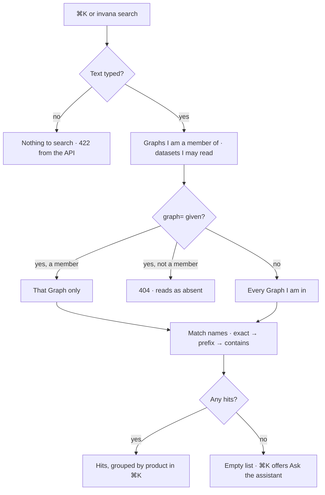

# Search

One search over everything a person may open — Graphs and the records inside them, and the datasets
above them — filtered by access before it is ranked. ⌘K and `invana search` read it.

| | |
|---|---|
| Index | [13.10](../../../README.md#13--platform) · Slice **B11** |
| Module | [Platform](../spec.md) |
| API / CLI / Studio | ✅ / ✅ / 🔵 |
| Product | [shell.md › Decisions](../../../../products/shell.md#decisions) — *Search (⌘K)* · *Search ranking* · *⌘K and access* · P-18 |
| Related | [roles](../../identity-and-access/features/roles.md) · [membership](../../identity-and-access/features/membership.md) · [datasets](../../bring-data-in/features/datasets.md) |

> **As** a member, **I want** to type a name and reach the record, wherever it lives,
> **so that** I never need the nav to find something I know exists — and never see what I may not open.

## Capabilities

| # | Capability | Notes |
|---|---|---|
| SE1 | Name search across kinds | `graph` · `model` · `agent` · `skill` · `project` · `world` · `guardrail` · `dataset` |
| SE2 | Filtered by access first | Graphs the caller is a member of; datasets the caller may read |
| SE3 | Exact, then prefix, then contains | Case-insensitive on the name; ties by name |
| SE4 | One Graph or all | `graph=<user>/<slug>` narrows to one; omitted, every Graph the caller is in |
| SE5 | Each hit names its product and Graph | So ⌘K groups by product and opens the right page |
| SE6 | From the terminal | `invana search "<text>" --user <u> [--graph <user>/<slug>] [--json]` |

## Journey

## Seams

| Seam | What the user sees |
|---|---|
| A Graph I was removed from | Its records stop appearing on the next search |
| A private dataset someone else owns | Never a hit; an install Admin sees every dataset |
| A world nobody named | Not a hit — an unnamed world is not shared |
| Very common text | At most `limit` hits (default 20, at most 50), the closest first |
| Archived Graph | Still searched; archiving never blocks access |

## Surfaces

| Surface | Shape |
|---|---|
| `GET /api/v1/search` | `q` (required, trimmed, 1–200 chars) · `graph?` · `limit?` → `{query, hits: [SearchHit]}` |
| `SearchHit` | `kind` · `id` · `name` · `graph?` (`user/slug`) · `product?` (`explorer` · `modeller` · `agents` · `projects` · `datasets`) · `match` (`exact` · `prefix` · `contains`) |
| CLI | `invana search` — one line per hit: kind, name, Graph, id |
| Studio | ⌘K reads it in C07; until then it matches the lists it already fetches ([shell.md](../../../../products/shell.md#decisions)) |

## Engine

| Thing | Shape |
|---|---|
| `activity/managers/search.py` | `SearchManager.search(session, *, reader, text, graph_ref?, limit)` — the access filter and the ranking |
| `activity/querysets/search.py` | one name query per kind, scoped to the Graph ids the manager hands it |
| Route | `server/search/` · tag `search` |

## Decisions

| # | Decision |
|---|---|
| SE1 | Search lives in `activity`, the band that may read every app, because it joins Graphs, models, agents, skills, projects, lenses and datasets. |
| SE2 | Access is applied in the query, never after it: the queryset is handed the Graph ids the reader is a member of, and datasets are read through the dataset reading rule (install-visible, own, or every one for an install Admin). |
| SE3 | Every member reads every record in their Graph, so a Graph role narrows nothing here. A private project is a hit only for the people staffed on it ([9.7](../../work/features/private-projects.md)) — filtered in `SearchManager`, the one place search decides access. |
| SE4 | Ranking is name-only: exact, prefix, contains, then the name. Meaning-based *related* hits wait for a vector index ([12.4](../../graph-connectors/features/vector-search.md)). |
| SE5 | `graph=` naming a Graph the reader is not in is 404, as every Graph route reads a scoping refusal. |
| SE6 | The Graph's own records (an airport, a gene) are not searched; that is the graph database's, through Explorer. |

## Not building

| Not building | Because |
|---|---|
| Meaning-based (*related*) hits | waits on a vector index |
| Runs, schedules, findings, branches | runs are found by their Graph's journal; schedules and project records arrive with B08 and B05, which add their kinds |
| Searching node and edge data | the graph database's job, through Explorer |
| Search history or saved searches | not asked for |
| Studio ⌘K wiring | C07 |
