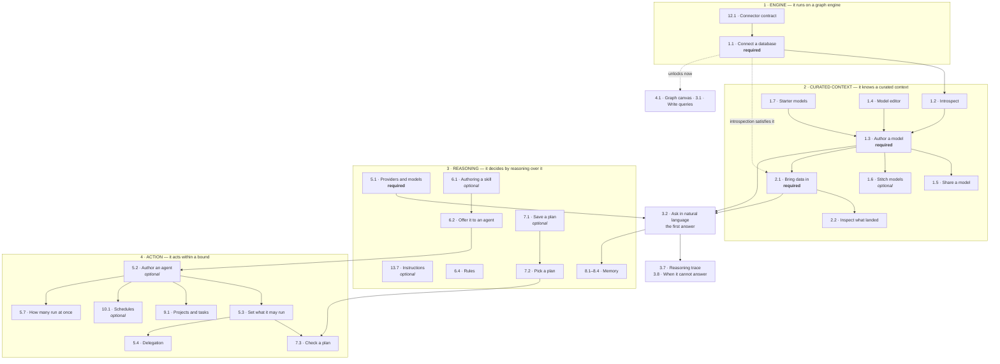

# Setup

The sequence a Graph walks from created to answering. It is **derived from facts, never ticked** — a
step is done because the thing it asks for exists, whoever made it exist and from wherever.

| | |
|---|---|
| Index | [13.7](../../../README.md#13--platform) · Slice **S13** |
| Module | [Platform](../spec.md) |
| API / CLI / Studio | 🟡 / — / 🟡 |
| Related | [Connect a database](../../connect-and-model/features/connect-a-database.md) · [Author a model](../../connect-and-model/features/domain-models.md) · [Bring data in](../../bring-data-in/features/load-data.md) · [Providers and models](../../agents/features/providers-and-models.md) · [Author an agent](../../agents/features/author-an-agent.md) · [Save a plan for reuse](../../workflows/features/the-library.md) · [Schedules](../../operate/features/schedules.md) · [Command line](command-line.md) |

Product spec: [SH-F02 · Create a graph](../../../../../specs/products/shell/features/SH-F02-create-a-graph/feature.md) — SH-03; the set-up steps, their rules, the gates, the lesson and the product decisions live there. This file keeps the lineage of index rows, the retired island surfaces, the engine shape and the rows not moved.

## 2. The four features

### The lineage

What each feature is built out of, and what has to land before what. Every node is a row in
[the index](../../../README.md); every arrow is a dependency one of the specs states.



Three things the lineage says that a list cannot:

| | |
|---|---|
| **Engine is a root, and a root of one** | nothing precedes it and nothing else sits in it. `12.1` is the contract its connector implements, not a step ([SU25](#decisions)) |
| **Curated Context is a chain; Reasoning is a set** | `1.3 → 2.1` is a hard order — `--model` names a published model. Reasoning's four have no order at all: a provider, instructions, skills and a workflow are each authored alone |
| **Action depends on Reasoning, never the reverse** | `6.2 → 5.2` and `7.2 → 7.3`: a skill is bound to an agent, a plan is checked against one. Nothing in Reasoning waits on anything in Action, which is why Action can owe nothing ([SU23](#decisions)) |

## 5. Surfaces

Setup owns **no forms** ([SU2](#decisions)). Every action routes to the panel that already owns that
field, with its tab named ([G24](../../../building-studio/graph-detail-page.md)), so there is one form
per fact in the whole product.

| Surface | Where | Shape |
|---|---|---|
| **The onboarding wizard** | `mainSection` — the graph page, titled **Setup** in the page strip while it is on it | An **island**: one `Card` centred on the board with the board visible around it, max 1060px. Inside it, a stepper on the left and the selected step's lesson on the right ([SU16](#decisions)) |
| **The cap** | `header.right` | A graduation-cap `ButtonWithTooltip` between `GitHubStars` and `ThemeMenu`, on graph-scoped routes only. It reopens the wizard at any time, including after the Graph is ready ([SU19](#decisions)) |
| **The setup band** | `leftSection` → Info panel | The compact echo — `TimelineList variant="rail"`. Disappears the moment the required steps are done ([G20 · G21](../../../building-studio/graph-detail-page.md)) |
| **The locks** | every surface a gate shuts | `EmptyState locks` naming the gate that opens it, and the step that opens the gate — *"Explorer opens when a database is connected"* ([SU13](#decisions)) |
| **The footer** | `footer` | `GraphStatusBar` already carries the connection's live state; setup never restates it |

### The island, region by region

| Region | Holds | Composed from |
|---|---|---|
| The island | the whole wizard, floating on the board. The margin is what says the graph page is still underneath | `Card` on `bg-background` |
| Head | the graph's name · `Progress` · one sentence of standing, written out of the four clauses — *"It runs on a graph engine and knows a curated context. It cannot decide yet."* | `Progress` · `text-*` ladder |
| Stepper | the four group headings, one row per step, a check or a `StatusDot` per row ([SU21](#decisions)), the selected row marked. It closes with **What next**, which carries no dot ([SU20](#decisions)) | `Eyebrow` · `StatusDot` |
| Lesson | the group and its clause · the step · its `concept` · why · how · the actions · the terminal line · what proves it | `Eyebrow` · `Item` · `Button` · `Terminal` |
| Foot of the lesson | *Previous* · *Next step* — **navigation, not a gate** | `ButtonGroup` |
| What next | the offers, no status dots, selectable from the first visit | `Eyebrow` · `ItemGroup` |

Below ~900px of `mainSection` the two panes stack inside the island into the gate-card board: the
groups as cards, each step one row, the selected step's lesson expanded in place. Same content, same
URL, one column. The island keeps its margin — it narrows before it touches the edges.

```
┌ header · Graphs › ravi-merugu › stock-market-graph › Setup     🎓 ☀ ⛶ ────────┐
├──┬─ Info panel ────────┬─ mainSection · the board ───────────────────────────┤
│▣ │ Stock Market Graph  │   ┌─ the island ───────────────────────────────┐    │
│  │ neo4j · connected   │   │ Stock Market Graph   ▓▓▓▓▓░░░  2 of 4      │    │
│  │                     │   │ It runs on a graph engine and knows a      │    │
│  │ Setup   2 of 4      │   │ curated context. It cannot decide yet.     │    │
│  │ ● Connect a database│   ├─ stepper ────────┬─ the lesson ────────────┤    │
│  │ ● Author a model    │   │ ENGINE           │ CURATED CONTEXT ·       │    │
│  │ ○ Bring data in next│   │  ✓ Connect a db  │ IT KNOWS      step 3/4  │    │
│  │ ○ Add a provider    │   │ CURATED CONTEXT  │ Bring data in           │    │
│  │ ○ Instructions  skip│   │  ✓ Author a model│ ✦ Answers are grounded, │    │
│  │ ○ Skills        skip│   │  ○ Stitch    opt │   or they are refused   │    │
│  │                     │   │ ▸◐ Bring data in │ WHY IT MATTERS …        │    │
│  │ Recent sessions     │   │ REASONING        │ HOW 1 · pick a dataset  │    │
│  │ …                   │   │  ○ LLM provider  │     2 · map its columns │    │
│  │                     │   │  ○ Instructions  │     3 · run the import  │    │
│  │                     │   │  ○ Skills        │ [ Open Imports ] Skip   │    │
│  │                     │   │  ○ Workflow      │ ⌨ invana records …   ⧉ │    │
│  │                     │   │ ACTION           │ YOU'LL KNOW IT WORKED … │    │
│  │                     │   │  ○ An agent      │    ‹ Previous   Next ›  │    │
│  │                     │   │  ○ Schedule it   │                         │    │
│  │                     │   │ AFTER SETUP      │                         │    │
│  │                     │   │    What next     │                         │    │
│  │                     │   └──────────────────┴─────────────────────────┘    │
└──┴─────────────────────┴─────────────────────────────────────────────────────┘
```

## 7. Engine

Setup stores almost nothing. Everything except a skip is read off the facts at serialize time
([CM8](../../connect-and-model/spec.md)).

| Thing | Shape |
|---|---|
| `graphs.setup_state` | JSON, one key per step: `graph_info · model · stitches · datasets · providers · instructions · skills · workflows · agents · schedules`. Only `skipped_at` is stored; `done` and `completed_at` are derived. `graph_info` keeps its name — it is a persisted key, and a rename is a migration that buys a word |
| Per-step payload | `done` · `completed_at?` · `skipped_at?` · `required` · `group` · `gate?` · `blocked_by?` · `broken?` with its message |
| Routes | `GET …/graphs/{slug}` carries `setup_state` · `POST …/graphs/{slug}/setup/{section}` takes `skip` · `reset` |
| Who composes a read | `SetupManager.graph_read` / `.graph_reads` — the **only** way a `GraphRead` is built ([SU26](#decisions)). `GraphManager.serialize` takes `setup_state` as a required argument and `GraphManager`'s create · list · update return rows, not reads |
| Derivations — existence | the connection row · published versions on a non-introspected model · committed stitches · succeeded import runs **or** node types on the introspected mirror · the default provider's `last_ping_ok` · `instructions` non-empty · skill count · published workflow templates · member-authored agents |
| Derivations — occurrence | `schedules` is done when a firing exists, not when a schedule is saved ([SU24](#decisions)) |
| Gates as dependencies | `require_graph_connected` · `require_graph_modelled` · `require_graph_grounded` · `require_graph_answering`. Explorer and the schema route wait on **connected**; the import routes wait on **modelled**; the canvas data route waits on **grounded**; sessions wait on **answering** |
| Events | none of its own. Setup has no verbs — `connection.tested`, `model.published`, `dataset.imported`, `provider.pinged`, `workflow.published`, `schedule.fired` are the record |

### What changes from what ships today

| Today | Becomes | Why |
|---|---|---|
| Three gates: `connected · grounded · answering` | Four groups and four gates, with `modelled` split out of `grounded` | `grounded` meant *model **and** records*, so an import waited on the records the import is what produces. `require_graph_grounded` has no consumers, which is that fault showing as disuse |
| Six sections | Ten — `stitches`, `workflows`, `agents`, `schedules` join | They are the steps that make an answer good, and they were offers with no state |
| Every step derives from an existence | Action steps derive from an **occurrence** | An action that has never run is an intention, not a capability ([SU24](#decisions)) |
| A step belongs to a gate | A step belongs to a **group**, and *may* belong to a gate | Action gates nothing; Curated Context gates twice ([SU3](#decisions)) |

## Decisions

| # | Decision |
|---|---|
| SU5 | **Instructions are optional and asked for late.** They are a Basic field ([G23](../../../building-studio/graph-detail-page.md)) and they leave the create form ([SU10](#decisions)). Requiring prose before anything works is the onboarding funnel [accounts](../../identity-and-access/features/accounts.md) refuses |
| SU7 | **The wizard is a page, not a modal — and it is the page the Graph already has.** It is the content of the graph page while anything is outstanding ([G26](../../../building-studio/graph-detail-page.md)), which is the page a new Graph lands on, cannot be closed and cannot be lost. A modal cannot show the thing it is configuring, and setup is resumable, partly delegated and never linear |
| SU8 | **The Info panel keeps the compact echo, and it disappears when it is finished** ([G20 · G21](../../../building-studio/graph-detail-page.md)). One sequence, two renderings — the wizard for doing it, the band for remembering it |
| SU10 | **Creating a Graph asks for a name and a slug.** The connection needs a connector choice and a passing test ([CD2](../../connect-and-model/features/connect-a-database.md)); a failure there must not cost the user the Graph. The create form is the shortest thing that can produce a URL |
| SU16 | **The wizard is an island, and it teaches the step it is on.** One card centred on the board with the board visible around it — never a region filled edge to edge, because the margin is what says the graph page is still underneath. A stepper on the left, that step's lesson on the right, selection carried in the URL (`?step=`) so a step can be handed to a teammate. *Previous* and *Next step* are navigation, not a gate — every step stays selectable in any order, which is what keeps this a page and not the wizard [SU7](#decisions) refuses. It reflows against **its own width, in px** ([SU27](#decisions)) |
| SU18 | **The wizard is the board — there is no second surface.** The graph page shows the stepper while anything is outstanding and the identity card when nothing is. It is not a first-run overlay on top of a board, which would be two renderings to keep true and would reintroduce the per-user first-run state [SU14](#decisions) refuses |
| SU19 | **The wizard has a door that never closes.** A graduation cap sits in `header.right`, between `GitHubStars` and `ThemeMenu`, on graph-scoped routes only. It opens the wizard at the first outstanding step, or at the step last looked at once every required step is done. It does **not** disappear when the Graph is ready: undoing a skip, reading why a step went `broken`, and re-reading a concept all live there. *Graduation* is the icon's metaphor only — the state a Graph reaches is **ready**, and no surface says otherwise |
| SU20 | **The rail ends in *What next*, and it carries no dot.** The offers select into the lesson column like a step, because the rail has one meaning — clicking a row changes what the pane shows, and never does anything. They have no status and none is owed ([SU4](#decisions)); a dot is the thing that would say otherwise. It is reachable from the first visit: someone weighing up four steps should be able to see what the steps are for |
| SU21 | **A done step is a check; every other state is a dot.** Done is a fact that exists ([SU1](#decisions)) — a green dot beside it says only *green*, which at a glance is the `running` tone of every other list in the product. One marker component across the stepper, the band and the board, because they are one sequence in three renderings ([G27](../../../building-studio/graph-detail-page.md)) |
| SU23 | **Reasoning is shared and inert; Action is owned and runs.** The provider, the instructions, the skills and the workflows are graph-level: one copy, authored once, usable by any number of agents, and none of them does anything on its own. The agent, its envelope and budget, and what sets it off are per-actor. A workflow containing action steps is still Reasoning — it is a *plan*, *"validated against the running agent's bounds before anything is dispatched"* ([workflows](../../workflows/spec.md)), and a recipe is not a meal. The [envelope](../../agents/features/envelope-and-budget.md) is the valve between the two |
| SU25 | **The connection is substrate, not knowledge.** *Connect a graph database* asks which engine runs underneath; the curated context is the same whichever answer you give. That is why it is its own group and not the first step of Curated Context, and why a group of one is worth the heading |
| SU26 | **Every Graph read derives; there is no fallback to the stored column.** `GraphManager.serialize` takes `setup_state` as a **required** argument, and create · list · detail · update all compose through `SetupManager.graph_read`. A default that fell back to `graphs.setup_state` served a column holding only skips and the instructions stamp, so every derived section came back absent — and a client cannot tell an absent section from a false one, which is how a Graph with a pinged provider kept being asked for one. `graphs` still never imports `setup` ([migration-plan §14.1](../../../building-engine/migration-plan.md)); the composition is `setup`'s, which is why the read lives there |
| SU27 | **The island reflows against its own width, and every threshold is in px.** Three of them: the island is at most **1060px**; below **640px** of island the stepper and the lesson stack into the board — the same rows, one column; and inside the lesson, *Why · How* sits beside *You'll know it worked* only once **the lesson pane itself** is past **600px**, with the side column at 240px. Two rules make it hold. The lesson pane is its own container — querying the island instead measured 248px of stepper it does not have, which split the columns at a 430px pane and squeezed *Why it matters* to three words a line whenever a side panel was open. And the widths are px, not `@2xl`/`@3xl`: the root font dial is **13px** ([design-kit `styling`](../../../building-studio/design-kit-coverage.md)), so every rem breakpoint fires ~19% narrower than its name reads — which is also why `max-w-5xl` was an 832px island, not the 1060px this decision asks for. And **both** directions of every reflow are variants — never a base utility plus one variant: the kit's stylesheet is concatenated after Studio's, so a base `flex-col` or `hidden` re-declared there wins on source order and the container rule never fires. Measured: island 1060 → lesson pane 810 → *Why* 512px; with both side panels open, island 735 → pane 485 → *Why* 446px, one column |

## Not building

| Not built | Because |
|---|---|
| A modal wizard, a tour overlay, a coach mark | setup is resumable and partly done from a terminal; a modal owns the screen and can show none of it |
| A setup page of its own | the graph page is already pinned, uncloseable, and where a new Graph lands (G26) |
| A first-run overlay over the board | [SU18](#decisions) |
| A *watch it* or *monitor it* step | there is no such feature. [Schedules](../../operate/features/schedules.md) is the one Action step that exists beyond authoring an agent, and setup never invents a destination |
