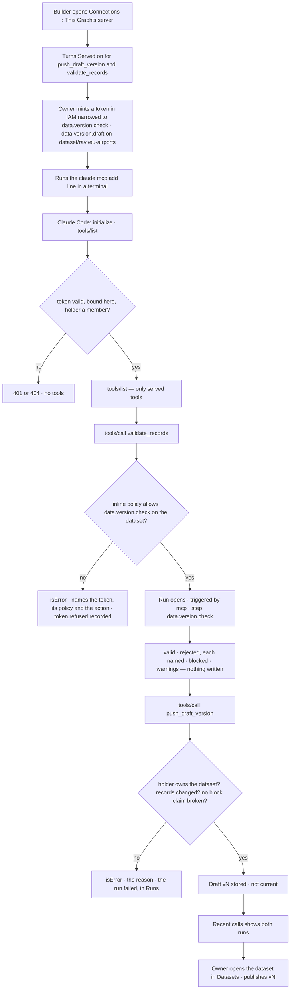
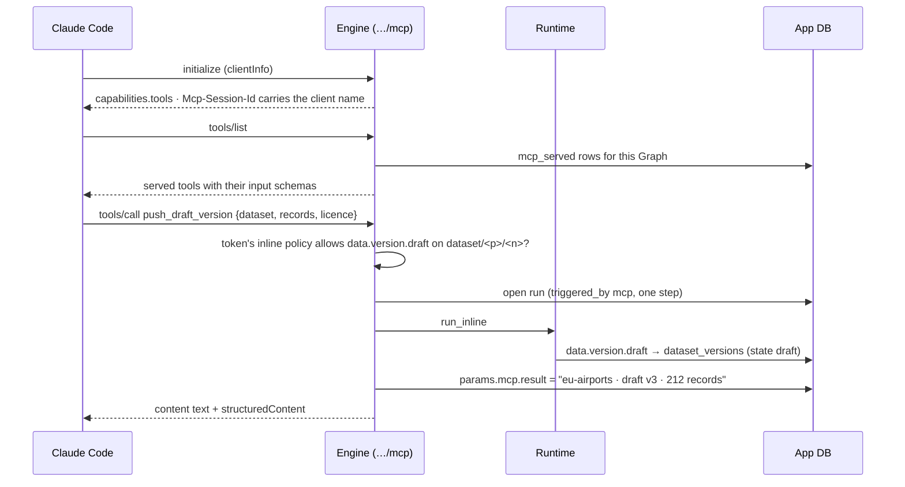

# This Graph's MCP server

One MCP endpoint per Graph. It serves the agents and functions a builder marks *served*; a caller —
Claude Code, Cursor, any MCP client — connects with a token made in IAM, and every call is a run, as
the token's holder ∩ the token's policy ∩ the agent, in the ledger. Claude Code checks records and
pushes **draft** dataset versions through it; a person publishes them.

| | |
|---|---|
| Index | [13.16](../../../README.md#13--platform) · Slice **I02** |
| Module | [Platform](../spec.md) |
| API / CLI / Studio | ✅ / — / ✅ |
| Related | [MCP plugins](mcp-plugins.md) (the other direction) · [tokens](../../identity-and-access/features/tokens.md) · [effective access](../../identity-and-access/features/effective-access.md) · [external-agent-api](../../operate/features/external-agent-api.md) · [datasets › draft versions](../../bring-data-in/features/datasets.md) · products: [agent-fabric](../../../../products/agent-fabric.md) AF-18 · [iam](../../../../products/iam.md) |

> **As** a builder or data owner, **I want** Claude Code, or any MCP client, to use this Graph — check
> records, push a draft dataset, ask an agent — **so that** data arrives without Invana pulling it, and a
> person still publishes.

## Capabilities

| # | Capability | Notes |
|---|---|---|
| C1 | One endpoint per Graph | `POST /api/v1/u/{username}/{graphSlug}/mcp`, MCP over Streamable HTTP |
| C2 | Served agents | Every authored, live agent may be served as the tool `ask_<agent name>` — one question in, its answer out |
| C3 | Served functions | `data.version.check` as `validate_records` and `data.version.draft` as `push_draft_version` |
| C4 | Served is a switch | Per agent and per function, on *Connections › This Graph's server* and on an agent's *Deploy* tab — one record. Everything starts not served |
| C5 | A token made in IAM | The caller's credential is an IAM token; a narrowed token's inline policy decides which tools it may call |
| C6 | Each call is a run | Recorded in Runs and the ledger like any run, triggered by `mcp`, with the tool, the token and the client |
| C7 | Recent calls | When · caller and client · token · tool · result · run, newest first |
| C8 | Use it from Claude Code | The page prints the `claude mcp add` line for this Graph's URL |
| C9 | A person publishes | `push_draft_version` stores a draft — numbered, listed, never current, never bound — and the dataset's owner publishes it in Datasets |

## Journey

## Seams

| Seam | What happens |
|---|---|
| No token, a session token, or a revoked one | 401 — the endpoint takes an IAM token in the `Authorization` header and nothing else |
| A token bound to another Graph | 404, as every scoping refusal |
| A tool that is not served, or not known | JSON-RPC error `-32602`, naming the tool; nothing opens |
| A narrowed token calling a tool its policy does not allow | The call returns `isError` naming the token, its policy and the action on the resource; `token.refused` is recorded; no run opens |
| An agent that is paused or retired | Not listed; a call is refused naming its status |
| A draft whose records match the current version | The run fails *unchanged*, named, and the caller reads why |
| A block claim the records break | The run fails *blocked*, naming the standard |
| The holder does not own the dataset | The run fails, naming the owner it needs |
| An agent's run refused at a policy layer | The run is refused before dispatch, naming the layer and the policy — the token's narrowing is a layer of its own |
| A GET for a server-sent stream | 405 — the server answers each POST with JSON and offers no stream |
| Nothing served yet | The table lists every candidate with Served off; Recent calls reads *No calls yet* with the line to connect |
| A member without *build* | Sees the page; the Served switches are drawn disabled |

## Surfaces

| Surface | Shape |
|---|---|
| `agents.connections` | Connections › **This Graph's server** (the landing tab; *MCP servers* is the second). Head *Connections* — *Where this Graph meets the outside — the server it offers, the MCP servers whose tools it calls*; *Add MCP server* stays in the head. Cards: **Endpoint** (URL · Transport *Streamable HTTP* · Who may connect *anyone with a token — made in IAM; its policy decides what they may call* · Each call *a run, as the caller ∩ the agent — in the ledger like any other*) · **Use it from Claude Code** (the `claude mcp add` line) · **What it serves** (Kind · Name · Tool · What it does · Served switch) · **Recent calls** (When · Caller · Token · Tool · Result · Run) |
| Path | `{G}/agents/connections/server` · `{G}/agents/connections/mcp`; `agents/connections` lands on `server` |
| Agent › Deploy | *Callable over MCP* — the same switch as the agent's row in *What it serves*, with its tool name |

## Engine

| Path | Holds |
|---|---|
| `apps/mcp_server/models.py` | `McpServed` |
| `apps/mcp_server/querysets/served.py` | the served rows of a Graph |
| `apps/mcp_server/managers/served.py` | `ServedManager` — the candidates (live authored agents + `SERVABLE` functions) joined to their switch; tool names |
| `runtime/managers/mcp_server.py` | `McpServerManager` — the JSON-RPC methods, the token check per call, opening and running the call's run, the result line |
| `runtime/services.py` | `open_mcp_function_run` · `open_mcp_agent_run` |
| `plugins/core/ingest/tasks/data_version_check` · `data_version_draft` | the two served functions |
| `server/mcp_server/` | the endpoint and the Connections reads |

| `mcp_served` column | Type | Notes |
|---|---|---|
| `graph_id` | String(36), PK, FK `graphs` cascade | |
| `kind` | String(16), PK | `agent` · `function` |
| `ref` | String(64), PK | the agent's id or the function's key |
| `served` | bool | |
| `changed_by_id` · `changed_at` | String(36) · timestamptz | who flipped it last |

| Endpoint | Who | Returns |
|---|---|---|
| `POST …/mcp` | any member, with an IAM token | JSON-RPC: `initialize` · `notifications/initialized` (202) · `ping` · `tools/list` · `tools/call` |
| `GET · DELETE …/mcp` | — | 405 |
| `GET …/connections/server` | any member | `McpServerInfo` — `url` · `transport` · `protocol_version` · `connect_command` · `agents_served` · `functions_served` · `calls_today` |
| `GET …/connections/server/served` | any member | `Page[ServedRead]` — `kind` · `ref` · `name` · `tool` · `does` · `served` · `status` (agents) |
| `PUT …/connections/server/served/{kind}/{ref}` `{served}` | *build* | `ServedRead`; 404 not a candidate |
| `GET …/connections/server/calls?limit=` | any member | `Page[McpCallRead]` — `run_id` · `number` · `at` · `caller` · `client` · `token` · `tool` · `status` · `result` |

| Tool | Input | Output |
|---|---|---|
| `validate_records` | `dataset` (`publisher/name`) · `records` | `records` · `valid` · `rejected[{record, key, reason}]` · `blocked[]` · `warnings[]` · `unchanged` |
| `push_draft_version` | `dataset` · `records` · `licence` · `author_chain?` · `why?` · `source?` | `dataset` · `version` · `state` · `record_count` · `warnings[]` |
| `ask_<agent>` | `question` | the answer as text; `run` · `outcome` · `summary` |

| Run field | For an MCP call |
|---|---|
| `triggered_by` | `mcp` |
| `ask_kind` | `mcp` |
| `author_id` · `on_behalf_of_user_id` | the token's holder |
| `params.mcp` | `{tool, token_id, token, client, result}` — `result` is the one-line outcome, written when the run settles |
| `agent_id` | the served agent, for `ask_*`; none for a function |

## Decisions

| # | Decision |
|---|---|
| MS1 | **The endpoint is a Graph route**, `…/u/{username}/{graphSlug}/mcp`, so membership, a token's Graph binding and the access gate are the ones every Graph route uses. |
| MS2 | **Streamable HTTP in its JSON response mode, stateless.** Each POST is answered with one JSON-RPC response; a GET for a stream is 405. The server needs no session store, so any engine process answers any call. |
| MS3 | **The session id carries the client's name.** `initialize` returns `Mcp-Session-Id: <random>.<base64url clientInfo name>`; the client sends it back on every call, and the call's run records it as `client`. Without it the client is `MCP client`. |
| MS4 | **Only an IAM token connects.** A session JWT is refused at `…/mcp` (401): the caller is software, and the token is what IAM narrows, expires and revokes. |
| MS5 | **Served is off until a builder turns it on**, per agent and per function, in `mcp_served`. The candidates are every authored agent that is live (not a draft, paused, retired or spawned) and the functions in `SERVABLE`. Turning one on is the *build* area. |
| MS6 | **The served functions are `data.version.check` and `data.version.draft`.** `data.records.validate` stays the load's per-record check of a bundle on disk against the model; a caller over MCP sends records inline against a dataset, so the check is its own function, running the gates a draft push runs and writing nothing. |
| MS7 | **A tool name is fixed for a function** (`validate_records`, `push_draft_version`) and `ask_` + the agent's name in snake case for an agent, ≤ 64 characters; two agents that snake to one name are told apart by their id's first six characters. |
| MS8 | **A narrowed token is checked per call, not per route.** The narrowing table lets `POST …/mcp` through; each `tools/call` is read as one action on one resource — `data.version.check` / `data.version.draft` on `dataset/<publisher>/<name>`, `agent.ask` on `agent/<name>` for an `ask_*` tool — and refused naming the token and its policy when the inline policy does not allow it. `tools/list` lists every served tool; the policy decides the call. |
| MS9 | **An agent's call carries the token as a layer.** The run records the token in `params.mcp.token_id`; the access gate adds the token's inline policy as the *token* layer for every step, beside its policies, started by (the holder) and the boundary. An agent never does more than the token allows. |
| MS10 | **The two data functions have bound `none`.** They touch no Graph data, call no model and spend nothing a policy ceilings; the holder's own right is the dataset's (only its owner pushes a draft), and the token's narrowing is checked at the call (MS8). |
| MS11 | **Each call is a run, run inline in the request.** A function call opens a root run with one queued step; an agent call opens the agent's run with the question as its body. The caller waits; the Graph's ceiling queues it like any run. |
| MS12 | **The result line is stored when the run settles** — `params.mcp.result`, written by the engine from the step's output (*eu-airports · draft v3 · 212 records*, *212 valid · 3 rejected*, *served · 3 rows*), so Recent calls formats and never derives. A run without a session keeps its answer in `result.summary`. |
| MS13 | **A refusal before a run opens is an event, not a run.** An unserved tool or a narrowed refusal opens nothing; the narrowed refusal is `token.refused` with the tool and the action. Recent calls lists runs. |
| MS14 | **The endpoint URL is the engine's public base** (`INVANA_ENGINE_BASE_URL`, default `http://localhost:8200`) plus the Graph's path, and the *Use it from Claude Code* line is built by the engine from it. |
| MS15 | **`Calls today` counts the Graph's runs triggered by `mcp` since 00:00 UTC**, served by `…/connections/server`. |

## Not building

| Not building | Because |
|---|---|
| `query_graph` (`graph.read.query`) as a served tool | a raw query's rows ride the run's stream and are not kept on the run, so a call could only say how many rows; served agents answer questions with records cited |
| Resources, prompts, sampling, elicitation | the server serves tools |
| A server-sent stream, resumable sessions | MS2 — one JSON answer per call |
| OAuth for callers | IAM tokens cover it ([iam.md](../../../../products/iam.md) › Not building) |
| Remote agents over A2A | [5.11](../../agents/features/remote-agents.md), later; the *Remote agents* tab is not drawn until then |
| An agent's Flow drawing its outside callers | the Flow tab's engine draws instructions; who calls it is Recent calls |
| A general write path | only a draft push writes, through the dataset's own contract, and a person publishes ([10.4](../../operate/features/external-agent-api.md) EA1) |
