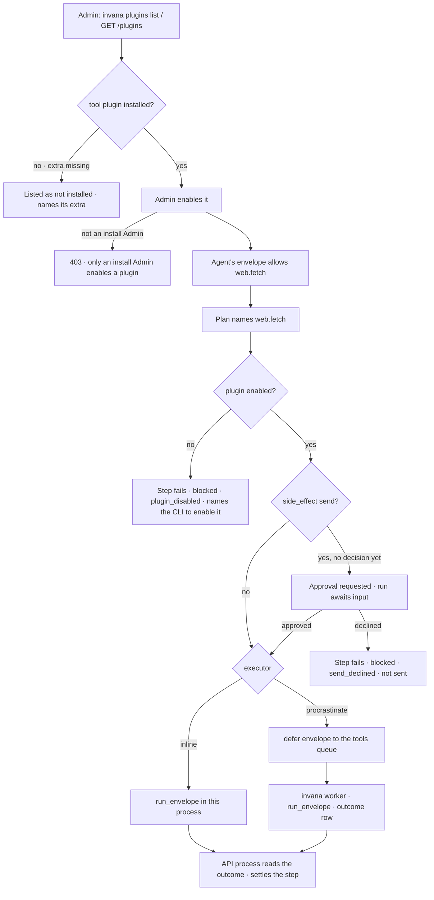
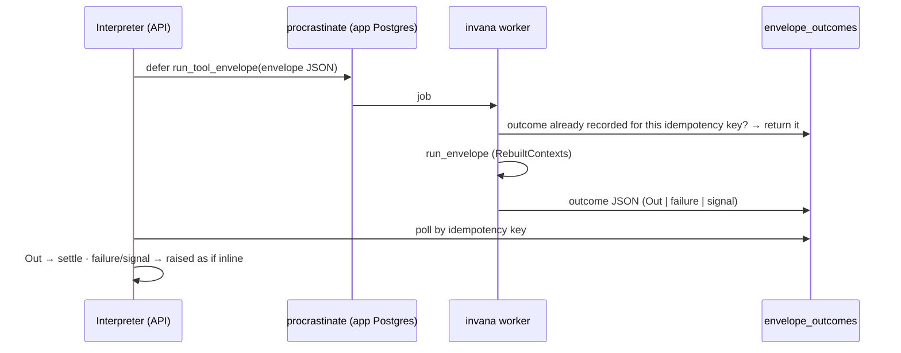

# Tool plugins

Optional plugins that reach outside Invana — the web, mail, science sources — as task types an agent
may name. Each is installed by its extra, enabled by an install Admin, and runs **in a worker**, never
in the API process. The registry they join is listed over the API and the CLI, so Agents › Plugins
(C03) and a terminal read the same thing.

| | |
|---|---|
| Index | [13.12](../../../README.md#13--platform) · Slice **B06b** |
| Module | [Platform](../spec.md) |
| API / CLI / Studio | ✅ / ✅ / 🔵 — the Agents › Plugins surface is C03 |
| Related | [plugins](plugins.md) · [distributed execution](distributed-execution.md) · [approvals](../../operate/features/approvals.md) · [products › plugins §4, §9](../../../../products/plugins.md#4-what-a-plugin-contributes) · [products › agents AG-13](../../../../products/agents.md) |

> **As** an install Admin, **I want** to see every plugin the engine carries — its task types, their
> manifests and versions, its skills and flows — and enable a tool plugin deliberately,
> **so that** agents reach the web, mail or a science source only when I have said they may, and that
> code never runs inside the API process.

## Capabilities

| # | Capability | Notes |
|---|---|---|
| C1 | Three tool plugins | `invana.tools.web` · `invana.tools.mail` · `invana.tools.science` under `plugins/tools/`, `kind = "tool"`, own semver |
| C2 | Optional extras | `invana[tools-web]` · `[tools-mail]` · `[tools-science]`; a tool plugin loads only when every requirement its extra names is installed |
| C3 | Task types | `web.search` · `web.fetch` · `web.download_and_extract` · `mail.read` · `mail.send` · `pubmed.search` · `uniprot.get` · `pubchem.get` — all bound `network` |
| C4 | A composite task type | `web.download_and_extract`: download → unzip → parse, one task type, one envelope, one step on the run page |
| C5 | A skill in a plugin | `plugins/tools/web/skills/collect-dataset/` — `skill.toml` + `instructions.md`; seeded into every Graph like the built-in playbook, `origin = builtin` |
| C6 | Enable · disable | An install Admin enables or disables a tool plugin; disabled is the default. Core and simulator plugins are always on |
| C7 | The registry API | `GET /api/v1/plugins` · `/plugins/{name}` · `POST /plugins/{name}/enable · disable` · `GET /api/v1/task-types/{ref}` |
| C8 | The CLI | `invana plugins list · show · enable · disable` · `invana tasks show <key>[@version]` · `invana worker` |
| C9 | Tools run in workers | Under `executor = "procrastinate"`, every tool step is deferred as a `TaskEnvelope` to the `tools` queue and run by `invana worker`; the API process waits for its outcome |
| C10 | `send` waits for an approval | A step whose task type is `side_effect = "send"` (`mail.send`) holds the run on an approval in the inbox; approve resumes it, decline fails the step as *not sent* |
| C11 | Secrets stay in the worker | A task type reads only the secrets its plugin declares, from the worker's environment (`INVANA_SECRET_<NAME>`); nothing rides an envelope |
| C12 | Wire forms | `Out`, `TaskFailure`, `NeedsInput`, `CannotAnswer` and `Converse` cross the queue as JSON and are raised again in the API process |

## Journey

## Seams

| Seam | What happens |
|---|---|
| Extra not installed | The plugin is listed `installed: false` with the extra that installs it; its task types are not in the registry, so a plan naming one is refused by the validator |
| Plugin disabled | Its task types stay in the registry (the frozen set is what the process *can* run); a step naming one fails `blocked · plugin_disabled` before any context opens |
| Enable while runs are in flight | Takes effect for the next step dispatched — no restart; enablement is a gate, not a load |
| No worker running | The envelope waits in the queue; the step stays `running` until its `timeout_s` (300 s when the manifest declares none) plus 120 s of queue wait — one reaper cycle and the stall window — then fails `transient · worker_unavailable` |
| Approved from the CLI | `invana approvals approve` records the decision but does not resume the run; the API's approve does. The run resumes on its next `submit` |
| A worker dies mid-step | Its heartbeat stops; the reaper inside `invana worker` retries jobs silent 10 s; the redelivered envelope keeps its idempotency key, and a recorded outcome is returned rather than re-run |
| Redelivered `mail.send` | Its `Message-ID` is derived from the idempotency key, so a resend after a crash between send and record is the same message to the receiving server |
| Approval expires | The run stays awaiting input; the expiry is in the inbox, and the run is cancelled by hand |
| An unattended run reaches `mail.send` | The approval is requested from the run's actor (the agent's or schedule's owner) like any other — an approval is not a clarification, so it does not end the run as *cannot answer* |
| Secret missing | `blocked · secret_missing`, naming `INVANA_SECRET_<NAME>` — the worker's environment, not the API's |
| robots.txt disallows | `web.fetch` fails `blocked · robots_disallowed` with the URL; nothing is read |
| SQLite install | `executor = "procrastinate"` needs Postgres; on SQLite the engine refuses to start with that setting |

## Engine

| Path | Holds |
|---|---|
| `plugins/tools/<plugin>/` | `plugin.toml` · `tasks/<key>/` · `skills/<slug>/` — same layout as a core plugin |
| `plugins/registry.py` | `TOOL_PLUGINS`; `installed()` per extra; `LoadedPlugin.skills`; `Registry.available` (every tool plugin on disk, installed or not) |
| `plugins/sdk/context.py` | `TaskContext.secret(name)` — refuses a name the plugin does not declare |
| `plugins/sdk/web.py` | the shared HTTP client, robots check and HTML → text, used by `web.*` and the science tools |
| `plugins/envelope.py` | `outcome_to_json(out | exc)` · `outcome_from_json(raw)` — the wire forms |
| `plugins/queue.py` | the procrastinate app, the `run_tool_envelope` job (contexts rebuilt by `RebuiltContexts`), `defer` · `await_outcome` · `run_worker` · the reaper · `apply_schema` |
| `runtime/interpreter/loop.py` | the `send` gate before dispatch; `resume_after_decision(run_id)` |
| `activity/managers/approvals.py` | `ApprovalSendGate` — the gate over the inbox |
| `runtime/executor.py` | `_dispatch` routes: enabled check → `send` approval gate → tool + procrastinate → queue, else inline |
| `runtime/managers/plugins.py` | `PluginManager` — list, show, enable, disable, task type by ref, enabled set |
| `runtime/models.py` | `PluginState` · `EnvelopeOutcome` |
| `server/plugins/` | routes · views · admin |
| `cli/commands/plugins.py` · `worker.py` | `invana plugins …` · `invana tasks show` · `invana worker` |

| `plugin_states` column | Type | Notes |
|---|---|---|
| `name` | String(128), PK | the plugin's name, e.g. `invana.tools.web` |
| `enabled` | bool | |
| `changed_by_id` | String(36), nullable | the Admin who last changed it |
| `changed_at` | timestamptz | |

| `envelope_outcomes` column | Type | Notes |
|---|---|---|
| `idempotency_key` | String(160), PK | `run_id:node_id:attempt` |
| `run_id` | String(36), indexed | |
| `outcome` | JSON | `{kind: out · failure · needs_input · cannot_answer · converse, …}` |
| `created_at` | timestamptz | |

| Endpoint | Who | Returns |
|---|---|---|
| `GET /api/v1/plugins` | any signed-in user | `PluginSummary[]` — `name · kind · version · title · extra · installed · enabled · task_types · skills · flows` |
| `GET /api/v1/plugins/{name}` | any signed-in user | `PluginDetail` — the summary plus each task manifest, flow and skill |
| `POST /api/v1/plugins/{name}/enable` · `/disable` | install Admin | `PluginSummary`; 409 for a core or simulator plugin, 404 for an unknown one, 409 to enable one not installed |
| `GET /api/v1/task-types/{ref}` | any signed-in user | `TaskTypeRead` — one manifest by `key` or `key@version`, its plugin, `runs_30d` |

| Task type | Args | Outputs | Side effect · secret |
|---|---|---|---|
| `web.search` | `query`, `limit=10` | `results` (title · url · snippet), `searched_at` | read · `web_search` (a SearXNG base URL) |
| `web.fetch` | `url` | `url · title · text · links · fetched_at` | read |
| `web.download_and_extract` | `url`, `max_mb=50` | `url · files · rows · fetched_at` | read |
| `mail.read` | `folder="INBOX"`, `limit=20`, `unseen_only=true` | `messages` (from · subject · date · text · message_id) | read · `imap` |
| `mail.send` | `to`, `subject`, `body` | `message_id · sent_at` | **send** · `smtp` |
| `pubmed.search` | `query`, `limit=20` | `articles` (pmid · title · journal · year · url) | read |
| `uniprot.get` | `accession` | `entry` · `url` | read |
| `pubchem.get` | `name` or `cid` | `compound` · `url` | read |

| Setting | Default | Notes |
|---|---|---|
| `INVANA_EXECUTOR` | `inline` | `inline` · `procrastinate` |
| `INVANA_WORKER_CONCURRENCY` | `4` | jobs one `invana worker` runs at once |
| `INVANA_SECRET_<NAME>` | — | read in the worker only, for declared secrets |

## Decisions

| # | Decision |
|---|---|
| TP1 | **Enablement is a gate, not a load.** Every *installed* tool plugin is in the frozen registry; whether it is *enabled* is checked when a step is dispatched, so an Admin's switch takes effect without a restart while the set of what the process can run stays closed. Disabled is the default. |
| TP2 | **Only tool plugins switch.** Core plugins are the product; a simulator is run on purpose from a project (9.8) and stays on whenever installed. |
| TP3 | **"Installed" is read from the engine's own metadata.** A tool plugin's extra lists its requirements; the plugin loads when each is importable. An extra with no third-party requirement — all three today, stdlib plus `httpx` — is always installed, the same rule as `sim-genomic`. |
| TP4 | **Tools run in workers under `procrastinate`; `inline` is the single-process mode.** `inline` (dev, tests, one-box installs) calls `run_envelope` in the API process for every step; `procrastinate` sends tool steps — and only tool steps (13.11 DE8) — to the `tools` queue. Production images set `procrastinate`. |
| TP5 | **procrastinate is the `workers` extra**, not a core dependency: `psycopg` and procrastinate are Postgres-only and a SQLite dev install never needs them. `all` includes it, so every image has it. |
| TP6 | **Outcomes come back through `envelope_outcomes`**, keyed by idempotency key, polled by the API process. procrastinate stores no result; a row also makes a redelivery return the recorded outcome instead of running twice. |
| TP7 | **procrastinate's schema is applied by `invana migrate`** on Postgres, through its own schema manager, after Alembic — its tables are not ours to diff in the golden schema. |
| TP8 | **The reaper runs in every worker.** Each `invana worker` heartbeats every 2 s and, once a minute, retries jobs whose worker has been silent 10 s (13.11 DE6). |
| TP9 | **`send` is gated by the interpreter, through the approvals inbox.** Before a `send` step dispatches, the run holds on an `Approval` (`subject_kind = "step"`, the args frozen as its payload, approver = the run's actor, else the Graph's owner, 24 h deadline). Approving or declining resumes the run; the task type itself never asks. |
| TP10 | **Secrets live in the worker's environment** as `INVANA_SECRET_<NAME>`, read through `ctx.secret(name)`, which refuses a name the plugin's `plugin.toml` does not declare. No secrets table this slice. |
| TP11 | **`web.search` speaks SearXNG.** The `web_search` secret is a SearXNG base URL; an open, self-hostable search keeps a vendor key out of the product. |
| TP12 | **The web tools honour robots.txt and cite.** Every fetch checks robots.txt for the `Invana` user agent first, and every row a web or science tool returns carries its source URL. Downloads stop at `max_mb`. |
| TP13 | **A plugin skill is a folder, seeded like the playbook.** `skills/<slug>/skill.toml` (`name · when_to_use · description · version`) + `instructions.md`; seeded into each Graph with `origin = builtin`, idempotent by name. Its plan is generated, never shipped (products › plugins §4). |
| TP15 | **The runtime names only the gate's shape.** `SendGate` (request · decision) is declared in the interpreter; `ApprovalSendGate` over the inbox lives with the approvals manager, and each front-end that builds a runtime installs it (the API at start-up, the CLI in `with_runtime`). With none installed a `send` step fails `blocked · approvals_unavailable` — nothing is sent. The approval's subject is the step row, which a resumed run re-runs. |
| TP16 | **A plugin skill is seeded as a published v1 whose plan is the one-step `human` placeholder, marked `generated`,** so the first draw replaces it — a skill version always has a plan, and the instructions are what the plugin ships. |
| TP17 | **Two keys of one plugin that end alike take whole-key folders** — `uniprot_get/`, `pubchem_get/`, and `pubmed_search/` beside them for symmetry; keys stay as the product named them. |
| TP14 | **Wire forms are tagged JSON.** `{kind: "out", …Out}` · `{kind: "failure", cls, cause, message, short, evidence, raw}` · `{kind: "needs_input", question, options}` · `{kind: "cannot_answer", reason, exchange}` · `{kind: "converse", reply, options, exchange}`; anything else a worker raises is `failure · defect · worker_error`. |

## Not building

| Not building | Because |
|---|---|
| MCP plugins and `invana plugins mcp add` | [13.13 MCP plugins](mcp-plugins.md) — they switch and run like tool plugins |
| The Agents › Plugins screen | C03 — this slice ships its API |
| Genebank tools | no single genebank API to target yet; the science plugin starts with PubMed, UniProt and PubChem |
| A secrets store in the app DB | env in the worker is enough for three secrets; a store is its own feature |
| Per-agent "who may call it" on the registry | worlds and guardrails already decide it per Graph; the install-level registry does not repeat it |
| Routing envelopes to resource pools | one `tools` queue until a plugin declares `gpu` (13.11) |
| Core steps on workers | they hand over through `RunVars` (13.11 DE8) |
| Idempotency checks in the core `*_write` task types | they run inline only; the worker-level outcome check covers every remote step |
| Resuming a run whose approval expired | the run waits; cancelling it is a person's act |
| Resuming a run from `invana approvals approve` | the CLI decides only; resume is the API's (seam above) |
| Disabling simulator plugins | TP2 |
