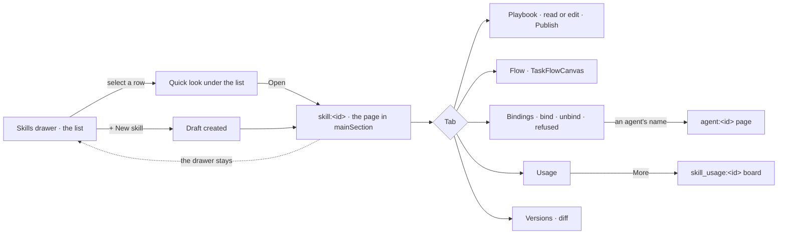

# Authoring a skill

A skill is a playbook with a name, a body, and — the part that matters — a **when to use**. It is
offered to a step, never forced on one.

| | |
|---|---|
| Index | [6.1](../../../README.md#6--skills) · Slice **S5** |
| Module | [Skills](../spec.md) |
| API / CLI / Studio | ✅ / — / ✅ |
| Related | [bindings](bindings.md) · [usage](usage.md) · [proposals](../../memory/features/proposals.md) |

Product spec: [AG-F04 · Skills](../../../../../specs/products/agents/features/AG-F04-skills/feature.md) — AG-37 · AG-19; the stories, their criteria, journey, states and product decisions live there. This file keeps the engine shape.

## Journey

### The skill's page

As someone writing playbooks, I want one skill in full width — its prose, its flow, who carries it,
whether it is applied and what it used to say — so that I can author and judge it without a 420px
column cutting each answer into a scroll.

| Step | Unhappy path | What is seen |
|---|---|---|
| Open | the skill was deleted since the list loaded | the page says *This skill is not in the Graph* and names the way back |
| Page loads | reading the skill list | a spinner where the page will be |
| Playbook on a draft | nothing is published | the tab opens editing; Usage and Versions say *nothing published yet* rather than a gap of zero |
| Flow on a draft | the version has no published plan | the Flow tab draws the draft's own plan |
| Bind | the check refuses | the refusal card under that agent's row ([BN8](bindings.md)) |

## Surfaces

| Surface | Shape |
|---|---|
| Skills list | One per Graph; `+` in the header |
| Skill panel | The four fields; version bar with what changed |
| Flow tab | The drawn plan, read-only — **reuses the plan canvas** (`WorkflowStepHiFi`, screen 34), not a new screen |
| **The skill's page** | `Open` on the selected row opens `skill:<id>` in `mainSection`: a record header — name · `vN` or `draft` · origin — over five tabs, `Playbook · Flow · Bindings · Usage · Versions`. The drawer stays beside it ([SK17](#decisions) · [SK36](#decisions)) |

## Engine

| Thing | Shape |
|---|---|
| `skills` | `graph_id` · `name` · `current_version_id` |
| `skill_versions` | `skill_id` · `version` · `description` · `content` · `when_to_use` · **`plan_id` (NOT NULL, UNIQUE)** · `published_at`, immutable. `plan_id` arrives with [M8](../../../building-engine/task-model-migration.md) — the column is added `NOT NULL` there, over a backfill, never nullable first ([SK13](#decisions)) |
| `skill_version_clarifications` | `skill_version_id` · `span` · `question` · `options` · `answer` · `answered_by` — recorded, so a redraw never re-asks |
| Routes | `…/skills*` · `POST …/skills/{id}/versions`. No route writes plan rows — a draw is the only writer ([SK7](#decisions)) |
| Events | `skill.create` · `skill.update` · `skill.publish` · `skill.delete` |

## Surfaces, as drawn

On [Govern, Agents and Skills](https://claude.ai/artifact/VrdrR5iKGfqsjhCouQDTbc) — the rows not yet settled into AG-F04.

| Surface | Shape | Artboard |
|---|---|---|
| The drawer | `Skills` list: name, version, the whole `when_to_use` sentence. A draft says so. The selected row's **quick look** under the list, and **Open** ([SK37](#decisions)) | `SkillsViewPanel` |
| The detail | The **page** `skill:<id>` in `mainSection` ([SK17](#decisions)) — `RecordHeader` over `TabbedPanel`, five tabs. Not drawn yet; built on the agent page's shape ([AG38](../../agents/features/author-an-agent.md#decisions)) | — |
| **Playbook** tab | The prose, one sentence per line, each showing the step it produced; a sentence with no step is marked | `SkillAuthor` |
| **Flow** tab | The plan on [`TaskFlowCanvas`](../../../building-studio/task-flow-canvas.md): its tasks and `depends_on` edges, ELK left to right, **Circles** or **Cards** ([SK16](#decisions)). A one-line header above it says the step count and how many of the six layers the plan declares, which is the bind check read in advance. A step inlined from a library plan is an ordinary node; its hover card says *from nl-single@1*. **Composed** under the canvas names each plan once — its step count, what this skill tuned, and *vN exists* when the library has published past it ([SK34](#decisions)) | `SkillFlow` · `SkillUsesPlan` |
| **Versions** tab | The version list, and the prose diff against the one before ([SK38](#decisions)) | `SkillVersions` |

## Decisions

Engine rows, and rows that stay until they are settled; the product decisions are AG-F04's.

| # | Decision |
|---|---|
| SK19 | **Every existing skill becomes its own immutable v1, and the steps that were offered it are rewritten to name it.** `published_at` is the skill's `created_at`; `task_runs.skills_offered` and `.skills_applied` are migrated from bare skill ids to that v1's id, so one id shape means one thing everywhere and no reader carries a *before versions* branch. The claim v1 makes is narrow and stated on the usage surface: *this is the text as it stands, and these steps were offered this skill* — not that the wording never changed before versions existed. |
| SK4 | Deactivate rather than delete. |
| SK5 | **A skill's plan hangs off the version, not the skill.** A version is immutable, so a plan can never be stale against the prose it was drawn from — there is no `stale` flag and no reconciliation job. |
| SK13 | **A skill version is drawn as exactly one `Flow`** — `plan_id` is `NOT NULL`. No surface branches on *does this skill have a flow*, and the Flow tab is always there. |
| SK16 | **The Flow tab draws the plan as a graph on `TaskFlowCanvas`, and that is the only flow view a skill has.** The question a reader brings to the tab is the plan's *shape*: what runs first, what waits on what, where two readings branch and join. A layer strip cannot draw that, and pointing the reader to the Library for it sent them away from the skill they were reading. The canvas is the same one the run page's Flow tab uses ([task-flow-canvas.md](../../../building-studio/task-flow-canvas.md) TF1), so a skill's plan and a run of it are drawn the same way. *What will this playbook engage?* is answered by the tab's one-line header — steps, and how many of the six layers the plan declares — and by the node colours. The Layers tab of a run keeps the six-band strip ([SR49](../../operate/features/see-what-ran.md#decisions)). The data is the current version's `SkillPlanRead`, turned into `TaskFlowData` by `taskflow/taskFlowFromPlan.ts`, with the plan's own edges (`binding` stays `binding`, `order` becomes `require`). |
| SK15 | **`form: human` is the universal fallback**, which is what makes SK13 safe: anything the catalogue cannot express, a person can, so a catalogue gap never blocks publishing a playbook. **A plan every row of which is a person's is one of those plans, not an empty one.** Such a plan reaches the envelope with nothing to validate, and the validator reads an empty step list as *the plan has no steps* — so the draw skips that check rather than passing it a list the check would misread. The genuinely empty plan is already refused a line earlier, in its own sentence ([SK14](#decisions)), and it is the plan a draft is born with ([SK22](#decisions)) that makes this the ordinary case rather than a corner. |
| SK12 | **A redraw is a revision, not a fresh draft.** The previous plan goes back to `draft_plan` and the result is shown as a diff, so a moved box is the author's edit and not the model's sampling. |
| SK8 | **It is a `Flow`, not a `SkillPlan`.** Same record, same Runtime, same `plan_snapshot`. The skill is provenance — `source_skill_version_ids[]` — and provenance is a column, not a type ([orchestration § 0.8](../../../orchestration.md#08-a-skill-drawn-as-a-flow)). |
| SK20 | **A draft is a `skill_versions` row with `published_at IS NULL`** — the only mutable version row there will ever be. Publishing stamps `published_at` and moves `skills.current_version_id`; from then on it is immutable ([SK2](#decisions)). A skill has at most one draft, and its `version` number is assigned when the draft is created, so the plan, the clarifications and the answers hang off the id the published version keeps. *Text, answers and plan publish as one act* is then one `UPDATE`, not a copy. |
| SK21 | **`skills.current_version_id` is null while a skill has only a draft**, and the read says `is_draft`. Nothing is ever offered a draft — assembly reads the current version, which does not exist yet — and the drawer draws it as what it is. |
| SK22 | **The plan exists from the first draw, never before it.** `plan_id` is `NOT NULL`, so a draft is written together with a plan: one `form: human` node carrying the skill's name ([SK15](#decisions)). A catalogue gap, an unrun planner and a half-written playbook are then the same shape — *a person does this step* — instead of three empty states. |
| SK23 | **Drawing is a `role=plan` TaskRun** ([AG-19.14](../../../../../specs/products/agents/features/AG-F04-skills/stories/AG-19-write-a-skill-as-a-document-and-see-the-plan-it-becomes/story.md)), and it is the first thing in the product to open one. The exchange is recorded, the clarification is an ordinary `TaskPrompt`, answering resumes from the cursor, and what the planner did opens in Runs like any other run — none of which is worth reimplementing inside a skill. |
| SK24 | **The three ambiguity cases are counted, not judged** ([SK10](#decisions)). `draft_plan` asks the model for **candidates per sentence**: exactly one → a `callable` task; **two or more → a clarification** quoting the sentence and offering the readings, each naming the step it would write; none → a `form: human` task. A sentence the model marks as not an instruction produces no task and is shown unmapped. |
| SK26 | **The draft's question is a row on the version, not a prompt on the run.** `draft_plan` records the clarification against the sentence and the run **settles** having written nothing — it does not suspend. Three reasons, and they agree: the question belongs *against the sentence in the editor* rather than in a queue (Seams); a run with no reply row is unattended, and the runtime turns an unattended question into *cannot answer* rather than leaving a run waiting on nobody; and an answer is part of what publishes, so it has to outlive the run that asked. Drawing again after an answer is another draw, which is also what makes a redraw a revision ([SK12](#decisions)). |
| SK28 | **A skill's plan is checked for whether it holds together when it is drawn, and for who may run it when it is bound.** A skill belongs to no agent — it is offered to whichever are bound to it — so *may **this** agent call **this** step* is checked where the agent is known: at bind time ([BN5](bindings.md)). The draw validates in the drawing envelope: a duplicate key, a binding to a step that does not run first, a binding to an output its source does not declare, a `requires` the catalogue declares, and a step the catalogue does not declare — each refused by name ([SK31](#decisions)). A step a person does is always allowed ([SK15](#decisions)). |
| SK27 | **The act a drawer is for sits on its header's right, and a drill-in is the header's title.** A stack gives each drawer one header with one action area ([G33](../../../building-studio/graph-detail-page.md)), so `+ New skill` is the Skills drawer's header action rather than a button floating above the list. The Skills drawer does not drill in — its detail is the page ([SK17](#decisions)). The Rules drawer does: `RULES / <statement>` is its header's title and `‹ Back to rules` takes the action area. **The trail is text.** A `PanelStack` header *is* its collapse control, so a crumb that could be clicked would be a `<button>` inside a `<button>` — invalid, and it would steal the collapse click. [`StackSection`](../../../building-studio/the-shell.md) drills in the same way. |
| SK29 | **`origin` names what wrote the rows, so the plan a draft is born with is `generated`.** The fallback plan is one `form: human` node nobody wrote ([SK22](#decisions)), and a draw leaves the plan `generated` ([SK7](#decisions)). *Redraw* is read off the rows: a node with a `source_span` was drawn. |
| SK30 | **Answering a question continues the drawing, and the surface is what opens the next draw.** The run that asked has already settled ([SK26](#decisions)) — resuming it would be a run waiting on nobody — so the loop the journey draws (*answer → `draft_plan` again*) is closed one band up: recording the answer returns the draft, and Studio opens the next draw with it. An answer is only ever given to get the flow drawn, so making the author press *Draw this* a second time is a step that asks them to restate what they just said. The engine's route records and nothing else, which is what keeps a redraw a revision ([SK12](#decisions)) and keeps the cap (`max_clarifications`) the only thing that ends the loop. |
| SK31 | **A draw that cannot write the plan settles, exactly as one that must ask does.** `resolve_plan` refuses a drawn plan for four reasons — a step outside the envelope, a duplicate key, a binding to a step that does not run first, and a `requires` the catalogue declares and the prose never named. All four are the *author's* to answer, so the draw records them on its result and settles with `steps: 0`; it does not raise. Raising put the reasons in a failure payload no surface reads, left the draft silently undrawn, and named the agent's envelope for a refusal that was usually about a missing prerequisite — a refusal on grounds it did not check, which is the one thing a refusal may never be ([BN7](bindings.md)). The reasons are read back off that run, in the validator's words, and shown where the flow would have been; the next draw that writes rows is a newer run, so the refusal clears itself and needs no column. |
| SK33 | **The inlined steps are flat siblings, each naming the plan version it came from.** A `composite` parent would need an interpreter that walks one — which nothing has ever written — and it would buy a drawing, which `tasks.source_plan_key` gives for free: the Flow tab groups five rows under *nl-single@1* without a node that hides them. Each copy also records the step it was copied from in `tasks.source_step_key`, so the library plan's page can count a skill's runs step by step without reading its prefix ([LB36](../../workflows/features/the-library.md#decisions)). Both are recomputed on every draw, because a draw copies the plan afresh. Flat also keeps one promise that nesting would quietly weaken — the envelope validates **every** step, because every step is a row at the same depth, so a composed plan cannot smuggle one past a bound ([LB18](../../workflows/features/the-library.md#decisions)). |
| SK36 | **`skill:<id>` is the skill's page, and it authors.** The `skill` board kind renders the page ([SK17](#decisions)) rather than a `BoardSpec`: one full-width surface per skill, because a read-only board beside an editable drawer was two drawings of one skill to keep in step. The page carries the writes — edit and publish on Playbook ([SK6](#decisions)), bind and unbind on Bindings ([BN8](bindings.md)) — the way the agent page carries an agent's ([AG34](../../agents/features/author-an-agent.md#decisions)). `skill_usage:<id>` stays a board — a reading of what happened, opened from the Usage tab's `More` ([skills-boards.md](../../../building-studio/skills-boards.md) SD2). |
| SK37 | **Selecting a row gives a quick look under the list; Open gives the page.** The same gesture as the Agents drawer ([AG36](../../agents/features/author-an-agent.md#decisions)), so the two list drawers work one way. The quick look answers *which one is this, and is it used*: name · `vN` or `draft`, the `when_to_use` sentence, offered and applied on the current version, and how many agents carry it. **Open** is its only act. `+ New skill` creates the draft and opens its page on Playbook, editing — a draft has nothing else to show. |
