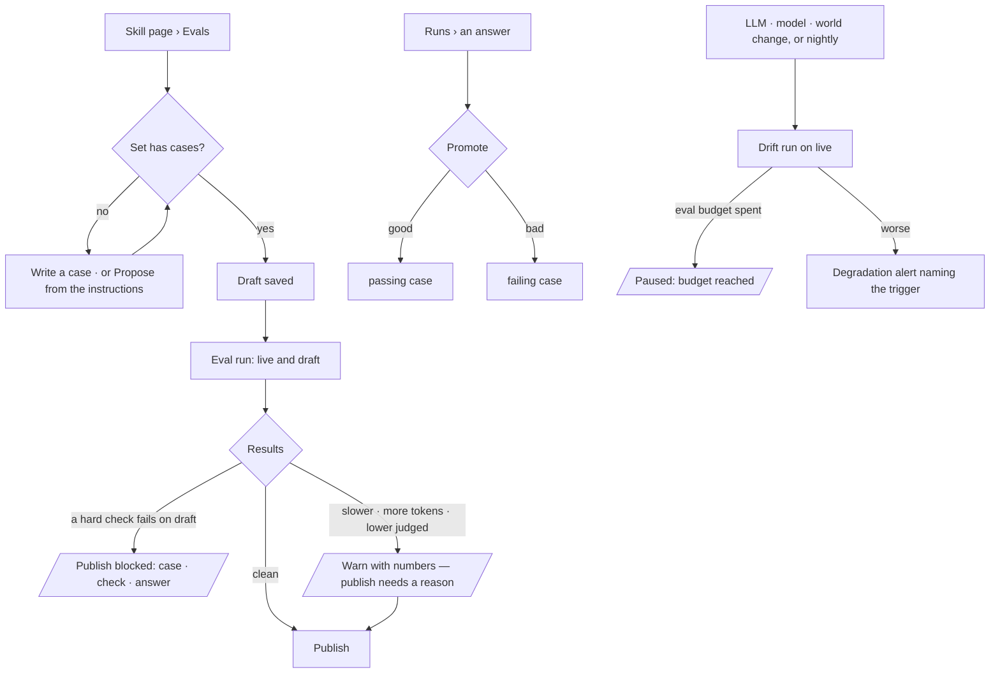

# Evals

Each skill and agent keeps an eval set — fixed questions with the traits a good answer must have. The
set replays against live and draft before anything publishes, re-runs when something it depends on
changes and nightly, and spends its own token budget.

| | |
|---|---|
| Index | [6.6](../../../README.md#6--skills) · Slice **B02** (P-15) |
| Module | [Skills](../spec.md) |
| API / CLI / Studio | ✅ / 🟡 / ✅ |
| Related | [instructions-publish-rollback](instructions-publish-rollback.md) · [pinned-model-versions](../../agents/features/pinned-model-versions.md) · [change-log](../../operate/features/change-log.md) · [schedules](../../operate/features/schedules.md) · products: [agents.md](../../../../products/agents.md) AG-08 · AG-15 |

> **As** a builder, **I want** every draft replayed against a fixed set of questions before it
> publishes, and re-checked when its model or world changes, **so that** regressions are caught the
> day they ship, not when a user notices.

## Capabilities

| # | Capability | Notes |
|---|---|---|
| C1 | An eval set per skill and per agent | Fixed questions, each with checks |
| C2 | Rule checks | Hard, counted: cites records · names the world · says *cannot answer* when it should · guardrail holds · expected records present · tokens under N · latency under N ms |
| C3 | A labelled judge | A rubric scored by a pinned model that differs from the one under test; a judged score is never mixed with hard checks |
| C4 | Live vs draft | One eval run replays every case on both and reports checks, changed answers, p95 and tokens |
| C5 | The publish gate | A failed hard check blocks publish; a regression warns with the numbers and needs a stated reason |
| C6 | Promote a real ask | A good answer becomes a `passing` case, a bad one a `failing` case — always a person's act |
| C7 | A starter set | Written by the builder, or proposed by the assistant from the instructions and accepted case by case |
| C8 | Drift re-runs | On an LLM pin or cast change, a Graph model publish, a bound world change, and nightly |
| C9 | Degradation alert | A drop in hard checks, or p95 or tokens past 1.5× the last run, raises an alert naming the trigger |
| C10 | Eval token budget | Per Graph, per month, apart from production tokens; at the ceiling scheduled evals pause and say so |

## Journey

## Seams

| Seam | What the user sees |
|---|---|
| No eval set yet | Publish is not gated; the gate says *no eval set — nothing checked* |
| A judge pinned to the model under test | Refused when the set is saved, naming both |
| Eval budget reached | Scheduled runs settle `paused: budget`; a publish-time run still runs, with a warning |
| A case whose source run is deleted | The case keeps its question and checks; the link reads *source gone* |
| No LLM offered | The eval run refuses at open, as any run does |
| A publish with no eval run over this exact draft | Refused `409 eval_required`, naming the set's case count — run the evals, then publish |
| A publish whose eval run has not settled | Refused `409 eval_running` |

## Surfaces

| Surface | Shape |
|---|---|
| Skill page › Instructions (evals mode) · Agent page › Instructions | The set — add, accept, delete, *Propose from the instructions* — and a run's tiles and cases, live vs draft (C03 `agents.skills.evals`) |
| Publish · Restore · Model version | A gate refusal drawn where the act was, with *Run the evals* when the gate asks for a run (C03) |
| Run page | *Promote to eval* — not in Studio yet; `invana evals promote` does it |
| Performance | Degradation alerts and the eval budget apart from production (AG-15, C10) |
| CLI | `invana evals list` · `run [--draft] [--version N] [--pin <address>]` · `promote <run> --as passing\|failing` · `drift [--trigger]`, each `--graph` and `--skill`/`--agent`. A run is worked in the CLI's own process and scored before it returns; `run` exits 1 when the gate blocks and 3 when it warns |

## Engine

| Table | Columns |
|---|---|
| `eval_sets` | `id` · `graph_id` · `subject_kind` (`skill` · `agent`) · `subject_id` · `judge_model_pin` (address, nullable) · `rubric` (Text, nullable) · `created_at` — unique on (`subject_kind`, `subject_id`) |
| `eval_cases` | `id` · `eval_set_id` · `question` · `checks` (JSON list of `{kind, value}`) · `label` (`passing` · `failing`) · `status` (`proposed` · `active` · `retired`) · `source_run_id` (nullable) · `created_by_id` · `created_at` |
| `eval_results` | `id` · `eval_run_id` (FK `task_runs`) · `eval_case_id` · `side` (`live` · `draft`) · `hard` (JSON `{check: pass\|fail}`) · `judged` (Float, nullable) · `tokens` · `latency_ms` · `answer_digest` |
| `eval_budgets` | `graph_id` (PK) · `monthly_tokens` (nullable = no ceiling) |

| An eval run | Is |
|---|---|
| Its record | A root `TaskRun` `role=evaluate`, `workflow_key=eval`, `triggered_by` `user` (publish, manual) or `system` (drift, nightly), `params.trigger` naming why |
| Its children | One replayed ask per case and side, `parent_run_id` the eval run; their tokens count on the eval budget, never on production |
| Its candidate | `params.candidate` — `draft`, a `version` (a rollback) or a `model_pin` (an agent's pin move) — and `params.candidate_digest`, the sha256 of the candidate's text and pin |
| Its summary | `result.eval` — per side: hard passed / total, p95 ms, tokens, judged mean; changed answers; the gate's verdict (`clean` · `warn` · `blocked`) with its reasons |

| Check `kind` | Passes when |
|---|---|
| `cites_records` | the answer cites at least one record |
| `names_world` | the run froze the world named in `value` — *Everything* when it froze none — so the answer's header names that world |
| `cannot_answer` | the run's outcome is `cannot_answer` |
| `guardrail_holds` | no refusal was overridden and no denied layer was read |
| `expected_records` | every id in `value` appears as a record `id` in the run's emissions |
| `max_tokens` | tokens ≤ `value` |
| `max_latency_ms` | latency ≤ `value` |

| Route | Does |
|---|---|
| `GET\|PUT …/evals/{subject_kind}/{subject_id}` | The set — judge pin, rubric |
| `POST\|PATCH\|DELETE …/evals/{subject_kind}/{subject_id}/cases[/{case_id}]` | Cases; `PATCH` accepts a proposed case |
| `POST …/evals/{subject_kind}/{subject_id}/runs` `{side: draft\|live\|both}` | An eval run — 202 |
| `POST …/evals/{subject_kind}/{subject_id}/propose` | The assistant's starter set, written as `proposed` cases — 201 |
| `GET …/evals/{subject_kind}/{subject_id}/runs[/{run_id}]` | Runs and their results |
| `POST …/evals/promote` `{run_id, subject_kind, subject_id, label}` | A case from a real ask |
| `GET\|PUT …/evals/budget` | The Graph's monthly eval tokens and what is spent |
| `POST …/evals/drift` `{trigger}` | The drift pass over every live set — what `invana evals drift` and the nightly schedule call |

## Decisions

| # | Decision |
|---|---|
| EL1 | **An eval run is a `TaskRun` with `role=evaluate`**, its cases replayed as child runs — the same machinery, trace and token count as any run. Only the per-case verdicts need a table, `eval_results`. |
| EL2 | **Hard checks are rule checks, counted from the run's own record** — citations, outcome, lens, tokens, latency. Nothing hard asks a model. |
| EL3 | **A judged score is labelled and kept apart.** The judge pins a model that differs from the one under test; its score warns, it never blocks, and it is never added to a hard count. |
| EL4 | **The gate: a failed hard check on the draft blocks publish.** Tokens or p95 more than 20% above live, or a judged mean 0.5 below it, warns with the numbers; publishing past a warning needs a `why`, kept on the publish event with the warnings. |
| EL5 | **Promoting is a person's act.** An agent never promotes, so a sensitive ask never becomes a case without someone reading it. A case keeps its source run's id. |
| EL6 | **A proposed case is not a case** until a person accepts it — the assistant's starter set waits as `proposed`. |
| EL7 | **Drift runs re-run the live version** when its model pin or cast changes, the Graph's model publishes, or a world bound to it changes, and nightly. The nightly pass is a shared schedule when [10.1](../../operate/features/schedules.md) exists; until then `invana evals drift` runs the same pass for an external cron. |
| EL8 | **Degradation is an event**, `eval.degraded`, naming the eval run, the trigger and the numbers, so it lands in Activity and Performance without a second store. |
| EL10 | **The gate reads a settled eval run over the exact candidate.** Publish, rollback and an agent's pin move each name a candidate — the draft, the version rolled back to, the new pin — and the gate looks for the newest settled eval run whose `candidate_digest` is that candidate's. None, while the set has active cases, refuses `409 eval_required`; a set with no active case passes and says *nothing checked*. An eval run never runs inside the publish request: replays take minutes, and the request would hold them. |
| EL11 | **A skill's eval runs with no agent; an agent's runs as the agent.** A skill case replays as an ask offered every published skill of the Graph, the subject's text swapped for the candidate's and the candidate's pin resolved first. An agent case replays as that agent, its draft instructions in place of its instructions and the candidate pin first. Neither writes a session or a reply. |
| EL12 | **The drift pass is one call**, `POST …/evals/drift {trigger}`: a live eval run for every set with active cases. The nightly schedule, `invana evals drift`, a Graph model publishing and a guardrail or world changing all call it; an agent's pin move needs no drift run, because the gate already replayed the new pin. A drift run is compared with the subject's last settled live run; `eval.degraded` fires on fewer hard passes, or p95 or tokens past 1.5× that run. |
| EL13 | **The judge reads a written answer.** The answer handed to the judge is the run's emissions as text — prose verbatim, a table's first rows, a subgraph's counts — capped at 4,000 characters; it scores 0–5 against the rubric. Its tokens are the eval run's own and count on the eval budget. |
| EL14 | **The starter set is one model call, and every case it writes waits.** `POST …/propose` hands the subject's text — its draft when one is open, else what is live — to the subject's own pinned model (the Graph's decide model when it has no pin), which writes up to five questions, each with rule checks it can state without the graph (`cites_records`, `cannot_answer`, `guardrail_holds`). Every case lands `proposed`, created by the person who asked; the exact model version is on each case's `eval_case.create` event. It is not an eval run, so it is not on the eval budget. |
| EL15 | **Studio draws the gate's answer, never predicts it.** A publish, a restore or a pin move goes to the engine as it is; a `409` whose `detail.error` is `eval_required` · `eval_running` · `eval_failed` · `eval_warned` is drawn as a refusal card, with *Run the evals* on `eval_required`. The evals view is a mode of the skill's Instructions tab, not a tab of its own ([agents.md › Decisions](../../../../products/agents.md#decisions) *Skill evals*). |
| EL9 | **The eval budget is tokens per Graph per month**, counted from eval runs only. At the ceiling scheduled and drift runs settle *paused: budget*; a publish-time run still runs and its result carries the warning. |

## Not building

| Not building | Because |
|---|---|
| Currency in eval spend | tokens only |
| A judge on the same model as the subject | it grades its own work |
| Judged scores in the gate | prose quality warns; only facts block |
| Agents promoting cases | a person reads every promoted ask |
| Traffic-split A/B evals | rollout is publish to every bound agent |
