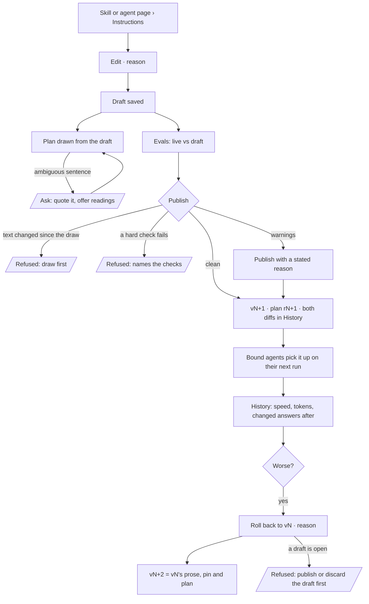

# Instructions, publish and roll back

People write `instructions.md` — a skill's playbook, an agent's instructions — as a draft; publishing
regenerates the plan from exactly that text, goes through the eval gate, and reaches every bound agent
on its next run. Rolling back is one act that makes a new version from an earlier one. Plans are
generated from instructions or packaged; nobody draws one.

| | |
|---|---|
| Index | [6.5](../../../README.md#6--skills) · Slice **B02** (P-11 · P-15) |
| Module | [Skills](../spec.md) |
| API / CLI / Studio | 🟡 / 🟡 / ✅ |
| Related | [authoring-a-skill](authoring-a-skill.md) · [evals](evals.md) · [author-an-agent](../../agents/features/author-an-agent.md) · [the-library](../../workflows/features/the-library.md) · [change-log](../../operate/features/change-log.md) · products: [agents.md › Instructions → plan](../../../../products/agents.md#instructions--plan) AG-04 · AG-08 · AG-09 · AG-11 |

> **As** a builder, **I want** to write a skill's or an agent's instructions and see the plan generated
> from them, **so that** I never hand-draw a pipeline and can roll back with evidence.

## Capabilities

| # | Capability | Notes |
|---|---|---|
| C1 | `instructions.md` on skills and agents | A skill's `content`; an agent's `instructions`. Plain Markdown a person owns |
| C2 | Drafts | A skill's draft is its unpublished version row; an agent's is `agents.instructions_draft` |
| C3 | Publish regenerates the plan | A skill version publishes only with the plan drawn from the exact text being published |
| C4 | Publish passes the eval gate | Hard checks block; warnings need a reason ([evals](evals.md)) |
| C5 | Pick-up on the next run | Bound agents read the current version when a run opens; running ones finish on the old |
| C6 | One-act rollback | A new version made from an earlier one — prose, pin and plan; nothing is rewritten |
| C7 | Plans are generated or packaged | `flows.origin` is written `generated` · `packaged` · `promoted` |

## Journey

## Seams

| Seam | What the user sees |
|---|---|
| A draft edited after its last draw | Publish is refused: *the plan was drawn from an earlier text — draw again* |
| A draw still asking | Publish waits on the answer; the clarification is on the draft |
| Rollback while a draft is open | Refused, naming the draft; the draft is never overwritten |
| Rollback to the current version | Refused — nothing to restore |
| A version an agent is running | It finishes on that version; the next run reads the new one |
| A plan row written `authored` before | Read as it is; nothing new is written `authored` |
| A sentence that names a library plan | Its rows land flat in the plan, each saying *from nl-single@2*; a tuned argument the plan does not declare refuses the draw, naming it |

## Surfaces

| Surface | Shape |
|---|---|
| Skill page › Instructions | The text beside its generated plan; *Edit instructions* saves the draft, draws it and replays the evals; *Publish vN* with a why (C03 `agents.skills.instructions.edit`) |
| Skill page › Plan | The generated plan, read-only, and under it what the last publish regenerated and which bound agents pick it up on their next run (C03 `agents.skills.plan.regenerated`) |
| Agent page › Instructions | The agent's draft, *Publish* through the gate, *Discard* (C03 `agents.agent.instructions`) |
| Agent page › History · Skill page › History | The change log; *Restore* on an older row, with a why, gated (C03 AG-06 · AG-09) |
| Plan page › Revisions in runs | A run that replanned, its steps against the base plan's (C03 AG-11) |
| Library › Plans | Generated and packaged plans, read-only; no *New plan* (AG-11) |
| CLI | `invana skills list` · `history` · `push <skill> --instructions <file>` · `publish` · `rollback --to N`; `invana agents list` · `push` · `publish`; `invana plans list` · `show`, all read-only for plans |

## Engine

| Column | On | Is |
|---|---|---|
| `drawn_digest` | `skill_versions` | String64, nullable — sha256 of the text the plan was last drawn from |
| `restored_from_version` | `skill_versions` | Integer, nullable — the version a rollback copied |
| `instructions_draft` | `agents` | Text, nullable — the agent's unpublished instructions; null = no draft |
| `origin` | `flows` | written `generated` · `packaged` · `promoted` |
| `uses` | `flows` | the library plans a draw inlined, `{key, version, args}` each |

| Route | Does |
|---|---|
| `POST …/skills/{id}/versions` | Publishes the draft — refused `409` when `drawn_digest` is not the digest of the draft's text |
| `POST …/skills/{id}/rollback` `{version, why}` | A new published version copying that version's prose, pin and plan; `skill.publish` with `details.restored_from` |
| `PATCH …/agents/{id}/draft` `{instructions}` · `DELETE …/agents/{id}/draft` | Writes or discards the agent's draft |
| `POST …/agents/{id}/publish` `{why}` | Moves the draft into `instructions` — an `agent.update` |
| `POST …/agents/{id}/rollback` `{version, why}` | Restores `instructions` as they were at that agent version — an `agent.update` |

## Decisions

| # | Decision |
|---|---|
| IS1 | **`instructions.md` is the record's own prose field**, not a file store: a skill version's `content`, an agent's `instructions`. *.md* names the format a person writes; the CLI's `push --instructions <file>` reads a file into that field. A schedule carries instructions when [10.1](../../operate/features/schedules.md) builds the schedule record. |
| IS2 | **Plans are generated or packaged; nobody draws one.** `flows.origin` is written `generated` (from instructions or for a Todo), `packaged` (ships with Invana or a plugin pack, seeded read-only) or `promoted` (a generated plan that served). Rows written `authored` before keep it and read as they are. |
| IS3 | **Nobody edits a plan by hand.** A skill has no route that writes plan rows and no *Edit by hand*; the library has no *New plan* and no drafting of one. A plan that reads wrong means the instructions are ambiguous, and the fix is the prose or the clarification answer. |
| IS11 | **Composition is drawn.** The planner reads the Graph's reusable library plans beside the catalogue — newest version of each, as `plan:<key>@<v>` with its description and declared arguments — and a sentence may name one as a candidate. It is counted like any candidate: one is a step, two or more ask. A picked plan is inlined at the draw: copied flat, keys prefixed with the plan key, each row naming the plan and step it came from ([SK32](authoring-a-skill.md#decisions) · [SK33](authoring-a-skill.md#decisions)), and validated in the drawing envelope with every other step. A candidate's `tune` sets arguments the plan declares; an undeclared one refuses the draw by name ([LB27](../../workflows/features/the-library.md#decisions)). `flows.uses` records the composition. A person composes by naming the plan in the prose. |
| IS4 | **Publish regenerates by requiring a fresh draw.** A draw stamps `drawn_digest` — the sha256 of the draft's description, content and when-to-use. Publish compares it with the draft's text now and refuses `409` when they differ, so a published plan is always the one drawn from the published words. Studio's *Publish* draws and then publishes; the engine never publishes an undrawn change. A draft opened over a published version, and a rollback, carry that version's digest: its plan is the plan of its text, so a pin-only or why-only publish needs no draw. `PATCH …/skills/{id}` with new prose writes the draft and publishes nothing. Seeds, fixtures and imports publish through `create(publish=True)`, a Python-only path no route reaches. The draft read says `drawn` — whether the digest matches the text now. |
| IS5 | **An agent's draft is one column**, `agents.instructions_draft`. An agent has no version table — its versions are its events ([CL8](../../operate/features/change-log.md#decisions)) — so publish is an ordinary `agent.update` that moves the draft into `instructions`, with its diff and why, and clears the draft; a draft equal to `instructions` clears without a new version. Publish with no draft open is refused `409`. `PATCH …/agents/{id}` `{instructions}` stays a direct write — an `agent.update` — for a caller with no draft surface; Studio writes the draft. An agent's draw and eval gate arrive with [evals](evals.md); until then publish moves the text. |
| IS10 | **An agent's rollback reads its events.** The instructions at version N are the `after` of the last change at or before N, else the `before` of the first change after N, else today's text. It is refused `409` while a draft is open, when that text is already current, and when the change that holds it predates recorded diffs; an unknown version is `404`. The `agent.update` it writes carries `restored_from`. |
| IS6 | **Rollback is a new version, never a rewrite.** It copies the chosen version's description, content, when-to-use, pin and plan rows into the next version number, publishes it, and records `restored_from_version`. The copied plan keeps the origin its rows had. An agent's rollback restores `instructions` from that version's fold in the change log. |
| IS7 | **Rollback refuses while a draft is open.** The draft owns the next version number; rolling back past it would either overwrite a person's work or skip a number. |
| IS8 | **Publish and rollback both pass the eval gate** ([evals](evals.md)). A rollback restores something that once passed — it still runs the current set, because the set may have grown. |
| IS9 | **Rollout is draft → publish to every bound agent on its next run.** No traffic splitting; a run open on the old version finishes on it. |
| IS13 | **Studio authors through the draft and the gate, never around them.** The agent's Instructions tab and the skill's Instructions tab write drafts, publish with a why and draw a gate refusal where the act was; History restores with a why through the same gate. Tab names, modes and what each draws are [agents.md › Decisions](../../../../products/agents.md#decisions) — *Agent instructions* · *Skill instructions* · *Plan regenerated* · *Skill history* · *Revisions in runs*. |
| IS12 | **`invana skills push` writes the draft and draws it**, in the CLI's own process, so the next `publish` has a plan drawn from that text. A draw that asks a question exits 2 and prints it; the question is answered in Studio, and the CLI never answers one. |

## Not building

| Not building | Because |
|---|---|
| Hand-drawn or hand-edited plans | plans come from instructions (IS3) |
| A picker that inlines a library plan | composition is named in the prose and drawn (IS11) |
| `GET …/skills/inlinable` | the planner reads the library itself; the picker it fed is gone (IS11) |
| A *New plan* in the Library | the same |
| Auto-publish on edit | editing prose never changes what runs by itself |
| Traffic splitting or canaries | rollout is publish to every bound agent |
| Instructions on schedules now | the schedule record does not exist yet ([10.1](../../operate/features/schedules.md)) |
| Rewriting history on rollback | a restore is a new version |
