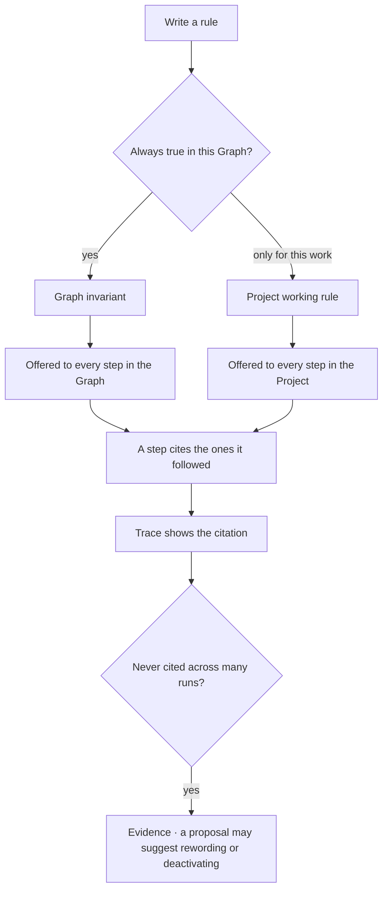
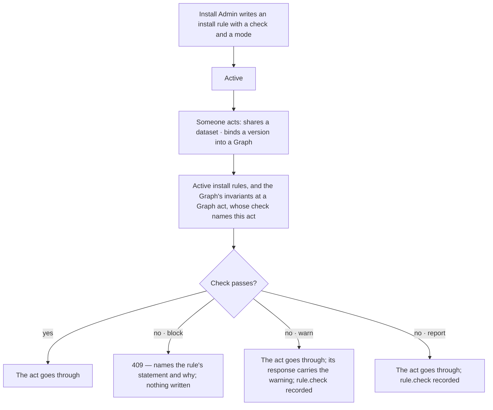
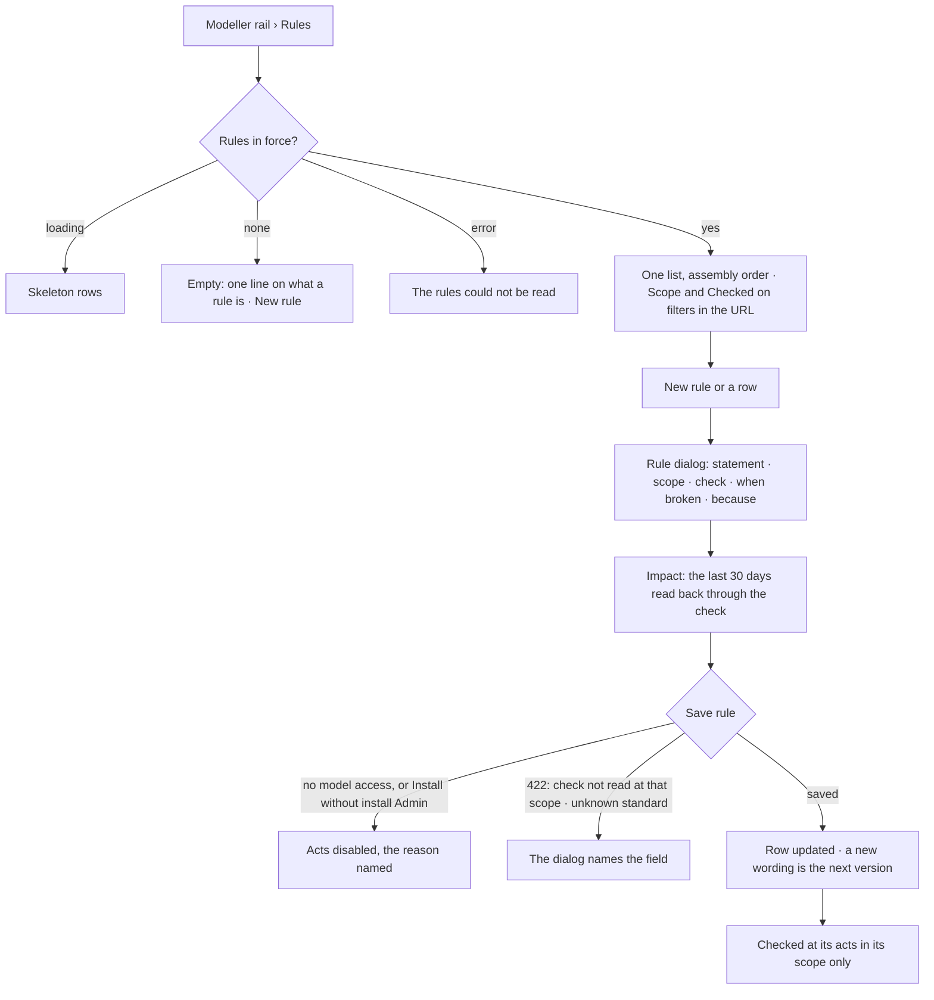

# Rules

One statement that is always true, offered to every step in its scope. **Install rules** hold across
every Graph; **invariants** belong to a Graph; **working rules** belong to a Project. A rule may also
carry a **check** — a machine half, read at the acts it names, and enforced `block · warn · report`.

| | |
|---|---|
| Index | [6.4](../../../README.md#6--skills) · Slice **S12b** · **B04** (P-12: install scope, checks) |
| Module | [Skills](../spec.md) |
| API / CLI / Studio | ✅ / ✅ / ✅ |
| Related | [authoring-a-skill](authoring-a-skill.md) · [objectives-and-criteria](../../work/features/objectives-and-criteria.md) · [standards](../../bring-data-in/features/standards.md) · products: [modeller.md](../../../../products/modeller.md) MO-12 · MO-F11 |

> **As** someone whose domain has hard facts, **I want** them stated once and offered to every run,
> **so that** no agent has to be told twice that prices are in rupees.
>
> **As** a compliance lead, **I want** rules at install, Graph or project scope, checked where they
> apply, **so that** organisation and certification policy holds.

## Capabilities

| # | Capability | Notes |
|---|---|---|
| C1 | One statement per rule | If it needs a paragraph, it is two rules |
| C2 | Three scopes | `install` (an install Admin's) · `graph` · `project` |
| C3 | Inheritance | A Graph inherits the install rules; a Project the install rules and its Graph's invariants. Read-only, shown as inherited |
| C4 | Offered discretely, with an id | So a step can cite the one it followed |
| C5 | Versioned | Editing publishes the next version; traces resolve to what was offered |
| C6 | Deactivate to stop | `active = false`; the versions and citations stay |
| C7 | Ordered | `order` decides the sequence in context, not importance |
| C8 | Cited by steps | A step cites the statements it followed; a citation is never enforcement |
| C9 | Checked at acts | A rule with a `check` is evaluated at the acts its kind names; the mode says what a failure does |
| C10 | Block · warn · report | `block` refuses the act, naming the rule · `warn` lets it through and says so · `report` records it only |

## Journey

A checked rule, at an act:

A compliance lead on Modeller › Rules:

## Seams

| Seam | What the user sees |
|---|---|
| A rule contradicting another | Not detected automatically — both are offered, and the trace shows which was cited |
| Deactivating a cited rule | Past citations resolve; nothing new is offered |
| A project with no rules | Inherits the install rules and the Graph's invariants and says so |
| A Graph member opens an install rule by id | Absent on the Graph's routes; the install routes read it |
| A check on a project rule | 422 — no project act is checked yet |
| A check naming a standard that does not exist | 422 at save |
| Two checked rules fail one act | Every block is named in one refusal; every warn is a separate warning |
| A deactivated checked rule | Checks nothing; its versions and past `rule.check` events stay |
| Long statement | Accepted, with a nudge that a rule reads better as one sentence |
| Clicking a statement in the **trace dialog** | The trace closes and the rule's board opens in its place ([RU13](#decisions)) — the citation chip reopens the trace where it was |
| A statement drawn where no board can open | It reads as text, not as a dead link ([RU13](#decisions)) |

## Surfaces

| Surface | Shape |
|---|---|
| Modeller › Rules (`modeller.rules`) | `/modeller/rules` — a page in the main area, no leftSection ([RU18](#decisions)). Head: *Rules*, the one-line purpose, the engine's `total` and *New rule*. The *Scope* and *Checked on* filters (`?f.scope=` · `?f.act=`, sent to the server). One list in assembly order: each row the statement, then scope (`install` · `Graph <name>` · `project <name>`) · checked on · mode · `N broken in 30 days`, the mode as a badge; an inactive rule dimmed in place. Under it, one line on what is not a rule: ranges on a property are constraints, shared vocabularies are standards |
| The rule dialog (`modeller.rules.edit`) | `/modeller/rules/<rule>` or *New rule* (`?new=1`) — a modal, its crumb the statement. Statement · Scope (*Install · Graph · Project*, fixed once saved; *Install* only for an install Admin; *Project* picks the project) · Check (the closed vocabulary and its params) · *Checked on* (the acts the check reads, drawn from it, never picked) · *When broken* (*Block · Warn · Report*) · *Because* (*Shown to whoever the rule stops.*) · the impact line, read as the check changes ([RU21](#decisions)). Footer: *Stop offering it* / *Offer it again* on an existing rule, *Open board* on an existing Graph or project rule (an install rule has no Graph board); *Cancel* · *Save rule* |
| `invana rules list [--graph u/slug] · show <id> · apply --file [--graph u/slug]` | CLI |
| Project panel → Working rules | A section of the project's **Details** tab, with the inherited invariants above it, greyed and read-only ([RU8](#decisions)) |
| Step row | The rules **offered**, each drawn as its statement, with the ones the step **cited** marked — the same two certainties as a skill ([RU12](#decisions)). A statement is the row, never an id, and clicking one opens that rule's board — beside the tree on the activity surface, in place of the dialog on the answer surface ([RU13](#decisions)). Drawn on the activity tree and in a step's trace detail |
| **The rule board** | `More`, drilled in, opens a `kind = rule` declared board: the statement, offered · cited · never cited, the row with its derived words, the versions with their own counts, and where each was cited ([RU11](#decisions)) |

## Engine

| Thing | Shape |
|---|---|
| `rules` | `graph_id?` · `project_id?` · `active` · `order` · `current_version_id` — the scope read off the two ([RU6](#decisions)) |
| `rule_versions` | `rule_id` · `version` · `statement` · `check?` · `mode?` · `because?` · `published_at`, immutable |
| Derived | `scope` and `kind` are read off `graph_id` and `project_id`, not stored |
| Assembly | install rules → graph invariants → project working rules, each with its id |
| Citations | `task_runs.rules_offered` · `rules_cited`, both `rule_version_id`s |
| A step's rules, read | `ActivityNode` and `TraceStep` each carry `rules_offered` · `rules_cited` as `{rule_id, statement}` — the version's wording, and the rule to open ([RU12](#decisions)) |
| Counts | `offered` · `total` over every version, and a `cited` count **per version**, all derived on read ([RU9](#decisions) · [RU10](#decisions)) |
| Routes | `…/rules*` · `…/projects/{key}/rules*` · `…/rules/{id}/citations` → `offered` · `total` · `versions` · `items` |
| `GET …/rules` | Every rule in force in this Graph — the install's, the Graph's and each project's the reader can see — as one list-contract `Page[RuleRead]` in assembly order. Filters `scope` (`install · graph · project`) and `act` (`dataset.share · dataset.bind · project.decide`); `q` on the statement ([RU18](#decisions)) |
| `POST …/rules/impact` · `POST /api/v1/rules/impact` | `{scope, project_key?, check}` → `RuleImpact` `{days: 30, read, broken, items[{act, subject, at, reason}]}` — the acts of the last 30 days read back through the check, newest first, at most five items. The Graph route reads this Graph's acts (and every share, for an install check); the install route, an install Admin's, every Graph's ([RU21](#decisions)) |
| `RuleRead` (on the Graph list) | gains `acts` (read off the check), `because`, `project_key` · `project_name` on a project rule, `graph_name`, and `broken_30d` — the same read-back over the current version's check, `null` on a rule with no check ([RU22](#decisions)) |
| Install routes (`/api/v1/rules`) | `GET ""` (any user) · `POST ""` · `GET · PATCH /{id}` · `POST /{id}/activate · deactivate` (install Admin) · `GET /{id}/versions` |
| `RuleRead` · `RuleVersionRead` | gain `check?` · `mode?`; `graph_id` is null on an install rule |
| Events | `rule.create` · `rule.publish` · `rule.activate` · `rule.deactivate` · `rule.check` (a failed warn or report: `act` · `subject` · `mode` · `version` · `reason`; `graph_id` the act's) |

| Check kind | Params | Checked at | Scopes | Fails when |
|---|---|---|---|---|
| `dataset.conforms` | `standard` (`p/n`) · `min_score` (0–1, default 1) | `dataset.share` · `dataset.bind` | install · graph | the dataset does not claim the standard, or the version's score is below `min_score` |
| `dataset.licence` | `allowed` (licences, compared case-blind) | `dataset.share` · `dataset.bind` | install · graph | the version's licence is not one of `allowed` |
| `evidence.reviewed` | — | `project.decide` | install · graph · project | a finding the decision cites was not reviewed by a person |
| `evidence.not_retracted` | — | `project.decide` | install · graph · project | a finding the decision cites cites a retracted dataset version |

| Act | When | Rules read |
|---|---|---|
| `dataset.share` | a dataset's visibility moves to `install` | install rules; the subject is the current version |
| `dataset.bind` | a version is bound into a Graph | install rules · that Graph's invariants |

## Surfaces, as drawn

On [Govern, Agents and Skills](https://claude.ai/artifact/VrdrR5iKGfqsjhCouQDTbc) — reconciled into this file before any of it is built.

Four artboards — the page carries the whole feature.

| Surface | Shape | Artboard |
|---|---|---|
| The drawer | `Rules`, stacked under `Skills`: the statement itself is the row, with kind, scope, version and citation count under it | `RulesPanel` |
| An inactive rule | Dimmed in place with its past citations counted — deactivating is not deleting ([RU4](#decisions)) | `RulesPanel` |
| The page | The rule's fields, where it was cited, the row shape with `scope` and `kind` shown as **derived**, and **what is not a rule** — four statements, each placed where it belongs | `RulesPanel` |
| Authoring | One statement, the scope as a two-way choice, `order`, and the **nudge** that a long statement reads as two rules — accepted, never refused ([RU1](#decisions)) | `RuleAuthor` |
| Offered vs cited | `rules_offered` against `rules_cited` as four tiles — *never cited* is not *never offered* ([RU7](#decisions)) | `RuleCited` |
| Deactivating | The dialog says what stops (offering) and what stays (versions, citations) — one boolean, reversible | `RuleCited` |
| Scope | `invariant` on a Graph · `working` on a Project, with a Project's inherited invariants read-only, and the response's two lists | `RulesProject` |
| A project with none | Inherits its Graph's invariants and says so — an empty section is never an empty context | `RulesProject` |

## Decisions

| # | Decision |
|---|---|
| RU1 | A rule is one statement. |
| RU2 | **Three scopes, fixed at create:** `install` (no Graph), `graph` (an invariant) and `project` (a working rule). An install rule is an install Admin's to write; until roles land, install Admin is `users.is_superuser`. |
| RU3 | Rules are offered discretely with ids, never concatenated. |
| RU4 | Rules are versioned; deactivation is not a version. |
| RU5 | **A rule is offered and cited; a rule with a check is also enforced at the acts its check names.** A step's citation is never enforcement — a run is bounded by its envelope and criteria. The check is a closed vocabulary ([RU15](#decisions)), never free text an engine interprets. |
| RU6 | **`scope` and `kind` are derived from `graph_id` and `project_id`, never stored.** No `graph_id` is `install`; a `graph_id` alone is `graph`; a `project_id` is `project`. `kind` is `working` on a project rule and `invariant` otherwise. Storing either word would be a column that can disagree with the two that decide it. A project rule always carries its Graph's id (that is its cascade). |
| RU7 | **A step records what it was offered as well as what it cited.** `rules_offered` is a fact written by assembly; `rules_cited` is the model's own claim — the same two certainties as a skill, kept apart for the same reason. Without the first, *never cited* cannot be told from *never offered*, and the evidence loop in the journey has nothing to read. |
| RU8 | **A Project's working rules are a section of its Details tab, never a fifth tab.** The project drawer's four tabs each answer one question about the same todos — *what is there*, *what order*, *what happened*, *what it is* — and a rule that is always true of this work is part of what the project **is**, which is also where the project's own acts already live ([PT13](../../work/features/projects-and-tasks.md)). The section draws the response's two lists in **assembly order**: the Graph's invariants first, read-only and dimmed, then the project's own — because that is the order a step is given them in, and a section that ordered them any other way would be a third opinion about context nobody assembles. A project with no working rules still draws the inherited ones ([C3](#capabilities)): an empty section is never an empty context. |
| RU9 | **A rule says what it was offered, not only what cited it.** [RU7](#decisions) put the pair on the record and nothing ever read the first half: `task_runs.rules_offered` has been written since the statement migration and no response carried it, so *never cited* could not be told from *never offered* — which is the one distinction the evidence loop needs. The citations read now carries `offered` beside `total`, counted from the record on read like every other number here, and the surface draws **offered · cited · never cited**. Until a Graph has offers, the two derived tiles are **absent**: an absent tile says *we do not know*, and `0` would say *it was never offered*. |
| RU10 | **A citation count per version is counted by the engine; the surface adds nothing up.** The read returns a bounded, newest-first window of citing steps and a total over every version. Counting the per-version column off that window would be a total taken from a page wearing the label of a total over the record — the same mistake [usage](usage.md) names — and it would shrink every time somebody narrowed the window. So each version comes back with its own count beside its statement. Per-version *offers* are deliberately not sent: an offer is written against whatever version was current, so the split is a fact nothing on the surface asks for. |
| RU12 | **A step row draws the statements it was offered, marks the ones it cited, and links each to its rule.** [RU7](#decisions) put both halves on the record and only the second was ever read, so a step said *followed these two* and never *out of these six* — and a reader could not tell a rule that was ignored from one that was never in the prompt. The row draws **offered** and marks **cited**, exactly as a skill row draws offered and marks reported, because they are the same two certainties and a reader should not have to learn a second convention. Each item is the `rule_version_id`'s **statement** resolved by the engine — never an id, and never the rule's *current* wording, which would rewrite the trace the next time somebody edited the rule ([RU4](#decisions)) — carried beside the `rules.id` that `More` would open, since a board is bound to the rule and the statement belongs to one of its versions. A version whose rule is gone resolves to nothing and is dropped from the row rather than drawn as an id. |
| RU14 | **An install rule is offered everywhere and read everywhere, written by an install Admin.** Assembly puts install rules first, then the Graph's invariants, then the project's working rules. On a Graph's list they are the `inherited` half; on a project's list they precede the Graph's invariants. A Graph route never reads or writes one by id — it is absent there — and its citations are counted per Graph. |
| RU15 | **A check is `{kind, …params}` from a closed vocabulary, validated at save.** Each kind names the acts it is read at and the scopes it may sit on; a check no act at that scope reads is 422, as is a `dataset.conforms` naming a standard that does not exist. The check and the mode are part of the published wording: changing either mints the next version, so a past `rule.check` names the version it read. A check without a mode is `warn`; a mode without a check is 422. |
| RU16 | **An act reads every active checked rule in its scope, and every block is named in one refusal.** The act evaluates them all before writing anything: a failed `block` is 409 listing each blocking rule's statement and reason; a failed `warn` adds a line to the response's `warnings` and records `rule.check`; a failed `report` records `rule.check` only. A blocked act writes nothing, its events included — the refusal is the record. |
| RU17 | **The acts checked are `dataset.share`, `dataset.bind` and `project.decide`.** A project rule may carry a check whose kind a project act reads — the two `evidence.*` kinds — and the decide act reads install, Graph and project rules together ([BD9](../../work/features/branches-and-decisions.md)). A model's publish is checked when it exists. |
| RU18 | **Modeller › Rules is one page of every rule in force in the Graph.** It lists the install rules, the Graph's own and every project's the reader can see, in assembly order, as one list from `GET …/rules` — the Graph's invariants are its Graph-scope rules and are still offered and cited. The page has no leftSection; a rule opens as a modal over it, at `/modeller/rules/<rule>`. The Scope and Checked-on filters are list-contract filters, held in the URL and applied by the engine. Writing goes to the scope's own route: install rules to `/api/v1/rules` (an install Admin's), Graph rules to `…/rules`, project rules to `…/projects/{key}/rules`. A Project's Details section still reads `…/projects/{key}/rules` with its `inherited` half ([RU8](#decisions)). |
| RU19 | **What a rule is checked on is read off its check, never chosen.** Each check kind names its acts ([RU15](#decisions)); the row and the dialog draw them in words — *Dataset share · Dataset bind · Project decision* — and the API serves them as `acts`. A rule with no check is *offered only* and is checked on nothing. |
| RU20 | **`because` is the rule's reason, said to whoever it stops.** One optional line on the version, part of the published wording (changing it mints the next version). A block names it: `blocked by rule — "<statement>" (because <because>): <reason>`; a warning carries it the same way. |
| RU21 | **A rule shows what it would have broken in the last 30 days before it saves.** The engine reads the acts of the window back through the check as the dialog holds it: shares (`dataset.update` events that moved a dataset to `install`, read against the version current then), binds (`dataset.bind` events, the version they bound) and decisions (`project_decisions`, their cited findings as they stood at the decision — reviewed means reviewed before it). The answer is the count read, the count broken and the newest five, each naming its act, subject, time and reason. The dialog words it by the mode: *would have stopped* (block) · *would have warned on* (warn) · *would have reported* (report). A rule with no check has no impact line. |
| RU22 | **A row's *broken in 30 days* is the same read-back of its current check, done by the engine.** It is a windowed aggregate over stored acts, returned on the list; Studio formats it. A blocked act writes nothing ([RU16](#decisions)), so the count is a replay, not a tally of `rule.check` events. A Graph's list counts this Graph's binds and decisions — and every share, for an install rule. |
| RU11 | **`More` opens the rule as a declared board, and the board reads.** The statement, the two counts, the versions and where each was cited are a page; the drawer stays the list of statements. Deactivating keeps its dialog in the drawer, because *what stops* and *what stays* is a consequence to read at the moment of the act ([RU4](#decisions)), and a reading surface that deactivated would put the module's only irreversible-looking gesture on the page people open to browse. Panel set: [skills-boards.md](../../../building-studio/skills-boards.md). |
| RU13 | **A statement links to its rule on every surface that draws one — and on the answer surface the act is *close the trace, then open the board*.** [RU12](#decisions) states the link without saying what it costs the surface it is drawn on, and the two surfaces differ: the activity tree is a panel and survives the act, the trace dialog is a modal and cannot — a board opened underneath it would be a page nobody can see. Dropping the link there instead would make the answer surface, the one place a reader is asking *why this answer*, the one place a rule cannot be reached, which is the opposite of what a trace is for. So the dialog dismisses itself and the rule's board opens in its place; the trace is one click away again on the same citation chip, and nothing was being edited to lose. **The host is reached through a context, not a prop**: the trace sits five components below anything that can open a page, and every one of them would be carrying a callback it has no use for — the same problem `Save report` already answers one level down ([B20](../../../building-engine/boards-migration.md#9-decisions)). The host publishes *open this board*; a surface that has one to open consumes it, and a surface mounted outside the host draws no link rather than a link that fails. |

## Not building

| Not building | Because |
|---|---|
| Rules a step must obey at run time | a run is bounded by its envelope and criteria; a rule's check is read at acts, never mid-run |
| A free-text or scripted check | a check is a closed vocabulary an auditor can read ([RU15](#decisions)) |
| A rule checked at a record write | a range or a standard's values on one property is a constraint on the model ([constraints](../../connect-and-model/features/property-constraints.md)) |
| A rule checked at a finding | a finding is evidence, not an act; a decision that cites it is where a rule reads it |
| Choosing the acts a check is read at | the check kind names its acts ([RU19](#decisions)) |
| An install rule's history and citations across Graphs | the change log and citations read one Graph; install-wide reads come with roles (P-18) |
| Contradiction detection | two rules in tension is a judgement, and the trace shows what was used |
| Rules on an agent | an agent carries bindings and bounds; rules describe the world |
