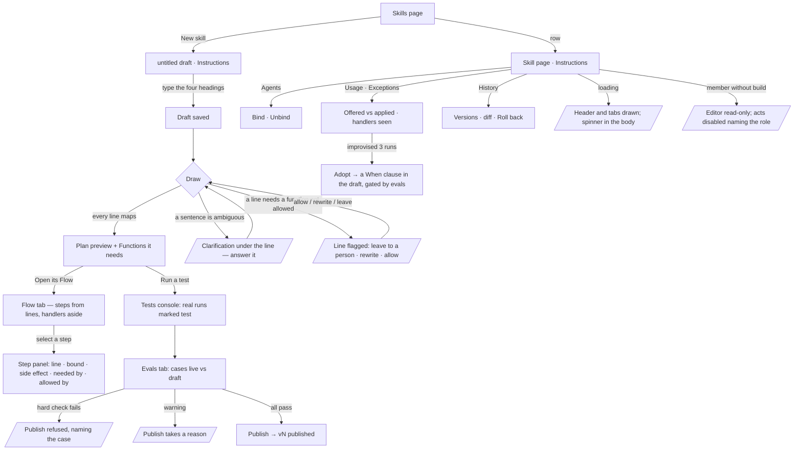

# The skill page

A skill is a document. Its page is `instructions.md` in an editor with the functions it needs and a
short preview of its plan beside it, and nine tabs that read what those instructions became and how
they are used: **Instructions · Flow · Functions · Agents · Usage · Exceptions · Evals · Tests · History**.

| | |
|---|---|
| Index | [6.7](../../../README.md#6--skills) · Slice **F04** |
| Module | [Skills](../spec.md) |
| API / CLI / Studio | 🟡 / — / ✅ |
| Related | [authoring-a-skill](authoring-a-skill.md) · [instructions-publish-rollback](instructions-publish-rollback.md) · [bindings](bindings.md) · [usage](usage.md) · [evals](evals.md) · [the-agent-page](../../agents/features/the-agent-page.md) · [the-agents-shell](../../agents/features/the-agents-shell.md) · products: [agent-fabric.md](../../../../products/agent-fabric.md) AF-03 · AF-04 · AF-22 |

> **As** a builder, **I want** to write a skill as a document, with the functions it needs beside it,
> and see its Flow — what the instructions resolve to — **so that** the instructions are the work and
> the flow is their consequence.

## Capabilities

| # | Capability | Notes |
|---|---|---|
| C1 | New skill | *New skill* on Skills creates an `untitled` draft and opens its page on Instructions, the editor holding the four headings (`Goal · Arguments · Steps · When things go wrong`) |
| C2 | Instructions | The editor (Edit · Preview, `instructions.md · Markdown`) on the left; **Functions it needs** and **Plan preview** on the right. Saving the draft draws the plan again |
| C3 | Functions it needs | The functions the draft's plan names, each with its bound; *Add functions* opens the picker (namespace groups, a send marked *send*) and adding one is a need written into the draft |
| C4 | A line that can't map | Flagged in amber under the document, naming its line, with its choices — *Leave it to a person* · *Rewrite the line*; the preview says why it cannot draw; Publish waits |
| C5 | Flow | The plan drawn top-down, each step tied to the line it came from, handlers to the side; **From the instructions** maps every line to its step or handler; **This flow** names its revision, bounds and test runs. Selecting a step shows its line, bound, side effect, who needs and allows it |
| C6 | Functions | Every function the published plan (or the draft's) names, with its bound and the steps that call it |
| C7 | Agents | Bound agents with version, applied in 7 days and last applied; Bind to an agent · Unbind |
| C8 | Usage | Offered · Applied · The gap · Bound to, then by agent, by outcome and the gap's runs with why not |
| C9 | Exceptions | Runs · Replanned · Replans a run p95 · Hit the limit, then every exception with where it happened, how it was handled, its source (declared · manifest · improvised · runtime), seen and served after |
| C10 | Evals | The gate's tiles and every case live against the draft; publish takes a reason |
| C11 | Tests | *Run a test* starts a real run marked **test**; the test runs list under the document in a console (Tests · Evals · Problems · Log) |
| C12 | History | Every version, newest first, with its diff and one-act rollback |

## Journey

## Surfaces

| Tab | `?tab=` | Body | Reads / writes |
|---|---|---|---|
| Instructions | `instructions` (default) | `SkillInstructionsTab` — `MarkdownEditor` · `FunctionsNeededCard` · `PlanPreviewCard` | `GET/PATCH …/skills/{id}/draft` · `POST …/draft/draw` · `GET …/catalogue` |
| Flow | `flow` | `SkillFlowTab` — `TaskFlowCanvas` on Cards (`skills/flow/skillFlowConfig.ts`): a card per step (`step N` · function · `from line N` · bound), a handler card off its step, a gap card per unmapped line; + *From the instructions* + *This flow* / the step panel | `GET …/skills/{id}/draft` or `…/versions/{v}/tasks` |
| Functions | `functions` | `SkillFunctionsTab` — kit `Table` | the plan's rows + `GET …/catalogue` |
| Agents | `agents` | `SkillAgentsTab` | `GET …/skills/{id}/agents` · `POST/DELETE …/agents/{a}/skills/{id}` |
| Usage | `usage` | `SkillUsageTab` | `GET …/skills/{id}/usage` |
| Exceptions | `exceptions` | `SkillExceptionsTab` | `GET …/skills/{id}/exceptions` |
| Evals | `evals` | `SkillEvalsTab` (`EvalSetPanel` · `EvalGateCard`) | `GET …/evals/skill/{id}` · runs · `POST …/skills/{id}/versions` |
| Tests | `tests` | `SkillTestsTab` + `SkillConsole` under Instructions (Tests · Evals · Problems · Log, on the kit's `TabbedPanel`, foldable); *Run a test* in the head opens Instructions, where the console is | `GET …/skills/{id}/tests` · `POST …/skills/{id}/tests` |
| History | `history` | `SkillHistoryTab` — *Regenerated — vN* · *Who picks it up* over the version list | `GET …/history/skill/{id}/compare?b=vN` · `GET …/skills/{id}/agents` · `GET …/skills/{id}/versions` · diff · rollback |

| Board | Draws |
|---|---|
| `agents.skill.new` | a new draft: the four headings, *No functions yet*, *Nothing to draw yet* |
| `agents.skill.draft` | a drafted skill: editor, Functions it needs, Plan preview with its handler |
| `agents.skill.flow` · `.flow.step` · `.flow.unmapped` | the Flow; a step selected; a line that cannot map drawn as a gap |
| `agents.skill.functions` | the *Add functions* picker open |
| `agents.skill.unmapped` | a flagged line with its two choices |
| `agents.skill.test` | the Tests console under the document |
| `agents.skill.exceptions` · `.evals` · `.agents` · `.usage` | those tabs of a published skill |

## Seams

| Seam | What the user sees |
|---|---|
| While drawing | The preview reads *Drawing…*; the editor stays editable; the Flow tab keeps the last drawn revision |
| Reload | `?page=skill:<id>&tab=<tab>` reopens the same tab; an unsaved edit is lost, a saved draft is kept |
| Nothing drawn yet | *Nothing to draw yet — the plan appears once the steps name things the allowed functions can do* |
| A line cannot map | The flagged line and its choices; the preview names the line; Publish is disabled |
| Never run | Usage, Exceptions and Tests say *Not run yet* with the act that fills them |
| Member without `build` | The editor is read-only, acts are disabled naming the role; the page opens with *You can read this skill. Editing needs the builder role — ask <holders>*; every tab still reads |
| The engine fails | The tab names what it could not read in the engine's words |

## Engine

| Shape | Fields |
|---|---|
| `SkillDraftRead.unmapped` | the sentences the last draw could not map to a function, verbatim — each is flagged under its line |
| `SkillPlanRead.handlers` | one row per line under `## When things go wrong`, in order: `span` (the line, verbatim) · `step_id` (the step it guards, or null when the line names none) |
| `GET …/skills/{id}/exceptions?window=30d` | `days` · `since` · `runs` · `replanned` · `replans_p95` · `max_replans` · `hit_limit` over the runs offered this skill, from `task_runs.replans`; `items[]` (exception, function, handled_by, source, seen, served_rate) — empty until runs record their handlers (F05) |
| `POST …/skills/{id}/tests` | body `question` → `202` `{run_id, stream_url}`: a real run of the draft (or the head with no draft) on that question, marked `test`, paid from the eval budget |
| `GET …/skills/{id}/tests` | `Page` of test runs: id · question · tokens · duration_ms · outcome · status · finished_at |

A step's line number is where its `source_span` reads in the text on screen; a span that no longer
appears in the text is drawn without a line.

## Decisions

| # | Decision |
|---|---|
| SP1 | **The skill page has nine tabs: Instructions · Flow · Functions · Agents · Usage · Exceptions · Evals · Tests · History.** Instructions is the document and is where a skill opens; every other tab reads what it became or how it is used |
| SP2 | **The open tab is `?tab=` beside `?page=`**, written on every switch, so a link, a board route or a reload opens the same tab. Opening another page drops it |
| SP3 | **The head is `RecordHeader variant="page"`**: crumb `Skills`, the name, a state chip (`draft · empty` · `draft vN` · `vN · published`, and `draft vN+1` beside a published head), one meta line, and the acts — *Run a test* · *Publish* on a draft, *Edit instructions* on a published skill with no draft |
| SP4 | **Instructions is one editor and two cards.** Editing writes the draft (`PATCH …/draft`); saving draws the plan again (`POST …/draft/draw`); the preview lists the plan's steps with their bounds and each handler under the step it guards, and *Open its Flow* switches tab |
| SP5 | **Functions it needs is the plan's functions, not a second list.** A skill needs what its plan calls ([AG30](../../agents/features/author-an-agent.md#decisions)); *Add functions* opens the picker and adds, for each function picked, a step line under `## Steps` naming it (`- Use web.search to …`), so the need lives in the prose and the next draw maps it ([IS3](instructions-publish-rollback.md#decisions)). A need is removed by editing the line that asks for it |
| SP6 | **A line that can't map is the draw's own refusal**, drawn under the line it names ([SK31](authoring-a-skill.md#decisions)); a clarification is drawn the same way with its readings as buttons ([SK26](authoring-a-skill.md#decisions)) |
| SP7 | **Flow is read-only and drawn from the plan's rows**: a step's line is its `source_span`, a handler is a row under `## When things go wrong`, and the canvas foot says *Drawn from the instructions, vN. A run may replan within what this skill may use — the change shows on that run, never here.* |
| SP8 | **Exceptions, Tests and the per-step test counts are engine reads.** A column the engine does not return is left out, never derived from a list of runs (CLAUDE.md rule 13) |
| SP9 | **Adopt is a proposal**: it appends the handler as a `When` line to the draft and opens Instructions; evals gate the publish like any edit ([agent-fabric › Adopt a handler](../../../../products/agent-fabric.md#functions-skills-and-plans)) |
| SP11 | **A handler guards the step it names**: `handlers[].step_id` is the step whose function the line names, else null and the handler is drawn under the plan's last step. Runs that record which handler fired arrive with replans (F05) |
| SP12 | **Exceptions shows the stored replan numbers now**; its table fills when runs record their handlers (F05), and its empty state says *No exceptions recorded yet* |
| SP10 | **Publish lives in the head and on Evals**, and both go through the eval gate with a reason ([IS4](instructions-publish-rollback.md#decisions) · [evals](evals.md)) |
| SP13 | **`unmapped` is read off the last settled draw**, the `plan.draft` step's `output.unmapped`, beside its refusal; while a draw is in flight it is empty, as `refusal` is |
| SP14 | **Handlers are parsed from the version's text, never drawn**: every non-empty line under a `When things go wrong` heading until the next level-one or level-two heading, its list marker dropped. `step_id` is the first plan node whose dotted function the line names as a whole word, else the first whose function's last segment it names, else null |
| SP15 | **Exceptions counts root runs queued in the last `days` UTC calendar days whose root or a step was offered any published version of the skill**, eval and test runs left out. `hit_limit` is a run whose `replans` reached its own agent's `effort.max_replans`; a skill carries no limit, so `max_replans` is null |
| SP16 | **A test is a one-question eval replay**: a root run with `role = evaluate` and the label `test:skill:<id>`, opened under no agent, replaying the draft (or the head) exactly as an eval case does. The label keeps it out of the skill's eval runs and every agent's numbers; the role puts its spend on the eval budget |
| SP17 | **An unmapped line's *Leave it to a person* rewrites the line as `A person does this: <line>`**, keeping its list marker, and saves the draft. A sentence no function can do is drawn as a person's step, so the next draw maps it; the choice is disabled once the line reads that way. The flag sits under the document, not inside it, because the editor has no under-line widgets |
| SP18 | **Instructions is the document over a docked console**: a vertical resizable split, the editor filling the space above, the console (Tests · Evals · Problems · Log) full width below; folding the console leaves its tab strip. The Flow draws every step chained in plan order, one gap card per unmapped line after the step written before it, and *From the instructions* has one row per line |
| SP19 | **History opens with what the head's publish regenerated.** On a published skill past v1, *Regenerated — vN* lists the plan's steps added, removed and changed against the version before, from the engine's history compare (`plan` of `…/history/skill/{id}/compare?b=vN`), with its one-line summary; *Who picks it up* lists every bound agent as `<agent> · next run`, because a run in flight keeps the plan it started with. A publish that changed no step says *The plan did not change with this version* |
| SP20 | **The Flow is one column of steps with the side cards in a column to their right.** The canvas lays the cards out with ELK's model order (steps come first in the data, so first in every layer) and network-simplex node placement, which keeps the chain straight. An edge between two steps that a longer path already joins — `translate → query` beside `translate → validate → query` — is not drawn, since it would pull the middle step off the column; the step panel still reads the plan's own edges. A side card sits one row below the step it hangs off, and a card off the last step sits under it. The fit is the board's own (padding 70, capped at 100%) |
| SP21 | **While a line is unmapped, the Plan preview's steps are the last plan that drew.** The preview's hint reads *from an earlier text* and the alert says *The steps below are from an earlier text*; the plan draws again once every line maps |
| SP22 | **The picker's act is *Add N*, not *Allow N*.** Picking writes a step line naming each function; it declares a need, and only a policy in IAM allows a function, so *Allow* would claim a grant the skill does not make |
| SP23 | **Usage's *Offered* is captioned `vN · all time`.** The usage read counts every run offered the current version since it was published, with no window; Exceptions' window is its own (`?window=`, 30 days by default) |
| SP24 | **The locked page names the role the engine enforces.** A member without `build` sees the shell's read-only notice, naming the builder role and who holds it; every write on a skill is gated by that one area, so there is no second, owner-only reason to name |

## Not building

| Item | Why |
|---|---|
| Editing a plan by hand | Nobody draws a plan ([IS3](instructions-publish-rollback.md#decisions)) |
| A Playbook tab apart from Instructions | The document is the playbook |
| A skill granting functions | A skill declares needs; a policy in IAM allows them (I01) |
| Assistant proposals marked in the editor | A proposal marked in the editor needs a proposal record the engine does not keep |
| *Allow / Need <function>* on an unmapped line | There is no allow act, and an unmapped line names no function; *Leave it to a person* and *Rewrite the line* are its choices |
| Agents' *Version* and *Last applied* columns, *Applied · 7 days* | The skill's agents read carries no per-agent applied window or last applied (engine) |
| Usage's *The gap — offered, not applied* table | The engine records no reason a run passed a skill over; the gap is shown as a number only |
| Skills list *Agents*, *Functions* and *Evals* columns | The skills list carries no bound-agent count, function count or eval pass rate (engine); *Plan* shows its steps |
| A Flow step's *Runs*, *Allowed by* and *In its test runs* cards | The engine stores no per-step run count of a skill's plan; policies arrive with IAM (I01) |
| Previewing writes and sends on a test run | A test runs the ask as an eval case does; a send already waits on an approval, and a held write has no preview store |
| Records of which handler fired on a run, and *Adopt* from them | Runs record replans, not the handler that guided each one; Exceptions shows the stored replan numbers and says *No exceptions recorded yet* |
| *Ask an owner* on a locked skill | Asking for access is an access request, and access requests arrive with IAM (I01); the notice names who to ask |
| *Publishing a skill that writes needs a Graph owner* | The engine gates every skill write by the `build` area alone; an owner-only gate on skills that write arrives with IAM's policies (I01) |
| An × on a *Functions it needs* row | A need is a line in the prose and is removed by editing that line; a skill has no allowed-but-unneeded function to remove, since a policy in IAM allows functions (I01) |
| A window on Usage (*Offered · 7 days*) | The usage read counts all time per version; a windowed count needs a `window` on `GET …/skills/{id}/usage` (engine) |
| A side card on its step's own row | ELK lays an edge's target a layer below its source, and the canvas passes no per-node layout options (a layer-choice constraint) to pin it beside its step (canvas) |
