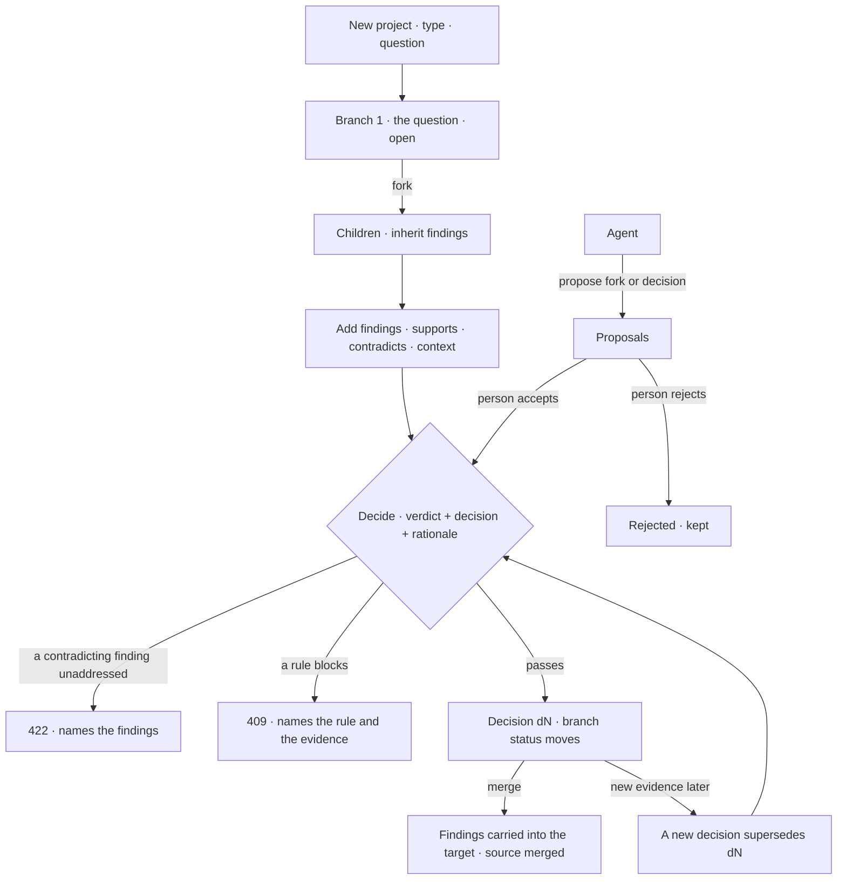

# Branches, findings and decisions

A project is one question of one **type**. Its lines of inquiry are **branches**; evidence for and
against each is a **finding**; a person closes a line with a **verdict** and a **decision**, checked by
the rules in force. Agents **propose**; people decide.

| | |
|---|---|
| Index | [9.5](../../../README.md#9--work) · B05 |
| Module | [Work](../spec.md) |
| API / CLI / Studio | ✅ / ✅ / ✅ |
| Product | [products/projects.md](../../../../products/projects.md) PJ-F1 · PJ-F2 · PJ-F3 · PJ-F4 · PJ-F5 |
| Related | [projects-and-tasks](projects-and-tasks.md) · [project-reports](project-reports.md) · [private-projects](private-projects.md) · [rules](../../skills/features/rules.md) · [datasets](../../bring-data-in/features/datasets.md) |

> **As** a thinker on a quest, **I want** to fork my question into lines of inquiry, gather evidence for
> and against each, and record a verdict and a decision that the rules check, **so that** what we
> decided is deliberate, defensible and revisable — and never silently overwritten.

## Capabilities

| # | Capability | Notes |
|---|---|---|
| C1 | A project has a type and a question | `research · policy · general` launch; `investment · market · investigation` are defined and refused until switched on |
| C2 | The type carries the words | Branch, evidence, verdict and decision labels come from the type; the stored values do not change |
| C3 | Every project starts with one branch | The question as asked, `open` |
| C4 | Fork a branch into several | Children inherit the parent's findings; open todos stay on the parent |
| C5 | A finding has a stance | `supports · contradicts · context`, cites records, dataset versions and runs |
| C6 | A finding's origin and review | Added by a person (reviewed by them) or an agent (unreviewed until a person reviews it) |
| C7 | Decide a branch | A verdict, a decision, a rationale; every contradicting finding addressed |
| C8 | Rules are checked on decide | Install · Graph · project rules with a decide check: block refuses, warn returns a line, report records |
| C9 | Decisions are append-only | Revisiting is a new decision naming the one it supersedes and citing newer evidence |
| C10 | Merge is a decision | Carries chosen findings into another branch by reference; both keep their history |
| C11 | Agents propose | A fork or a decision, with a rationale; a person accepts or rejects |
| C12 | Every decision in one place | The Graph's decisions, newest first, with what each cited and the rules it passed |

## Journey

## Seams

| Seam | What the caller gets |
|---|---|
| A type not switched on | 422 naming the launched types |
| Fork of a dropped or merged branch | 409 — revisit it with a superseding decision first |
| Contradicting finding not addressed | 422 naming each one by number |
| A rule blocks | 409 `blocked by rule — "<statement>": <reason>`; nothing written, events included |
| A rule warns | 201, `warnings[]` on the decision |
| Deciding a branch that already has one | 409 naming the current decision; the new one must `supersedes` it |
| Supersede without newer evidence | 422 — cite a finding added after the decision it supersedes |
| Merge into itself or a dropped branch | 422 |
| Merge into another project's branch | 404 — branches are addressed by number inside the project |
| A proposal already resolved | 409 |
| An archived project | 409 on every write, as for its todos |
| A dataset cite that does not resolve | 422 on the finding |

## Surfaces

Studio is [C02](../../../../products/migration-sessions.md#track-c--new-product-ui), in
`@invana-studio/projects` `src/project/`. A project is the declared board `project:<key>` in
`mainSection`; its tab and drill-ins ride in the query (`view · branch · finding · decision`).

| Surface | Board | Consumes |
|---|---|---|
| Project page · `ProjectPage` | `projects.project` | `GET …/projects/{key}` · `…/branches` · each `…/branches/{n}` · `…/assignments` |
| Branch tree · `BranchTree` | `projects.project.branches` | `GET …/projects/{key}/branches` |
| Fork · `ForkDialog` | `projects.branch.fork` | `POST …/branches/{n}/fork` |
| Branch page · `BranchView` | `projects.branch` | `GET …/branches/{n}` — findings with stance, the balance, decisions, proposals · `POST …/proposals/{n}/accept\|reject` · `POST …/tasks` with `branch` |
| Finding · `FindingView` · `AddFindingDialog` | `projects.finding` | `GET …/findings/{n}` · `POST …/findings/{n}/review` · `POST …/branches/{n}/findings` |
| Decide and merge · `DecideDialog` | `projects.branch.decide` · `projects.branch.merge` | `POST …/branches/{n}/decisions` |
| Decisions page · `DecisionsPage` | `projects.decisions` | `GET …/decisions` · each project's `…/assignments` for *By* |
| CLI | — | `invana branches · findings · proposals` |

## Engine

| Thing | Shape |
|---|---|
| `projects` gains | `type` (default `general`) · `question` · `visibility` ([9.7](private-projects.md)) |
| `project_branches` | `project_id` · `number` (per project) · `parent_id?` · `title` · `body` · `status (open\|pursuing\|parked\|dropped\|merged)` · `merged_into_id?` · `created_by_*` |
| `project_findings` | `project_id` · `branch_id` (added on) · `number` · `statement` · `stance` · `cites[]` · `added_by_kind (user\|agent)` · `added_by_id` · `reviewed_by_id?` · `reviewed_at?` |
| `branch_findings` | `branch_id` · `finding_id` · `via (own\|fork\|merge)` — a branch's evidence is its links |
| `project_decisions` | `project_id` · `branch_id` · `number` · `verdict` · `choice` · `rationale` · `cites[]` (finding ids) · `addresses[]` · `into_branch_id?` · `supersedes_id?` (unique) · `checks[]` · `warnings[]` · `decided_by_id` |
| `project_proposals` | `project_id` · `branch_id` · `number` · `kind (fork\|decision)` · `payload` · `rationale` · `status (open\|accepted\|rejected)` · `agent_id` · `submitted_by_id` · `resolved_by_id?` · `note` · `result` |
| `todos.branch_id?` | A todo filed on a branch of its project |
| A cite | `{kind: record\|dataset\|run, ref}` — a dataset cite is `publisher/name@v`, resolved to `version_id` on add |
| Rule checks | acts `project.decide`; kinds `evidence.reviewed` · `evidence.not_retracted` at scopes install · graph · project |
| Routes | `…/projects/{key}/branches` · `/{n}` · `/{n}/fork` · `/{n}/findings` · `/{n}/decisions` · `/{n}/proposals` · `…/projects/{key}/findings/{n}/review` · `…/projects/{key}/proposals/{n}/accept\|reject` · `GET …/decisions` |
| Events | `branch.fork` · `finding.add` · `finding.review` · `decision.record` · `proposal.submit · accept · reject` |

## Decisions

| # | Decision |
|---|---|
| BD1 | The stored verdict and decision are the **canonical** words (`supported · refuted · inconclusive`; `pursue · park · drop · merge`); the type is a label table read on the way out. Changing a type only relabels — nothing is rewritten. |
| BD2 | Launched types are `research · policy · general`. The other three are in the label table and refused at create with 422 until switched on in code. |
| BD3 | A branch is addressed by `number`, one counter per project, because people type it (`b3`). Findings, decisions and proposals number the same way, each with its own counter. |
| BD4 | A branch's evidence is its `branch_findings` links. Fork links the parent's findings into each child (`via = fork`); merge links the chosen findings into the target (`via = merge`). References are copied, never findings. |
| BD5 | The datasets a branch uses are the dataset versions its findings cite — no second list to keep in step. |
| BD6 | A branch's status is written by its decisions only: `pursue → pursuing`, `park → parked`, `drop → dropped`, `merge → merged`. A fork leaves the parent's status alone. |
| BD7 | One current decision per branch. A new decision on a decided branch must name it in `supersedes` (409 otherwise) and cite at least one finding added after it (422 otherwise). Nothing edits or deletes a decision. |
| BD8 | The verdict must address every `contradicts` finding linked to the branch: `addresses` lists them, and a missing one is 422 naming it. A built-in rule, not a configurable one. |
| BD9 | Decide reads every active rule whose check names `project.decide`, at install, Graph and project scope, **before** writing. Block → 409 naming each rule and the evidence that broke it; warn → `warnings[]`; report → the `rule.check` event only. The decision stores the rules it was checked against in `checks[]`. |
| BD10 | Two decide checks: `evidence.reviewed` (every cited finding was reviewed by a person) and `evidence.not_retracted` (no cited finding cites a retracted dataset version). |
| BD11 | A finding a person adds is reviewed by them at once; an agent's waits for a person's `review`. |
| BD12 | A proposal is attributed to an **agent** of the Graph, with `submitted_by_id` naming the signed-in principal that sent it. Accepting a decision proposal runs the full decide — rules included — as the accepting person; a refusal leaves the proposal open. |
| BD13 | Verdicts and decisions are always a person's: no route takes an agent as the decider. |
| BD14 | Merge needs `into` (another branch of the same project, not dropped or merged) and optionally the finding numbers to carry; with none named, every finding on the source is carried. |
| BD15 | The Graph's decisions list (`GET …/decisions`) is a read across projects, filtered to the projects the reader may see ([9.7](private-projects.md)). |
| BD16 | Studio fills in what the engine requires rather than asking: *Decide* addresses every contradicting finding and supersedes the current decision. A rule's 409 is drawn as a refusal card naming the findings, with *Remove fN from the cites*; reviewing one is the finding page's *Review*. |
| BD17 | Studio draws the Branches tab as a tree on the layered canvas — fork edges, a dashed edge into the branch a merge went into, a dropped branch hollow — and a merge's dialog asks only *What moves*, which is also what the decision cites. A project, branch and finding are levels of the shell's breadcrumb, named for what they are, never their key. |

## Not building

| Not building | Because |
|---|---|
| Lineage (`invana lineage --decision`) | PJ-F8, a later session; the records here carry every link it will read |
| Simulation and impact | Simulation is [9.8](simulation.md); impact is [9.9](impact.md) |
| Editing or deleting a decision or a finding | append-only is the point; a finding is superseded by a newer one |
| Type authoring | six built-in types |
| Agents deciding | agents propose; people decide |
| A per-branch dataset list | BD5 |
