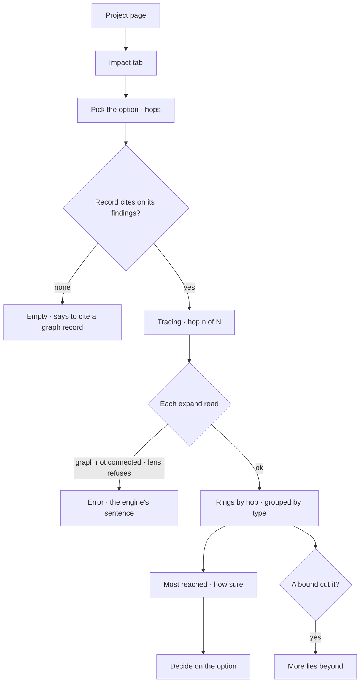

# Impact

What a branch's option reaches over the graph, hop by hop: the records its evidence cites, then
everything one, two and three relationships away — so a decision is seen at its reach before it is
made.

| | |
|---|---|
| Index | [9.9](../../../README.md#9--work) · C06 |
| Module | [Work](../spec.md) |
| API / CLI / Studio | — / — / ✅ |
| Product | [products/projects.md](../../../../products/projects.md) PJ-F7 · PJ-10 |
| Related | [branches-and-decisions](branches-and-decisions.md) (the cites it starts from) · [simulation](simulation.md) (what-if values) · [graph canvas](../../explore/features/graph-canvas.md) (the expand reads it walks) |

> **As** a policy maker, **I want** a decision's blast radius across the graph, **so that** I see
> who it reaches before I commit.

## Capabilities

| # | Capability | Notes |
|---|---|---|
| C1 | Reach starts from the evidence | The `record` cites of the branch's findings, every stance — the graph records the option stands on |
| C2 | Hop by hop | 1, 2 or 3 hops (2 by default); each hop is what the one before reached, minus what was already reached |
| C3 | Grouped by type | Each hop counts what it reached per node type — *2 hops · 38 District* |
| C4 | Bounded, and says so | At most 12 records expanded per hop, each to 50 neighbours; a cut reach reads *more lies beyond* |
| C5 | Most reached | The records reached by the most relationships, each with its type and hop |
| C6 | How sure | How many of the findings it starts from a person reviewed, and the origins of the datasets they cite |
| C7 | Under the lens | Every read is the Explorer's expand, under the Graph's world, so a type the world denies is never reached |

## Journey

## Seams

| Seam | What the caller gets |
|---|---|
| While it traces | The tab says which hop it is on; what earlier hops reached is drawn as it lands |
| No record cites | An empty state naming the act: add a finding that cites a graph record |
| A cited record gone from the graph | That expand reads zero neighbours; the record still counts at hop 0 |
| The graph is not connected | The read's refusal, worded by the engine |
| Reload | The tab, option and hops ride in the query; the reach is read again |
| Cost | One expand run per record expanded — at most 12 per hop, so 3 hops is at most 36 reads |
| A viewer | Reads; expanding is a read |

## Surfaces

| Surface | Consumes |
|---|---|
| Impact tab (`projects.impact`) — `…?view=impact&of=<branch>&hops=<n>` | the branch's findings (`GET …/branches/{n}`, `GET …/findings/{n}`) · `POST …/explorer/expand/neighbors` per record expanded · `GET /api/v1/datasets/{publisher}/{name}` for the origins |

## Engine

None. Impact walks the Explorer's existing expand read ([graph canvas](../../explore/features/graph-canvas.md)).

## Decisions

| # | Decision |
|---|---|
| IM1 | **Reach starts from the records the option's evidence cites.** A decision is about a branch, so the reach is the branch's: the `record` cites of its findings, of every stance. Drawn before deciding, it is what the decision would reach. |
| IM2 | **Studio walks the reach through the Explorer's expand, one run per record expanded.** Every read of the graph is a run under the Graph's lens, so the reach is traceable like any canvas read; no endpoint is added for it. |
| IM3 | **Bounded: up to 3 hops, 12 records expanded per hop, 50 neighbours each.** The records reached by the most relationships are expanded first. When a bound cuts the reach the tab says *more lies beyond*. |
| IM4 | **Drawn on the shared layered canvas, kind `impact`.** A column is a hop; a node is a type at that hop with its count; an edge joins two groups a relationship type connects, labelled with it. A **Links** list says every group in words, for a reader who cannot see the canvas. |
| IM5 | **How sure is the evidence's, not a score.** The tab names how many of the findings it starts from are person-reviewed and the origins of the datasets they cite. |
| IM6 | **No what-if values.** The change at each node (a price, an income) comes from a simulator plugin when a policy model exists; Impact draws reach only, and no figure in any currency. |

## Not building

| Not building | Because |
|---|---|
| What-if values per node | A simulator plugin's job (IM6, [simulation](simulation.md)) |
| *Compare with* another option side by side | One option at a time; switch the option |
| An engine reach endpoint or a CLI | Expand already reads the graph under the lens (IM2) |
| Impact saved as a record | It is read from the graph each time; a decision cites findings, not a reach |
