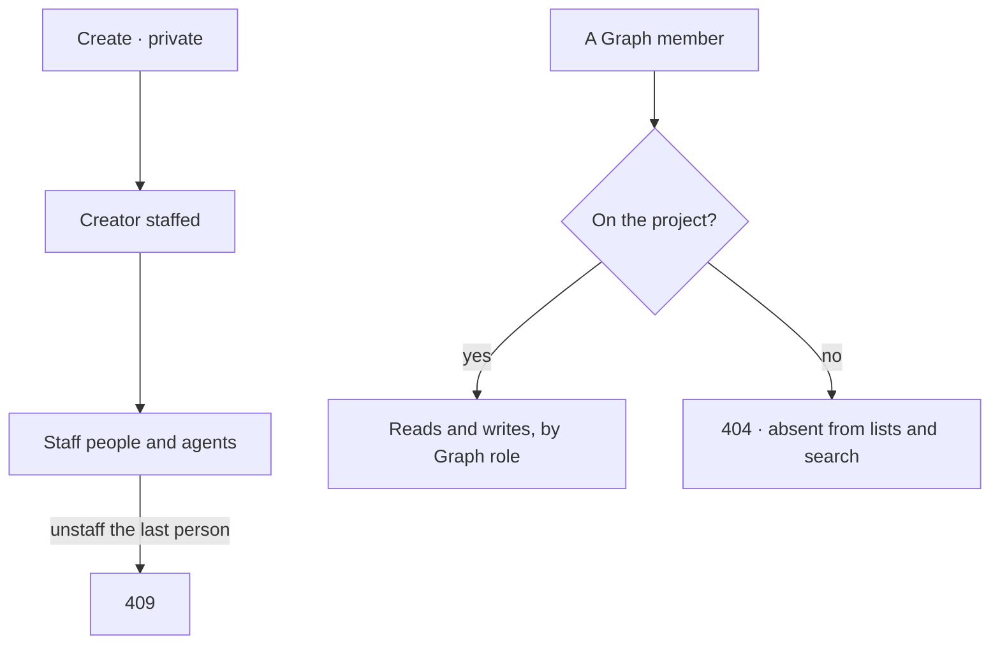

# Private projects

A project is visible to every member of its Graph, or only to the people and agents on it.

| | |
|---|---|
| Index | [9.7](../../../README.md#9--work) · B05 |
| Module | [Work](../spec.md) |
| API / CLI / Studio | ✅ / ✅ / 🔵 |
| Product | [products/projects.md › Visibility](../../../../products/projects.md#visibility) PJ-02 · P-14 |
| Related | [roles](../../identity-and-access/features/roles.md) · [search](../../platform/features/search.md) · [projects-and-tasks](projects-and-tasks.md) |

> **As** a thinker, **I want** a project only its people can see, **so that** a sensitive quest is not
> open to the whole Graph.

## Capabilities

| # | Capability | Notes |
|---|---|---|
| C1 | `visibility: graph \| private` | Chosen at create; changeable by anyone who can see it |
| C2 | The people on it are its staffing | A private project's `project_assignments` are its access list |
| C3 | The creator is on it | Staffed at create |
| C4 | Hidden reads as absent | 404 by key, missing from lists, todos, decisions and search |
| C5 | Never empty of people | Unstaffing the last person on a private project is refused |

## Journey

## Seams

| Seam | What the caller gets |
|---|---|
| A member not on it | 404 — never 403; the project's key is not disclosed |
| Its todos | Missing from `GET …/tasks`; 404 by id |
| Search | No `project` hit |
| The Graph's event feed (`GET …/events`) | None of the project's events, `?project=<id>` included |
| The Graph's live stream (`…/events/stream`) | A frame carries only an event's id, Graph and time; the row is read through the feed above |
| Last person unstaffed | 409 |
| Made private by someone not staffed | They are staffed in the same act, so they can still see what they hid |

## Surfaces

Studio is C02 (`projects.new` visibility) and C07 (private projects in the access views).

| Surface | Consumes |
|---|---|
| New project | `POST …/projects` `visibility` |
| Project details | `PATCH …/projects/{key}` `visibility` |
| CLI | `invana projects create --private` |

## Engine

| Thing | Shape |
|---|---|
| `projects.visibility` | `graph` (default) · `private` |
| `ProjectManager.hidden_ids(graph_id, reader)` | The private projects a reader is not staffed on — the one query every read filters by |
| Applied in | project list · get by key · task list · task get · plan · decisions list · `SearchManager` |

## Decisions

| # | Decision |
|---|---|
| PP1 | A private project's access list **is** its staffing. Staffing stays a default for a `graph` project ([PT6](projects-and-tasks.md)); on a private one it is also the grant. One list, not two. |
| PP2 | Per-project access sits **on top of** Graph roles: a person on a private project still needs the role for the area of a write ([11.6](../../identity-and-access/features/roles.md)). Being on it never grants a role. |
| PP3 | A hidden project reads as absent (404) — the caller must not learn the key exists. |
| PP4 | Graph owners and install Admins are not exempt. Whoever should see a private project is put on it. |
| PP5 | Turning a project private staffs the person doing it, so it is never left with nobody on it; the last person cannot be unstaffed. |
| PP6 | Agent runs read projects through their own principals; per-project access is enforced on the people-facing API, search and the Graph's event feed. |

## Not building

| Not building | Because |
|---|---|
| Per-project roles | Graph roles cover the writes; a project adds who can see it |
| Sharing a private project read-only | put the person on it |
| Hiding the existence of private projects from owners in counts | there are no such counts |
