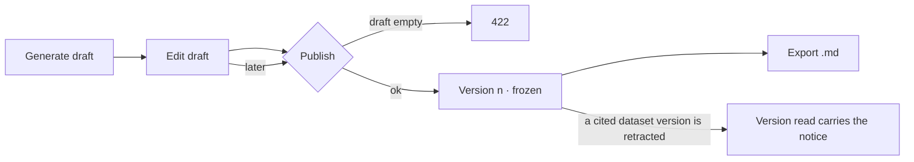

# Project reports

A report is the project written up from its records — drafted, edited by a person, and published as
frozen versions that cite the dataset versions behind them.

| | |
|---|---|
| Index | [9.6](../../../README.md#9--work) · B05 |
| Module | [Work](../spec.md) |
| API / CLI / Studio | ✅ / ✅ / ✅ |
| Product | [products/projects.md › Reports](../../../../products/projects.md#reports) PJ-F10 · PJ-14 |
| Related | [branches-and-decisions](branches-and-decisions.md) · [retract-and-refresh](../../bring-data-in/features/retract-and-refresh.md) |

> **As** a thinker, **I want** a report drafted from the records, edited and published as a frozen
> version, **so that** what we decided can be circulated, cited and audited.

## Capabilities

| # | Capability | Notes |
|---|---|---|
| C1 | Draft from the records | Question, branches, evidence by stance, verdicts and decisions — in the type's words, nothing invented |
| C2 | Edit the draft | Markdown, by a person |
| C3 | Publish a version | Frozen body and the dataset versions it cites; numbered 1, 2, 3 |
| C4 | Read any version | Earlier versions stay readable |
| C5 | Retraction notice | A version citing a retracted dataset version names it |
| C6 | Export Markdown | `GET …/versions/{v}/export` returns `text/markdown` |

## Journey

## Seams

| Seam | What the caller gets |
|---|---|
| No report yet | `GET …/report` returns an empty draft and no versions |
| Generate over an edited draft | The draft is replaced; published versions are untouched |
| Publish an empty draft | 422 |
| A version that does not exist | 404 |
| Archived project | 409 on generate, edit and publish; reads still work |

## Surfaces

Studio is C02 — board `projects.report`, the project page's Report tab (`ReportTab`, `?view=report`).

| Surface | Consumes |
|---|---|
| Report tab | `GET …/projects/{key}/report` · `PUT …/report` · `POST …/report/generate` · `POST …/report/publish` |
| A version | `GET …/report/versions/{v}` |
| CLI | `invana reports generate · publish · export` |

## Engine

| Thing | Shape |
|---|---|
| `project_reports` | `project_id` (unique) · `draft` · `draft_updated_by_id?` · `draft_updated_at?` |
| `project_report_versions` | `report_id` · `version` · `body` · `cites[]` (`{ref, version_id}`) · `published_by_id` · `published_at` |
| `ReportVersionRead.retracted[]` | The cited dataset refs whose version is retracted, read when the version is read |
| Events | `report.generate` · `report.publish` |

## Decisions

| # | Decision |
|---|---|
| RP1 | The draft is generated from the records by a template, not an LLM — "never invented" is a property of the code, not of a prompt. An assistant rewrite is a later act on the draft. |
| RP2 | One report per project: a single draft and its numbered versions. |
| RP3 | A version freezes its body and the dataset versions cited by the project's findings at publish time. Nothing changes a published version. |
| RP4 | The retraction notice is read, never stored: a version read names every cited dataset version retracted since. |
| RP5 | The engine exports Markdown. PDF is the Studio's print of the rendered version. |
| RP6 | Studio's *Markdown* downloads the version body (or the draft) as it is read, with no second request; *Publish vN* stays off while the draft has unsaved edits, because what is published is the saved draft. |
| RP7 | Studio reads the draft and every version rendered: the template's Markdown subset in the kit's typography, a finding's trailing cites as numbered marks listed once under *Cites* (a run as `run 8195c5e8`). *Read · Edit* switches the draft to its Markdown. |

## Not building

| Not building | Because |
|---|---|
| PDF rendering in the engine | RP5 |
| LLM drafting | RP1 |
| Several reports per project | RP2 |
| Editing a published version | publish a new one |
