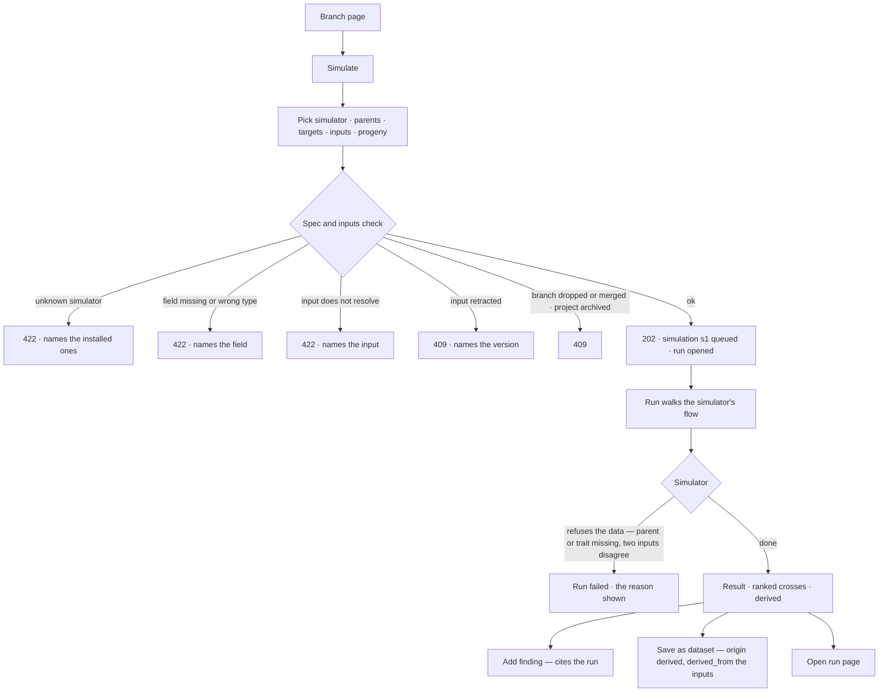
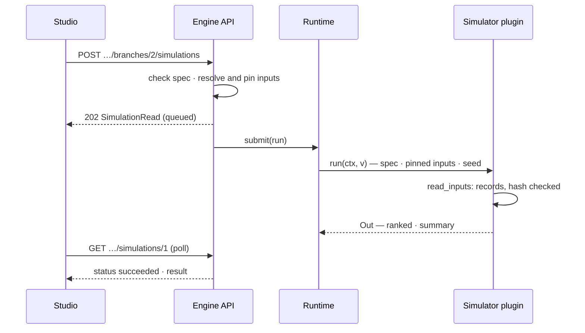

# Simulation

A branch runs a **simulator plugin** over pinned dataset versions. The plugin does the science; Invana
checks the spec, pins every input by version and hash, runs it as an ordinary run, and labels what comes
back `derived`.

| | |
|---|---|
| Index | [9.8](../../../README.md#9--work) · B09 · C06 |
| Module | [Work](../spec.md) |
| API / CLI / Studio | ✅ / ✅ / ✅ |
| Product | [products/projects.md](../../../../products/projects.md) PJ-F6 · PJ-09 · P-06 · P-07 |
| Related | [plugins](../../platform/features/plugins.md) (the simulator kind) · [branches-and-decisions](branches-and-decisions.md) · [datasets](../../bring-data-in/features/datasets.md) · [see what ran](../../operate/features/see-what-ran.md) |

> **As** a scientist, **I want** to simulate crosses against target traits before making them, **so
> that** I spend a season on the best bet.

## Capabilities

| # | Capability | Notes |
|---|---|---|
| C1 | The installed simulators | `GET /api/v1/simulators` — each simulator's key, version, plugin, title, summary and the spec fields it takes |
| C2 | Simulate on a branch | `POST …/projects/{key}/branches/{n}/simulations` with a simulator, a spec, the input dataset versions and an optional seed → `202`, the simulation queued |
| C3 | The spec is checked before anything runs | Every required spec field is present and has its declared type; refused with the field named |
| C4 | Inputs pinned | Each input is `publisher/name@v`; the version id and its content hash are recorded on the simulation and handed to the run |
| C5 | Reproducible | The seed is recorded; when none is given Invana picks one. The same simulator version, spec, inputs and seed give the same result |
| C6 | It is a run | A `simulate` run of the simulator's packaged flow, under the Graph's guardrails; its run page, trace and tokens are the run's own |
| C7 | The result, ranked | Rows in the simulator's order, each with its own figures, and a summary; read off the run's step |
| C8 | Output is derived | Every simulation reads `origin: derived`; saved as a dataset it is published with `origin derived` and the simulation's inputs as `derived_from` |
| C9 | The list | `GET …/projects/{key}/simulations[?branch=n]`, newest first; `GET …/simulations/{n}` for one |
| C10 | The CLI | `invana simulate --project --branch --plugin <name> --file <spec.json>` waits for the run and prints the ranked rows; `invana simulations list · show` |

## Journey

## Seams

| Seam | What the caller gets |
|---|---|
| While it runs | `status: queued · running`; `result` is null. Studio polls the simulation or follows the run's stream |
| The simulator refuses the data | `status: failed`, `error` is the simulator's sentence (*"JG 11 is in none of the inputs"*); nothing is half-written |
| An input retracted after the simulation opened | The run fails with *input retracted* before the simulator reads a record |
| A simulator uninstalled since | The simulation still reads; its run keeps the key and version it ran. Simulating again with it is a 422 |
| A private project the reader is not on | 404, as every project read ([9.7](private-projects.md)) |
| A viewer | Reads; simulating is the `work` area — 403 naming who can ([11.6](../../identity-and-access/features/roles.md)) |
| Reload | Everything is a record: the simulation, its run, its result on the run's step |
| Tokens | The run's tokens, summed over its steps — `0` for a simulator that calls no model |
| Add finding | The existing findings API with a `run` cite naming the simulation's run ([9.5](branches-and-decisions.md)) |
| Save as dataset | The existing datasets API: a dataset with `origin: derived`, a version whose records are the ranked rows and whose `derived_from` is the simulation's `inputs[].ref` ([2.4](../../bring-data-in/features/datasets.md)) |

## Surfaces

Studio is `@invana-studio/projects` (C06).

| Surface | Route | Consumes |
|---|---|---|
| *Simulate* on a branch's header and the project's header | — | `GET /api/v1/simulators` (hidden when none is installed) |
| Simulate dialog (`projects.simulate`) | over the page | the simulator's spec fields · the branch's cited dataset versions for *Reads* · `POST …/branches/{n}/simulations` |
| Simulation result (`projects.simulate.result`) | `…?page=project:<key>&simulation=<n>` | `GET …/simulations/{n}`, polled while queued or running · header from `simulator · inputs · tokens · started_at/finished_at`, the table from `result.ranked` |
| Add finding (a row's act) | over the result | `POST …/branches/{n}/findings` with a `run` cite |
| Save as dataset | over the result | `POST /api/v1/datasets` then `POST …/{publisher}/{name}/versions` |
| Branch page *Simulations · N* tab | `…&branch=<n>` | `GET …/simulations?branch=n` |
| CLI | | `invana simulate` · `invana simulations list · show` |

## Engine

| Route | Does |
|---|---|
| `GET /api/v1/simulators` | `SimulatorListResponse` — every installed simulator |
| `POST /api/v1/u/{u}/{g}/projects/{key}/branches/{n}/simulations` | `SimulationCreate` → `202 SimulationRead` |
| `GET /api/v1/u/{u}/{g}/projects/{key}/simulations` | `?branch=n` · `SimulationListResponse` |
| `GET /api/v1/u/{u}/{g}/projects/{key}/simulations/{n}` | `SimulationRead` |

All four carry the OpenAPI tag `simulations`.

| `SimulationCreate` field | Type | Notes |
|---|---|---|
| `simulator` | str | a simulator key, or `key@version` to pin one |
| `spec` | object | checked against the simulator's declared spec fields |
| `inputs` | list of `publisher/name@v` | 0–20; each resolved, readable by the caller and not retracted |
| `seed` | int, optional | Invana picks one when absent |

| `SimulationRead` field | Type | Notes |
|---|---|---|
| `number` · `branch` | int | per project (`s1`) · the branch's number |
| `simulator` | `{key, version, plugin, plugin_version, title}` | what ran |
| `spec` · `seed` | object · int | as run |
| `inputs` | `[{ref, dataset_id, version_id, content_hash}]` | the pins |
| `origin` | `derived` | always |
| `run_id` · `status` · `outcome` · `error` | | the run's |
| `result` | `{ranked: [...], summary: {...}}` or null | the simulator's step output once the run succeeded |
| `tokens` | int | the run's tokens in plus out |
| `created_by_id` · `created_at` · `started_at` · `finished_at` | | |

| Table `project_simulations` | Type | Notes |
|---|---|---|
| `id` · `project_id` · `branch_id` · `number` | | number unique per project |
| `simulator` · `simulator_version` | String | the task type key and version |
| `plugin` · `plugin_version` | String | the plugin that declared it |
| `spec` · `seed` | JSON · BigInteger | |
| `inputs` | JSON | the pins |
| `run_id` | FK `task_runs`, SET NULL | |
| `created_by_id` · `created_at` | | |

| Code | Holds |
|---|---|
| `runtime/managers/simulation.py` | `SimulationManager` — list simulators, check the spec, pin inputs, open the run, read the result |
| `runtime/services.py` `open_simulation_run` | the run, from the simulator's packaged flow |
| `apps/work/querysets/simulation.py` | the table's queries |
| `plugins/sdk/simulation.py` | what a simulator imports: `read_inputs(ctx)` and `Input` |
| `plugins/simulators/genomic/` | the first simulator — `sim.genomic_prediction` |
| `server/work/` · `cli/commands/simulate.py` | the routes and the CLI |

### The genomic prediction simulator

`invana.simulators.genomic` · `sim.genomic_prediction` · extra `sim-genomic` (no dependencies).

| Spec field | Type | Notes |
|---|---|---|
| `females` | list of str | parent keys; every female is crossed with every male |
| `males` | list of str | |
| `targets` | list of `{trait, op, value, sd?}` | `op` is `>=` or `<=`; `sd` overrides the segregation spread |
| `progeny` | int | per cross, default 2,000; at most 10,000, and crosses × progeny at most 200,000 |

| Model | |
|---|---|
| A parent's trait | read from the inputs: the record whose key is the parent, the column named by the trait |
| A progeny's trait | mid-parent value plus a Gaussian draw with spread `sd`, or half the parents' difference when no `sd` is given — additive, each trait drawn independently |
| A cross's figures | the share of progeny meeting every target, and per trait the mean, spread and share meeting it |
| Ranked by | share meeting every target, highest first; ties by cross name |

## Decisions

| # | Decision |
|---|---|
| SM1 | **A simulator is a plugin of kind `simulator`, and it does the science.** Invana owns the spec check, the pins, the run, the record and the `derived` label; it never computes a figure itself. The contract is in [13.9](../../platform/features/plugins.md) PL11–PL14. |
| SM2 | **A simulation is a run.** It walks the simulator's packaged flow under the Graph's guardrails, with no agent, so retry, cancel, the trace, the run page and token use come for free. The `project_simulations` row is the project's handle on it, not a second record of what happened. |
| SM3 | **The result lives on the run.** `result` is read from the simulator step's output, so a simulation never disagrees with its run. |
| SM4 | **Inputs are pinned by version id and content hash at open.** The run reads only those versions through `read_inputs`, which checks the hash and refuses a version retracted since. |
| SM5 | **The seed is part of the input.** Recorded on the simulation and on the step, so a re-run of the run reproduces the result. |
| SM6 | **The spec is checked against what the simulator declares; the data is checked by the simulator.** A missing or mistyped field is a 422 before a run opens. A parent missing from the inputs is the simulator's refusal and fails the run with its sentence. |
| SM7 | **Simulating is a `work` act.** Its routes sit under `projects/…`, so the role table needs no new row. Dropped and merged branches and archived projects refuse it (409); a parked branch may still be simulated. |
| SM8 | **Saving as a dataset and adding a finding reuse what exists.** A finding cites the simulation's run; a saved dataset is `derived` with the simulation's inputs as `derived_from`. Neither is a simulation endpoint. |
| SM9 | **The genomic simulator is deliberately simple:** mid-parent plus independent Gaussian segregation per trait. A better model is a new version of the plugin, and simulations already run keep the version they ran. |
| SM10 | **Numbered per project** (`s1`, `s2`), like branches, findings and decisions, because people type it. |
| SM11 | **Studio offers *Simulate* wherever a branch can be simulated.** On a branch's header, and on the project's header with the branch to pick (dropped and merged branches are not offered). It is hidden while no simulator is installed and off on an archived project. |
| SM12 | **The dialog is drawn from what the simulator declares, never from its science.** One control per spec field, by type: `int`/`float` a number (its default filled in), `str` a text field, `bool` a switch, `obj` JSON, `list` one entry per line. A list entry written `trait >= value` or `trait <= value`, optionally `± sd`, is sent as a target `{trait, op, value, sd}`; any other entry as its text. *Reads* lists the branch's cited dataset versions, all ticked, and takes more as `publisher/name@v`. The seed is optional. |
| SM13 | **A refusal stays in the dialog with the engine's sentence**, and nothing opens. A `202` closes it and opens the simulation over the branch. |
| SM14 | **The result is a drill-in of the project page, `simulation=<n>`.** It polls every 2 s while queued or running and draws the run's status meanwhile; a failed run shows the simulator's sentence beside *Open run page*. The table reads the ranked contract: the row label (`cross`, else its first text field), `meets_all` as a bar, each trait's `mean ± sd` and share meeting it, and any other plain figure as a column. A muted line says the rows are predictions, not observations. |
| SM15 | **A row's *Add finding* opens Add a finding fixed to the simulation's branch**, the statement drawn from the row (*Col-0 × Ler-1: 41% of progeny meet every target*) and the simulation's run as its cite. |
| SM16 | **Save as dataset writes one `derived` dataset.** Its key column is the row label; each row flattens to the label, `meets_all` and `<trait>_mean · _sd · _meets`; the version's `derived_from` is the simulation's inputs and its author chain one `original` step of kind `run` naming the simulation and its run. The licence is asked for. A refusal (a taken name, a role) stays in the dialog. |
| SM17 | **The branch page lists its simulations** in a *Simulations · N* tab, newest first, each opening its result; the breadcrumb reads *Projects › project › H2 · title › Simulation s1*. |

## Not building

| Not building | Because |
|---|---|
| Impact — reach by hop and what-if values (PJ-10) | Reach by hop is [9.9](impact.md); what-if values arrive as a simulator plugin when a policy model exists |
| Parameter sweeps · game theory | Still not built ([README](../../../README.md#not-building)) |
| Enabling or disabling a simulator per install | An Admin enables plugins with B06b; a simulator loads whenever it is installed |
| Simulators on a GPU worker pool | Workers and routing by `resources` are B14 |
| Third-party simulator packages | Plugins live in the engine for now ([products › plugins](../../../../products/plugins.md#not-deciding-here)) |
| An agent simulating | A simulation is a person's act on a branch; an agent proposes |
| Editing or deleting a simulation | It is a record of a run; simulate again |
