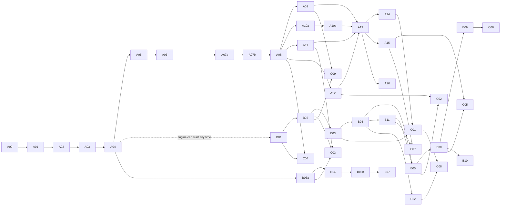

# Migration plan — today's Studio → five products

How Studio moves from one graph page to five products under one shell, in phases small enough
that each fits one Claude session. The session-by-session runbook is
[migration-sessions.md](migration-sessions.md); progress is recorded in its [log](migration-sessions.md#log).

| | |
|---|---|
| Goal | `studio/` becomes a Turborepo: one app, `apps/studio`, composing product **library packages** |
| Engine | **Not split.** One `invana` package. It grows the new features ([README › Prerequisites](README.md#prerequisites)); the UI split needs no engine change |
| Builds on | [`refactor-plan.md`](../for-developers/building-studio/refactor-plan.md) (phases 1–3 are done: build green, kit substitutions, feature folders) and [`code-shape.md`](../for-developers/building-studio/code-shape.md) |
| Unit of work | A **session**: one Claude context, one runbook entry, ends green and logged |
| Order | Track A (restructure, no behaviour change) → Track B (engine prerequisites) → Track C (new product UI) |
| Standing rules | Tokens, never currency · every run records its exact model version · templates stay out of prompts |

## 1. Where we start

| Measure | Today |
|---|---|
| App | One Vite app, `studio/`, React 19, port 8300 |
| Source | 354 `.ts`/`.tsx` files · ~71,500 lines |
| The page | `pages/graphs-detail/` — one route `u/:username/:graphSlug`, every surface a `?panel=` value |
| Feature folders | 16 under `pages/graphs-detail/features/`, each with an `index.ts` |
| Workspace | `studio/pnpm-workspace.yaml` exists for settings only — no packages |
| Import alias | `@/` → `src/` |
| Local-checkout hatches | `INVANA_DESIGN_KIT` · `INVANA_CANVAS` in `vite.config.ts`, with Tailwind `@source` rewriting |
| Gates | `pnpm lint` (Biome + `check-names` + `check-kit-overlap`) · `knip` · `check-types` (`tsc -b --noEmit`) · `vitest` · Playwright e2e |
| CI | `.github/workflows/ci.yml` runs each gate with `cd studio && …`; changeset check on `studio/src/` |
| Dev container | `docker-compose.yml` `studio` service: `./studio:/app` + named volume `studio-node-modules` |

### Folder sizes

| Folder | Files | Lines |
|---|---|---|
| `features/models` | 37 | 9,785 |
| `features/assistant` | 29 | 6,861 |
| `features/lenses` | 26 | 5,357 |
| `features/runs` | 23 | 4,792 |
| `features/skills` | 15 | 4,013 |
| `features/plans` | 19 | 3,979 |
| `features/agents` | 20 | 3,954 |
| `graphs-detail/shell` | 17 | 3,572 |
| `features/explorer` | 14 | 3,213 |
| `features/boards` | 20 | 3,113 |
| `features/projects` | 10 | 2,948 |
| `canvases/` | 15 | 2,633 |
| `features/graphs` | 11 | 2,001 |
| `services/` | 14 | 1,866 |
| `graphs-detail/shared` | 14 | 1,837 |
| `features/setup` | 12 | 1,712 |
| `features/llms` | 7 | 1,343 |
| `features/events` | 10 | 1,046 |
| `pages/graphs` · `settings` · `auth` · `platform` | 7 | 2,721 |
| `features/rules` | 6 | 929 |
| `components/` | 15 | 900 |
| `features/projections` | 3 | 678 |
| `stores/` · `ui/` · `hooks/` · `lib/` · `types/` | 25 | 1,635 |

## 2. Where we end

```
studio/
├── package.json            root scripts call turbo
├── turbo.json
├── pnpm-workspace.yaml     packages: apps/*, packages/*
├── biome.json
├── apps/
│   └── studio/             the only runnable app — router, providers, index.css, vite.config.ts, e2e/
└── packages/
    ├── core/               @invana-studio/core
    ├── ui/                 @invana-studio/ui
    ├── canvases/           @invana-studio/canvases
    ├── assistant/          @invana-studio/assistant
    ├── shell/              @invana-studio/shell
    ├── datasets/           @invana-studio/datasets
    ├── modeller/           @invana-studio/modeller
    ├── explorer/           @invana-studio/explorer
    ├── projects/           @invana-studio/projects
    └── agents/             @invana-studio/agents
```

### Packages

| Package | Holds | Exports |
|---|---|---|
| `apps/studio` | `main.tsx`, the router built from product definitions, providers, `index.css`, `vite.config.ts` (hatches move here), Playwright | nothing — it runs |
| `core` | API client, auth, TanStack Query client, stores, `useEventStream` · `useTicker` · `useAuth`, telemetry, types, path builders, the **product contract** types | functions, hooks, types — no components |
| `ui` | Studio-only reusable components composed from `@invana/*` (see [§4](#4-the-studio-ui-package)) | components |
| `canvases` | Canvas compositions used by more than one product — layered, model, taskflow | components, hooks |
| `assistant` | The chat (centred start, docked right, closable), sessions, the answer surface, the composer with Ask · Cypher · Gremlin, **the Console** (`bottomSection`) | components, hooks |
| `shell` | `AppLayoutV2` composition, header (launcher, wordmark, Graph picker, breadcrumbs, ⌘K, notifications, Assistant toggle, user menu), the Workbook, Activity (Inbox · Approvals · Runs · Schedules · Events · Rules · Channels), set-up, sign-in, Graph home, profile, platform pages, the action registry | `<StudioShell>`, hooks (`useBreadcrumbs`, `useOpenPage`, `useAction`) |
| `datasets` · `modeller` · `explorer` · `projects` · `agents` | One product each | a `ProductDefinition` (default export) |

### The product contract

Each product package default-exports one object. The app passes the list to the shell; the shell never imports a product.

| Field | Type | Meaning |
|---|---|---|
| `id` | `'datasets' \| 'modeller' \| 'explorer' \| 'projects' \| 'agents'` | Path segment and launcher key |
| `name` · `tagline` · `icon` | strings · icon | Launcher row and wordmark |
| `scope` | `'graph' \| 'install'` | `install` hides the Graph picker (Datasets) |
| `routes` | `RouteObject[]` | Lazy routes under `/:product`; each route's `handle.crumb` feeds the breadcrumbs |
| `nav` | `{ groups: NavItem[][], bottom: NavItem[] }` \| `null` | The icon rail (`leftNav`); `null` for Explorer |
| `landing` | path | Where the launcher and the Graph name go |
| `actions` | `Record<string, ActionDef>` | Things other products may invoke (e.g. `projects.addFinding`) — a dialog or a navigation |
| `commands` | `CommandDef[]` | Entries for ⌘K |
| `gate` | `(setup) => Lock \| null` | Locks the product until a set-up step is done (Explorer today) |

### Allowed imports

| From ↓ may import → | core | ui | canvases | assistant | shell | a product | `@invana/*` |
|---|---|---|---|---|---|---|---|
| `apps/studio` | ✅ | ✅ | ✅ | ✅ | ✅ | ✅ all | ✅ |
| a product | ✅ | ✅ | ✅ | ✅ | ✅ | ❌ never another | ✅ |
| `shell` | ✅ | ✅ | ✅ | ✅ | — | ❌ | ✅ |
| `assistant` | ✅ | ✅ | ✅ | ❌ | ❌ | ❌ | ✅ |
| `canvases` | ✅ | ✅ | — | ❌ | ❌ | ❌ | ✅ |
| `ui` | ❌ | — | ❌ | ❌ | ❌ | ❌ | ✅ |
| `core` | — | ❌ | ❌ | ❌ | ❌ | ❌ | ❌ (non-UI libs only) |

- Cross-product features go through `useAction(id)`. If the target product is not registered, the button does not render.
- A boundary check enforces this table in CI (session A04).

## 3. Today's code → packages

| Today | → | Notes |
|---|---|---|
| `services/` · `stores/` · `hooks/` · `lib/` · `types/` | `core` | `useEventStream`, `useAuth`, `useTicker`, auth/appearance/run stores |
| `ui/` | `ui` | `BindRefusalCard`, `FilterSelect`, `PanelSection`, `PanelStatusBar`, `PrincipalChip`, `layerPalette` |
| `graphs-detail/shared/` presentational (`DetailRows`, `ListPanel`, `RecordRow`, `SectionTitle`, `StackSection`, `statusTone`, `boardIcons`) | `ui` | |
| `graphs-detail/shared/` region hooks (`useLeftSection`, `useRightSection`, `useStackSections`, `useOpenSessionRequest`) | `shell` | `useLeftSection` is replaced by routes in A06 |
| `components/forms` | `ui` | |
| `components/` rest (header, theme, `ProtectedRoute`, version) | `shell` | |
| `canvases/` (layered · model · taskflow) | `canvases` | |
| `features/boards` | `shell` (Workbook, board pages, versions) | `useCanvasTabs` → `explorer` |
| `features/assistant` | `assistant` | + `useAssistantCanvasBridge`, `AssistantHost` from `shell/` |
| `graphs-detail/shell/` | `shell` + `apps/studio` | `GraphDetail*` is retired in A13 |
| `features/runs` · `features/events` · `features/setup` | `shell` | Activity › Runs · Events; set-up checklist. The run, session and emission records, the runs API and the live run store are in `core`, because the assistant and Activity both read them |
| `features/explorer` | `explorer` | |
| `features/models` · `features/lenses` | `modeller` | lenses = worlds + guardrails |
| `features/rules` | **split** — `RulesSection` → `modeller` · `ProjectRules` → `projects` | |
| `features/graphs` | **split** — Info/Graph/Connection/Settings → `modeller` (Graph settings) · `PoolsTable`/`ConcurrencyFields` → `agents` (Settings) · `RecentSessions` → `assistant` | |
| `features/agents` · `skills` · `plans` · `projections` · `llms` | `agents` | plans + projections = Library (Plans · Templates); the catalogue view becomes Agents › Plugins |
| `features/projects` | `projects` | Projects + todos |
| `pages/auth` · `pages/graphs` · `pages/settings` · `pages/platform` | `shell` | sign-in, Graph home, profile, platform |
| imports (today inside runs, `kind in (import, bulk)`) | `datasets` | Imports journal, read-only |

## 4. The studio UI package

| Rule | Detail |
|---|---|
| What goes in | Reusable components built **exclusively for Studio**, composed from `@invana/*` and tokens — e.g. `OriginChip`, `BranchTree`, `ProvenanceChain`, `ConsolePanel` |
| What does not | Primitives (buttons, inputs, tables, menus) — those are built in `design-kit`, with a story, as today |
| Composition only | No raw `hsl(`/hex, no `style={{}}` literals, no hard-coded control heights — the same gates as the kit |
| Names | Never a kit export's name — `check-kit-overlap` runs over `packages/*` |
| Promotion | Some components move to `design-kit` later; candidates are those used by two or more products. Reviewed in session A16 |
| Data | No fetching. Props in, events out — data hooks live in `core` or the product |

**This changes a project rule.** `CLAUDE.md` rule 9 and *Design rules › Missing component* say Studio builds no components. Session A00 updates them to allow `@invana-studio/ui` under the rules above, before any code moves.

## 5. URLs

| Product | Pattern | Example |
|---|---|---|
| Graph home | `/graphs` | unchanged |
| Explorer | `/u/:user/:graph/explorer[/:session]` | `/u/admin/airways/explorer` |
| Modeller | `/u/:user/:graph/modeller/<section>[/:id]` | `/u/admin/airways/modeller/models/airroutes` |
| Projects | `/u/:user/:graph/projects/<section>[/:id[/branches/:b]]` | `/u/admin/arabidopsis/projects/early-flowering-under-drought/branches/h1-1` |
| Agents | `/u/:user/:graph/agents/<section>[/:id]` | `/u/admin/airways/agents/skills/answer-nl` |
| Activity | `/u/:user/:graph/activity/<tab>[/:id]` | `/u/admin/airways/activity/runs/15` |
| Datasets | `/datasets/<section>[/:id]` | `/datasets/catalogue/accession-phenotypes` (install scope, no Graph) |

- The Graph root `/u/:user/:graph` redirects to the user’s last product, else Explorer.
- Tabs inside a page are `?tab=`, not a path level — matching the breadcrumb rule.

### Redirects from today's `?panel=` values

| `?panel=` | → |
|---|---|
| `info` | `modeller/settings?tab=info` |
| `connection` · `settings` | `modeller/settings` |
| `explorer` · `canvases` · `layers` | `explorer` |
| `sessions` · `messages` | `explorer?right=assistant` (sessions open in the chat history) |
| `schema` · `model` · `links` | `modeller/global-model` |
| `skills` | `agents/skills` |
| `agents` · `llms` (+ `agent`, `provider`) | `agents/agents[/:agent]` · `agents/llms[/:provider]` |
| `library` (+ `plan`) | `agents/library[/:plan]` |
| `library` + `entry` (a catalogue entry) | `agents/plugins/tasks/:key` |
| `library` + `template` | `agents/templates[/:template]` |
| `runs` (+ `run`) | `activity/runs[/:run]` |
| `events` | `activity/events` |
| `projects` (+ `project`, `todo`) | `projects[/:project]` · `projects/todos/:todo` |
| `govern` (+ `world`, `guardrail`) | `modeller/worlds[/:world]` · `modeller/guardrails[/:guardrail]` |
| legacy `?settings=` · `?drawer=` | as today, onto the same targets |
| a product root — `modeller` · `agents` · `activity` · `agents/plugins` | its first section |
| any other value | the Graph root, key dropped |

- Until a panel's product moves, its path renders the graph page with that panel open. One table in Studio, `panelPaths.ts`, converts both ways. The other page params (`?page=`, `?right=`, `?tab=`) stay in the query string.
- The path holds the stack section that has the height and that section's drill-in. A drill-in held by another section stays in the query string.
- The Graph root stays the graph page with nothing open. The redirect to the last product, else Explorer, lands with Explorer (A09): today `explorer` opens the type list, and the root does not.

## 6. Phases

| Phase | Sessions | Track | Ends with | Behaviour change |
|---|---|---|---|---|
| 0 · Gate | A00 | A | Rules allow `@invana-studio/ui`; overlap check covers packages | none |
| 1 · Workspace | A01 | A | Turborepo running today's app from `apps/studio`; CI, Make, Docker green | none |
| 2 · Foundations | A02 · A03 · A04 | A | `core`, `ui`, `canvases` extracted; boundary check in CI | none |
| 3 · Shell | A05 · A06 | A | Product contract, `<StudioShell>`, path URLs, redirects, breadcrumbs, launcher | URLs change (redirected) |
| 4 · Shared features | A07a · A07b · A08 | A | `assistant` (chat right, closable; Console), Activity in the shell | assistant docks right; Console appears |
| 5 · Products that exist | A09 · A10a · A10b · A11 · A12 | A | Explorer, Modeller, Agents, Projects as packages | each product gets its rail |
| 6 · Retire | A13 | A | `GraphDetailPage` and the `?panel=` union deleted | none (redirects stay) |
| 7 · Ready for new | A14 · A15 · A16 | A | Datasets shell (imports), ⌘K + notifications inbox, studio-ui promotion review | Datasets and ⌘K appear |
| 8 · Engine | B01–B14 (B06 split into a/b) | B | Prerequisites P-01…P-21 landed, each with a feature row | API additions only |
| 9 · New product UI | C01–C09 | C | Datasets, project branches, instructions → plans, change log, schedules, notifications, roles, semantic imports, re-run and share | the new screens |



- Track B may run in parallel with Track A from A04 on — it touches `engine/` only.
- A09, A10, A11, A12 are independent after A08 and may run in any order.

## 7. Engine work (Track B)

| Session | Prerequisite | Adds | Feeds |
|---|---|---|---|
| B01 | P-09 Change log | versions + diff + effect-after for versioned records; `GET …/history` | C04, AG/MO history |
| B02 | P-11 · P-15 Generated plans, drafts, evals | instructions.md on skills/agents/schedules → TaskPlan; drafts, eval sets, rollback; retire user-authored, add `packaged` | C03 |
| B03 | P-08 Datasets | Dataset record (origin, author chain, licence, versions, hash), install scope, record change log | C01 |
| B04 | P-12 Install-wide rules & standards | Standard record, conformance, rule scope `install` | C01, MO-12 |
| B05 | P-10 · P-14 Project records | type, Branch, Finding + stance, Verdict, Decision (supersede), Proposal, Report, merge; per-project access | C02 |
| B06a | P-01 Plugins module | `engine/src/invana/plugins/`: core plugins moved from `runtime/catalogue/`, task manifests, registry, task type versions — no behaviour change ([plugins.md](plugins.md)) | B14, C03 |
| B06b | P-01 · P-03 · P-04 · P-05 Tool plugins | web, mail, science as optional extras; composites and skills; Admin enable; run in workers | C01 collect, schedules |
| B07 | P-02 MCP | MCP client → an `mcp` plugin, its tools as task types | AG-13 |
| B08 | P-13 Notifications & delivery | rules, channels (in app, email, Slack, webhook), schedule delivery | C05 |
| B09 | P-06 · P-07 Simulation | post-1.0; runtime + simulator plugin contract | C06 |
| B11 | P-18 Roles and access | Graph roles, install Admin, access-filtered search | A15, C02, C04 |
| B12 | P-19 Semantic imports | SKOS → standards, RDFS/OWL subset + schema.org → draft models | C01, Modeller import |
| B13 | P-20 Intent-ranked templates | `prefer` from the intent classifier ranks templates | Explorer answers |
| B14 | P-21 Distributed execution | serialisable task envelopes; N workers; procrastinate vs Dramatiq vs Prefect benchmarked at 1 · 3 · 9 workers | B06b workers, scale |
| B10 | P-16 Breaking-publish review | additive vs breaking classification, migration run with preview, approval | C04 (MO-05) |

| Rule for every B session | Detail |
|---|---|
| Feature row first | `CLAUDE.md` scope rule: nothing is built that `for-developers/README.md` does not list. Each B session starts by adding its row and feature file there — the one place this plan reaches outside `docs/products/` |
| Tests | Few positive and negative tests, against a real graph database (no mocks) — and per memory, graph-DB tests are run only when the user asks |
| API shape | New routes are tagged per product area in OpenAPI so `core`'s client groups them |
| Migrations | Alembic; PostgreSQL is the target, SQLite is not |

**Added prerequisite:** P-13 *Notifications, channels and schedule delivery* — the shell's Inbox, Rules and Channels need it; now listed in [README › Prerequisites](README.md#prerequisites).

## 8. Track C — new product UI

| Session | Builds | Needs |
|---|---|---|
| C01 | Datasets: catalogue, dataset page, provenance, versions, records, observations, validation, standards, bind, share | A14, B03, B04 |
| C02 | Projects: branches, fork/merge, findings, decisions with rule checks, lineage, My todos | A12, B05 |
| C03 | Agents: instructions.md ↔ generated plan, drafts, evals, regenerate diff, skill/agent history, pinned model versions, Plugins registry | A11, B02, B06a |
| C04 | Activity › Events › Changes, compare two versions | A08, B01 |
| C05 | Schedules (new, detail, delivery), notification Rules and Channels | A15, B08 |
| C06 | Projects simulation and impact | B09 |
| C07 | Roles and access: read-only views, members and roles, access-filtered ⌘K, private projects | A15, B11 |
| C08 | Semantic imports: SKOS → standards, ontology → draft model, import preview | C01, A10b, B12 |
| C09 | Re-run on same or current versions; share as live link or frozen snapshot | A09, A08, B02 |

Each C session draws its boards from the [prototype](https://claude.ai/artifact/HcPfkMUYUtEbRaZFaYnHtg) and the story IDs in the product docs; a screen ships when every board of its story renders.

## 9. Rules for every session

| Rule | Detail |
|---|---|
| One session, one runbook entry | Do only that entry. Stop at its exit checks |
| Move ≠ change | A move session moves files and fixes imports; no logic edits. A change session changes behaviour; no moves |
| `git mv` | So history follows the file |
| Compiler fixes imports | Move, run `check-types`, fix what it names, `biome check --write` |
| Barrels last | A package's `src/index.ts` is written after its files compile |
| Same gates every time | `pnpm turbo run lint check-types test` · `pnpm knip` · e2e specs · boundary check (from A04) — all green before the session ends |
| Log it | Update the session's row in the [log](migration-sessions.md#log) and write its hand-off note |
| Commits | Only when the user has asked in that session (`CLAUDE.md` rule 11). An automated run must carry that permission explicitly |
| Branch | Never on `main`. One working branch per phase (`refactor/studio-phase-N`), merged by PR |
| Size | A session moves at most ~60 files / ~10,000 lines; bigger folders are split into a/b sessions |
| Peers | Re-check `git status` before writing; never edit over a peer session’s uncommitted work |

## 10. Risks

| Risk | Mitigation |
|---|---|
| Vite and Tailwind miss workspace packages | Internal packages export `src` (no build step); `apps/studio/src/index.css` adds `@source "../../../packages/*/src"`; checked in A01/A02 |
| The local-checkout hatches break | `vite.config.ts` moves intact to `apps/studio`; its paths are relative to the file — A01 runs both hatches once |
| Two React or PixiJS copies | Keep `resolve.dedupe`; packages list `react`, `@invana/*` as **peer** dependencies |
| Docker dev container serves stale `node_modules` | A01 updates the compose volume for the workspace layout and documents `pnpm install` inside the container |
| Coverage splits per package | One root Vitest config with `projects`, so CI uploads one coverage file |
| Changeset check misses moved code | CI path filter becomes `studio/(apps|packages)/*/src/` in A01 |
| A product imports another | Boundary check fails CI (A04) |
| Long sessions run out of context | Size rule above; every runbook entry lists only the files it needs to read |

## 11. Not doing

| Item | Why |
|---|---|
| Splitting the engine | The products are a UI split |
| Products as separate apps | They are libraries; one app composes them |
| Publishing `@invana-studio/*` | Private workspace packages; the published scope stays `@invana/*` |
| A new state library | Zustand + TanStack Query stay |
| Rewriting screens while moving them | Move sessions never change behaviour |
