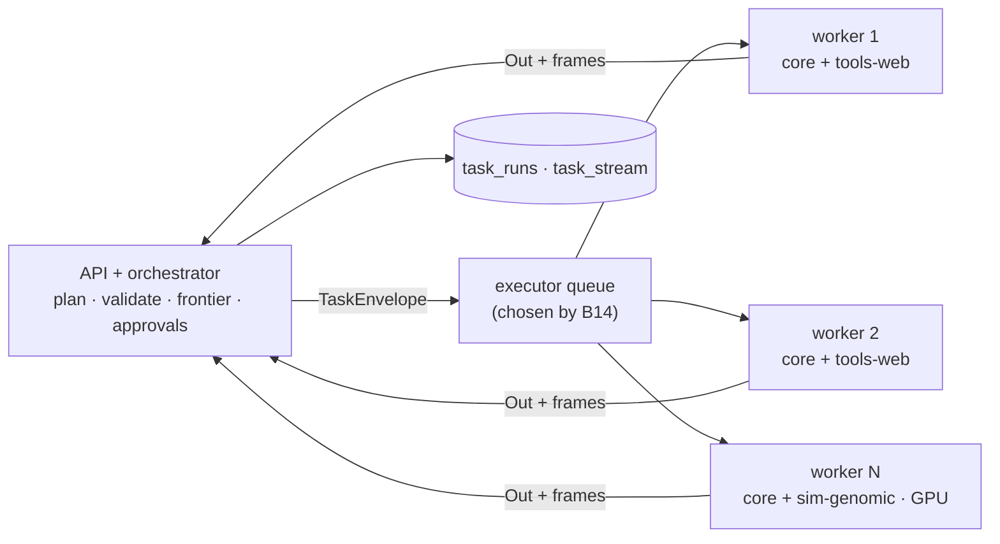

# Plugins — the engine's task types, versioned and runnable on any worker

How the catalogue (today's built-in steps) and the new tools become one versioned system of **plugins**, laid out so that any number of workers can run any task. Execution is not decided here: the executor is picked by the benchmark in [migration-sessions › B14](migration-sessions.md#track-b--engine).

| | |
|---|---|
| Today | `engine/src/invana/runtime/catalogue/` — ~30 catalogue entries in 7 modules (one per bound), a closed set built at import, dispatched in-process by `runtime/executor.py` |
| Proposal | `engine/src/invana/plugins/` — every task type lives in a **plugin**; core plugins always load, tool plugins load when their extra is installed and an Admin enables them. The registry of everything available builds itself from the manifests |
| Requirement | **Distributed**: deploy N workers and get more runs and tasks per second; a worker can die without losing work |
| Not decided here | Which executor (procrastinate · Dramatiq · Prefect) — B14 measures |

## Words

| Word | Means |
|---|---|
| **Plugin** | A folder of task types, skills and flows, with a `plugin.yaml` manifest. Versioned as a whole |
| **Task type** | One callable the runtime can run — e.g. `web.fetch`. Declared by its **task manifest** (`manifest.yaml`) beside its code (`run.py`). Versioned on its own |
| **Task** | Unchanged (`terminology.md`): a node in a TaskPlan. A Task **uses** a task type; its TaskRun is one execution |
| Retired | *pack* and *catalogue entry* — the catalogue is the registry of task types |

## 1. Should the built-ins be plugins?

| Choice | View |
|---|---|
| Built-ins become optional plugins | ❌ `execute_graph_query` or `understand_intent` missing would break every Graph |
| Built-ins stay a separate, special catalogue | ❌ two declaration formats, two versioning schemes, two registries |
| **One format, two kinds of plugin** ⭐ | ✅ **core plugins** (built-ins, always loaded, versioned with the engine) and **tool plugins** (optional extras, Admin-enabled). Same task manifest, same versioning, same registry, same worker contract |

## 2. Code layout

```
engine/src/invana/plugins/
├── __init__.py            load_plugins() → the frozen registry, once at process start
├── sdk/                   what a plugin author imports — nothing else
│   ├── manifest.py        PluginManifest, TaskManifest, Arg, Type, Bound, SideEffect  (from runtime/catalogue/registry.py)
│   ├── context.py         TaskContext — what a task is handed (from contract.py)
│   └── errors.py          TaskFailure, NeedsInput, CannotAnswer
├── registry.py            Registry — plugins → task types, by key and key@version; frozen
├── envelope.py            TaskEnvelope — the serialisable unit of work a worker receives
├── worker.py              run_envelope(): rebuild context from ids, call the task type, return Out
├── core/                  always loaded; today's catalogue and built-in flows, moved plugin by plugin
│   ├── pure/              validate_query · shape_for_canvas · verify_result · await_delegations
│   ├── graph_read/        execute_graph_query · preview_stitches · count_types · resolve_elements · expand_neighbours
│   ├── graph_write/       write_graph · stitch · withdraw_stitch · bulk_write · apply_stitches · commit_stitches
│   ├── schema_write/      understand_ask · validate_proposal
│   ├── ingest/            check_bundle · snapshot_model · validate_records · flows: model-import · bundle-import · bulk-load
│   ├── llm/               understand_intent · plan_workflow · translate_thought · draft_plan · propose_model
│   └── work_write/        spawn_agent · delegate · create_task
├── tools/                 optional; one extra each
│   ├── web/               web.search · web.fetch · web.download          → invana[tools-web]
│   ├── mail/              mail.read · mail.send                          → invana[tools-mail]
│   └── science/           pubmed.search · uniprot.get · pubchem.get      → invana[tools-science]
├── simulators/
│   └── genomic/           sim.genomic_prediction                         → invana[sim-genomic]
└── mcp/                   turns an enabled MCP server's tools into task types, frozen at enable time
```

### One plugin

```
plugins/tools/web/
├── plugin.yaml              name · version · kind · engine range · extra · secrets
├── tasks/
│   ├── fetch/
│   │   ├── manifest.yaml    the task manifest
│   │   └── run.py           async def run(ctx, vars) -> Out
│   ├── search/
│   │   ├── manifest.yaml
│   │   └── run.py
│   └── download_and_extract/    a composite task type — fixed steps in code, one task
├── skills/
│   └── collect-dataset/     instructions.md · evals.yaml
├── flows/                   packaged flows (fixed multi-step TaskPlans)
└── tests/                   positive and negative — real services, no mocks
```

| Stays where it is | Why |
|---|---|
| `runtime/` interpreter, planning, layers, diagnosis | the orchestrator; it reads the registry, it does not hold task types |
| `runtime/catalogue/__init__.py` | becomes a thin re-export (`CATALOGUE`, `TASKS` from `plugins.registry`) so its ~20 importers keep working |
| Task type **keys** | stored in `run_nodes.task_key` and read by Studio — moving a task type never renames it |
| Bodies (`bundle`, `records`, `stitching`) | move with the `ingest` core plugin as internal modules, not task types |

## 3. The manifests

```yaml
# plugins/tools/web/plugin.yaml
name: invana.tools.web
version: 1.2.0
kind: tool                  # core | tool | simulator | mcp
engine: ">=0.9,<1.0"
extra: tools-web
secrets: []                 # e.g. [smtp] for mail
```

```yaml
# plugins/tools/web/tasks/fetch/manifest.yaml
key: web.fetch
version: 1.1.0
summary: Read one page and cite its URL.
bound: network
side_effect: read           # read | write | send — send always needs approval
args:
  url: { type: str, required: true }
outputs:
  text: str
  links: list
  fetched_at: str
requires: []
timeout_s: 30
retries: 2
resources: [cpu]            # llm | cpu | gpu
```

| Task manifest field | New? | Why |
|---|---|---|
| `key` · `summary` · `bound` · `args` · `outputs` · `requires` | exists (today in Python) | the planner, validator and interpreter read them |
| `version` | **new** | a task type versions independently of its plugin |
| `side_effect` | **new** | read · write · send; send is gated by approval |
| `timeout_s` · `retries` | **new** | defaults the executor applies; a plan may tighten, never loosen |
| `resources` | **new** | `llm` (token use) · `cpu` · `gpu` — lets a worker pool advertise what it can run |
| Validation | — | Manifests are checked at start-up against `run.py`'s signature; a mismatch stops the process with the file named |

## 4. What a plugin contributes

| Contribution | Is | Runs as | Example |
|---|---|---|---|
| **Task type** | one callable — `run(ctx, vars) -> Out` | one envelope on one worker | `web.fetch` |
| **Composite task type** | a fixed, deterministic sequence in code, exposed as **one** task type | one envelope on one worker — no per-step dispatch | `web.download_and_extract` (download → unzip → parse) |
| **Skill** | `instructions.md` + an eval set; its plan is **generated** | a flow: each step its own envelope | *Collect a dataset from the web* |
| **Flow** | a fixed multi-step TaskPlan written in the plugin | a flow: each step its own envelope | `model-import@1` · `bundle-import@1` (today's built-ins) |

| Rule | Detail |
|---|---|
| Who writes flows | Plugin authors, in code review — never users in Studio. Users write instructions; their plans are generated |
| Plan origins | `generated` (from instructions) · `packaged` (shipped in a plugin). User-authored plans stay retired |
| Versioning | Flows and skills carry versions like task types; a run records `flow@version` or the generated plan's revision |
| Composite or flow? | Composite when steps are tight, deterministic and share local state (files on disk) — dispatch overhead would dominate. Flow when steps need lanes, approvals, replanning or per-step visibility |
| Visibility | A flow's steps appear on the run page one by one; a composite task appears as one step with its own log |

## 5. How a flow runs across workers

| Step | Where |
|---|---|
| Walk the flow, hold the frontier, decide what is ready | orchestrator |
| Each ready step → one `TaskEnvelope` | queue |
| Steps of one flow, and every lane of a fan-out, spread across all workers | workers |
| A step finishes → `Out` and frames back → the frontier moves | orchestrator |
| Replan mid-run | orchestrator — appends a revision; settled steps never change |

- A fan-out of 200 lanes is 200 envelopes: with 9 workers they run 9-wide (or more, per worker concurrency) — this is where N workers pay off.

## 6. Versioning

| Rule | Detail |
|---|---|
| Two versions | A **plugin** version (what is installed) and a **task type** version (what a plan ran) |
| Semver per task type | Patch: behaviour fix · Minor: new optional arg or output · Major: an arg or output removed or changed |
| Runs record the version | A Task stores `task_key` **and** `task_version` — the same rule as pinned model versions |
| Plans resolve, then pin | A generated plan names keys; the run's plan snapshot records the resolved `key@version` |
| Majors live side by side | After a major release the previous major keeps serving for a deprecation window, so re-runs on the same versions still work |
| Core plugins | Versioned with the engine release; a core task type's major bump is called out in the changeset |
| Closed per process | The registry is built once at start-up from installed and enabled plugins, then frozen. Nothing registers while plans run — the envelope stays enforceable |

## 7. Ready for N workers

The plugin contract is what makes horizontal scaling possible, whichever executor B14 picks.

| Requirement | How the plugins module meets it |
|---|---|
| Any worker can run any task | A task travels as a **`TaskEnvelope`**: `run_id`, `node_id`, `attempt`, `plugin@version`, `key@version`, args, ids of the Graph and lens. All JSON |
| No live objects cross the wire | Today `TaskContext` carries a DB session, connection manager, emitter and runtime handle. A worker **rebuilds** them from the envelope's ids — the main engineering change, and executor-independent |
| Results come back the same way | `Out` (detail, outputs, artifacts) and run frames are serialisable; the orchestrator applies them to `task_runs` / `task_stream` |
| A worker dies mid-task | The task is redelivered; every attempt carries an **idempotency key** (`run_id:node_id:attempt`), and write task types check it before writing |
| Add capacity | Start more workers; they pull from the queue. Scale on queue depth |
| Different hardware | Workers advertise the plugins and `resources` they can run (e.g. a GPU pool for `sim.*`); envelopes route to a matching pool |
| Secrets | Resolved inside the worker for the task type's declared `secrets` only — never in the envelope |
| Third-party code | Tool plugins run in workers, never in the API process |
| One code path everywhere | The `inline` executor calls the same `worker.run_envelope()` in-process, so single-machine and distributed behave alike and the benchmark compares like with like |



## 8. What the orchestrator keeps

| Stays in the orchestrator | Moves to the worker |
|---|---|
| Plan generation and validation against the envelope | Calling one task type |
| The frontier, replan, approvals, token budgets | Rebuilding the context from ids |
| Writing `task_runs` and `task_stream` | Returning `Out` and frames |
| Retry *policy* (whether to retry) | Retry *mechanics* (redelivery) — supplied by the executor |

## 9. Where it is administered

| Surface | What |
|---|---|
| Studio | **Agents › Plugins** — the registry: every plugin (core, tool, simulator, MCP), its task types with their manifests and versions, its skills and flows, enabled or not, who may call them, how often they run |
| CLI | `invana plugins list` · `show <plugin>` · `enable <plugin>` · `disable <plugin>` · `invana tasks show <key>[@version]` · `invana plugins mcp add <url>` |
| Access | Only an install Admin enables a plugin; worlds and guardrails decide which agents may call its task types |

## 10. Changes to existing docs, applied when B06 lands

| Doc says | Becomes |
|---|---|
| `runtime/catalogue/__init__.py`: *nothing outside this package adds an entry* | Task types come from plugins in `plugins/`; the set is still closed — per process, frozen at start-up |
| `orchestration.md` §5.1: *not a plugin host* | Admin-enabled in-engine plugins register task types |
| `runtime/executor.py`: *one protocol, one implementation* | `inline` plus the distributed executor B14 selects; both call `worker.run_envelope()` |
| `terminology.md`: *catalogue entry* | *task type*, declared by a task manifest; the catalogue is their registry |

## Not deciding here

| Item | Where |
|---|---|
| procrastinate vs Dramatiq vs Prefect | B14 benchmark |
| Third-party plugin packages outside the engine | Later — plugins live in-engine for now |
| Hot-loading plugins without a restart | Not building — the registry is frozen per process |
