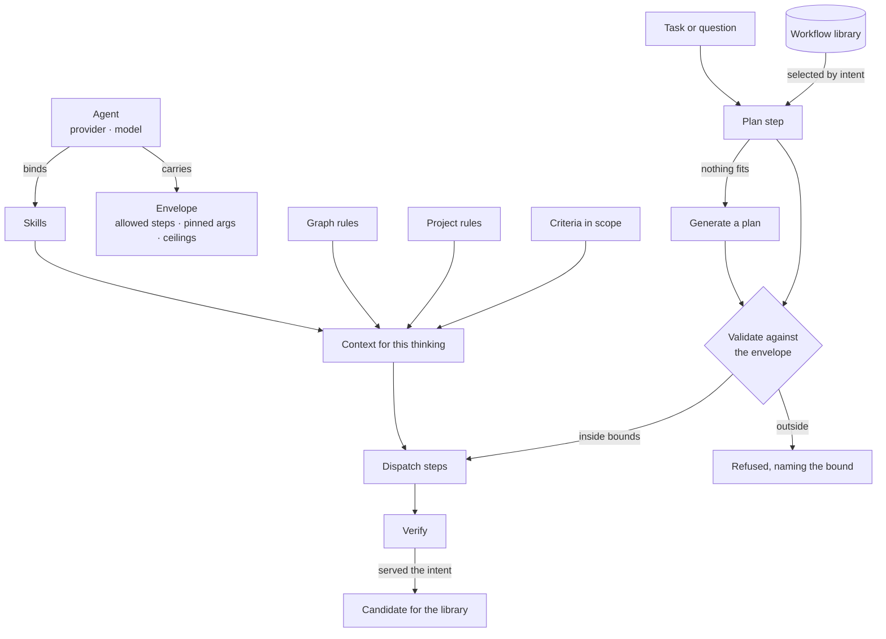

# Invana — System Design

What Invana is, its layers, its records and the behaviours every feature keeps now live in
[`specs/vision.md`](../specs/vision.md) and [`specs/system-design/`](../specs/system-design/architecture.md). What is
left here is waiting for review: rows written against the retired record model, and §4 *Flows*, which becomes
`specs/journeys/`.

| | |
|---|---|
| The record | [`for-developers/README.md`](for-developers/README.md) is authoritative for **scope and status**. If this document and a feature file disagree, the feature file wins. |
| This document | Orientation and flow. It states no schema, no endpoint and no status. |
| Words | [`for-developers/terminology.md`](for-developers/terminology.md). Nothing outside it is ours. |
| Not built | Everything under [Not building](for-developers/README.md#not-building) is out of scope, and this document does not describe it. |

---

## 1. What Invana is

| Claim | Means |
|---|---|
| **Bounded** | Membership in the Graph is the whole permission model. |

**Invana orchestrates the agents** — which one takes a task, what it may run, what it is offered, in
what order, and who checks the result. It also **runs them itself**: one in-process runtime, one
asyncio task per thinking, no external infrastructure. That runtime sits behind a protocol so a
deployment could swap in a job scheduler it already operates; none has been written, and the default
is the only one.

### 1.1 What Invana is not

| Not | Because |
|---|---|
| A permissions product | Membership is binary. What looks like a permission question is usually an **envelope** question (what an agent may run) or a **criterion** question (what "done" means). |
| An OS | The operating-system framing, and the word *mission* with it, is retired. The container is a **Graph**. |

### 1.2 The use-case surface

Simulation, parameter sweeps and game theory are **post-1.0 and not built** — see
[Not building](for-developers/README.md#not-building).

---

## 2. Core concepts

| Term | Is |
|---|---|
| **Member** | Someone with access to a Graph. Binary — there are no roles. |
| **Import run** | One load of a dataset. It is a Thought — it inherits the runtime, trace, retries and failure vocabulary. |
| **Thought** | A unit of intent: `ask` · `import` · `stitch`. |
| **Thinking** | One run of a Thought. A task assignment or a question opens exactly one. |
| **Step** | One callable inside a thinking: `understand · plan · translate · validate · execute · project · verify`. |
| **Agent** | A principal that can be assigned work, carrying provider, model, skills, envelope and budget. |
| **Workflow** | A named, reusable plan. **Promoting** a plan that served turns it into a template. |
| **Project** | A piece of work inside a Graph — a folder of Tasks, staffed by principals. |
| **Task** | One unit of work with an assignee and a definition of done. Sub-tasks nest three deep. |
| **Review** | The one queue: questions block a thinking, proposals wait, results need accepting. |
| **Schedule** | A cron on a question or a task. A **firing** is one occurrence. |

---

## 4. Flows

Each flow names who triggers it, what happens, and what the user sees next.

The person's paths are journeys in `specs/`: creating a Graph and connecting it, linking models and bringing data in are [J01](../specs/journeys/J01-from-an-empty-install-to-a-first-answer.md); a task through an agent and delegation are [J03](../specs/journeys/J03-give-an-agent-work-and-decide-on-the-result.md); what carries over and schedules are [J04](../specs/journeys/J04-build-an-agent-and-improve-it-from-what-runs-teach.md). Their rules are in the features those journeys cross. The flows below are the engine's.

### 4.1 Bootstrap

An operator has just installed Invana. There are no accounts.

1. `invana migrate` applies database migrations. Nothing migrates itself on boot.
2. `invana users create --superuser` creates the first install Admin. It prompts, or takes
   `--non-interactive` with every value as a flag; nothing is defaulted.
3. `invana start` runs the engine, and Studio when bundled.

Further accounts are created by an operator with shell access (`invana users`) or by a superuser
through the register route. Superuser is **platform administration** — it is never a way into
someone else's Graph.

### 4.2 Sign in

1. Signing in returns a short-lived **access token** and an opaque, server-side **refresh token**.
2. The access token carries identity and the superuser flag — not membership, and not the username,
   because both can change while a token lives.
3. Membership is looked up **per request**, so revoking access takes effect immediately.
4. Refresh rotates: the old row is revoked, and a reused one is a signal rather than a convenience.

Graph-scoped routes hang off `/u/{username}/{graphSlug}/…`; user-level routes live under `/auth/…`.

### 4.4 Author a model

A **domain model** is authored against a domain, not against the Graph that first holds it — which is
what makes it exportable, importable and upgradable.

1. Authoring happens on a **draft**. Introspection can seed one; it never writes a published version.
2. The model canvas draws node types and edge types. Edits **stage** — nothing reaches the database
   until a commit, and the staged set is visible and reversible.
3. Publishing makes the version **immutable**. Editing publishes the next one; imports and answers
   that used the old version still resolve.
4. The projector composes DDL from every active model onto the graph database; the introspector reads
   back what is actually there. Neither writes the other's truth.

Starter models — memory, provenance — are importable shapes a Graph renames on arrival, travelling
the same export/import path as any other model.

### 4.7 Ask

A question becomes a run; the run becomes steps; the steps produce things a person can read.

```
understand → plan → translate → validate → execute → project → verify
```

| Step | Does | Can end the run |
|---|---|---|
| `understand` | Settles what is being asked; asks back when it cannot | yes — cannot answer |
| `plan` | Selects a template by intent, or generates a plan inside the envelope | yes — refused by the envelope |
| `translate` | Intent → query, against the global model | |
| `validate` | The query parses and only names things the model has | yes — repaired **once**, then reported |
| `execute` | Runs it on the graph database | yes — failure with a diagnosis |
| `project` | Records → emissions, through a projection template | |
| `verify` | Did this serve the intent? | records the verdict |

Every step streams. The user sees the step, its state and its emissions as they arrive — never a
spinner followed by everything at once. An emission of kind subgraph draws **onto** the current data
canvas rather than replacing it.

### 4.8 How a run assembles

Three separately authored things meet at run time for the first time: the **agent** that runs, the
**skills and rules** it is offered, and the **workflow** it plans from.



**The agent decides what is possible, the library decides what is tried, the rules and skills decide
what it knows, and the envelope is checked before anything runs.** A refusal is a first-class
outcome, not an error: nothing is dispatched and nothing is spent.

### 4.13 Serving the Graph to an external agent

The same curated graph is reachable from outside — an IDE assistant, a chat copilot, an application
backend.

1. A **scoped token** names what it may read. Anything else is refused, not silently filtered.
2. Reads carry **provenance**: which records answered, and the dataset and run they entered through.
3. The external caller appears in activity as a principal, like any other actor.
4. **The external surface never writes.** Imports have their own contract (§4.6); a general write API
   has none.

---

## 5. Cross-cutting behaviours

| Behaviour | Detail |
|---|---|
| **The Graph is the boundary** | Membership of the Graph is the whole permission model. |
| **Offered, not obeyed** | Skills and rules reach a step as discrete items with ids. Neither is enforced — the gap between *offered* and *applied* is the signal a person acts on. Enforcement is an envelope bound or a criterion. |
| **Bounds nest** | An envelope bounds what one agent may run; a budget bounds what it may spend; delegation bounds depth and fan-out; a Graph ceiling bounds how many run at once. Each refuses with the bound named, and none is negotiable at run time. |
| **Derived, never stored** | The global model, the task plan, evidence and metrics are all computed from what already exists. A second copy of the truth would drift from the first. |
| **Invana runs its own work** | One in-process runtime, one asyncio task per thinking, persisted to the app database, zero external dependencies. The protocol around it is a seam, not a shipped alternative. |

---

## 6. What this document is not

| Not | Where it lives |
|---|---|
| A scope or status statement | [`for-developers/README.md`](for-developers/README.md) — the feature index, its `Slice` column and its Shipped / Partly built tables |
| A schema | The `What this module owns` section of each [module spec](for-developers/modules/) |
| An API spec | [`for-developers/modules/platform/spec.md`](for-developers/modules/platform/spec.md) §5, and the generated client |
| A design record | Each feature's own file. A decision lives with the feature it governs, in present tense; there is no RFC tree and no history of what was tried |
| A delivery plan | [`for-developers/README.md#delivery`](for-developers/README.md#delivery) |

When a module spec or a feature file uses the words *Graph*, *domain model*, *global model*,
*dataset*, *thought*, *thinking*, *emission*, *agent*, *envelope*, *skill*, *rule* or *workflow*, it
means them as [`terminology.md`](for-developers/terminology.md) defines them — and this document uses
them the same way.
