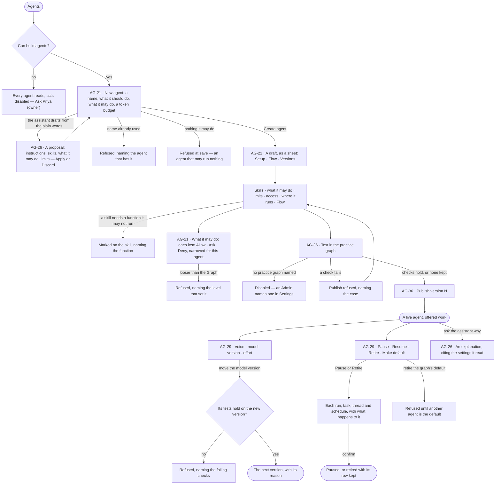
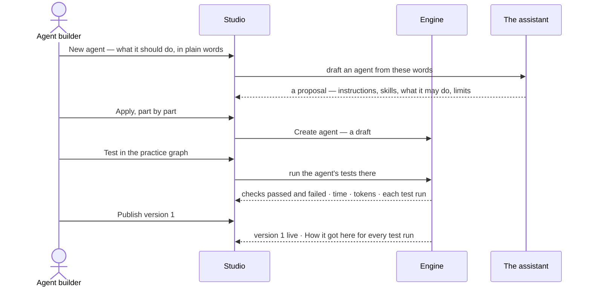

# Build an agent

> Make an agent from plain words — what it should do, what it may do, what it may spend — read what it will do before
> it runs, test it in the practice graph and publish a version; then tune its voice, model version and effort, and
> pause or retire it with its open work named. The decision it helps make: *is this agent ready to be given work, and
> is this change to it safe to publish?*

## User journey

Journeys this feature is a step of: [J04 · Build an agent and improve it from what runs teach](../../../../journeys/J04-build-an-agent-and-improve-it-from-what-runs-teach.md) · [J06 · Set what an agent may touch](../../../../journeys/J06-set-what-an-agent-may-touch.md)

## Stories

| ID | Story | Status |
|---|---|---|
| AG-21 | [Draft an agent and see what it will do](stories/AG-21-draft-an-agent-and-see-what-it-will-do/story.md) | idea |
| AG-36 | [Test an agent and publish a version](stories/AG-36-test-an-agent-and-publish-a-version/story.md) | idea |
| AG-29 | [Tune an agent's voice, model and effort, and retire it](stories/AG-29-tune-an-agents-voice-model-and-effort-and-retire-it/story.md) | idea |
| AG-26 | [Let the assistant draft and explain an agent](stories/AG-26-let-the-assistant-draft-and-explain-an-agent/story.md) | idea |

## Access

| Act | Role (`.claude/team/TEAM.md` §7) | Everyone else sees |
|---|---|---|
| Read every agent — its setup, what it may do, its limits, voice, model version, Flow and versions | Operator — every member of the graph | — |
| Create an agent, edit a draft, test it, publish a version, discard a draft | `builder` · shown as *Can build agents* · Admin | *New agent*, *Test* and *Publish* disabled, naming *Can build agents* — *Ask Priya (owner)* |
| Change voice, model version, effort or limits · Pause · Resume · Retire · Make default | `builder` · *Can build agents* · Admin | The setting reads as saved; the act is disabled, naming *Can build agents* |
| Narrow the agent's own modes — tighten, or loosen back no further than the Graph, never past a locked line | `builder` · *Can build agents* · Admin | Each mode reads; changing it is disabled, naming *Can build agents* |
| Give the agent an access rule | `iam-admin` · shown as *Can manage people* · Admin | The rules it holds read; *Add an access rule* disabled, naming *Can manage people* |
| Give the agent a rule of its own that must always hold | Who may change the graph's rules (SE-F07) | The rule reads; editing it is disabled, naming who may |
| Offer model versions to pin | Admin, in Settings › AI and connections | A version not offered cannot be picked |
| Name the practice graph | Admin, in Settings › Invana | *Test in the practice graph* disabled, naming the Admin |
| Ask the assistant to explain an agent | Operator | — |
| Ask the assistant to draft or change an agent | `builder` · *Can build agents* · Admin | The assistant explains and says it cannot change the agent, naming *Can build agents* |

## States

| State | What the person sees |
|---|---|
| First use | Agents with only the graph's own assistants: *New agent* and a line on what an agent is. A new agent's sheet with no skill reads that it runs on the graph's own plans alone |
| Empty after a filter | *No agents match* — the filters (kind · status · helpers shown) named, with *Clear filters* |
| Loading | The sheet's head and tabs drawn at once; the body loads in place |
| Has data | An agent as a sheet: Setup (instructions, voice, skills, model version and effort, limits, lifecycle) · Flow · Versions; a live agent's tokens today and this month as meters |
| Failed | The tab names what it could not read, in the engine's words; a refused save names the field and why |
| Agent working or proposing | The assistant drafting the agent, then its proposal beside the form; a test running in the practice graph with its checks filling in |
| No access | Every tab reads; each act is disabled, naming the grant it needs, with *Ask Priya (owner)* |

## Rules

| Rule | Detail |
|---|---|
| No unbounded agent | Every agent starts from a template that brings what it may do; there is no agent that may run anything |
| What it may do is modes | Each thing the agent may touch carries Allow · Ask · Deny ([one access model](../../../../os/access/product.md#decisions)). A builder narrows a single agent from its sheet; its own modes are lines of its own access rule — *An agent's own*, beside *A person's own* and *A key's own* (AC-F04) — which starts with a new agent's starting lines ([Starting lines are shown](../../../../os/access/product.md#decisions)) and tightens what the Graph set, or loosens back no further — never past a line someone who can manage people locked |
| What it may do is checked before it runs | A plan that names a function the agent may not run, an argument it must not change, or a limit it would pass is refused before anything is dispatched — nothing is spent |
| A refusal names its side | The agent's own limits, the view of the graph the work runs in, or a rule that must always hold — whichever bound it |
| Bounds nest | An agent's own limits ∩ the work's view of the graph ∩ the graph's rules, frozen when a run opens; a run's helpers may only narrow them |
| Standing and situational | What an agent may ever do — functions, effort, tokens a month, runs at once, helpers, its own rule — is on the agent. What one piece of work may see and spend comes with the work: a thread, a task, a schedule |
| Tighten, never loosen | An agent may propose narrowing its own limits; widening them is a person's act |
| Tokens, never currency | Every budget, meter and refusal counts tokens ([glossary › Token budget](../../../../glossary.md#what-may-happen)) |
| Declared is not enforced | The limits table says which limits stop a run and which are only drawn against |
| An agent sees no provider | Its model version is a pin or comes from the view of the graph; it holds no AI connection of its own |
| Skills reach an agent only when added to it | A template suggests skills; it adds none |
| A skill's needs come from its plan | The functions a skill needs are read from its current plan, never typed beside it |
| Voice is words only | The voice reaches the steps whose words a person reads — the question back, the reason, the answer — and never what is queried, planned, seen or refused |
| Instructions and voice differ | Instructions say what to do and reach the steps that read the question and write the query, after the graph's own; the voice says who is speaking |
| Humour is off when something went wrong | A refusal, a cannot-answer, an error and a budget pause are said without humour, whatever the voice says |
| A run keeps what it opened with | Its voice, model version and limits are the ones it opened with; a change reaches the next run |
| A pin is exact | A model version is the provider's own name, never an alias; a pinned version the graph does not offer refuses the run — nothing falls back |
| Moving a pin is a change | It runs the agent's tests on the new version first and becomes a version with its reason |
| A draft takes no work | A draft is never asked, assigned a task, scheduled or made the default |
| Nothing is deleted once it ran | Retiring keeps the agent's row, so every run, trace and helper still resolves; the name stays taken |
| Pausing kills nothing | Runs in flight finish; open work is named item by item before the act |
| One default | Every graph has one default agent, and it can answer questions |
| No AI model offered | *New agent* says no model version is offered yet and opens Settings › AI and connections for an Admin |
| A model version not offered at run time | The run is refused before it starts, naming the version and the view of the graph or pin that chose it |
| A skill removed | It leaves every agent it was added to; the agent keeps working on the rest |
| No default agent | The first published agent is offered as the graph's default |
| The engine counts | Tokens today and this month, served, p95 and every number on the sheet are the engine's; Studio formats them |
| Leans on | Skills (AG-F04) · runs and how agents are doing (AG-F03) · helpers and delegation (AG-F05) · access rules (AC-F03) · AI models (RT-F01) · rules that must always hold (SE-F09) · the catalogue and inviting (AG-F02) |

## Data touched

| Record | Read or write |
|---|---|
| Agent — name, kind, status, instructions, voice, voice dials, what it may do, limits, effort, model pin | Write · read |
| The agent's own modes — lines of its own access rule, *An agent's own* (AC-F02) | Write · read |
| Agent version and its reason | Write · read |
| Skills added to the agent | Write · read |
| The agent's tests and their runs in the practice graph | Write · read |
| Access rules it holds | Read (written in AC-F03) |
| Model versions offered | Read (written in RT-F01) |
| Open work it holds — runs, tasks, threads, schedules | Read · write on Pause and Retire |
| Runs it opened — tokens, model version called, outcome | Read |

## Engine

### Records

| Table | Columns | Notes |
|---|---|---|
| `agents` | `key` · `name` · `description` · `kind` (`seeded` · `authored` · `spawned` · `remote`) · `status` (`draft` · `active` · `paused` · `retired`) · `lifetime` (`persistent` · `ephemeral`) · `parent_agent_id?` · `spawned_in_run_id?` · `remote_agent_id?` · `instructions` · `instructions_draft` · `soul` · `soul_traits` · `envelope` · `budget` · `effort` · `policy` · `model_pin?` · `version` | `name` unique and never freed. One table: `envelope`, `budget`, `effort`, `policy` and `soul_traits` are JSON on the row, read by presence. `envelope` names functions by key — the catalogue is code, with no function table (AG-F06). `spawned` and `remote` rows are written by AG-F05. No provider or credential on the row. A version's reason and a retirement's *Why* ride their events (AC-F06), which Versions reads |

| JSON column | Keys |
|---|---|
| `soul_traits` | `humour` (`off` · `light` · `playful`, default `light`) · `formality` (`casual` · `neutral` · `formal`, default `neutral`) · `emoji` (`off` · `on`, default `off`) · `greeting` (`off` · `on`, default `off`) |
| `effort` | `max_steps` (24) · `max_replans` (1) · `max_clarifications` (3) |
| `envelope` | `allow` (function keys) · `pins` (arguments no plan may change) · `plans` (reusable plans, `key@version`) · `entry` and `steps` (an agent of fixed steps) |
| `budget` | `max_tokens_run` (200k) · `max_tokens_month` (5M) · `max_concurrent_runs` (3) · `max_children` (3) · `max_depth` (2) · `max_descendants` (12) · `max_live` (4) · `max_fanout` (200) |
| `policy` | `can_be_assigned` · `unattended` · `may_delegate` (`{agent: always · ask · never}`, AG-F05) |
| `model_pin` | An exact address `llm/<endpoint>/<model version>` |

### Reads

| Record | Owner |
|---|---|
| Runs — `agent_id` · `agent_version` · `model_version`, tokens, exit reason, the budget and effort a run opened with | [AG-F03](../AG-F03-runs-and-how-the-agents-are-doing/feature.md#engine) |
| Skills, their bindings (`agents_skill_bindings`), the eval sets, cases, runs, the eval gate and the eval token budget | [AG-F04](../AG-F04-skills/feature.md#engine) |
| Helpers, delegation and outside agents | [AG-F05](../AG-F05-delegation-and-outside-agents/feature.md#engine) |
| Functions and reusable plans an envelope names | [AG-F06](../AG-F06-plans-and-functions/feature.md#engine) |
| The agents a Graph has invited and the shipped agents | [AG-F02](../AG-F02-the-agents-catalogue/feature.md#engine) |
| The agent's own rule — a `model_lenses` row scoped `agent:<id>`; the agent holds no pointer to it | [SE-F09 › Engine](../../../semantics/features/SE-F09-views-of-the-graph/feature.md#engine) · [AC-F04](../../../../os/access/features/AC-F04-what-an-agent-may-touch/feature.md#engine) |
| Access rules the agent holds | [AC-F02](../../../../os/access/features/AC-F02-access-rules/feature.md#engine) |
| The AI models an install offers and their rates | [RT-F01](../../../../os/runtime/features/RT-F01-ai-models/feature.md#engine) |
| Tasks, schedules and conversations a lifecycle preview lists | [PJ-F01](../../../projects/features/PJ-F01-projects-and-tasks/feature.md#engine) · [AG-F07](../AG-F07-schedules/feature.md#engine) · [EX-F03](../../../explore/features/EX-F03-ask-a-question/feature.md#engine) |
| Runs at once per Graph | [RT-F04](../../../../os/runtime/features/RT-F04-limits/feature.md#engine) |
| The Graph's row — `default_agent_id`, written only by `POST /agents/default` and seeding (AG-F02) | [GR-F04](../../../../os/graph/features/GR-F04-this-graph/feature.md#engine) |
| Version history — each version's reason, a retirement's *Why* | [AC-F06](../../../../os/access/features/AC-F06-history/feature.md#engine) |

### Routes

| Route, after `/api/v1/u/{u}/{g}` | Does | Story |
|---|---|---|
| `GET /agents` | A page of `AgentRead` with `persistent` · `ephemeral` counts, `default_agent_id` and `tokens_this_month` as a `{agent_id: tokens}` sidecar from one grouped read | AG-21 |
| `POST /agents` | Create a draft; takes `skill_ids`, each added through AG-F04's add | AG-21 |
| `GET /agents/{id}` · `PATCH /agents/{id}` | `AgentRead` — the row as stored, plus `effective_budget` · `effective_effort` · `skill_ids` (read only) · change it, sending only what moved | AG-21 · AG-29 |
| `PATCH /agents/{id}/draft` · `DELETE /agents/{id}/draft` | Write or discard the instructions draft | AG-21 · AG-36 |
| `DELETE /agents/{id}` | Discard a draft that never ran — `204` | AG-21 |
| `POST /agents/{id}/create` · `POST /agents/{id}/publish` · `POST /agents/{id}/rollback` | Make live (version 1), publish the draft, roll back as a draft of an earlier version — each through AG-F04's eval gate; returns `{verdict, eval_run_id, warnings}` | AG-36 · AG-29 |
| `GET /agents/{id}/pause` · `GET /agents/{id}/retire` | The `LifecyclePreview` | AG-29 |
| `POST /agents/{id}/pause` · `POST /agents/{id}/retire` · `POST /agents/{id}/resume` | Apply; retire takes `reason` | AG-29 |
| `GET /agents/{id}/functions` | `{agent_id, skills[{skill_id, name, version, when_to_use, needs, uses, missing, offered, applied, enough_to_read}], callables[{step_key, bound, pinned, needed_by}], plans[key@version], offered, applied, prompt_chars}` | AG-21 |
| `GET /agents/{id}/meters` | `{agent_id, tokens_this_month, max_tokens_month, max_tokens_run, running, queued, max_concurrent_runs, runs_this_month, sessions, spawned_this_month, depth, max_children, max_depth, max_fanout}` | AG-21 · AG-29 |
| `GET /agents/{id}/activity` | Its recent runs | AG-21 |
| `POST /agents/{id}/voice/preview` | Two answers to one sample ask, current voice and draft; nothing recorded or drawn against any budget | AG-29 |
| `POST /agents/default` | Make an agent the Graph's default | AG-21 · AG-29 |

### Events

| Event | When |
|---|---|
| `agents.create` · `agents.update` | A draft is created · a field changes; `agents.update` carries the `changed` keys (envelope, budget, effort and policy included) |
| `agents.soul_set` | The voice or a dial changes; bumps `version` |
| `agents.activate` · `agents.publish` · `agents.rollback` | Made live · a version published · rolled back; each carries the gate's verdict and the `why` |
| `agents.pause` · `agents.resume` · `agents.retire` · `agents.delete` | The lifecycle acts; `agents.retire` carries the reason |
| `agents.set_default` | A Graph's default changes |

### Refusals

| Status | When | Sentence | Criterion |
|---|---|---|---|
| 409 | A name another agent has, retired or not | *{name} is taken by {agent}.* | AG-21.3 |
| 422 | Saving with nothing in `envelope.allow` | *An agent that may run nothing is a mistake — allow something.* | AG-21.4 |
| 422 | `max_tokens_run` above `max_tokens_month` | *A run's budget cannot exceed the month's.* | AG-21.12 |
| 422 | An unknown voice dial or value | *{dial} takes {values}.* | API only — Studio offers the dials as fixed choices (`check_traits`) |
| 409 | Opening a run on a `paused`, `retired` or `draft` agent — asked, assigned, scheduled or made the default | *{agent} is {state}.* | AG-29.20 · AG-36.11 |
| 409 | Pause or Resume on a draft · `POST …/create` on an agent that is not a draft | *{agent} is a draft.* · *{agent} is already live.* | API only — Studio offers neither act there |
| 409 | `DELETE /agents/{id}` once the agent has run or is seeded | *{agent} has run — retire it instead.* | AG-21.21 |
| 409 | Retiring the Graph's default | *Make another agent the default first.* | AG-29.17 |
| 422 | Making an agent the default that cannot answer questions | *{agent} cannot answer questions.* | AG-21.20 |
| 409 | A new run past `max_concurrent_runs` — refused at admission, never queued | *{agent} is running {n} of {max} at once.* | AG-21.32 |
| 409 | A plan naming a function outside `envelope.allow`, changing a pinned argument, or passing a limit — before dispatch | *{function} is not something {agent} may run.* · *{argument} is fixed for {agent}.* · *This passes {bound} ({side}).* | AG-21.10 · AG-21.14 |
| 409 | A model version not offered by RT-F01 or not allowed by the view of the graph | *{model version} is not offered here.* | AG-29.10 · AG-29.23 |
| 422 | The agent's own modes looser than the Graph's, past a locked line, or an access change set to Allow | *{level} set this — it cannot be looser here.* | AG-21.26 · AG-21.28 |
| 403 | Loosening the agent's own modes with a key | *Loosening needs a person's session.* | AG-21.28 |
| 403 | Any write without *Can build agents* | *This needs Can build agents — ask {owner}.* | AG-21.22 · AG-29.21 · AG-36.17 · AG-29.24 |
| — | The eval gate's refusals on make live, publish, roll back and a pin move | [AG-F04 › Refusals](../AG-F04-skills/feature.md#refusals) | AG-36.4 · AG-36.18 · AG-29.9 |

### CLI

| Command | Does |
|---|---|
| `invana agents list` | List the Graph's agents |
| `invana agents push` | Write the instructions draft from a file |
| `invana agents publish` · `invana agents pin` | Publish · move the model pin — both through the eval gate |

### Mechanisms

| Mechanism | How |
|---|---|
| Read by presence | A key that is present is the value, 0 included; only an absent key takes the default in *Records*. `effective_effort` and `effective_budget` fill the defaults and are what a run reads |
| A run records the agent | `agent_id` · `agent_version` · `model_version` and every key of `effective_budget` and `effective_effort` it opened with, the per-run cap as frozen, ride the run and its trace (AG-F03) |
| Where each limit is enforced | `effort.*` — during the run; reaching one ends it with its exit reason (`step_limit`, …) · `max_concurrent_runs` — at admission · `max_tokens_run` · `max_tokens_month` — drawn against; reaching one raises a `budget` ask and the run waits on a person; a declined ask ends it `budget_declined` · `max_children` · `max_depth` · `max_descendants` · `max_live` · `max_fanout` — AG-F05 |
| A conversation's cap | Never above `max_tokens_run`; clamped and frozen on the run as `params.max_tokens_run` (EX-F03) |
| `require_available` | Runs first on every path that opens a run; a conversation bound to a paused, retired or draft agent never switches to another |
| The voice block | `voice_for` = `render_traits(soul_traits)` then `soul`, or `DEFAULT_VOICE` when `soul` is empty; the dials come first, so a sentence in the soul can override one. `""` clears the soul; the default voice is a product constant, never stored |
| Which steps read the voice | `RunVars.soul`, read at run open, reaches only `nl.understand` (its question back and reason) and the answer's words; translate, plan, validate and execute take no voice parameter |
| Humour when it went wrong | `render_traits(…, went_wrong=True)` renders `humour: off`; a step that may refuse in the same call carries *when you refuse, cannot answer, or report an error or a pause, use no humour* |
| A version | Any published change — instructions, voice, a dial, a model pin — bumps `version`; a run's `agent_version` names the voice it spoke with |
| The model a step calls | The person's pick for that question → the skill version's pin (AG-F04) → `model_pin` → the view of the graph's cast (role → model address). Each must be offered by RT-F01 and allowed by the view, or the run is refused before it starts; nothing falls back |
| The AI model client | `complete_tool` — one structured call to the endpoint the run resolved, over Anthropic, OpenAI, Ollama or the Claude Agent SDK. Called by `nl.understand` · `nl.translate` · `plan.compose` · `plan.draft` · `model.propose`, the eval judge, starter cases, the voice preview and grounding. No cost is stored for a person to read |
| A skill's needs | Adding a skill checks its current plan's functions against `envelope.allow` (AG-F04 › Refusals) |
| `LifecyclePreview` | `{agent_id, act (pause · retire), items[{kind (run · task · session · schedule), id, title, effect (finishes · blocked · unchanged · refused · paused), note}]}`; Resume has none |
| Pause · Resume · Retire | `paused` refuses new work; a run already queued starts; Resume unblocks its tasks. Retire keeps the row and the name and pauses each schedule that starts the agent. A task's `start_agent_work` blocks the task when the agent is paused or retired (PJ-F01) |
| `functions` | `needs` are the distinct functions of each skill's current plan in plan order; `missing` the needs `envelope.allow` lacks; `offered` and `applied` count this agent's runs of the current version; a function's `needed_by` includes the plans in `envelope.plans` at their newest version; the totals and `prompt_chars` are served so Studio sums nothing |
| The month meter | `tokens_in + tokens_out` over root runs that started this calendar month and their steps, eval runs left out, against `effective_budget.max_tokens_month`; no run reads `0`. `sessions` counts every conversation bound to the agent, whoever opened it |
| The command line's grant | Each command needs the grant of the route it stands for |

## System impact

| HLD section | Change | NFRs |
|---|---|---|
| § 6 Data and storage | `agents` in Invana's own store; limits as JSON on the row | — |
| § 8 APIs and events | The routes, events and CLI above, under `agents` | — |
| § 10 AI and agents | Every limit refuses before anything runs or is drawn against with a person's ask; the model a step calls resolves in one order with no fallback; the voice never reaches a query | — |
| § 11 Failure modes and the outside boundary | A model version an outside provider stops offering refuses the run, naming it | — |

## Decisions

| Decision | Detail |
|---|---|
| New agent is a modal, the agent a sheet | *New agent* asks for a name, what it should do in plain words, what it may do and a token budget; *Create agent* saves a draft and opens it as a sheet |
| The sheet's tabs | Setup · Flow · Versions. Setup holds instructions, voice, skills, model version and effort, limits, access, where it runs and lifecycle |
| Draft, test, publish | Every change is a draft of the next version; *Test in the practice graph* runs its tests; *Publish version N* makes it live |
| One draft across the sheet | Edits on every part of Setup are one draft and one Save; Save sends only what moved; adding a skill is its own act, so a refusal names the one skill |
| Flow is drawn from records | Triggers → the agent → its skills → the helpers it may create; its foot says it is drawn from the agent's instructions and skills and that a run may replan within them, never wider |
| Reach is read, never stored | What it may do, what each skill needs and what is missing are read on every open |
| Callable over MCP | A switch under where it runs; disabled for a draft |
| The pause preview | One list for Pause and Retire — each run, task, thread and schedule, with what that act does to it: finishes · blocked · unchanged · refused · paused |
| Pause asks, Resume does not | Pause and Retire confirm; Resume is one click |
| Retire takes a reason | Its *Why* is kept in Versions |
| The preview of a voice is not a run | Two answers to one sample ask, current and draft, stating no fact from the data; nothing is recorded or drawn against any budget |
| An empty voice is the default voice | Invana's voice — warm, plain, brief — shown as the placeholder and never stored, so a change to it reaches every agent that wrote none |
| Studio cannot clear a pin | Once set, a model version is moved, never cleared |
| Discard a draft | A draft that never ran is deleted; an agent that ran is retired instead |
| Who may change the graph's rules | Gives an agent a rule of its own that holds whoever asks it |
| The model a step calls | Resolved in one order — the person's pick, the skill's pin, the agent's pin, the view of the graph's — and nothing falls back ([Engine › Mechanisms](#mechanisms)) |
| A pause stops new work only | A run already queued starts and finishes; only work that arrives after the pause is refused |
| A pause takes no reason | Resume undoes it in one click; only Retire asks *Why* |
| A 0 is a value | Effort and limits are read by presence: 0 means none; only an empty cell takes the value shown |
| Tests are evals | An agent's tests are an eval set like a skill's — the same cases, checks, judge, gate and eval token budget (AG-F04) |
| The command line follows Studio | `invana agents push · publish · pin` and `invana evals` pass the same gate and need the same grant as Studio |

## Open questions

| Question | Who answers |
|---|---|
| Who builds agents — *Can build agents* in a graph (the engine today) or an Admin only, once agents are install-wide (AG-F02)? The spec states the engine's rule meanwhile | Ravi |
| Effort is drawn as *Low · Medium · High*; the engine stores steps, replans and questions. Presets over the three numbers, or the numbers alone? | Ravi |
| The boards show tokens *today*; the engine budgets a run and a month. Add a daily budget, or draw the run and the month? | Ravi |

## Not building

| Item | Why not |
|---|---|
| Avatars, names as characters, voice audio | An agent's character is how it writes; a face adds nothing a reader can check |
| Per-person voices | The agent is the same colleague for everyone who asks it |
| A shared library of voices | A voice belongs to one agent; copy its words if two should sound alike |
| A voice that grants or asks for access | Access is the access rules' and the graph's rules' alone |
| Dials that take any value | That is the written voice with a worse editor |
| A length dial | How long an answer runs is the answer's shape (EX-F04) |
| Cloning an agent with its history | Starting from the same template is the honest path |
| Bounds argued at run time | A bound that can be argued with is not one |
| Limits per task | The agent carries the limits; the task carries the goal |
| Warnings instead of refusals | A warning when work is dispatched has already spent the tokens |
| Deleting an agent that ran | Its runs and helpers must resolve |
| Pausing on spend | The limit's own rule decides what happens at it |
| Scheduled pause windows | A schedule that stops work is a policy engine |
| Following a provider's *latest* | A pin that moves by itself is the surprise pinning removes |
| Falling back to another model | A silent model change is a change nobody approved |
| Splitting traffic across two versions | A version is published to every graph that takes it |
| *Run now* on an agent | A run starts from a question, a task or a schedule; with no question there is nothing to answer |
| *Try it once* on New agent | An agent is tried by its tests in the practice graph; one-off test runs are a skill's |
| An estimate of what a run will cost | The engine stores none, and Studio never derives a number |
| Remote agents in Flow and access | AG-F05 |
| A default way of reasoning on the agent | How to approach a question is picked for that one question (*Act as*, EX-F05); an agent carries none |
| Mapping each resource to a worker group on *Where it runs* | Worker groups follow the kinds of work an agent's functions do (RT-F03); the sheet reads them, it does not assign them |
| A capacity forecast | The engine stores no forecast, and Studio never derives a number |
| Sections inside the voice (*How it speaks* · *Caution* · *When unsure*) | The voice is one block of words; caution and what to do when unsure are instructions and rules |
