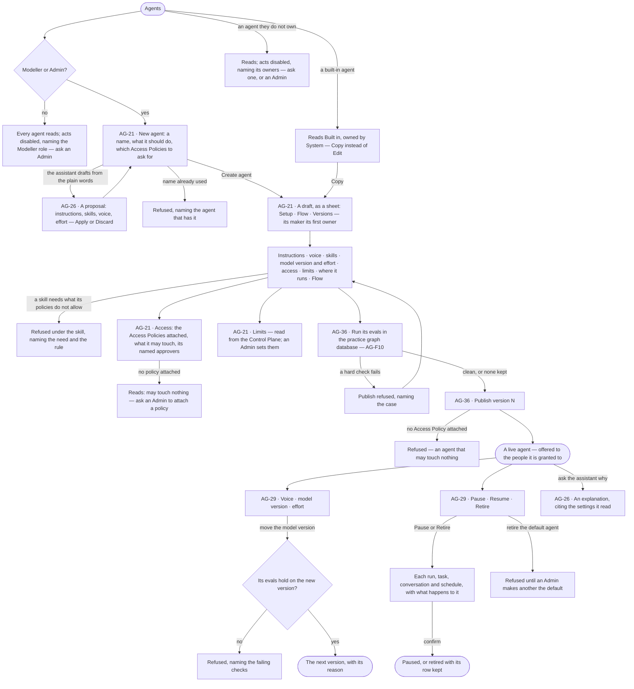
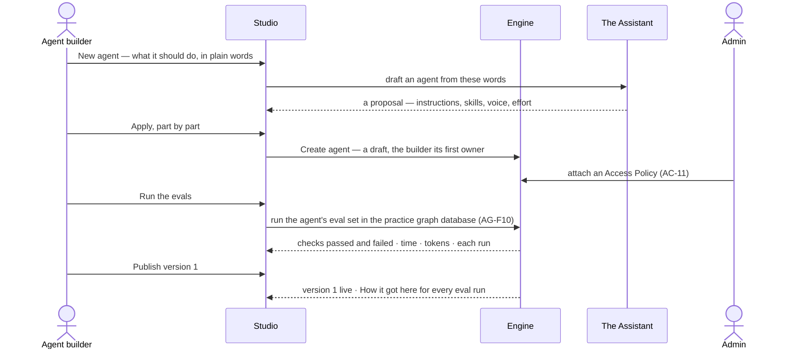

# Build an agent

> Make an agent from plain words — what it should do and how it should sound — read what it may touch and what it will
> do before it runs, test it in the practice graph database and publish a version; then tune its voice, model version
> and effort, and pause or retire it with its open work named. What it may touch is the Access Policies an Admin
> attaches; what it may spend is its limits in the Control Plane. The decision it helps make: *is this agent ready to
> be given work, and is this change to it safe to publish?*

## User journey

Journeys this feature is a step of: [J04 · Build an agent and improve it from what runs teach](../../../../journeys/J04-build-an-agent-and-improve-it-from-what-runs-teach.md) · [J06 · Set what an agent may touch](../../../../journeys/J06-set-what-an-agent-may-touch.md)

## Stories

| ID | Story | Status |
|---|---|---|
| AG-21 | [Draft an agent and see what it will do](stories/AG-21-draft-an-agent-and-see-what-it-will-do/story.md) | idea |
| AG-36 | [Publish an agent's version and roll one back](stories/AG-36-publish-an-agents-version-and-roll-one-back/story.md) | idea |
| AG-29 | [Tune an agent's voice, model and effort, and retire it](stories/AG-29-tune-an-agents-voice-model-and-effort-and-retire-it/story.md) | idea |
| AG-26 | [Let the assistant draft and explain an agent](stories/AG-26-let-the-assistant-draft-and-explain-an-agent/story.md) | idea |

## Access

Building an agent is *Reads* for Operator and *Acts* for Modeller and Admin in [the role table](../../../../os/access/features/AC-F02-access-policies/feature.md#the-role-table);
*Acts* is on the agents a person owns ([AC-F07](../../../../os/access/features/AC-F07-ownership/feature.md)), and an Admin acts on any.

| Act | Role | Everyone else sees |
|---|---|---|
| Read every agent — its setup, Access Policies, what it may touch, named approvers, limits, voice, model version, Flow, owners and versions | Every signed-in person — Operator, Modeller, Admin | — |
| Create an agent — its maker is its first owner; copy a built-in agent — the copier owns the copy | Modeller · Admin | *New agent* and *Copy* disabled, naming the role — *Needs the Modeller role — ask an Admin* |
| Edit a draft, add or remove a skill, set voice, model version and effort, publish, roll back, Pause, Resume, Retire, discard a draft — in Studio or on the command line | An owner of the agent with the Modeller role · Admin. Never on a built-in agent | Each act disabled, naming the role, or the owners on an agent the reader does not own — *Only its owners or an Admin — ask Lee*; a built-in agent offers *Copy* |
| Attach an Access Policy to the agent, take one off | Admin, in a session, with the password again ([AC-11](../../../../os/access/features/AC-F02-access-policies/stories/AC-11-attach-a-policy-to-agents/story.md)) | The attached policies read; *Attach a policy* reads *Ask an Admin* |
| Name or change the agent's approvers | Its owners · Admin ([AC-26](../../../../os/access/features/AC-F05-asks-and-approvals/feature.md)) | The approvers read; changing them is disabled, naming the owners |
| Set the agent's limits | Admin, in the Control Plane ([CP-F04](../../../../os/control/features/CP-F04-limits/feature.md)) | The limits read; *Edit in Usage and limits* reads *Ask an Admin* |
| Make an agent the deployment's default | Admin ([AG-F02](../AG-F02-the-agents-catalogue/feature.md)) | *Make default* disabled — *Needs the Admin role* |
| Add a co-owner, hand an agent over | Its owners · Admin ([AC-F07](../../../../os/access/features/AC-F07-ownership/feature.md)) | The owners read |
| Offer model versions to pin | Admin, in Control Plane › AI models ([CP-F01](../../../../os/control/features/CP-F01-ai-models/feature.md)) | A version not offered cannot be picked |
| Name the practice graph database | Admin ([CP-41](../../../../os/control/features/CP-F05-graph-databases/stories/CP-41-name-a-practice-graph-database/story.md)) | The evals read *No practice graph database — they read in read mode* |
| Ask the assistant to explain an agent | Every signed-in person | — |
| Ask the assistant to draft or change an agent | As creating or editing it | The assistant explains and says it cannot change the agent, naming the role or the owners |

## States

| State | What the person sees |
|---|---|
| First use | Agents with only the built-in agents, each *Built in*, owned by *System*; *New agent* and a line on what an agent is. A new agent's sheet with no skill reads that it answers with the built-in plans alone; one with no Access Policy reads *May touch nothing yet* |
| Empty after a filter | *No agents match* — the filters (kind · status · owner · helpers shown) named, with *Clear filters* |
| Loading | The sheet's head and tabs drawn at once; the body loads in place |
| Has data | An agent as a sheet: its head with its owners and state, then Setup (instructions, voice, skills, model version and effort, access, limits, where it runs, lifecycle) · Flow · Versions; a live agent's tokens this month against its limit |
| Failed | The tab names what it could not read, in the engine's words; a refused save names the field and why |
| Agent working or proposing | The Assistant drafting the agent, then its proposal beside the form; an eval run in the practice graph database with its checks filling in |
| No access | Every tab reads; each act is disabled, naming the Modeller role, or the agent's owners — *ask Lee*; a built-in agent offers *Copy* |

## Rules

| Rule | Detail |
|---|---|
| An agent is a resource | `agent/<name>`. A person uses it only when it is granted to them or a team they are on ([AC-F03](../../../../os/access/features/AC-F03-directory/feature.md#rules)); another agent runs it only when a rule allows Run `agent/<name>` (AG-F05) |
| What it may touch is its Access Policies | Every Read · Write · Run comes from a rule on an Access Policy an Admin attaches to it ([AC-F02](../../../../os/access/features/AC-F02-access-policies/feature.md#rules)); the agent holds no rule, list of functions or mode of its own. Default deny: an agent with no policy attached may touch nothing |
| Checked before it runs | A step whose function, workflow or data no rule allows is refused before anything is dispatched — nothing is spent ([AC-F04](../../../../os/access/features/AC-F04-what-an-agent-may-touch/feature.md#rules)) |
| What binds a run | The agent's Access Policies ∩ the rules for the person behind the run's teams ∩ every caller's on a delegated run; its limits ∩ the person's ∩ their teams' ∩ the deployment's ([CP-F04](../../../../os/control/features/CP-F04-limits/feature.md#rules)). A refusal names the bound and whose it was |
| Limits live in one place | Tokens a run and a month, runs at once, helpers and depth are the agent's limits in [CP-F04](../../../../os/control/features/CP-F04-limits/feature.md), set by an Admin; the sheet reads them. Effort — steps, replans, questions — is the agent's own |
| Tighten, never loosen | An agent may propose a tighter Access Policy or a lower limit; widening either is a person's act ([AC-F05](../../../../os/access/features/AC-F05-asks-and-approvals/feature.md)) |
| Owned by people | An agent has one or more owners, people or the system user ([AC-F07](../../../../os/access/features/AC-F07-ownership/feature.md#rules)); its maker is its first owner; what an agent makes in a run is owned by the person behind it |
| Built-in agents are copied, never edited | The built-in agents ([AG-F02](../AG-F02-the-agents-catalogue/feature.md#mechanisms)) are the system user's; *Copy* makes a custom agent the copier owns, with no policy attached and granted to nobody |
| Tested in the practice graph database | An agent's evals read the practice graph database that stands in for each graph database it reads ([AG-F10](../AG-F10-test-an-agent-and-a-skill/feature.md#rules)) |
| Tokens, never currency | Every limit, meter and refusal counts tokens ([glossary › Token budget](../../../../glossary.md#what-may-happen)) |
| An agent sees no provider | Its model version is a pin or the deployment's default ([CP-F01](../../../../os/control/features/CP-F01-ai-models/feature.md#rules)); it holds no AI connection of its own |
| Skills reach an agent only when added to it | A template suggests skills; it adds none. Adding checks each skill's declared needs against the agent's Access Policies ([AG-F04](../AG-F04-skills/feature.md#rules)) |
| Voice is words only | The voice reaches the steps whose words a person reads — the question back, the reason, the answer — and never what is queried, planned, seen or refused |
| Instructions and voice differ | Instructions say what to do and reach the steps that read the question and write the typed query plan; the voice says who is speaking |
| Humour is off when something went wrong | A refusal, a cannot-answer, an error and a limit pause are said without humour, whatever the voice says |
| A run keeps what it opened with | Its voice, model version, effort and the policy versions it was checked against are the ones it opened with; a change reaches the next run, and a policy change meets it at its next step ([AC-F03](../../../../os/access/features/AC-F03-directory/feature.md#rules)) |
| A pin is exact | A model version is the provider's own name, never an alias; a pinned version the deployment does not offer refuses the run — nothing falls back |
| Moving a pin is a change | It runs the agent's evals on the new version first and becomes a version with its reason |
| A draft takes no work | A draft is never asked, assigned a task, scheduled, delegated to or made the default |
| Nothing is deleted once it ran | Retiring keeps the agent's row, so every run, trace and helper still resolves; the name stays taken |
| Pausing kills nothing | Runs in flight finish; open work is named item by item before the act |
| One default | The deployment has one default agent, which can answer questions; an Admin sets it ([AG-F02](../AG-F02-the-agents-catalogue/feature.md#rules)) |
| No AI model offered | *New agent* says no model version is offered yet, linking Control Plane › AI models |
| The engine counts | Tokens this month, served, p95 and every number on the sheet are the engine's; Studio formats them |
| Leans on | Skills (AG-F04) · evals (AG-F10) · runs (CP-F10) · helpers and delegation (AG-F05) · the catalogue and the default (AG-F02) · Access Policies (AC-F02) · grants (AC-F03) · what an agent may touch (AC-F04) · named approvers (AC-F05) · ownership (AC-F07) · AI models (CP-F01) · limits (CP-F04) · the practice graph database (CP-F05) |

## Data touched

| Record | Read or write |
|---|---|
| Agent — name, kind, status, instructions, voice, voice dials, effort, triggers, model pin | Write · read |
| Agent version and its reason | Write · read |
| Owners of an agent ([AC-F07](../../../../os/access/features/AC-F07-ownership/feature.md)) | Write the first owner at creation and copy · read |
| Skills added to the agent | Write (AG-F04) · read |
| Access Policies attached, what it may touch, named approvers | Read (written in AC-F02 · AC-F05) |
| Its limits | Read (written in CP-F04) |
| Its eval set and eval runs | Read (written in AG-F10) |
| Model versions offered and the default | Read (written in CP-F01) |
| Open work it holds — runs, tasks, conversations, schedules | Read · write on Pause and Retire |
| Runs it opened — tokens, model version called, outcome | Read |

## Engine

### Records

| Table | Columns | Notes |
|---|---|---|
| `agents` | `name` (`[a-z0-9-]`) · `title` · `description` · `kind` (`builtin` · `custom` · `helper` · `external`) · `status` (`draft` · `active` · `paused` · `retired`) · `copied_from_id?` · `parent_agent_id?` · `spawned_in_run_id?` · `external_agent_id?` · `instructions` · `instructions_draft` · `soul` · `soul_traits` · `effort` · `triggers` · `model_pin?` · `version` | `name` unique and never freed; it is the `agent/<name>` resource. `soul_traits`, `effort` and `triggers` are JSON on the row, read by presence. `helper` and `external` rows are written by AG-F05. No provider, credential, rule or limit on the row. Owners live in `access_owners` (AC-F07). A version's reason and a retirement's *Why* ride their events in History (AC-F06) |

| JSON column | Keys |
|---|---|
| `soul_traits` | `humour` (`off` · `light` · `playful`, default `light`) · `formality` (`casual` · `neutral` · `formal`, default `neutral`) · `emoji` (`off` · `on`, default `off`) · `greeting` (`off` · `on`, default `off`) |
| `effort` | `max_steps` (24) · `max_replans` (1) · `max_clarifications` (3) |
| `triggers` | `can_be_assigned` · `unattended` · `mcp_callable` |
| `model_pin` | An exact address `llm/<endpoint>/<model version>` |

### Reads

| Record | Owner |
|---|---|
| Runs — `agent_id` · `agent_version` · `model_version`, tokens, exit reason, the effort a run opened with | [CP-F10](../../../../os/control/features/CP-F10-runs-and-how-the-agents-are-doing/feature.md#engine) |
| Skills and their bindings (`agents_skill_bindings`) | [AG-F04](../AG-F04-skills/feature.md#engine) |
| Eval sets, cases, runs and the eval gate | [AG-F10](../AG-F10-test-an-agent-and-a-skill/feature.md#engine) |
| Helpers, delegation and outside agents | [AG-F05](../AG-F05-delegation-and-outside-agents/feature.md#engine) |
| Plans and workflows a run chooses | [AG-F06](../AG-F06-plans-and-workflows/feature.md#engine) |
| The built-in agents and the default agent | [AG-F02](../AG-F02-the-agents-catalogue/feature.md#engine) |
| Access Policies attached to the agent | [AC-F02](../../../../os/access/features/AC-F02-access-policies/feature.md#engine) |
| Grants — who may use the agent | [AC-F03](../../../../os/access/features/AC-F03-directory/feature.md#engine) |
| What it may touch, for a person and a caller chain | [AC-F04](../../../../os/access/features/AC-F04-what-an-agent-may-touch/feature.md#engine) |
| Named approvers | [AC-F05](../../../../os/access/features/AC-F05-asks-and-approvals/feature.md#engine) |
| Owners and copies | [AC-F07](../../../../os/access/features/AC-F07-ownership/feature.md#engine) |
| The AI models offered, the default and their locality | [CP-F01](../../../../os/control/features/CP-F01-ai-models/feature.md#engine) |
| The agent's limits and what binds a run | [CP-F04](../../../../os/control/features/CP-F04-limits/feature.md#engine) |
| Tasks, schedules and conversations a lifecycle preview lists | [PJ-F01](../../../projects/features/PJ-F01-projects-and-tasks/feature.md#engine) · [AG-F07](../AG-F07-schedules/feature.md#engine) · [EX-F03](../../../explore/features/EX-F03-ask-a-question/feature.md#engine) |
| Version history — each version's reason, a retirement's *Why* | [AC-F06](../../../../os/access/features/AC-F06-history/feature.md#engine) |

### Routes

| Route, after `/api/v1/agents` | Does | Story |
|---|---|---|
| `GET /agents` | A page of `AgentRead` by the list contract (`?f.kind=` · `?f.status=` · `?f.owner=` · `?f.granted=me`), with `tokens_this_month` as a `{agent: tokens}` sidecar from one grouped read | AG-21 |
| `POST /agents` | Create a draft, its first owner the caller; takes `skills[]`, each added through AG-F04's add | AG-21 |
| `GET /agents/{name}` · `PATCH /agents/{name}` | `AgentRead` — the row as stored, plus `effective_effort` · `owners[]` · `skills[]` · `policies[]` · `approvers[]` (read only) · change it, sending only what moved | AG-21 · AG-29 |
| `PATCH /agents/{name}/draft` · `DELETE /agents/{name}/draft` | Write or discard the instructions draft | AG-21 · AG-36 |
| `DELETE /agents/{name}` | Discard a draft that never ran — `204` | AG-21 |
| `POST /agents/{name}/create` · `POST /agents/{name}/publish` · `POST /agents/{name}/rollback` | Make live (version 1), publish the draft, roll back as a draft of an earlier version — each through AG-F10's eval gate; returns `{verdict, eval_run_id, warnings}` | AG-36 · AG-29 |
| `GET /agents/{name}/pause` · `GET /agents/{name}/retire` | The `LifecyclePreview` | AG-29 |
| `POST /agents/{name}/pause` · `POST /agents/{name}/retire` · `POST /agents/{name}/resume` | Apply; retire takes `reason` | AG-29 |
| `GET /agents/{name}/reach` | `{agent, skills[{skill, version, when_to_use, needs[{verb, resource, met, effect?, rule?, policy?}], offered, applied, enough_to_read}], policies[{name, version}], prompt_chars}` | AG-21 |
| `GET /agents/{name}/meters` | `{agent, tokens_this_month, monthly_tokens, tokens_per_run, running, queued, max_concurrent_runs, runs_this_month, conversations, helpers_this_month}` — the limits read from CP-F04 | AG-21 · AG-29 |
| `GET /agents/{name}/activity` | Its recent runs | AG-21 |
| `POST /agents/{name}/voice/preview` | Two answers to one sample ask, current voice and draft; nothing recorded or drawn against any limit | AG-29 |

A built-in agent is copied through [AC-F07](../../../../os/access/features/AC-F07-ownership/feature.md#routes)'s `POST /copies`; owners are read and changed there. What it may touch is [AC-F04](../../../../os/access/features/AC-F04-what-an-agent-may-touch/feature.md#routes)'s `GET /agents/{name}/effective`.

### Events

| Event | When |
|---|---|
| `agents.create` · `agents.update` | A draft is created or copied · a field changes; `agents.update` carries the `changed` keys |
| `agents.soul_set` | The voice or a dial changes; bumps `version` |
| `agents.activate` · `agents.publish` · `agents.rollback` | Made live · a version published · rolled back; each carries the gate's verdict and the `why` |
| `agents.pause` · `agents.resume` · `agents.retire` · `agents.delete` | The lifecycle acts; `agents.retire` carries the reason |

### Refusals

| Status | When | Sentence | Criterion |
|---|---|---|---|
| 409 | A name another agent has, retired or not | *{name} is taken by {agent}.* | AG-21.3 |
| 422 | A name not lowercase and hyphenated, or over 64 characters | *An agent's name is lowercase, hyphenated, up to 64 characters.* | AG-21.3 |
| 409 | Making live or publishing an agent with no Access Policy attached | *{agent} may touch nothing — ask an Admin to attach an Access Policy.* | AG-36.19 |
| 422 | An unknown voice dial or value | *{dial} takes {values}.* | API only — Studio offers the dials as fixed choices |
| 422 | Editing, publishing, pausing, retiring or deleting a built-in agent | *{agent} is built in — copy it to change it.* | AG-21.33 |
| 409 | Opening a run on a `paused`, `retired` or `draft` agent — asked, assigned, scheduled, delegated to or made the default | *{agent} is {state}.* | AG-29.20 · AG-36.11 |
| 409 | Pause or Resume on a draft · `POST …/create` on an agent that is not a draft | *{agent} is a draft.* · *{agent} is already live.* | API only — Studio offers neither act there |
| 409 | `DELETE /agents/{name}` once the agent has run | *{agent} has run — retire it instead.* | AG-21.21 |
| 409 | Retiring the deployment's default agent | *Make another agent the default first.* | AG-29.17 |
| 409 | A model version not offered by CP-F01 | *{model version} is not offered here.* | AG-29.10 · AG-29.23 |
| 403 | A write by someone whose role is not Modeller or Admin | *This needs the Modeller role — ask an Admin.* | AG-21.22 · AG-29.21 · AG-36.14 |
| 403 | A write on an agent by a Modeller who is not one of its owners | *Only its owners or an Admin — ask {owners}.* | AG-21.34 · AG-29.25 · AG-36.20 |
| — | A step no rule allows, before dispatch | [AC-F04 › Refusals](../../../../os/access/features/AC-F04-what-an-agent-may-touch/feature.md#refusals) | AG-21.14 |
| — | A run past the agent's runs at once or tokens a month | [CP-F04 › Refusals](../../../../os/control/features/CP-F04-limits/feature.md#refusals) | AG-21.32 |
| — | A skill whose needs the agent's policies do not allow | [AG-F04 › Refusals](../AG-F04-skills/feature.md#refusals) | AG-21.8 |
| — | The eval gate's refusals on make live, publish, roll back and a pin move | [AG-F10 › Refusals](../AG-F10-test-an-agent-and-a-skill/feature.md#refusals) | AG-36.4 · AG-36.18 · AG-29.9 |

### CLI

| Command | Does |
|---|---|
| `invana agents list` | List the deployment's agents |
| `invana agents push` | Write the instructions draft from a file |
| `invana agents publish` · `invana agents pin` | Publish · move the model pin — both through the eval gate |

### Mechanisms

| Mechanism | How |
|---|---|
| Read by presence | A key that is present is the value, 0 included; only an absent key takes the default in *Records*. `effective_effort` fills the defaults and is what a run reads |
| Owned at birth | `POST /agents` writes the caller's `access_owners` row (`via = made`) in the same transaction; a helper made in a run is owned by the person behind it ([AC-F07](../../../../os/access/features/AC-F07-ownership/feature.md#mechanisms)) |
| A copy | `POST /copies` copies a built-in agent's current version — instructions, voice, effort, model pin and its skills' bindings — into a new `custom` draft named by the copier, `copied_from_id` set, owned `via = copied`, with no Access Policy attached and no grant |
| A run records the agent | `agent_id` · `agent_version` · `model_version` and every key of `effective_effort` it opened with ride the run and its trace (CP-F10); the limits that bound it are CP-F04's |
| Where each bound is enforced | `effort.*` — during the run; reaching one ends it with its exit reason (`step_limit`, …) · Access Policies — before each step ([AC-F04](../../../../os/access/features/AC-F04-what-an-agent-may-touch/feature.md#mechanisms)) · limits — at admission and before each call ([CP-F04](../../../../os/control/features/CP-F04-limits/feature.md#mechanisms)) |
| `require_available` | Runs first on every path that opens a run; a conversation bound to a paused, retired or draft agent never switches to another |
| The voice block | `voice_for` = `render_traits(soul_traits)` then `soul`, or `DEFAULT_VOICE` when `soul` is empty; the dials come first, so a sentence in the soul can override one. `""` clears the soul; the default voice is a product constant, never stored |
| Which steps read the voice | `RunVars.soul`, read at run open, reaches only `nl.understand` (its question back and reason) and the answer's words; the typed query plan, the plan, the check and execution take no voice parameter |
| Humour when it went wrong | `render_traits(…, went_wrong=True)` renders `humour: off`; a step that may refuse in the same call carries *when you refuse, cannot answer, or report an error or a pause, use no humour* |
| A version | Any published change — instructions, voice, a dial, effort, a model pin — bumps `version`; a run's `agent_version` names the voice it spoke with |
| The model a step calls | The person's pick for that question → the skill version's pin (AG-F04) → `model_pin` → the deployment's default ([CP-F01](../../../../os/control/features/CP-F01-ai-models/feature.md#rules)). Each must be offered, or the run is refused before it starts; nothing falls back. A call carrying a sensitive property to an external model is refused ([AC-F09](../../../../os/access/features/AC-F09-what-left-the-platform/feature.md#rules)) |
| The AI model client | `complete_tool` — one structured call to the endpoint the run resolved, over Anthropic, OpenAI, Ollama or the Claude Agent SDK, recorded in the ledger (AC-F09). Called by `nl.understand` · `nl.translate` · `plan.compose` · `plan.draft` · `model.propose`, the eval judge, starter cases, the voice preview and grounding |
| `LifecyclePreview` | `{agent, act (pause · retire), items[{kind (run · task · conversation · schedule), id, title, effect (finishes · blocked · unchanged · refused · paused), note}]}`; Resume has none |
| Pause · Resume · Retire | `paused` refuses new work; a run already queued starts; Resume unblocks its tasks. Retire keeps the row and the name and pauses each schedule that starts the agent. A task's `start_agent_work` blocks the task when the agent is paused or retired (PJ-F01) |
| `reach` | Each added skill's needs with met or missing, from the same `decide` AG-F04's add runs, for the rules that hold for everyone; `offered` and `applied` count this agent's runs of the current version; `prompt_chars` is served so Studio sums nothing |
| The month meter | `tokens_in + tokens_out` over root runs that started this calendar month and their steps, eval runs left out, against the agent's `monthly_tokens` in CP-F04; no run reads `0`. `conversations` counts every conversation bound to the agent, whoever opened it |
| The command line's role | Each command needs the role and ownership of the route it stands for |

## System impact

| HLD section | Change | NFRs |
|---|---|---|
| § 6 Data and storage | `agents` in Postgres; effort, voice dials and triggers as JSON on the row; owners in `access_owners`; no rule or limit on the row | — |
| § 8 APIs and events | The routes, events and CLI above, under `/api/v1/agents` | — |
| § 10 AI and agents | What an agent may touch is its Access Policies alone; the model a step calls resolves in one order with no fallback; the voice never reaches a query | — |
| § 11 Failure modes and the outside boundary | A model version an outside provider stops offering refuses the run, naming it | — |

## Decisions

| Decision | Detail |
|---|---|
| New agent is a modal, the agent a sheet | *New agent* asks for a name and what it should do in plain words, and suggests which Access Policies to ask an Admin for; *Create agent* saves a draft and opens it as a sheet |
| The sheet's tabs | Setup · Flow · Versions. Setup holds instructions, voice, skills, model version and effort, access, limits, where it runs and lifecycle |
| The head says its state and owners | The name, *Draft* or *vN · live*, its owners — *System* on a built-in — and its acts: *Run the evals* and *Publish* on a draft, *Copy* on a built-in |
| Access is read on the sheet, changed in the Access Plane | Access lists the Access Policies attached, what the agent may touch for everyone and for each team (AC-13), who may use it (AC-F03) and its named approvers (AC-26); *Attach a policy* opens AC-11 for an Admin |
| Limits are read on the sheet, set in the Control Plane | Limits reads the agent's rows of CP-F04 beside what binds a run, with *Edit in Usage and limits* for an Admin |
| Draft, evaluate, publish | Every change is a draft of the next version; *Run the evals* runs its eval set (AG-F10); *Publish version N* makes it live |
| One draft across the sheet | Edits on every part of Setup are one draft and one Save; Save sends only what moved; adding a skill is its own act, so a refusal names the one skill |
| Flow is drawn from records | Triggers → the agent → its skills → the agents it may hand work to; its foot says it is drawn from the agent's instructions, skills and Access Policies and that a run may replan within them, never wider |
| Reach is read, never stored | What it may touch, what each skill needs and what is missing are read on every open |
| Callable over MCP | A trigger under where it runs; disabled for a draft; a caller still acts as the person behind it through the agents they may use ([CP-F02](../../../../os/control/features/CP-F02-plugins-and-outside-tools/feature.md)) |
| The pause preview | One list for Pause and Retire — each run, task, conversation and schedule, with what that act does to it: finishes · blocked · unchanged · refused · paused |
| Pause asks, Resume does not | Pause and Retire confirm; Resume is one click |
| Retire takes a reason | Its *Why* is kept in Versions |
| The preview of a voice is not a run | Two answers to one sample ask, current and draft, stating no fact from the data; nothing is recorded or drawn against any limit |
| An empty voice is the default voice | Invana's voice — warm, plain, brief — shown as the placeholder and never stored, so a change to it reaches every agent that wrote none |
| Studio cannot clear a pin | Once set, a model version is moved, never cleared |
| Discard a draft | A draft that never ran is deleted; an agent that ran is retired instead |
| The model a step calls | Resolved in one order — the person's pick, the skill's pin, the agent's pin, the deployment's default — and nothing falls back ([Engine › Mechanisms](#mechanisms)) |
| A pause stops new work only | A run already queued starts and finishes; only work that arrives after the pause is refused |
| A pause takes no reason | Resume undoes it in one click; only Retire asks *Why* |
| A 0 is a value | Effort is read by presence: 0 means none; only an empty cell takes the value shown |
| Effort is three numbers | Steps, replans and questions, each shown with the number a run reads; no preset hides them |
| Tests are evals | An agent's tests are its eval set — the same cases, checks, judge, gate and eval token budget as a skill's ([AG-F10](../AG-F10-test-an-agent-and-a-skill/feature.md)) |
| The command line follows Studio | `invana agents push · publish · pin` and `invana evals` pass the same gate and need the same role and ownership as Studio |

## Open questions

| Question | Who answers |
|---|---|

## Not building

| Item | Why not |
|---|---|
| Avatars, names as characters, voice audio | An agent's character is how it writes; a face adds nothing a reader can check |
| Per-person voices | The agent is the same colleague for everyone who asks it |
| A shared library of voices | A voice belongs to one agent; copy its words if two should sound alike |
| A voice that grants or asks for access | Access is the Access Policies' alone |
| Dials that take any value | That is the written voice with a worse editor |
| A length dial | How long an answer runs is the answer's shape (EX-F04) |
| Rules, modes or a function list on the agent | Every rule lives on an Access Policy attached to it ([AC-F04](../../../../os/access/features/AC-F04-what-an-agent-may-touch/feature.md#not-building)) |
| Limits set on the agent's sheet | One place for limits ([CP-F04](../../../../os/control/features/CP-F04-limits/feature.md)) |
| Editing a built-in agent | What Invana ships stays as shipped; *Copy* makes one to change |
| Cloning an agent with its history | Starting from a copy of its current version is the honest path |
| Bounds argued at run time | A bound that can be argued with is not one |
| Limits per task | The agent carries the limits; the task carries the goal |
| Warnings instead of refusals | A warning when work is dispatched has already spent the tokens |
| Deleting an agent that ran | Its runs and helpers must resolve |
| Pausing on spend | The limit's own rule decides what happens at it |
| Scheduled pause windows | A schedule that stops work is a policy engine |
| Following a provider's *latest* | A pin that moves by itself is the surprise pinning removes |
| Falling back to another model | A silent model change is a change nobody approved |
| Splitting traffic across two versions | A version reaches every run that opens after it publishes |
| *Run now* on an agent | A run starts from a question, a task or a schedule; with no question there is nothing to answer |
| *Try it once* on New agent | An agent is tried by its evals in the practice graph database (AG-F10) |
| An estimate of what a run will cost | The engine stores none, and Studio never derives a number |
| A default way of reasoning on the agent | How to approach a question is picked for that one question (*Act as*, EX-F05); an agent carries none |
| Mapping each resource to a worker group on *Where it runs* | Worker groups follow the kinds of work an agent's functions do (CP-F03); the sheet reads them, it does not assign them |
| A capacity forecast | The engine stores no forecast, and Studio never derives a number |
| Sections inside the voice (*How it speaks* · *Caution* · *When unsure*) | The voice is one block of words; caution and what to do when unsure are instructions and Access Policies |
