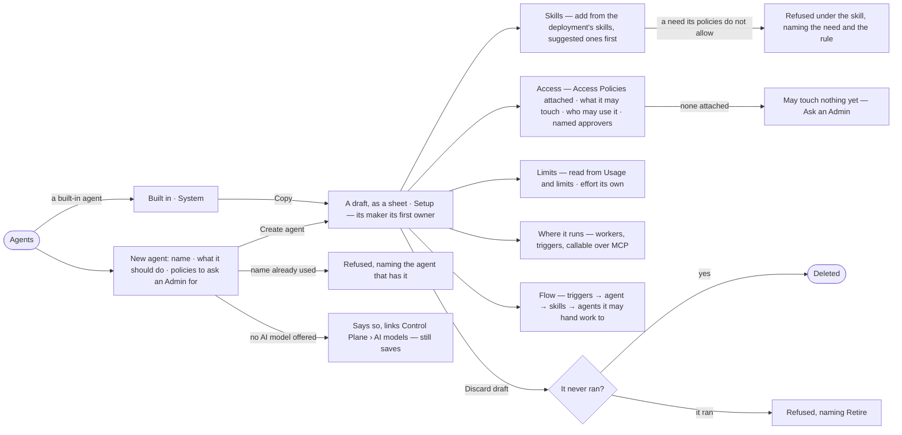

# AG-21 · Draft an agent and see what it will do

**As** an agent builder **I want** to make an agent from plain words — what it should do — and read, before it ever
runs, which skills it has, what each needs, what its Access Policies let it touch, what it may spend and what it does
**so that** giving it work is a choice I can predict, not a guess, and a refusal never surprises me.

Tasks: [task.md](task.md) · Feature: [AG-F01](../../feature.md)

## Who can

| Lens | Can | Otherwise sees |
|---|---|---|
| Admin | Create an agent and copy a built-in one; on any agent not built in: edit its draft, add and remove skills, set effort and triggers, discard a draft; attach Access Policies (AC-11) and set its limits (CP-F04) | A built-in agent has no Edit — *Built in — copy it to change it* |
| Modeller | Create an agent — they are its first owner — and copy a built-in one; act as Admin on the agents they own, except attaching policies and setting limits | On an agent they do not own, every act is disabled, naming its owners — *Only its owners or an Admin — ask Lee*; *Attach a policy* and *Edit in Usage and limits* read *Ask an Admin* |
| Operator | Read every agent's setup, Access Policies, what it may touch, limits, owners and Flow | *New agent*, *Copy*, every edit and *Discard draft* disabled, naming the role — *Needs the Modeller role — ask an Admin* |

## Flow

## Acceptance criteria

| # | Given | When | Then |
|---|---|---|---|
| AG-21.1 | A Modeller or Admin in Agents | they open *New agent* | a modal asks for a name and what it should do in plain words, and lists the saved Access Policies with the ones its words suggest marked *Suggested* — to ask an Admin for, never attached here |
| AG-21.2 | A filled *New agent* | they press *Create agent* | a draft is saved from a template, its maker its first owner, and opens as a sheet on Setup with a *Draft* chip; the suggested policies wait on Access, marked *Suggested*, until an Admin attaches them |
| AG-21.3 | A name another agent already has, retired or not, or one not lowercase and hyphenated | they save | it is refused, naming the agent that has it or the rule for a name |
| AG-21.4 | A draft with no Access Policy attached | Access opens | it reads *May touch nothing yet*, with *Ask an Admin* — and for an Admin *Attach a policy* (AC-11) |
| AG-21.5 | No AI model offered in the deployment | they create an agent | it saves and says it has no model to think with, linking Control Plane › AI models |
| AG-21.6 | A draft | its Setup opens | it shows instructions, voice, skills, model version and effort, access, limits, where it runs and lifecycle; an agent with no skill says it answers with the built-in plans alone |
| AG-21.7 | The deployment's skills | the builder presses *Add a skill* | the picker lists published and draft skills, the template's suggested skills first; the added skill shows its version, when to use it, what it needs, and offered against applied — *too few to read* below the threshold |
| AG-21.8 | A skill whose declared need the agent's Access Policies do not allow | it is added | it is refused under that skill, naming the need, and the rule and policy that refuse it or *no rule* (AG-30.21) — before any run is refused |
| AG-21.9 | Access | it opens | the Access Policies attached, each with its version; then what the agent may touch — each resource and verb with Allow · Ask · Deny, the rule and policy that set it, and *only for {team}* where a rule names one (AC-13); who may use it — the people and teams it is granted to; and its named approvers, or *Its owners* |
| AG-21.11 | Limits | they open | tokens a run and a month, runs at once, helpers and depth — the agent's rows of Usage and limits, each beside what it bounds, *No limit* where none is set — then effort (steps, replans, questions), the agent's own, each with the number a run reads |
| AG-21.12 | An Admin on Limits | they press *Edit in Usage and limits* | the agent's limits open in the Control Plane (CP-11); a Modeller reads *Ask an Admin* |
| AG-21.13 | The agent's Access Policies, the rules for the person's teams and its limits | Setup opens | they read as rows that nest — policies ∩ teams, then the agent's ∩ the person's ∩ their teams' ∩ the deployment's limits — so a refusal is predictable before it happens |
| AG-21.14 | A step that names a function, workflow or data no rule on the agent's policies allows | it is about to run | it is refused before anything is dispatched, naming the verb, the resource and the rule or *no rule*; nothing is spent |
| AG-21.15 | An agent that proposes a change to what it may touch or its limits | the proposal arrives | a narrowing is offered for an Admin to save; a widening is never proposed by the agent — only a person widens access or a limit |
| AG-21.17 | Where it runs | it opens | each kind of work its functions do, the workers that run it and their free slots; its triggers — the schedules that start it, *Can be given tasks*, *Runs with nobody to ask*; *Callable over MCP* disabled while it is a draft |
| AG-21.18 | Flow | it opens | triggers → the agent → its skills → the agents it may hand work to, drawn from records; the foot says it is drawn from the agent's instructions, skills and Access Policies, and that a run may replan within them, never wider |
| AG-21.19 | Edits on several parts of Setup | they press Save | one version is saved, carrying only what moved; adding a skill is saved on its own so a refusal names that skill |
| AG-21.21 | A draft that never ran | an owner presses *Discard draft* and confirms | it is deleted and Agents opens; an agent that has run is refused, naming *Retire* |
| AG-21.22 | An Operator | they open an agent | every tab reads; *New agent*, *Copy*, every edit and *Discard draft* are disabled, naming the role — *Needs the Modeller role — ask an Admin* |
| AG-21.23 | A sheet whose engine read fails | it opens | the tab names what it could not read, in the engine's words; the rest of the sheet still reads |
| AG-21.24 | A run refused by the agent's Access Policies or limits | the person opens *How it got here* | its steps show the refused step, the bound — the rule and policy, or the limit and whose it was |
| AG-21.29 | An ask the agent may not take for this person — not granted to them, or a policy refuses it before any run opens | it is sent | the reply reads *This question was not run*, naming why; no run opens and nothing is spent |
| AG-21.30 | Effort set to 0 | a run reads it | 0 is the value — *0 questions* never asks; only an empty cell takes the value shown beside it |
| AG-21.31 | Where it runs | it opens | beside each kind of work's free slots, the slots the agent's next trigger will take of that kind, counted by the engine; an agent no trigger starts reads *Nothing starts it yet* |
| AG-21.32 | An agent at its *runs at once* or its tokens a month | new work would open another run | it is refused or held as CP-F04 says, naming the limit, whose it is and the count |
| AG-21.33 | A built-in agent | anyone opens it | it reads *Built in*, owned by *System*, with *Copy* in place of every edit; *Copy* makes a draft the copier owns, with no Access Policy attached and granted to nobody |
| AG-21.34 | A Modeller on an agent they do not own | they open it | every tab reads; each act is disabled, naming its owners — *Only its owners or an Admin — ask Lee* |
| AG-21.35 | A draft's Access | a builder reads it | *Granted to nobody yet* until an Admin grants it (AC-22); a draft is offered to nobody |

## Screens

| Surface | Lens | First use | Empty after a filter | Loading | Has data | Failed | Agent working or proposing | No access |
|---|---|---|---|---|---|---|---|---|
| Agents | Admin | agents · Only the built-in agents | agents · No agents match | agents · Loading | agents | agents · Could not load | — | — |
| Agents | Operator | agents · Only the built-in agents | agents · No agents match | agents · Loading | agents | agents · Could not load | — | agents · New agent disabled |
| New agent | Admin | agents.new | — | agents.new · Saving | agents.new | agents.new · Name taken | — | — |
| New agent | Operator | — | — | — | — | — | — | agents · New agent disabled |
| The agent · Setup | Admin | agents.agent · No skills yet | — | agents.agent · Loading | agents.agent | agents.agent · Could not load | — | — |
| The agent · Setup | Operator | agents.agent · No skills yet | — | agents.agent · Loading | agents.agent · Read only | agents.agent · Could not load | — | agents.agent · Read only |
| A built-in agent and Copy | Admin | — | — | agents.agent · Loading | agents.agent · Built in | agents.agent · Name taken | — | — |
| A built-in agent and Copy | Operator | — | — | agents.agent · Loading | agents.agent · Built in | agents.agent · Could not load | — | agents.agent · Built in |
| Access | Admin | agents.agent · May touch nothing | — | agents.agent · Loading | agents.agent · Access | agents.agent · Could not load | — | — |
| Access | Operator | agents.agent · May touch nothing | — | agents.agent · Loading | agents.agent · Access | agents.agent · Could not load | — | agents.agent · Access |
| Limits and effort | Admin | agents.agent · No limits of its own | — | agents.agent · Loading | agents.agent · Limits | agents.agent · Could not load | — | — |
| Limits and effort | Operator | agents.agent · No limits of its own | — | agents.agent · Loading | agents.agent · Limits | agents.agent · Could not load | — | agents.agent · Read only |
| Skills and their needs | Admin | agents.agent · No skills yet | — | agents.agent · Loading | agents.agent · Skills | agents.agent · Need refused | — | — |
| Skills and their needs | Operator | agents.agent · No skills yet | — | agents.agent · Loading | agents.agent · Skills | agents.agent · Could not load | — | agents.agent · Read only |
| Where it runs | Admin | agents.agent · Nothing starts it | — | agents.agent · Loading | agents.agent · Where it runs | agents.agent · Could not load | — | — |
| Where it runs | Operator | agents.agent · Nothing starts it | — | agents.agent · Loading | agents.agent · Where it runs | agents.agent · Could not load | — | agents.agent · Read only |
| Flow | Admin | agents.agent · Flow empty | — | agents.agent · Loading | agents.agent · Flow | agents.agent · Could not load | — | — |
| Flow | Operator | agents.agent · Flow empty | — | agents.agent · Loading | agents.agent · Flow | agents.agent · Could not load | — | agents.agent · Flow |
