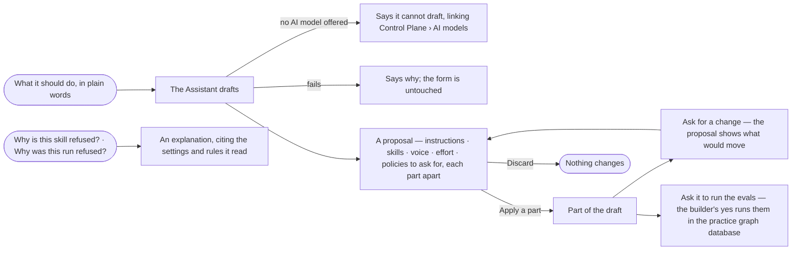

# AG-26 · Let the assistant draft and explain an agent

**As** an agent builder **I want** the Assistant to draft an agent from what I say it should do, propose changes I
apply or discard, and explain any setting or refusal **so that** I start from a working draft and keep every decision
about it myself. *The Assistant proposes → the builder decides.*

Tasks: [task.md](task.md) · Feature: [AG-F01](../../feature.md)

## Who can

| Lens | Can | Otherwise sees |
|---|---|---|
| Admin | Ask the Assistant to draft an agent, propose changes to any agent not built in, run its evals in the practice graph database and explain; apply or discard every proposal | — |
| Modeller | Ask for drafts and proposals on the agents they own, and apply or discard them; ask for an explanation of any agent | On an agent they do not own, a request to change it is answered with an explanation and *I can't change this agent — only its owners or an Admin*, naming them |
| Operator | Ask the Assistant to explain an agent — a setting, a skill's need, a refusal | A request to draft or change an agent is answered with an explanation and *I can't change this agent — that needs the Modeller role* |

## Flow

## Acceptance criteria

| # | Given | When | Then |
|---|---|---|---|
| AG-26.1 | *New agent* with what it should do in plain words | the builder asks the Assistant to draft it | the Assistant proposes instructions, skills to add, voice, effort and the Access Policies to ask an Admin for, each part shown apart with *Apply* and *Discard*; nothing is saved until a part is applied |
| AG-26.2 | A proposal being drafted | the modal is open | it says the Assistant is drafting and fills in each part as it lands; the form stays editable |
| AG-26.3 | A proposed part | the builder presses *Apply* | it joins the draft and can be edited like anything typed; *Discard* leaves the draft as it was |
| AG-26.4 | An agent's sheet | the builder asks for a change — *make it ask before sending* | the Assistant proposes what would move, shown against what is saved, and applies nothing until the builder does; a change to what it may touch is proposed as a policy change for an Admin to save |
| AG-26.5 | A proposal that would widen what the agent may touch or its limits | it is shown | the widening is marked as an Admin's act, never applied with the rest |
| AG-26.6 | A draft | the builder asks the Assistant to run its evals | it asks first, then runs the agent's eval set in the practice graph database and reports the checks; it never publishes |
| AG-26.7 | Any signed-in person | they ask why a skill is refused, why a run was refused or what a limit does | the Assistant explains, citing the settings, the rule and policy, and the refusal it read |
| AG-26.8 | No AI model offered in the deployment | the builder asks for a draft | the Assistant says it cannot draft, linking Control Plane › AI models; the form still saves by hand |
| AG-26.9 | A draft that fails | it ends | the Assistant says why in a sentence; the form is untouched |
| AG-26.10 | A proposal | the builder opens *How it got here* | its steps and the sources it read are shown, each assumption marked *Challenge this* |
| AG-26.11 | An Operator, or a Modeller on an agent they do not own | they ask the Assistant to draft or change an agent | it explains instead and says it cannot change the agent, naming the role or the owners |
| AG-26.12 | A drafted part of an agent | it is proposed | it names the option the Assistant recommends and why, beside *Apply* |

## Screens

| Surface | Lens | First use | Empty after a filter | Loading | Has data | Failed | Agent working or proposing | No access |
|---|---|---|---|---|---|---|---|---|
| The Assistant's draft in New agent | Admin | agents.new | — | — | agents.new · Proposal | agents.new · Could not draft | agents.new · Drafting | — |
| The Assistant's draft in New agent | Operator | — | — | — | — | — | — | agents · New agent disabled |
| A proposed change on the sheet | Admin | — | — | — | agents.agent · Proposal | agents.agent · Could not draft | agents.agent · Drafting | — |
| A proposed change on the sheet | Operator | — | — | — | — | — | — | agents.agent · Read only |
| An explanation | Admin | — | — | — | agents.agent · Explained | agents.agent · Could not load | agents.agent · Drafting | — |
| An explanation | Operator | — | — | — | agents.agent · Explained | agents.agent · Could not load | agents.agent · Drafting | — |
