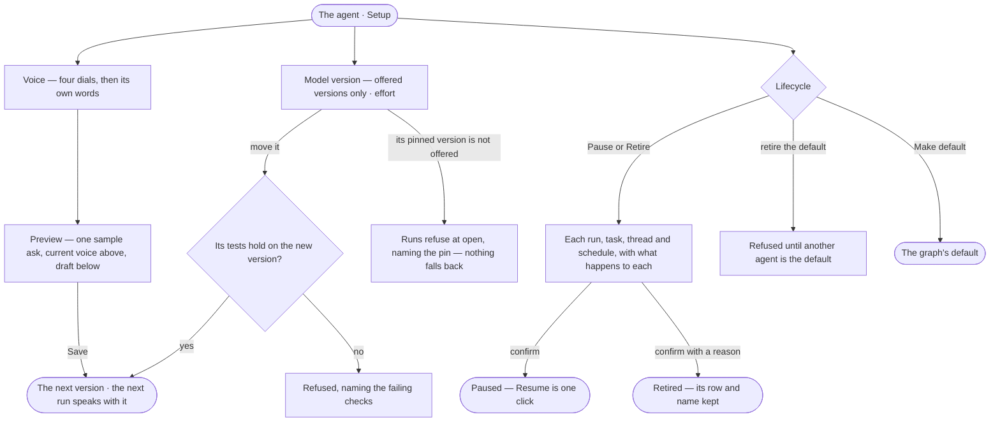

# AG-29 · Tune an agent's voice, model and effort, and retire it

**As** an agent builder **I want** to set how an agent sounds, the exact model version it thinks with and how hard it
tries — and to pause or retire it with every piece of its open work named first **so that** an agent changes only
when I change it, a provider's release never changes it by surprise, and stopping it never loses what it did.

Tasks: [task.md](task.md) · Feature: [AG-F01](../../feature.md)

## Who can

| Lens | Can | Otherwise sees |
|---|---|---|
| Admin | Set the voice and its dials, preview it, pin and move a model version, set effort, Pause, Resume, Retire, Make default; offer model versions in Settings › AI and connections | — |
| Operator | Read the voice, model version, effort, the versions it has run on and its lifecycle | Every edit and every lifecycle act disabled, naming *Can build agents* — *Ask Priya (owner)*. With *Can build agents*: every act here except offering model versions, which stays an Admin's |

## Flow

## Acceptance criteria

| # | Given | When | Then |
|---|---|---|---|
| AG-29.1 | The agent's Voice | it opens | four dials — humour (off · light · playful), formality (casual · neutral · formal), emoji (off · on), greeting (off · on) — sit above the agent's own words, which are read after the dials and win where they disagree |
| AG-29.2 | An agent with no voice written | Voice opens | it reads *Speaking in Invana's default voice* — warm, plain, brief — shown as the placeholder; saving it empty keeps it empty |
| AG-29.3 | A changed voice | the builder presses *Preview* | one sample ask they may edit is answered twice — current voice above, draft below — stating no fact from the data, using a model the graph's rules allow; nothing is recorded or drawn against any budget |
| AG-29.4 | A voice that says *always search the web* or *never say you can't* | a run meets what it may not do | it is still refused, naming what is missing; only the words around the refusal are the voice's |
| AG-29.5 | Any voice | the agent refuses, cannot answer, fails or pauses on its budget | it says so without humour, whatever the dial reads |
| AG-29.6 | A long voice | it is typed | Voice shows its length in characters, which every ask carries |
| AG-29.7 | A run in flight when the voice changes | it ends | it spoke with the voice it opened with; the next run speaks with the new one; a helper it creates speaks with its voice |
| AG-29.8 | Model version | it opens | it lists only the versions Settings › AI and connections offers, each by the provider's exact name; a provider alias cannot be pinned |
| AG-29.9 | A pinned version moved to another | the builder saves | the agent's tests run on the new version first; a failing hard check refuses the move naming it; otherwise the move becomes the next version with its reason |
| AG-29.10 | A pinned version the install does not offer | a run opens | the run is refused, naming the pin; nothing calls another model; Settings › AI and connections warns, naming the agents that pin it |
| AG-29.11 | An agent with no pin | it runs | the view of the graph decides the model, and the run records the version it called |
| AG-29.12 | A pinned agent | Model version opens | *Versions it has run on* lists each recorded version with its first run, runs, served rate and p95 — the engine's numbers; a set pin can be moved, never cleared |
| AG-29.13 | Effort | it opens | the most steps, replans and questions a run may take, each with the number a run reads; *0 questions* means it never asks, and every reading it picks is a declared assumption shown before the answer |
| AG-29.14 | A live agent | the builder presses *Pause* | a dialog lists each piece of open work and what happens to it — a run in flight finishes; an open task is blocked, naming the agent; a task in review is unchanged; a thread with the agent refuses its next ask, naming the state; a schedule that starts it stays on and its runs are refused until it resumes — before *Pause* applies |
| AG-29.15 | A paused agent | the builder presses *Resume* | it takes work again from now, in one click; nothing is replayed and its blocked tasks unblock |
| AG-29.16 | A live agent | the builder presses *Retire* | the same list names a task in review as blocked and each schedule that starts it as paused; *Why* is asked and kept in Versions; once retired it never takes work, its row stays so every run, trace and helper resolves, and its name stays taken |
| AG-29.17 | The graph's default agent | the builder retires it | it is refused until another agent is made the default |
| AG-29.18 | A helper an agent created | the work it was made for closes | it retires itself |
| AG-29.19 | A retired agent | it appears in a run's trace | it reads normally, marked *retired*; every act on its sheet is disabled |
| AG-29.20 | An ask to a paused or retired agent | it is sent | it is refused, naming the state, and *How it got here* shows the refused step and why |
| AG-29.21 | An Operator without *Can build agents* | they open Voice, Model version or Lifecycle | each reads as saved; every edit, *Preview*, *Pause*, *Resume*, *Retire* and *Make default* are disabled, naming *Can build agents*, with *Ask Priya (owner)* |

## Screens

| Surface | Lens | First use | Empty after a filter | Loading | Has data | Failed | Agent working or proposing | No access |
|---|---|---|---|---|---|---|---|---|
| Voice | Admin | agents.agent · Default voice | — | agents.agent · Loading | agents.agent · Voice | agents.agent · Could not save | agents.agent · Previewing | — |
| Voice | Operator | agents.agent · Default voice | — | agents.agent · Loading | agents.agent · Read only | agents.agent · Could not load | — | agents.agent · Read only |
| Model version and effort | Admin | agents.agent · No pin | — | agents.agent · Loading | agents.agent | agents.agent · Version not offered | agents.agent · Testing | — |
| Model version and effort | Operator | agents.agent · No pin | — | agents.agent · Loading | agents.agent · Read only | agents.agent · Version not offered | — | agents.agent · Read only |
| Pinned by | Admin | settings.ai · No pins | — | settings.ai · Loading | settings.ai | settings.ai · Pin not offered | — | — |
| Pinned by | Operator | settings.ai · No pins | — | settings.ai · Loading | settings.ai | settings.ai · Pin not offered | — | settings.ai · Read only |
| Pause and Retire | Admin | — | — | agents.agent · Reading open work | agents.agent · Retire | agents.agent · Default cannot retire | — | — |
| Pause and Retire | Operator | — | — | — | — | — | — | agents.agent · Read only |
| A retired agent | Admin | — | — | — | agents.agent · Retired | — | — | — |
| A retired agent | Operator | — | — | — | agents.agent · Retired | — | — | agents.agent · Retired |
