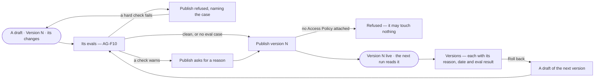

# AG-36 · Publish an agent's version and roll one back

**As** an agent builder **I want** to publish an agent's draft as a version once its evals hold, with every earlier
version kept and its reason, and roll back to one **so that** the people it is granted to get an agent that was tested,
and a change reaches them only as a version someone chose to publish.

Tasks: [task.md](task.md) · Feature: [AG-F01](../../feature.md) · Its evals: [AG-F10](../../../AG-F10-test-an-agent-and-a-skill/feature.md)

## Who can

Publishing and rolling back is the Modeller's and the Admin's ([the role table](../../../../../../os/access/features/AC-F02-access-policies/feature.md#the-role-table)).

| Lens | Can | Otherwise sees |
|---|---|---|
| Admin | Publish a version of any agent not built in, roll back to an earlier one | A built-in agent has no *Publish* — *Built in — copy it to change it* |
| Operator | Read every version, its reason and its eval result. A Modeller does what an Admin does | *Publish* and *Roll back* disabled, naming the role — *Needs the Modeller role — ask an Admin* |

## Flow

## Acceptance criteria

| # | Given | When | Then |
|---|---|---|---|
| AG-36.1 | A draft | its sheet opens | the head reads *Draft* with *Run the evals* and *Publish version N*; Lifecycle reads the live version and since when, and this draft with how many changes it holds |
| AG-36.4 | A draft whose eval run failed a hard check | the builder presses *Publish* | publishing is refused, naming the failing case and its check (AG-F10) |
| AG-36.5 | A draft whose eval run warned | the builder publishes | they are asked for a reason, kept with the version |
| AG-36.6 | A draft with no eval case | the builder publishes | it publishes, and the version says nothing was checked |
| AG-36.7 | A draft whose evals hold | the builder presses *Publish version N* | version N is live: the next run reads it and runs in flight finish on the version they opened with |
| AG-36.8 | A live agent | the builder edits any part of Setup | the edit is a draft of the next version; the live version keeps running until it is published |
| AG-36.9 | Versions | the tab opens | every version with its date, who published it, its reason and its eval result; a voice change, a model move and an instructions publish each read as their own row |
| AG-36.10 | An earlier version | the builder presses *Roll back* | it becomes a draft of the next version and passes the evals before it publishes, like any other |
| AG-36.11 | A draft | anyone asks it, gives it a task, schedules it, delegates to it or makes it the default | it is refused, naming that it is a draft |
| AG-36.14 | An Operator | they open a draft or Versions | the results and every version read; *Publish* and *Roll back* are disabled, naming the role — *Needs the Modeller role — ask an Admin* |
| AG-36.17 | The command line | `invana agents push` writes a draft's instructions from a file and `invana agents publish` publishes it | each passes the same gate as Studio and needs the same role, refused naming it |
| AG-36.18 | A draft with active eval cases and no settled eval run over its exact text and model version, or one still running | the builder presses *Create*, *Publish* or *Roll back* | it is refused where the act was, naming the case count, with *Run the evals*; Studio never predicts the gate |
| AG-36.19 | A draft with no Access Policy attached | the builder presses *Create* or *Publish* | it is refused — *may touch nothing — ask an Admin to attach an Access Policy* — and nothing goes live |
| AG-36.20 | An Operator | they open Versions | every version reads; *Publish* and *Roll back* are disabled — *Needs the Modeller role — ask an Admin* |

## Screens

| Surface | Lens | First use | Empty after a filter | Loading | Has data | Failed | Agent working or proposing | No access |
|---|---|---|---|---|---|---|---|---|
| A draft's head and Lifecycle | Admin | agents.agent · Unchecked draft | — | agents.agent · Loading | agents.agent | agents.agent · Publish refused | agents.agent · Evals running | — |
| A draft's head and Lifecycle | Operator | agents.agent · Unchecked draft | — | agents.agent · Loading | agents.agent · Read only | agents.agent · Publish refused | agents.agent · Evals running | agents.agent · Read only |
| Versions | Admin | agents.agent · Versions one | — | agents.agent · Loading | agents.agent · Versions | agents.agent · Could not load | — | — |
| Versions | Operator | agents.agent · Versions one | — | agents.agent · Loading | agents.agent · Versions | agents.agent · Could not load | — | agents.agent · Versions |
| Agents — a draft in the list | Admin | — | agents · No agents match | agents · Loading | agents · Draft | — | — | — |
| Agents — a draft in the list | Operator | — | agents · No agents match | agents · Loading | agents · Draft | — | — | agents · Draft |
