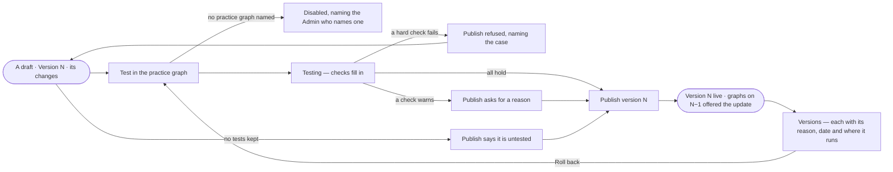

# AG-36 · Test an agent and publish a version

**As** an agent builder **I want** to test an agent's draft in the practice graph and publish it as a version, with
every earlier version kept and its reason **so that** graphs get an agent that was tested, and a change reaches them
only as a version someone chose to publish.

Tasks: [task.md](task.md) · Feature: [AG-F01](../../feature.md)

## Who can

| Lens | Can | Otherwise sees |
|---|---|---|
| Admin | Test a draft in the practice graph, publish a version, roll back to an earlier one; name the practice graph in Settings › Invana | — |
| Operator | Read the test results, every version and its reason | *Test in the practice graph*, *Publish* and *Roll back* disabled, naming *Can build agents* — *Ask Priya (owner)*. With *Can build agents*: test, publish and roll back |

## Flow

## Acceptance criteria

| # | Given | When | Then |
|---|---|---|---|
| AG-36.1 | A draft | its sheet opens | the head reads *Draft* with *Test in the practice graph* and *Publish version N*; Lifecycle reads the live version, where it runs and since when, and this draft with how many changes it holds |
| AG-36.2 | A draft with tests | the builder presses *Test in the practice graph* | its tests run in the practice graph an Admin names in Settings › Invana, and a line reads *6 of 6 checks pass · 41s · 12k tokens* with *See the test runs* |
| AG-36.3 | No practice graph named | the sheet opens | *Test in the practice graph* is disabled, saying an Admin names one in Settings › Invana |
| AG-36.4 | A test whose hard check fails | the builder presses *Publish* | publishing is refused, naming the failing case and its check |
| AG-36.5 | A test with a check that only warns | the builder publishes | they are asked for a reason, kept with the version |
| AG-36.6 | A draft with no tests | the builder publishes | it publishes, and the version says it was not tested |
| AG-36.7 | A tested draft | the builder presses *Publish version N* | version N is live: the next run reads it, runs in flight finish on the version they opened with, and graphs on an earlier version are offered the update (AG-35) |
| AG-36.8 | A live agent | the builder edits any part of Setup | the edit is a draft of the next version; the live version keeps running until it is published |
| AG-36.9 | Versions | the tab opens | every version with its date, who published it, its reason and its test result; a voice change, a model move and an instructions publish each read as their own row |
| AG-36.10 | An earlier version | the builder presses *Roll back* | it becomes a draft of the next version and is tested before it publishes, like any other |
| AG-36.11 | A draft | anyone asks it, gives it a task, schedules it or makes it the default | it is refused, naming that it is a draft |
| AG-36.12 | A test still running | the sheet is open | the checks fill in as each case ends; the rest of the sheet stays usable |
| AG-36.13 | A test run | the person opens *See the test runs* | each case opens its run, and *How it got here* shows its steps and sources |
| AG-36.14 | An Operator without *Can build agents* | they open a draft or Versions | the results and every version read; *Test*, *Publish* and *Roll back* are disabled, naming *Can build agents*, with *Ask Priya (owner)* |

## Screens

| Surface | Lens | First use | Empty after a filter | Loading | Has data | Failed | Agent working or proposing | No access |
|---|---|---|---|---|---|---|---|---|
| A draft's head and Lifecycle | Admin | agents.agent · Untested draft | — | agents.agent · Loading | agents.agent | agents.agent · Check failed | agents.agent · Testing | — |
| A draft's head and Lifecycle | Operator | agents.agent · Untested draft | — | agents.agent · Loading | agents.agent · Read only | agents.agent · Check failed | agents.agent · Testing | agents.agent · Read only |
| Versions | Admin | agents.agent · Versions one | — | agents.agent · Loading | agents.agent · Versions | agents.agent · Could not load | — | — |
| Versions | Operator | agents.agent · Versions one | — | agents.agent · Loading | agents.agent · Versions | agents.agent · Could not load | — | agents.agent · Versions |
| Agents — a draft in the list | Admin | — | agents · No agents match | agents · Loading | agents · Draft | — | — | — |
| Agents — a draft in the list | Operator | — | agents · No agents match | agents · Loading | agents · Draft | — | — | agents · Draft |
