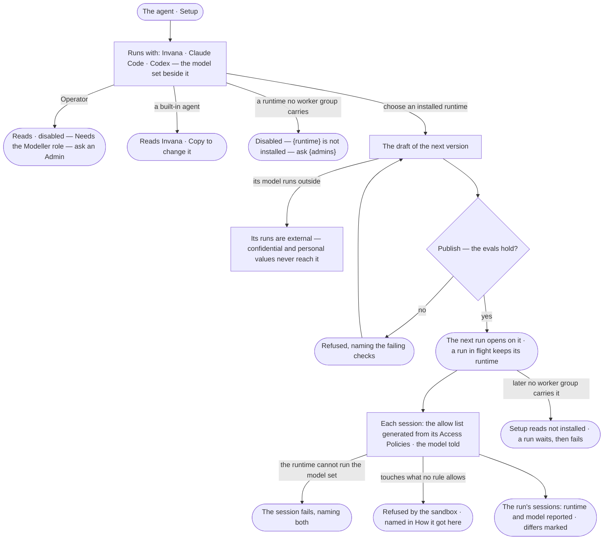

# AG-61 · Choose what an agent runs with

**As** an agent builder **I want** to choose what an agent runs with — Invana, Claude Code or Codex — and see the model
it is set to beside the model each run reported **so that** I pick the runtime that fits the work, knowing it is
installed, where its model runs and that it still touches only what its Access Policies allow.

Tasks: [task.md](task.md) · Feature: [AG-F01](../../feature.md)

## Who can

Building an agent in [the role table](../../../../../../os/access/features/AC-F02-access-policies/feature.md#the-role-table):
Operator *Reads*, Modeller and Admin *Act*. Installing a runtime on a worker group is an Admin's, in the Control Plane.

| Lens | Can | Otherwise sees |
|---|---|---|
| Admin | Choose what any agent not built in runs with and set its model version; read where each runtime's model runs and which worker groups carry it; install a runtime (Control Plane, CP-F02 · CP-F03) | A built-in agent offers *Copy* — *Built in — copy it to change it* |
| Modeller | As Admin on any agent not built in, except installing a runtime | A runtime that is not installed reads disabled — *{runtime} is not installed — ask {admins}* |
| Operator | Read what every agent runs with, its model set, where the model runs, and the model each of its runs reported | *Runs with* and the model version disabled, naming the role — *Needs the Modeller role — ask an Admin* |

## Flow

## Acceptance criteria

| # | Given | When | Then |
|---|---|---|---|
| AG-61.1 | An agent's Setup | it opens | *Runs with* offers Invana, Claude Code and Codex with the agent's choice selected, each saying whether its model runs inside the deployment or outside it; beside it, the model set — the agent's pin or *The deployment's default — {model version}* |
| AG-61.2 | A Modeller or Admin on an agent not built in, with Claude Code installed on a worker group | they choose Claude Code and publish | the choice is saved on the draft of the next version and publishes through the agent's evals; the next run opens on Claude Code, and a run already in flight keeps its runtime across all its sessions |
| AG-61.3 | A runtime no worker group carries, or whose plugin is off | *Runs with* opens | it is disabled, reading *{runtime} is not installed — ask {admins}*; sent from the API or the command line, it is refused with the same sentence |
| AG-61.4 | An agent whose runtime stops being installed | its Setup opens, or a run of it opens | Setup marks the runtime *not installed*, naming the Admins; the run waits for a worker group that carries it, naming the runtime, then fails — it never runs on another runtime |
| AG-61.5 | A runtime whose model runs outside | it is chosen | Setup reads *Its model runs outside — confidential and personal values never reach it*; every call to it is an external row of *What left the platform*, and what it is sent passes the outbound check |
| AG-61.6 | An agent on Claude Code or Codex | a session starts | the runtime is told the model set — the agent's pin, else the deployment's default; a skill's pin and a person's pick do not reach it, and Setup says so beside the model set |
| AG-61.7 | An agent that has run | its recent runs read on Setup | each run lists its sessions with the runtime, its version, the model set and the model reported; a reported model not the same as the set one is marked *differs* |
| AG-61.8 | A runtime that cannot run the model set | a session starts | the session fails, reading *{runtime} cannot run {model version}*; nothing falls back to another model |
| AG-61.9 | An agent on Claude Code or Codex | a session starts | the runtime's own allow list is generated from the agent's Access Policies for that session ([AC-37](../../../../../../os/access/features/AC-F02-access-policies/stories/AC-37-say-what-an-agent-may-touch-on-a-worker/story.md)); Setup says it is generated, links what the agent may touch on a worker, and offers no way to edit it |
| AG-61.10 | An agent on Claude Code or Codex with skills added | a session starts | each skill reaches the runtime as its folder in the session's workspace ([AG-F04](../../../AG-F04-skills/feature.md#rules)); what a skill declares grants nothing |
| AG-61.11 | An Operator | they open an agent's Setup | *Runs with*, the model set and each run's model reported read; changing them is disabled, naming the role — *Needs the Modeller role — ask an Admin* |
| AG-61.12 | A built-in agent | anyone opens its Setup | it reads *Invana*, with *Copy* in place of the choice; a copy runs with Invana until its draft changes it |
| AG-61.13 | A run on an outside runtime | the person behind it opens *How it got here* | each session reads its runtime and version, the model set and the model reported, the worker it ran on, and every step refused by the sandbox with the rule that refused it |
| AG-61.14 | The runtimes cannot be read | *Runs with* opens | it names what it could not read, in the engine's words, with the agent's choice still shown; the rest of Setup reads |

## Screens

| Surface | Lens | First use | Empty after a filter | Loading | Has data | Failed | Agent working or proposing | No access |
|---|---|---|---|---|---|---|---|---|
| Runs with and the model set | Admin | agents.agent · Runs with Invana | — | agents.agent · Loading | agents.agent · Runs with | agents.agent · Runtime not installed | — | — |
| Runs with and the model set | Operator | agents.agent · Runs with Invana | — | agents.agent · Loading | agents.agent · Runs with | agents.agent · Could not load | — | agents.agent · Read only |
| A runtime that is not installed | Admin | — | — | — | agents.agent · Runtime not installed | — | — | — |
| A runtime that is not installed | Operator | — | — | — | agents.agent · Runtime not installed | — | — | agents.agent · Read only |
| Its model runs outside | Admin | — | — | — | agents.agent · Model runs outside | — | — | — |
| Its model runs outside | Operator | — | — | — | agents.agent · Model runs outside | — | — | agents.agent · Read only |
| Recent runs — model set and reported | Admin | agents.agent · No runs yet | — | agents.agent · Loading | agents.agent · Model reported | agents.agent · Could not load | agents.agent · Running | — |
| Recent runs — model set and reported | Operator | agents.agent · No runs yet | — | agents.agent · Loading | agents.agent · Model reported | agents.agent · Could not load | agents.agent · Running | agents.agent · Read only |
| A built-in agent | Admin | — | — | agents.agent · Loading | agents.agent · Built in | agents.agent · Could not load | — | — |
| A built-in agent | Operator | — | — | agents.agent · Loading | agents.agent · Built in | agents.agent · Could not load | — | agents.agent · Built in |
