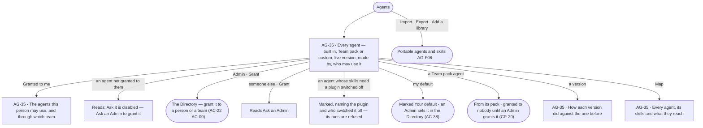

# The agents catalogue

> Every agent the deployment has — the built-in agents, the agents a Team pack brings and the ones people built or
> imported — each with its live version, who made it and who may use it. A person uses the agents granted to them or to
> a team they are on; an Admin grants them. The decision it helps make: *which agent should take this work, and who
> should be able to use it?*

## User journey

Journeys this feature is a step of: [J05 · Join a team](../../../../journeys/J05-join-a-team.md) · [J06 · Set what an agent may touch](../../../../journeys/J06-set-what-an-agent-may-touch.md)

## Stories

| ID | Story | Status |
|---|---|---|
| AG-35 | [See every agent and who may use it](stories/AG-35-see-every-agent-and-who-may-use-it/story.md) | idea |

## Access

The catalogue is *Acts* for every role in [the role table](../../../../os/access/features/AC-F02-access-policies/feature.md#the-role-table):
each person uses the agents granted to them; granting is the Directory's ([AC-F03](../../../../os/access/features/AC-F03-directory/feature.md)).

| Act | Role | Everyone else sees |
|---|---|---|
| Read every agent — kind, status, live version, its owner and who made it, who may use it, its versions and the map | Every signed-in person — Operator, Modeller, Admin | — |
| Use an agent — ask it, give it a task, schedule it | A person it is granted to, or to a team they are on ([AC-F03](../../../../os/access/features/AC-F03-directory/feature.md#rules)) | *Ask*, *Assign* and *Schedule* disabled — *Not granted to you — ask an Admin* |
| Grant an agent to a person or a team, take it away | Admin, in a session, with the password again ([AC-22](../../../../os/access/features/AC-F03-directory/feature.md)) | Who may use it reads; *Grant* reads *Ask an Admin* |
| Set a person's default agent | Admin, in the Directory ([AC-38](../../../../os/access/features/AC-F03-directory/stories/AC-38-choose-a-persons-default-agent/story.md)) | *Your default* reads; changing it reads *Ask an Admin* |
| Build or change an agent | As [AG-F01](../AG-F01-build-an-agent/feature.md#access) | As AG-F01 |

## States

| State | What the person sees |
|---|---|
| First use | Agents holds only the built-in agents, each *Built in*, owned by the platform, granted by role; the Assistant marked *Your default* |
| Empty after a filter | *No agents match* — the filters (kind · status · made by · granted to me) named, with *Clear filters* |
| Loading | Rows hold their shape |
| Has data | Every agent with its kind — *Built in*, *Team pack* with its pack, or *Custom* — status, live version, who made it, who may use it — people and teams — and *Granted to you* or *Not granted to you*; the person's default marked |
| Failed | A failed read names what could not load |
| Agent working or proposing | — |
| No access | Everything reads; an agent not granted to the person cannot be asked, naming *Ask an Admin*; *Grant* reads *Ask an Admin* |

## Rules

| Rule | Detail |
|---|---|
| Agent → skills → functions | An agent holds skills, a skill calls functions and workflows, functions are code. A person uses an agent, never a skill on its own |
| Built once for the deployment | Every agent is one definition with one live version; there is no copy per team, person or graph database |
| Granted, never invited | A person may use the agents granted to them and to every team they are on; a grant is an Admin's, read at each step ([AC-F03](../../../../os/access/features/AC-F03-directory/feature.md#rules)) |
| A grant gives use, never access | What an agent may touch is its Access Policies alone ([AC-F02](../../../../os/access/features/AC-F02-access-policies/feature.md#rules)); granting an agent to someone widens nothing it may touch, and the same agent does the same thing for everyone it is granted to |
| An agent has no role | It acts for the person behind the run through its own Access Policies; it holds no Operator, Modeller or Admin role |
| The built-in agents | One of each, owned by the platform: Assistant · Query console · Modeller · Coordinator · Record editor · Loader ([Engine › Mechanisms](#mechanisms)). Each starts granted to every person whose role holds the feature it acts for. Copied to customise, never edited |
| Team pack agents | A Team pack an Admin turned on brings its agents into the catalogue, owned by the platform, made by the pack, at the pack's version ([CP-F02](../../../../os/control/features/CP-F02-plugins-and-outside-tools/feature.md#rules)); each is granted to nobody until an Admin grants it, and reaches only what the Access Policies an Admin applied allow. Copied to customise; a newer pack version is their next version. [The Software delivery pack](../../../../packs/software-delivery.md) brings five |
| Who made it | Every agent reads its owner — the platform, or its person for a personal agent — and who made it: *System* for a built-in, the pack for a Team pack agent, a person for the rest ([AC-F07](../../../../os/access/features/AC-F07-ownership/feature.md#rules)) |
| One live version | A run opens on the agent's live version; a newer published version reaches the next run, and runs in flight finish on theirs |
| Each person's default | Each person has one default agent, granted to them, and an ask that names no agent goes to it; the catalogue marks it *Your default*. An Admin sets it in the Directory ([AC-F03](../../../../os/access/features/AC-F03-directory/feature.md#rules)) |
| Switched off means refused | An agent whose skills need a plugin or graph database that is switched off reads so, naming who switched it off; its runs are refused before they start ([CP-F02](../../../../os/control/features/CP-F02-plugins-and-outside-tools/feature.md#rules)) |
| Retired stays listed | A retired agent reads *Retired*, keeps its row and name, and is offered to nobody |
| Helpers are hidden by default | A helper made inside a run (AG-F05) lists only with *Show helpers* |
| The query language follows the database | The Query console and the Assistant use each graph database's own language — Cypher or Gremlin — through the typed query plan |
| Leans on | Building an agent (AG-F01) · skills (AG-F04) · delegation and outside agents (AG-F05) · portable files (AG-F08) · Access Policies (AC-F02) · the Directory, grants and default agents (AC-F03) · ownership (AC-F07) · plugins, Team packs and switches (CP-F02) · runs (CP-F10) |

## Data touched

| Record | Read or write |
|---|---|
| Agents, their kind, status, owner, who made them and versions | Read |
| Grants — who may use each agent | Read (written in AC-F03) |
| Each person's default agent | Read (written in AC-F03) |
| Runs per version — runs, served, p95, tokens a run | Read |
| Plugins and graph databases switched off | Read |

## Engine

### Records

| Table | Columns | Notes |
|---|---|---|
| — | — | The catalogue stores nothing of its own: it reads agents (AG-F01), grants and default agents (AC-F03), who owns and made each agent (AC-F07) and Team packs (CP-F02) |

### Reads

| Record | Owner |
|---|---|
| Agents, their versions, `kind`, `status` and the plugin a Team pack agent came from | [AG-F01](../AG-F01-build-an-agent/feature.md#engine) |
| Skills an agent holds | [AG-F04](../AG-F04-skills/feature.md#engine) |
| Grants, teams and each person's default agent | [AC-F03](../../../../os/access/features/AC-F03-directory/feature.md#engine) |
| An agent's owner and who made it | [AC-F07](../../../../os/access/features/AC-F07-ownership/feature.md#engine) |
| The built-in agents' Access Policies | [AC-F02](../../../../os/access/features/AC-F02-access-policies/feature.md#engine) |
| Runs and their numbers per agent version | [CP-F10](../../../../os/control/features/CP-F10-runs-and-how-the-agents-are-doing/feature.md#engine) |
| Plugins, Team packs, graph databases and their switches | [CP-F02](../../../../os/control/features/CP-F02-plugins-and-outside-tools/feature.md#engine) · [CP-F05](../../../../os/control/features/CP-F05-graph-databases/feature.md#engine) |

### Routes

| Route, after `/api/v1/agents` | Does | Story |
|---|---|---|
| `GET /agents/catalogue` | A page by the list contract (`?q=` · `?f.kind=` (`builtin` · `pack` · `custom`) · `?f.status=` · `?f.made_by=` · `?f.granted=me` · `?f.helpers=`) — each agent with `live_version` · `owner` (`platform` or a person) · `made_by` (`system`, a pack or a person) · `pack?` · `granted_to{users[], teams[]}` · `granted_to_me` (`direct` · `team:<name>` · `null`) · `switched_off[{kind, name, by}]` · `is_my_default` | AG-35 |
| `GET /agents/{name}/versions` | Each version — `version` · `published_by` · `published_at` · `why` · `eval_verdict` · `runs` · `served` · `p95_ms` · `tokens_per_run` · `versus_previous` | AG-35 · AG-36 |
| `GET /agents/map` | Every agent, its skills and the functions, workflows and data they reach, as nodes and edges | AG-35 |

### Events

| Event | When |
|---|---|
| — | The catalogue emits nothing of its own; a default agent changes in AC-F03 (`access.users.default_agent`) |

### Refusals

| Status | When | Sentence | Criterion |
|---|---|---|---|
| — | Asking, assigning or scheduling an agent not granted to the person | [AC-F02 › Refusals](../../../../os/access/features/AC-F02-access-policies/feature.md#refusals) | AG-35.3 |
| — | A run needing a switched-off plugin or graph database | [CP-F02 › Refusals](../../../../os/control/features/CP-F02-plugins-and-outside-tools/feature.md#refusals) | AG-35.4 |

### CLI

| Command | Does |
|---|---|
| `invana agents list [--granted-to-me] [--kind pack]` | The catalogue, the agents the caller may use, or a kind of them |

### Mechanisms

| Mechanism | How |
|---|---|
| The built-in agents | One instance each, `kind = builtin`, owned by the platform — the system user — their Access Policies [AC-F02](../../../../os/access/features/AC-F02-access-policies/feature.md#engine)'s: `assistant` · **Assistant** — answers questions in plain words and shows its work; the default · `query-console` · **Query console** — runs the query typed, in read mode, asks before a write, every query recorded · `modeller` · **Modeller** — turns a described change into staged edits on the model's draft · `coordinator` · **Coordinator** — plans, workflows and handing work to helpers; the one built-in agent that may make helpers · `record-editor` · **Record editor** — edits on the board, fixes and merges · `loader` · **Loader** — loads datasets. `SEEDED_AGENTS` holds exactly these six |
| Seeded at migrate | The built-in agents, their policies and their starting grants ([AC-F03 › Mechanisms](../../../../os/access/features/AC-F03-directory/feature.md#mechanisms)) are written at migrate, idempotently |
| Team pack agents | Written when an Admin turns a pack on ([CP-F02 › Mechanisms](../../../../os/control/features/CP-F02-plugins-and-outside-tools/feature.md#mechanisms)) — `kind = builtin` with the pack's plugin named, owned by the platform, made by the pack — and read here as `kind = pack`; paused while the pack is off, retired when it is removed |
| `is_my_default` | The caller's `users.default_agent_id` ([AC-F03](../../../../os/access/features/AC-F03-directory/feature.md#engine)), read at request time |
| Versioned with the engine | A built-in agent's definition ships with the release; a release brings its new version, which reaches the next run |
| `granted_to_me` | Read from the caller's grants and team places at request time, the same reads the step check makes; `direct` wins over a team |
| `switched_off` | For each skill the agent holds, its plugins and the graph databases its needs name, against the install switch and the caller's own switch, naming who switched each off |
| Version numbers | Per agent version from CP-F10's stored counts; `versus_previous` is computed when a version's first run settles and on each settle after, never in Studio |

## System impact

| HLD section | Change | NFRs |
|---|---|---|
| § 8 APIs and events | The routes, events and CLI above, under `/api/v1/agents` | — |
| § 10 AI and agents | An agent is built once for the deployment with one live version — built in, from a Team pack or made by a person; who may use it is a grant, what it may touch its Access Policies | — |

The code changes are [migrations.md](../../../../migrations.md) M37 (Team pack agents) and M38 (one default agent per person).

## Decisions

| Decision | Detail |
|---|---|
| Agents is the catalogue | One list of every agent, each row its name, what it does, kind, live version, who made it, who may use it and *Granted to you* or *Not granted to you*; the row opens the agent's sheet (AG-F01) |
| Who may use it is shown, changed in the Directory | The row and the sheet read the people and teams it is granted to; an Admin's *Grant* opens the Directory on that agent |
| A person sees why they may use it | *Granted to you* names *directly* or the team that gives it |
| The default is marked, set in the Directory | *Your default* sits on the person's default agent; who has which default is set in the Directory, one place for what every screen reads through |
| Team pack agents list beside the built-in ones | A team finds the agents its pack brought where it finds every other, marked with the pack |
| A version reads against the one before | An agent's Versions list each version's runs, served, p95 and tokens a run against the version before, as the engine stores them |
| The map | Agents can be read as a map — each agent, its skills and the functions, workflows and data they reach |
| Switched off is drawn, not hidden | An agent that needs a switched-off plugin or graph database stays listed, marked, naming it and who switched it off |

## Open questions

| Question | Who answers |
|---|---|

## Not building

| Item | Why not |
|---|---|
| A copy of an agent per team or per person | One definition, one live version; teams differ by the agents granted to them |
| A version pinned per team or person | A version reaches every run that opens after it publishes |
| Granting an agent from its sheet | Grants are the Directory's, one place to read who may use what |
| A role for an agent | It would let an agent do whatever that role may |
| Removing a built-in agent | What the product needs stays; an Admin takes its grants away instead |
| A deployment-wide default agent | Each person has their own default, set by an Admin ([AC-F03](../../../../os/access/features/AC-F03-directory/feature.md)) |
| A router agent that classifies each ask, a fixed roster of specialists and a named skill catalogue for them | An ask goes to the agent the person picks, or the default; skills reach a step only through the agent that holds them |
| A built-in data assistant | Bringing records in is a load (RC-F02), run by the Loader as a plan |
| Built-in agents named *<Product> assistant* | A built-in agent is named for what it does |
