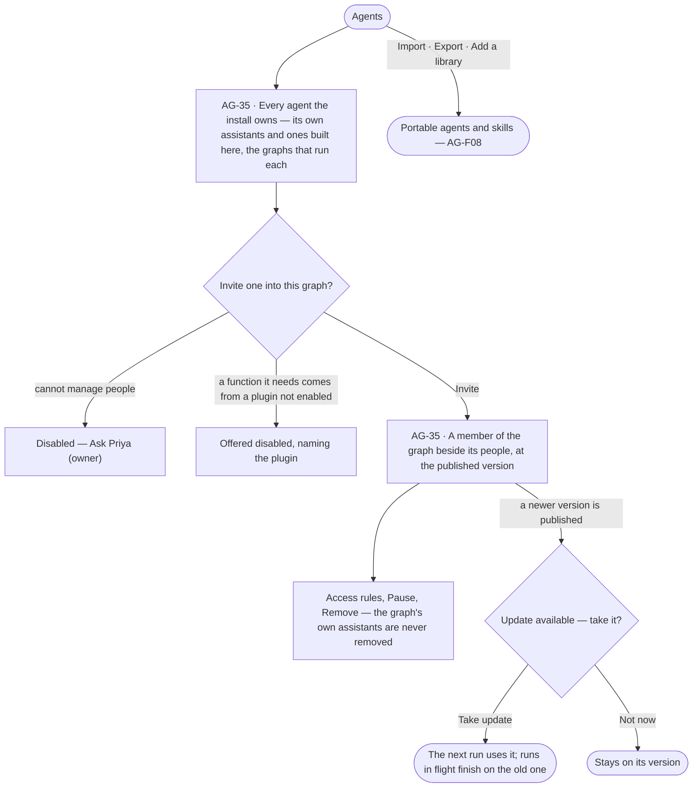

# The agents catalogue — invite

> Every agent and skill the install owns, built once and versioned; a graph invites the agents it needs the way it
> invites people, at a pinned version, and takes an update only when its owner chooses. Agents and skills come in and
> go out as standard files in AG-F08. The decision it helps make: *which agent should this graph have, at which
> version?*

## User journey

## Stories

| ID | Story | Status |
|---|---|---|
| AG-35 | [See every agent the install owns and invite one into a graph](stories/AG-35-see-every-agent-the-install-owns-and-invite-one-into-a-graph/story.md) | idea |

## Access

| Act | Role (`.claude/team/TEAM.md` §7) | Everyone else sees |
|---|---|---|
| Read every agent and skill in the install, its versions and the graphs that run each | Operator — every member of the install | — |
| Invite an agent into a graph · give it access rules · pause it there · remove it · take an update | `iam-admin` · shown as *Can manage people* · Owner · Admin | The graph's agents and what they did read; *Invite agent*, *Pause*, *Remove* and *Take update* disabled — *Ask Priya (owner)* |
| Build or change an agent or skill in the catalogue | As AG-F01 and AG-F04 | As AG-F01 and AG-F04 |

## States

| State | What the person sees |
|---|---|
| First use | Agents holds only the assistants Invana ships, each marked *Included in every graph* |
| Empty after a filter | *No agents match* — the filters named, with *Clear filters* |
| Loading | Rows hold their shape |
| Has data | Every agent with its version, kind (shipped · built here) and the graphs that run each; a graph's members with each agent's version and *Update available* where one is |
| Failed | A failed read names what could not load; a refused update or remove names why |
| Agent working or proposing | — |
| No access | The catalogue reads; invite, update, pause and remove are disabled with *Ask Priya (owner)* |

## Rules

| Rule | Detail |
|---|---|
| Agent → skills → functions | An agent carries skills, a skill calls functions, functions are code. Only an agent is added to a graph; a skill reaches a graph only inside an agent |
| Built once, invited everywhere | Agents and skills are built and versioned in the install's catalogue; a graph invites an agent as a member and gives it access — never its definition, budget or instructions |
| A graph never edits an agent | It invites, gives access rules, pauses and removes; the graph's own instructions and rules reach every agent in it |
| Pinned, with updates offered | A graph runs the version it invited; a newer published version is offered, and its owner moves to it in one act. Runs in flight finish on the version they opened with |
| The graph's own assistants | The assistants Invana ships are added to every new graph and stay: they may be paused there, never removed |
| The query skill follows the database | The assistants use the query skill of the language the graph's database speaks — Cypher, Gremlin or both |
| An agent has no graph role | Its reach is the access rules the graph gives it, and it always acts as the person who started the run ∩ the agent |
| Retired in the catalogue | Graphs that invited it keep their version; it is not offered to any other |
| One plan everywhere | A skill version's plan reads only the function vocabulary, so it is the same in every graph |
| Leans on | Building an agent (AG-F01) · skills (AG-F04) · portable files (AG-F08) · access rules (AC-F02) · plugins (RT-F02) · AI models (RT-F01) · a graph's members (GR-F04) |

## Data touched

| Record | Read or write |
|---|---|
| Agents and skills of the install, and their versions | Read |
| An agent invited into a graph — its version, status, who invited it | Write · read |
| The access rules it holds in that graph | Write (AC-F03) · read |

## Engine

### Records

| Table | Columns | Notes |
|---|---|---|
| `agents_members` | `graph_id` · `agent_id` · `version` (the one the Graph runs) · `status` (`active` · `paused`) · `invited_by_id` · `invited_at` | Unique on (`graph_id`, `agent_id`). Its access rules are AC-F02 rows; it carries no definition, budget or instructions |

### Reads

| Record | Owner |
|---|---|
| Agents, their versions and `kind` | [AG-F01](../AG-F01-build-an-agent/feature.md#engine) |
| Skills an agent carries | [AG-F04](../AG-F04-skills/feature.md#engine) |
| Runs and their numbers per Graph, for a version across Graphs | [AG-F03](../AG-F03-runs-and-how-the-agents-are-doing/feature.md#engine) |
| The access rules a member holds | [AC-F02](../../../../os/access/features/AC-F02-access-rules/feature.md#engine) |
| Plugins enabled — whether an agent's functions can run | [RT-F02](../../../../os/runtime/features/RT-F02-plugins-and-outside-tools/feature.md#engine) |
| The Graph's people and `default_agent_id` | [GR-F04](../../../../os/graph/features/GR-F04-this-graph/feature.md#engine) |

### Routes

| Route, after `/api/v1/u/{u}/{g}` | Does | Story |
|---|---|---|
| `GET /agents/members` · `POST /agents/members` | The Graph's agents with their version and *Update available* · invite one at its published version | AG-35 |
| `PATCH /agents/members/{agent}` · `DELETE /agents/members/{agent}` | Pause or resume it in this Graph · remove it | AG-35 |
| `POST /agents/members/{agent}/update` | Move to the newest published version | AG-35 |

### Events

| Event | When |
|---|---|
| `agents.members.create` · `agents.members.update` · `agents.members.delete` | Invited · paused, resumed or moved to a version · removed |

### Refusals

| Status | When | Sentence | Criterion |
|---|---|---|---|
| 409 | Removing one of the Graph's shipped agents | *{agent} keeps {product} working — pause it instead.* | AG-35.7 |
| 409 | Inviting an agent whose functions need a plugin not enabled | *{agent} needs {plugin} — an Admin enables it.* | AG-35.4 |
| 409 | Inviting an agent retired in the catalogue | *{agent} is retired.* | AG-35.10 |
| 403 | Invite, pause, remove or update without *Can manage people* | *This needs Can manage people — ask {owner}.* | AG-35.13 |

### CLI

| Command | Does |
|---|---|
| — | No command of its own |

### Mechanisms

| Mechanism | How |
|---|---|
| The shipped agents | `explorer` · Explorer — answers questions about this graph in plain words and shows its work; the default · `ql-query` · Query — runs the query typed, with no translation · `modeller` · Modeller — turns a described change into staged edits on the model's draft · `coordinator` · Coordinator — splits a question into parts, hands each to a helper and answers from what they return; the one shipped agent that may make helpers. `SEEDED_AGENTS` holds exactly these four |
| Seeded on first read | A Graph gets its shipped agents when it is created, and again on the first read of its agents, idempotently; `explorer` becomes `default_agent_id` when none is set |
| Versioned with the engine | A shipped agent's definition ships with the release; a release adds the functions and plans it brings and never gives back what an owner took away — the row remembers what it was last given |
| Pinned per Graph | A run opens on `agents_members.version`; a newer published version is offered, never applied; runs in flight finish on theirs |

## System impact

| HLD section | Change | NFRs |
|---|---|---|
| § 6 Data and storage | `agents_members` in Invana's own store | — |
| § 8 APIs and events | The routes and events above | — |
| § 10 AI and agents | An agent is built once and invited per Graph at a pinned version | — |

## Decisions

| Decision | Detail |
|---|---|
| A graph's agents are its members | Invited in Settings › This graph › Members beside people, and in *Create a graph*'s people step; an agent's row opens its version, access, runs and tokens in this graph, with *Edit in Agents* |
| The catalogue shows where each agent runs | Each agent's row names the graphs that run it and at which version |
| An update is a chip | *Update available* on the agent's member row, and a line on its sheet saying what changed |
| A plugin not enabled | An agent whose functions need it is offered disabled, naming the plugin; an Admin enables it |
| The assistants Invana ships | The agents seeded in every graph are listed in [Engine › Mechanisms](#mechanisms) |
| A version reads across graphs | A catalogue agent's version shows how it did in each graph that runs it, against the version before |
| The map | Agents can be read as a map — each agent, its skills and the functions they reach |
| Not built yet | Inviting agents into a graph and updates have no engine yet |

## Open questions

| Question | Who answers |
|---|---|
| Who builds and publishes catalogue agents — an Admin only, or *Can build agents* in any graph? (AG-F01 states the engine's rule meanwhile) | Ravi |

## Not building

| Item | Why not |
|---|---|
| Creating or editing an agent or skill inside a graph | One place to build keeps the install simple; a graph shapes its agents through access rules, its instructions and its rules |
| Adding a skill to a graph | A skill only works inside an agent |
| Budgets or runs at once set per agent by a graph | Cost and capacity are set once, per graph, by an Admin (RT-F04) |
| Automatic updates in graphs | An update can change answers; the owner moves |
| Removing one of the graph's own assistants | Its product stops working without it; pause it instead |
| A graph role for an agent | It would let an agent do whatever that role may |
| A shipped assistant for an experimental product | *Create a graph* promises nothing experimental |
| A router agent that classifies each ask, a fixed roster of specialists and a named skill catalogue for them | An ask goes to the agent the work names, or the Graph's default; skills reach a step only through the agent that holds them |
| A shipped data assistant | Bringing records in is a load (RC-F02), run as a plan |
| Shipped agents named *<Product> assistant* | A shipped agent is named for what it does — Explorer, Query, Modeller, Coordinator |
