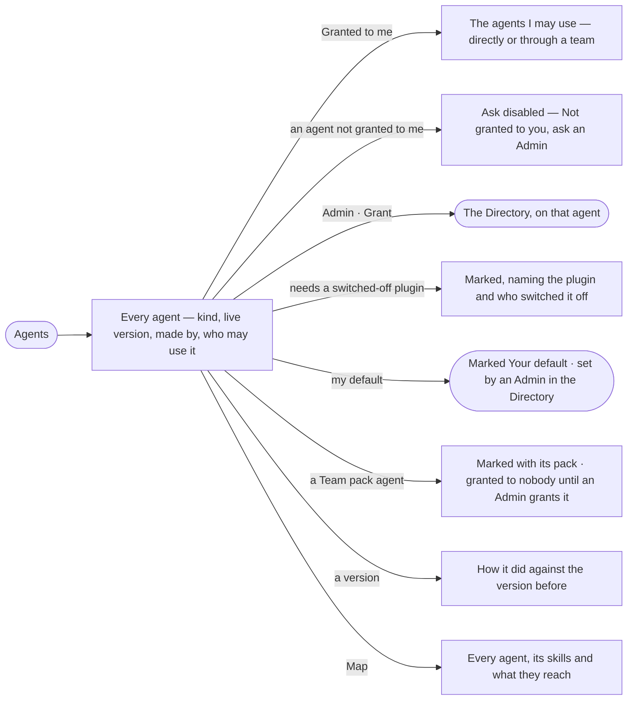

# AG-35 · See every agent and who may use it

**As** an analyst **I want** to see every agent the deployment has — the built-in agents, the agents a Team pack
brought and the ones people built or imported — which of them I may use and through which team, which is my default,
and how each version did **so that** I give work to the right agent, nobody builds the same agent twice, and an Admin
can see at a glance who may use what.

Tasks: [task.md](task.md) · Feature: [AG-F02](../../feature.md)

## Who can

The catalogue is *Acts* for every role in [the role table](../../../../../../os/access/features/AC-F02-access-policies/feature.md#the-role-table); granting and default agents are the Directory's.

| Lens | Can | Otherwise sees |
|---|---|---|
| Admin | Read the whole catalogue; use the agents granted to them; grant an agent to a person or a team, and set a person's default, in the Directory | — |
| Modeller | Read the whole catalogue; use the agents granted to them | *Grant* reads *Ask an Admin*; an agent not granted to them reads *Not granted to you — ask an Admin* |
| Operator | Read the whole catalogue; use the agents granted to them | As Modeller |

## Flow

## Acceptance criteria

| # | Given | When | Then |
|---|---|---|---|
| AG-35.1 | The deployment's agents | anyone opens Agents | every agent lists its name, what it does, *Built in*, *Team pack* or *Custom*, its live version, who made it, the people and teams it is granted to, and *Granted to you* or *Not granted to you* |
| AG-35.2 | A fresh deployment | Agents opens | the six built-in agents list — Assistant, Query console, Modeller, Coordinator, Record editor, Loader — each owned by the platform, made by *System* and granted by role; the Assistant reads *Your default* |
| AG-35.3 | An agent not granted to the person or any team they are on | they try to ask it, give it a task or schedule it | *Ask*, *Assign* and *Schedule* are disabled — *Not granted to you — ask an Admin*; the engine refuses the same from the API, naming the agent and the Admins |
| AG-35.4 | An agent whose skills need a plugin or graph database switched off | it is listed | it reads so, naming the plugin or graph database and who switched it off; asking it is refused before a run starts |
| AG-35.5 | An Admin on an agent's row | they press *Grant* | the Directory opens on that agent (AC-22), where they grant it to a person or a team with the password again |
| AG-35.6 | A person | they open Agents | their default agent reads *Your default*, and an ask that names no agent goes to it; changing it is an Admin's, in the Directory (AC-38) |
| AG-35.7 | *Granted to you* | the person reads it | it says *directly* or names the team that gives it |
| AG-35.8 | A granted agent | the person reads its row | it says nothing about what it may touch beyond *See what it may touch* — granting widens nothing an agent may touch |
| AG-35.9 | A newer published version | the next run opens | it runs on the new version; runs in flight finish on the one they opened with; nobody takes an update |
| AG-35.10 | A retired agent | Agents lists it | it reads *Retired*, its row and name kept, and it is offered to nobody |
| AG-35.12 | Filters on Agents | none match | it reads *No agents match*, naming the filters, with *Clear filters* |
| AG-35.13 | An Operator or Modeller | they look for *Grant* | it reads *Ask an Admin*; their default reads *Your default*, with no act to change it |
| AG-35.14 | An agent's run | the person opens *How it got here* | its steps name the agent and the version that ran |
| AG-35.15 | An agent's version | its row opens | runs, served, p95 and tokens a run, against the version before, as the engine stores them |
| AG-35.16 | Agents | the person picks *Map* | every agent draws with the skills it holds and the functions, workflows and data they reach; a node opens its sheet |
| AG-35.17 | Helpers made inside runs | Agents opens | they are hidden until *Show helpers*, then listed with the run that made them |
| AG-35.18 | A Team pack an Admin turned on that brings agents | Agents opens | each of its agents lists as *Team pack*, naming the pack, owned by the platform; it reads *Not granted to you* until an Admin grants it, and its sheet names the pack's policies still waiting for an Admin to apply (CP-20) |
| AG-35.19 | A Team pack turned off or removed | Agents opens | its agents read *Paused* while it is off and *Retired* once it is removed, keeping their rows and names |

## Screens

| Surface | Lens | First use | Empty after a filter | Loading | Has data | Failed | Agent working or proposing | No access |
|---|---|---|---|---|---|---|---|---|
| Agents — the catalogue | Admin | agents · Only the built-in agents | agents · No agents match | agents · Loading | agents | agents · Could not load | — | — |
| Agents — the catalogue | Operator | agents · Only the built-in agents | agents · No agents match | agents · Loading | agents | agents · Could not load | — | agents · Not granted to you |
| Who may use it, on the sheet | Admin | agents.agent · Granted by role | — | agents.agent · Loading | agents.agent · Who may use it | agents.agent · Could not load | — | — |
| Who may use it, on the sheet | Operator | agents.agent · Granted by role | — | agents.agent · Loading | agents.agent · Who may use it | agents.agent · Could not load | — | agents.agent · Not granted to you |
| Grant, in the Directory | Admin | settings.people · Agent grants | — | settings.people · Loading | settings.people · Agent grants | settings.people · Could not load | — | — |
| Grant, in the Directory | Operator | — | — | — | — | — | — | settings.people · Read only |
| Your default | Admin | — | — | — | agents · Default | — | — | — |
| Your default | Operator | — | — | — | agents · Default | — | — | agents · Default |
| Team pack agents | Admin | — | — | agents · Loading | agents · Team pack | agents · Could not load | — | — |
| Team pack agents | Operator | — | — | agents · Loading | agents · Team pack | agents · Could not load | — | agents · Not granted to you |
| Switched off | Admin | — | — | — | agents · Switched off | agents · Switched off | — | — |
| Switched off | Operator | — | — | — | agents · Switched off | agents · Switched off | — | agents · Switched off |
| Versions against the one before | Admin | agents.agent · Versions one | — | agents.agent · Loading | agents.agent · Versions | agents.agent · Could not load | — | — |
| Versions against the one before | Operator | agents.agent · Versions one | — | agents.agent · Loading | agents.agent · Versions | agents.agent · Could not load | — | agents.agent · Versions |
| Agents — the map | Admin | agents · Map empty | — | agents · Loading | agents · Map | agents · Could not load | — | — |
| Agents — the map | Operator | agents · Map empty | — | agents · Loading | agents · Map | agents · Could not load | — | agents · Map |
