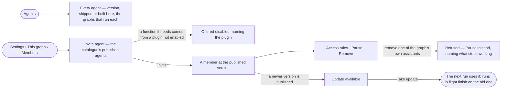

# AG-35 · See every agent the install owns and invite one into a graph

**As** a graph owner **I want** every agent the install owns — the assistants Invana ships and the ones built here,
with the graphs that run each — and to invite the ones I need into my graph the way I invite people **so that** a new
graph has agents working on day one, nobody builds the same agent twice, and an improvement reaches my graph only
when I take it.

Tasks: [task.md](task.md) · Feature: [AG-F02](../../feature.md)

## Who can

| Lens | Can | Otherwise sees |
|---|---|---|
| Admin | Read the whole catalogue; invite an agent into any graph, give it access rules, pause it, remove it, take an update | — |
| Operator | Read the catalogue, the graph's agents, their versions and what they did | *Invite agent*, *Access*, *Pause*, *Remove* and *Take update* disabled — *Ask Priya (owner)*. With *Can manage people* or as the graph's Owner: every act here in that graph |

## Flow

## Acceptance criteria

| # | Given | When | Then |
|---|---|---|---|
| AG-35.1 | The install's catalogue | anyone opens Agents | every agent lists its name, what it does, its published version, whether Invana ships it or it was built here, and the graphs that run it with the version each runs |
| AG-35.2 | A new graph | it is created | the assistants Invana ships are its members, each marked *Included in every graph*, using the query skill of the language its database speaks |
| AG-35.3 | *Create a graph*'s people step, or Settings › This graph › Members | an owner presses *Invite agent* | the catalogue's published agents are offered beside people; an invited agent joins at the version published when it was invited |
| AG-35.4 | An agent whose functions need a plugin that is not enabled | it is offered | it is disabled, naming the plugin and that an Admin enables it |
| AG-35.5 | An invited agent | the owner opens its member row | it reads its version, the access rules it holds here, its runs and tokens in this graph, and *Edit in Agents* |
| AG-35.6 | An invited agent | the owner gives it access rules, pauses it or removes it | each applies to this graph only; nothing about its definition, budget or instructions changes |
| AG-35.7 | One of the graph's own assistants | the owner removes it | it is refused, naming what stops working, and *Pause* is offered instead |
| AG-35.8 | A newer published version of an invited agent | the owner opens Members | the row reads *Update available*, and its sheet says what changed |
| AG-35.9 | *Update available* | the owner presses *Take update* | the graph's next run uses the new version; runs in flight finish on the one they opened with; nothing updates on its own |
| AG-35.10 | An agent retired in the catalogue | a graph runs it | the graph keeps its version; it is not offered to any other graph |
| AG-35.11 | An agent in a graph | it runs | it acts as the person who started the run ∩ the access rules the graph gave it; it holds no graph role |
| AG-35.12 | Filters on Agents | none match | it reads *No agents match*, naming the filters, with *Clear filters* |
| AG-35.13 | An Operator without *Can manage people* | they open Members | the graph's agents, their versions and what they did read; *Invite agent*, *Access*, *Pause*, *Remove* and *Take update* are disabled, with *Ask Priya (owner)* |
| AG-35.14 | An agent's run in a graph | the person opens *How it got here* | its steps name the agent and the version that ran |
| AG-35.15 | A catalogue agent's version | its row opens | how it did in each graph that runs it — runs, served, p95 and tokens a run — against the version before, as the engine stores them |
| AG-35.16 | Agents | the person picks *Map* | every agent draws with the skills it holds and the functions they reach; a node opens its sheet |

## Screens

| Surface | Lens | First use | Empty after a filter | Loading | Has data | Failed | Agent working or proposing | No access |
|---|---|---|---|---|---|---|---|---|
| Agents — the catalogue | Admin | agents · Only the graph's assistants | agents · No agents match | agents · Loading | agents | agents · Could not load | — | — |
| Agents — the catalogue | Operator | agents · Only the graph's assistants | agents · No agents match | agents · Loading | agents | agents · Could not load | — | agents · New agent disabled |
| Members — the graph's agents | Admin | settings.people · Only the graph's assistants | settings.people · No members match | settings.people · Loading | settings.people | settings.people · Could not load | — | — |
| Members — the graph's agents | Operator | settings.people · Only the graph's assistants | settings.people · No members match | settings.people · Loading | settings.people · Read only | settings.people · Could not load | — | settings.people · Read only |
| Invite agent | Admin | settings.people · Invite agent | — | settings.people · Loading | settings.people · Invite agent | settings.people · Plugin not enabled | — | — |
| Invite agent | Operator | — | — | — | — | — | — | settings.people · Read only |
| Update available | Admin | — | — | — | settings.people · Update available | settings.people · Could not update | — | — |
| Update available | Operator | — | — | — | settings.people · Update available | — | — | settings.people · Read only |
| The agent in this graph | Admin | — | — | agents.agent · Loading | agents.agent · In this graph | agents.agent · Could not load | — | — |
| The agent in this graph | Operator | — | — | agents.agent · Loading | agents.agent · In this graph | agents.agent · Could not load | — | agents.agent · Read only |
| Agents — the map | Admin | agents · Map empty | — | agents · Loading | agents · Map | agents · Could not load | — | — |
| Agents — the map | Operator | agents · Map empty | — | agents · Loading | agents · Map | agents · Could not load | — | — |
