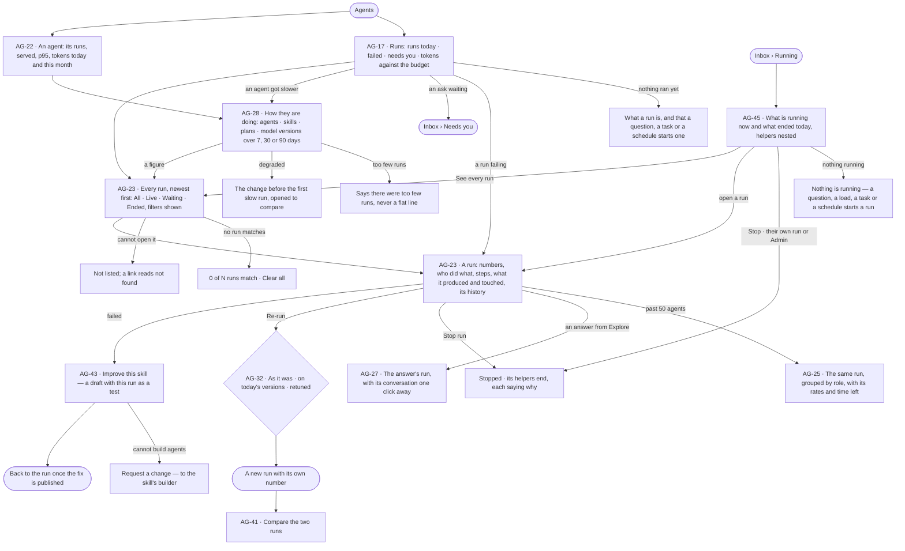
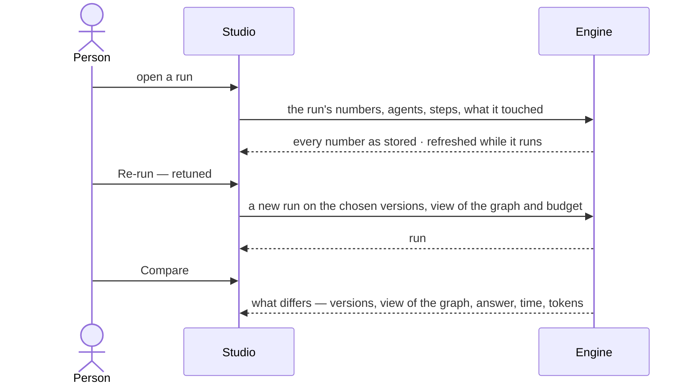
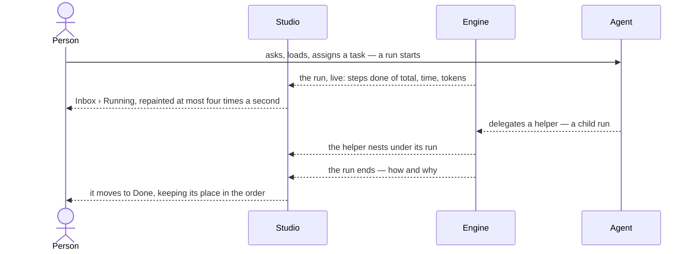

# Runs and how the agents are doing

> Every run in a graph in one list and read one way, at any size — its numbers, who did what, each step's input and
> output, what it produced and touched — and every agent, skill, plan and model version against its own baseline, with
> the change that made it worse named. The decisions it helps make: *does anything need me now, is this agent getting
> worse, and is this run worth re-running, comparing or turning into a better skill?*

## User journey

Journeys this feature is a step of: [J04 · Build an agent and improve it from what runs teach](../../../../journeys/J04-build-an-agent-and-improve-it-from-what-runs-teach.md)

## Stories

| ID | Story | Status |
|---|---|---|
| AG-17 | [See what needs me across every agent](stories/AG-17-see-what-needs-me-across-every-agent/story.md) | idea |
| AG-22 | [Read how one agent is doing](stories/AG-22-read-how-one-agent-is-doing/story.md) | idea |
| AG-28 | [See what got worse and the change that did it](stories/AG-28-see-what-got-worse-and-the-change-that-did-it/story.md) | idea |
| AG-23 | [Find a run and see where it stands](stories/AG-23-find-a-run-and-see-where-it-stands/story.md) | idea |
| AG-25 | [Read a run of hundreds of agents like any run](stories/AG-25-read-a-run-of-hundreds-of-agents-like-any-run/story.md) | idea |
| AG-27 | [Read an answer's run like any run](stories/AG-27-read-an-answers-run-like-any-run/story.md) | idea |
| AG-32 | [Re-run a run as it was, or retuned](stories/AG-32-re-run-a-run-as-it-was-or-retuned/story.md) | idea |
| AG-41 | [Compare two runs of one question](stories/AG-41-compare-two-runs-of-one-question/story.md) | idea |
| AG-43 | [Turn a failed run into a better skill](stories/AG-43-turn-a-failed-run-into-a-better-skill/story.md) | idea |
| AG-45 | [See what is running and what just ran](stories/AG-45-see-what-is-running-and-what-just-ran/story.md) | idea |

## Access

| Act | Role (`.claude/team/TEAM.md` §7) | Everyone else sees |
|---|---|---|
| Read Runs, every run, every agent's numbers and how they are doing | Operator — every member of the graph | — |
| Open the conversation behind an answer's run | The person who asked, or anyone it is shared with | The run reads; *Open the conversation* is absent |
| Stop a run | The person who started it · Admin | *Stop run* disabled, naming who started it |
| Re-run a run — as it was, on today's versions, or retuned | The person who started it · Admin | *Re-run* disabled, naming who started it |
| Compare two runs | Operator | — |
| Improve this skill from a run | `builder` · shown as *Can build agents* · Admin | *Request a change* in its place, sent to the skill's builder |
| Answer an ask a run waits on | Whoever the ask is routed to (AC-F05) | The ask reads, with who it waits on |
| Read Running and Done — runs the reader can open | Operator — every member | A run the reader cannot open is not listed |

## States

| State | What the person sees |
|---|---|
| First use | Nothing ran: tiles read `0` or `—`, *Nothing ran in the last 30 days*, and what a run is — a question, a task or a schedule starts one |
| Empty after a filter | *0 of N runs match*, the filters named as chips, *Clear all* |
| Loading | The head and its acts drawn at once; the body loads in place |
| Has data | Tiles against the window before, the runs list, a run's sheet, each agent's and skill's numbers |
| Failed | What could not be read, in the engine's words; a refused act names why |
| Agent working or proposing | A run in flight: *running*, time so far, its agents and steps filling in, refreshed every few seconds |
| No access | A run the person cannot open is not listed and its link reads *not found*; acts they may not take are disabled, naming who may |

## Rules

| Rule | Detail |
|---|---|
| One runs list | Agents › Runs lists every run in the graph; an agent's runs, a person's runs and a schedule's runs are that list, filtered |
| A run has a number | `#2291` is how people quote a run; numbered per graph, never reused; a helper's run and a step carry none |
| Its status is why it ended | Once ended, a run reads its reason: served · cannot answer · out of tokens · out of time · out of steps · no progress · loop · stopped with its parent · stopped · failed. Running reads *running*; held on a person, *waiting* |
| From | Where a run started, in the reader's words: Explore · Task · Schedule · Project · API |
| One run, read one way | The same parts for one agent, nine or seven hundred; past 50 agents the numbers read as rates and agents group by role |
| Cannot-answer is not a failure | Counted on its own, never inside *failed* |
| Run time is what a person waits | From queued to finished; a run still going has none |
| Baselines | A subject's numbers are read against the same window before; degraded is its last 3 runs each slower than 1.5× its 7-day p95, with at least 5 runs in that baseline; failing is 2 or more latest runs failed, and outranks degraded |
| The change named | The newest agent or skill version published inside the baseline before the first slow run; none named when there is none |
| Every figure opens its runs | A tile, a row or a bar opens Runs filtered to what it counts |
| Too few runs is said | A subject with too few runs reads so, never as a flat line |
| Tokens, never currency | Every tile, meter and row counts tokens |
| A number not recorded is `—` | Never `0` |
| The engine counts | Every tile, rate, percentile, change and time left is the engine's; Studio formats them and derives nothing |
| A run nobody can open is absent | It is not listed, and a link to it reads *not found* |
| An ended run holds no asks | Its pending asks close as expired and leave *Needs you* |
| The run sheet acts only to stop | *Stop run* is its one write; re-running makes a new run |
| One journal | There is one record of runs in a Graph. Agents › Runs (AG-23) is the full list; Inbox › Running and Done are readings of it, and Data's import history is the same journal filtered to loads — never a second record |
| Running is not History | A run is what executed — how it ended, what it spent; a History row is what a person or an agent did — who, on whose behalf. Neither is drawn from the other |
| Everything that runs is a run | A question, a typed query, a load, a link between models, an enrichment, a planner and a checker are each a run; a step is never a run of its own in a list |
| Helpers nest | A helper an agent delegated to, or a part a step fanned out, sits under the run that started it, never as a sibling; past the second level it collapses, showing how many it holds |
| A chain shows its worst | A run still going whose helper already failed shows that beside its own status; neither hides the other |
| Tokens add up the chain | A run's tokens include what its helpers spent. Tokens only, never currency |
| Interaction is hidden | Expanding a node on a board and a provider check are runs too, hidden unless *Show interactive runs* is on |
| A row leads with what was asked | The question as typed, the query, or the dataset and where it loads — then the agent, how far (*steps 4 of 9*, never a percentage), time so far, tokens |
| Live, but still | A run in flight updates in place and keeps its place in the order; a run that starts while the list is open joins the top; the list repaints at most four times a second |
| Stop is the one act | Running offers *Stop* while a run is going; nothing here retries, edits or re-runs — re-running is where the run was started (AG-32) |
| Leans on | Build an agent (AG-F01) · skills and their tests (AG-F04) · helpers and delegation (AG-F05) · the Inbox (GR-F05 · AC-F06) · the answer and *How it got here* (EX-F04) |

## Data touched

| Record | Read or write |
|---|---|
| Runs — number, agent, origin, who started it, agents used, tokens, time, why it ended | Read |
| A run's steps, helpers, what it produced and what it touched | Read |
| Per-run numbers stored when a run settles — run time, tokens, served | Read |
| Agent, skill and plan versions, with when they were published | Read |
| A re-run — the run it repeats, the versions, view of the graph and budget it used | Write |
| Stop — the run and each helper's reason | Write |
| A skill draft with a run added as a test (AG-F04) | Write |
| History rows of a run (AC-F06) | Read |

## Decisions

| Decision | Detail |
|---|---|
| Runs opens on what needs you | Tiles — runs today against the same day last week · failed today · needs you · p95 over 7 days · tokens this month against the agents' month budgets · success over 7 days — then *Needs attention*, runs a day over 30 days and what changed recently |
| Needs attention | Failing plans first, then agents, then degraded agents; an agent whose latest failure is a listed plan's run is not listed again; each item has one act that opens where it is answered |
| A run is a sheet | A run opens as a sheet over the work: its head (number, agent, status, what started it, tokens against its budget, *Re-run*, *Stop run*, *Compare*) and its parts — numbers, who did what, steps, what it produced, data touched, history |
| A step opens inside its run | Its input, output, what it touched and its log; a step that fanned out opens on its first part with *All parts* beside it |
| Who did what is drawn | Who made whom, each agent with its state in words and its tokens against what it was given; an ask still waiting drawn dashed |
| Re-run is one dialog | Wherever a run reads: *As it was* (the versions it recorded, shown — *not recorded* when it pinned none) · *Today's versions* · *Retune* (agent version, model version, run budget, view of the graph). It is offered once the run has ended |
| Time left is a rate | Agents still to finish over the last ten minutes' finishing rate; absent when none finished |
| Stopping a run | Its helpers end *stopped with its parent*, the run *stopped*; both are history rows |
| An answer from Explore is a run | Run by the graph's assistant on behalf of whoever asked; its head names the conversation |
| A run's conversation stays with its author | Others read the run, its steps and history rows; the conversation opens only for its author, or when shared |
| Windows | 7, 30 or 90 days, in the URL with the tab; each tile compares the same length before it |
| A change is the engine's | `↑ 38%`, `▲ 1.2 pt` or *flat* — under 2% or 0.1 pt reads flat; run time and tokens up read worse, success up reads better, counts are neutral |
| A failed run is the way into a better skill | *Improve this skill* opens the skill's draft with the run added as a test and a way back to the run |
| Spend in tokens | No cost is shown anywhere, even when a provider prices tokens |
| Running is the Inbox's, the list is Agents' | Inbox › Running answers *what is moving now*; Agents › Runs is where every run is found, filtered and opened. A run opens as one sheet wherever it is listed |
| Done is today | Done lists the runs that ended today, the reader's day; older runs are in Agents › Runs |
| Mine first | Running lists the reader's runs first, then everyone else's they can open |

## Open questions

| Question | Who answers |
|---|---|
| May *Can build agents* stop or re-run a run someone else started, or only its starter and an Admin? The spec says its starter and an Admin meanwhile | Ravi |
| The canvas draws *Re-run this step* on a run's step; a step out of its plan has no inputs to trust. Draw a step re-run, or re-run the whole run only? The spec says the whole run meanwhile | Ravi |
| *Alert me when it degrades* — a notification when an agent degrades needs the engine to raise an event. Add it to GR-F05, or leave it out? | Ravi |
| Does Done keep runs the reader did not start, or only theirs? Recommend: every run they can open, theirs first, as Running does | Ravi |

## Not building

| Item | Why not |
|---|---|
| A cost per run, agent or model | Tokens only |
| Custom windows or date ranges | 7, 30 and 90 days answer *since it shipped* |
| *Roll back* from how agents are doing | A version rolls back on its own sheet, after its tests (AG-36) |
| A provider's release feed | Invana does not poll vendors; an Admin offers the version they want (RT-F01) |
| Who pins each model version | Settings › AI and connections (RT-F01) |
| An icicle of a big run | Who did what and by role answer *who made whom* and *how each role is doing* |
| Saved copies of a run | A settled run never changes; its sheet reads it any time |
| A section of its own for big runs | A run of hundreds of agents is a run, started like any other |
| An estimate before a big run starts | The engine stores none, and Studio never derives a number (AG-F01) |
| *Select them* on a big run's agents | Acting on many agents is a re-run, retuned |
| Custom dashboards, alerting, paging, exporting metrics | Four questions answered well beat a builder; the record is the source — export it, not a summary |
| A word for *job* | A run and its steps already name it |
| Retry or re-run from Running | A run is re-run where it was started, with its own inputs — a blind re-run of a load writes a graph twice |
| A step as a row of its own | Steps belong to their run and open inside it |
| Runs across Graphs | A Graph is the reasoning boundary |
| Alerting on a failed run here | A rule does that (GR-17) |

