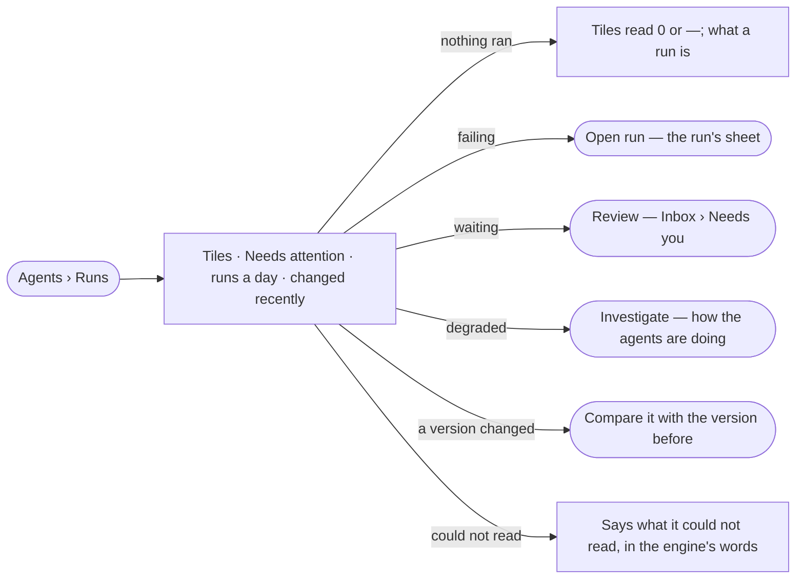

# AG-17 · See what needs me across every agent

**As** an agent builder **I want** to open Runs and see at once what failed, what waits on a person, what got slower
and what changed, across every agent in the graph **so that** I tend agents before the people who ask them notice.

Tasks: [task.md](task.md) · Feature: [AG-F03](../../feature.md)

## Who can

| Lens | Can | Otherwise sees |
|---|---|---|
| Admin | Read every tile, *Needs attention* and what changed; follow each item's act | — |
| Operator | Read every tile, *Needs attention* and what changed; follow each item's act to where it is answered | An act they may not take there is disabled, naming who may |

## Flow

## Acceptance criteria

| # | Given | When | Then |
|---|---|---|---|
| AG-17.1 | A graph with runs | the person opens Runs | six tiles read runs today against the same day last week, failed today, needs you, p95 over 7 days against the 7 before, tokens this month against the agents' month budgets, and success over 7 days |
| AG-17.2 | No agent has a month budget | Runs opens | *Tokens this month* reads the tokens alone, with *no month budget* — never zero |
| AG-17.3 | A plan or agent whose latest runs failed, an ask waiting, an agent degraded | Runs opens | *Needs attention* lists failing plans, then agents, then degraded agents, each with one act — *Open run*, *Review* or *Investigate* |
| AG-17.4 | An agent whose latest failure is a listed plan's run | Runs opens | the agent is not listed a second time |
| AG-17.5 | Nothing needs attention | Runs opens | it reads *Nothing needs attention* |
| AG-17.6 | Runs over the last 30 days | Runs opens | *Runs a day* draws succeeded over failed per day, counting each run once, never its steps |
| AG-17.7 | New agent and skill versions | Runs opens | *Changed recently* lists the newest, each with who published it, when, and its runs, failures and p95 after against the version before |
| AG-17.8 | A version with fewer than 3 runs after it | Runs opens | its row shows runs and failures, and no p95 change |
| AG-17.9 | A changed skill version | the person presses *Compare* | it opens the change compared with the version before; a skill's first version offers no *Compare* |
| AG-17.10 | Nothing has run | Runs opens | tiles read `0` or `—`, *Runs a day* reads *Nothing ran in the last 30 days*, and a line says a question, a task or a schedule starts a run |
| AG-17.11 | The engine cannot read the runs | Runs opens | it says what it could not read, in the engine's words |
| AG-17.12 | Any tile or bar | the person opens it | Runs lists the runs it counts, filtered, the filters shown |
| AG-17.13 | An Operator | they follow *Review* on an ask routed to someone else | the ask reads, naming who it waits on |

## Screens

| Surface | Lens | First use | Empty after a filter | Loading | Has data | Failed | Agent working or proposing | No access |
|---|---|---|---|---|---|---|---|---|
| Runs — tiles, Needs attention, changed recently | Admin | agents.runs · Nothing ran | — | agents.runs · Loading | agents.runs | agents.runs · Could not load | agents.runs · Running | — |
| Runs — tiles, Needs attention, changed recently | Operator | agents.runs · Nothing ran | — | agents.runs · Loading | agents.runs | agents.runs · Could not load | agents.runs · Running | agents.runs |
| Inbox — the ask *Review* opens | Admin | — | — | inbox · Loading | inbox | — | — | — |
| Inbox — the ask *Review* opens | Operator | — | — | inbox · Loading | inbox · Not yours to answer | — | — | inbox · Not yours to answer |
