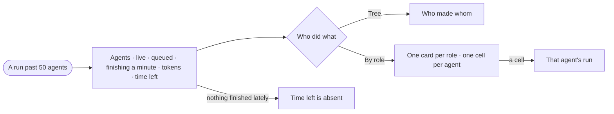

# AG-25 · Read a run of hundreds of agents like any run

**As** an analyst **I want** a run of seven hundred agents read like any run — grouped by role, with how fast they
finish and how long is left **so that** a big run is as traceable as a small one.

Tasks: [task.md](task.md) · Feature: [AG-F03](../../feature.md)

## Who can

| Lens | Can | Otherwise sees |
|---|---|---|
| Admin | Read a big run's rates, roles and every agent in it; stop it | — |
| Operator | Read a big run's rates, roles and every agent in it; stop it when they started it | *Stop run* disabled on someone else's run, naming who started it |

## Flow

## Acceptance criteria

| # | Given | When | Then |
|---|---|---|---|
| AG-25.1 | A run of more than 50 agents | its sheet opens | the parts are the same as any run's; its numbers read agents · live · queued · finishing a minute · tokens · time left |
| AG-25.2 | A big run | its numbers read | *Agents finished a minute*, *Agents live* against the graph's runs-at-once limit, and *By role* — each role with its count, p50 and p95 |
| AG-25.3 | A big run | the person picks *By role* in who did what | one card per role with a status bar, and one cell per agent; a cell opens that agent's run |
| AG-25.4 | A run of 50 agents or fewer | who did what opens | it draws the tree alone; *By role* is not offered |
| AG-25.5 | Agents finished in the last ten minutes | time left is read | it is the agents still to finish over that rate |
| AG-25.6 | No agent finished in the last ten minutes | the numbers read | time left is absent, never a guess |
| AG-25.7 | A role whose agents recorded no tokens | *By role* reads | its p50 and p95 read `—` |
| AG-25.8 | Agents waiting for workers | the numbers read | they say the run waits on workers, naming which |
| AG-25.9 | A big run still going | its sheet is open | the numbers refresh every few seconds |

## Screens

| Surface | Lens | First use | Empty after a filter | Loading | Has data | Failed | Agent working or proposing | No access |
|---|---|---|---|---|---|---|---|---|
| A big run — numbers and rates | Admin | — | — | agents.run · Loading | agents.run · Many agents | agents.run · Failed | agents.run · Many agents running | — |
| A big run — numbers and rates | Operator | — | — | agents.run · Loading | agents.run · Many agents | agents.run · Failed | agents.run · Many agents running | agents.run · Not found |
| A big run — by role | Admin | — | — | agents.run · Loading | agents.run · By role | agents.run · Could not load | agents.run · Many agents running | — |
| A big run — by role | Operator | — | — | agents.run · Loading | agents.run · By role | agents.run · Could not load | agents.run · Many agents running | agents.run · Not found |
