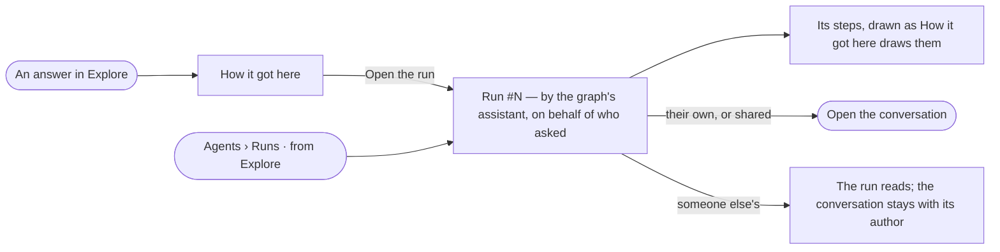

# AG-27 · Read an answer's run like any run

**As** an analyst **I want** an answer from Explore read as a run like any other, its steps drawn as the answer's
*How it got here* draws them **so that** everything an agent did is checked in one place, whoever asked.

Tasks: [task.md](task.md) · Feature: [AG-F03](../../feature.md)

## Who can

| Lens | Can | Otherwise sees |
|---|---|---|
| Admin | Read the run of any answer; open its conversation when it is theirs or shared with them | — |
| Operator | Read the run of any answer they can open; open their own conversation | *Open the conversation* is absent on someone else's, unless it is shared |

## Flow

## Acceptance criteria

| # | Given | When | Then |
|---|---|---|---|
| AG-27.1 | A question asked in Explore | it is answered | the answer is a run in Agents › Runs, from *Explore*, run by the graph's assistant on behalf of whoever asked |
| AG-27.2 | An answer's run | its sheet opens | its head reads *asked in Explore by meera* with the conversation's name |
| AG-27.3 | An answer's run | a step opens | it is drawn as the answer's *How it got here* draws it — the same step, the same parts |
| AG-27.4 | An answer's run | it is read | *How it got here* shows its steps and sources |
| AG-27.5 | The person who asked, or someone it is shared with | they press *Open the conversation* | the conversation opens at that answer |
| AG-27.6 | Someone else's conversation, not shared | an Operator opens its run | the run, its steps and history rows read; *Open the conversation* is absent |
| AG-27.7 | History rows of an answer's run | they read | the actor reads *person ▸ the assistant* |

## Screens

| Surface | Lens | First use | Empty after a filter | Loading | Has data | Failed | Agent working or proposing | No access |
|---|---|---|---|---|---|---|---|---|
| An answer's run | Admin | — | — | agents.run.answer · Loading | agents.run.answer | agents.run.answer · Failed | agents.run.answer · Running | — |
| An answer's run | Operator | — | — | agents.run.answer · Loading | agents.run.answer · Not their conversation | agents.run.answer · Failed | agents.run.answer · Running | agents.run.answer · Not their conversation |
| Runs from Explore | Admin | agents.runs · Nothing ran | agents.runs · No runs match | agents.runs · Loading | agents.runs · Filtered | agents.runs · Could not load | agents.runs · Running | — |
| Runs from Explore | Operator | agents.runs · Nothing ran | agents.runs · No runs match | agents.runs · Loading | agents.runs · Filtered | agents.runs · Could not load | agents.runs · Running | agents.runs · Filtered |
