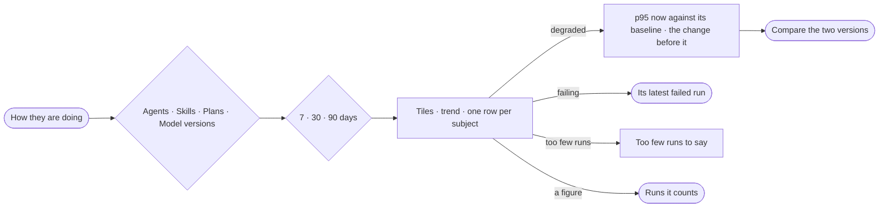

# AG-28 · See what got worse and the change that did it

**As** a graph owner **I want** speed, success and tokens for every agent, skill, plan and model version against its
own baseline, with what got worse and the change before it named **so that** a regression is caught the day it ships
and I know which change to undo.

Tasks: [task.md](task.md) · Feature: [AG-F03](../../feature.md)

## Who can

| Lens | Can | Otherwise sees |
|---|---|---|
| Admin | Read how every agent, skill, plan and model version is doing; open the runs behind a figure; open a change to compare | — |
| Operator | The same — every figure reads and opens its runs | — |

## Flow

## Acceptance criteria

| # | Given | When | Then |
|---|---|---|---|
| AG-28.1 | Runs in the window | the person opens how they are doing | tiles read success · p50 · p95 · runs · tokens a run · degraded, each against the same window before |
| AG-28.2 | Any tab | it opens | one row per subject — runs · success · p50 · p95 · trend · tokens a run · signal |
| AG-28.3 | A subject whose last 3 runs each took more than 1.5× its 7-day p95, with at least 5 runs in that baseline | the tab opens | its row reads *degraded*, with p95 now against the baseline |
| AG-28.4 | A degraded subject with an agent or skill version published inside its baseline before the first slow run | its row opens | the change is named with who published it and *Compare*; with none, it is named by its numbers alone — *p95 7.4s, up from 4.6s* |
| AG-28.5 | A subject whose 2 or more latest runs failed | the tab opens | its row reads *failing*, outranking *degraded*, and opens its latest failed run |
| AG-28.6 | The trend | the tab opens | it draws p95 a day for the most degraded subject, else the busiest, with its baseline and each version published in the window marked |
| AG-28.7 | Cannot-answer runs | success and failures are counted | a cannot-answer is counted on its own, never as a failure |
| AG-28.8 | A subject with too few runs | its row is drawn | it reads *too few runs*, never a flat line |
| AG-28.9 | Any tile, row or point | the person opens it | Runs lists the runs it counts, filtered, the filters shown |
| AG-28.10 | A window and a tab picked | the page is reloaded or the link shared | the same window and tab open |
| AG-28.11 | Any figure | it is shown | it is in tokens; no cost is shown |
| AG-28.12 | Nothing ran in the window | the page opens | tiles read `0` or `—` and a line says nothing ran in the window |
| AG-28.13 | The engine cannot read the numbers | the page opens | it says what it could not read, in the engine's words |

## Screens

| Surface | Lens | First use | Empty after a filter | Loading | Has data | Failed | Agent working or proposing | No access |
|---|---|---|---|---|---|---|---|---|
| How they are doing — tiles, trend, rows | Admin | agents · Nothing ran | — | agents · Loading | agents · How they are doing | agents · Could not load | agents · Degraded | — |
| How they are doing — tiles, trend, rows | Operator | agents · Nothing ran | — | agents · Loading | agents · How they are doing | agents · Could not load | agents · Degraded | agents · How they are doing |
| Runs a figure opens | Admin | — | agents.runs · No runs match | agents.runs · Loading | agents.runs · Filtered | agents.runs · Could not load | — | — |
| Runs a figure opens | Operator | — | agents.runs · No runs match | agents.runs · Loading | agents.runs · Filtered | agents.runs · Could not load | — | agents.runs · Filtered |
