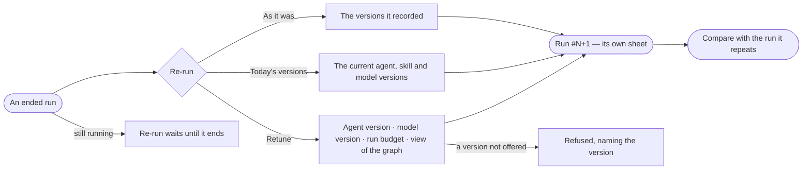

# AG-32 · Re-run a run as it was, or retuned

**As** an agent builder **I want** to re-run a run as it was, on today's versions, or retuned — another agent version,
model version, budget or view of the graph **so that** I can reproduce a failure and test a fix on the run that failed.

Tasks: [task.md](task.md) · Feature: [AG-F03](../../feature.md)

## Who can

| Lens | Can | Otherwise sees |
|---|---|---|
| Admin | Re-run any ended run, as it was, on today's versions or retuned | — |
| Operator | Re-run a run they started | *Re-run* on someone else's run is disabled, naming who started it |

## Flow

## Acceptance criteria

| # | Given | When | Then |
|---|---|---|---|
| AG-32.1 | An ended run | the person presses *Re-run* | one dialog offers *As it was* · *Today's versions* · *Retune* |
| AG-32.2 | *As it was* | the dialog shows it | it names the agent and model versions the run recorded; *not recorded* when it pinned none |
| AG-32.3 | *Retune* | the person changes the agent version, model version, run budget or view of the graph | only versions the graph offers and views they may use are offered |
| AG-32.4 | Any choice | the person confirms | a new run starts with its own number, names the run it repeats, and opens its own sheet |
| AG-32.5 | A re-run that has ended | its sheet reads | *Compare* opens the two runs side by side (AG-41) |
| AG-32.6 | A run still going | its sheet is open | *Re-run* is disabled, saying it is offered once the run ends |
| AG-32.7 | A recorded version since retired or not offered | *As it was* is chosen | it is refused before it runs, naming the version |
| AG-32.8 | A re-run | it runs | it is a run like any other — its tokens, its history rows, *How it got here* showing its steps and sources |
| AG-32.9 | An Operator on someone else's run | they read it | *Re-run* is disabled, naming who started it |
| AG-32.10 | A run that recorded no agent or model version | *As it was* is chosen | it is refused before it runs, saying no version was recorded and offering *Today's versions* or *Retune* |
| AG-32.11 | A run that is not a question or a typed query — a load, a link between models, a task's run | its sheet is open | *Re-run* is disabled, saying it re-runs where it was started |

## Screens

| Surface | Lens | First use | Empty after a filter | Loading | Has data | Failed | Agent working or proposing | No access |
|---|---|---|---|---|---|---|---|---|
| Re-run dialog | Admin | — | — | agents.run · Loading | agents.run · Re-run | agents.run · Re-run refused | agents.run · Running | — |
| Re-run dialog | Operator | — | — | agents.run · Loading | agents.run · Re-run | agents.run · Re-run refused | agents.run · Running | agents.run · Not yours to stop |
