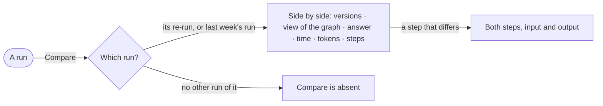

# AG-41 · Compare two runs of one question

**As** an analyst **I want** to compare two runs of one question side by side **so that** I see what a different
view of the graph, agent version or model version did to the answer.

Tasks: [task.md](task.md) · Feature: [AG-F03](../../feature.md)

## Who can

| Lens | Can | Otherwise sees |
|---|---|---|
| Admin | Compare any two runs of one question | — |
| Operator | Compare any two runs of one question they can open | A run they cannot open is not offered |

## Flow

## Acceptance criteria

| # | Given | When | Then |
|---|---|---|---|
| AG-41.1 | A run with another run of the same question — its re-run, or the same schedule's last run | the person presses *Compare* | the two open side by side |
| AG-41.2 | Two runs compared | they read | what differs is marked: agent version, model version, view of the graph, budget, answer, time, tokens and why each ended |
| AG-41.3 | Two runs compared | the person opens a step that differs | both steps' input and output read side by side |
| AG-41.4 | A run with no other run of its question | it is read | *Compare* is absent |
| AG-41.5 | Two runs compared | any change between them is shown | it is the engine's — `↑ 38%` or *flat* — never worked out by Studio |
| AG-41.6 | One run the person cannot open | they compare | it is not offered |

## Screens

| Surface | Lens | First use | Empty after a filter | Loading | Has data | Failed | Agent working or proposing | No access |
|---|---|---|---|---|---|---|---|---|
| Two runs compared | Admin | — | — | agents.run · Loading | agents.run · Compare | agents.run · Could not load | agents.run · Running | — |
| Two runs compared | Operator | — | — | agents.run · Loading | agents.run · Compare | agents.run · Could not load | agents.run · Running | agents.run · Not found |
